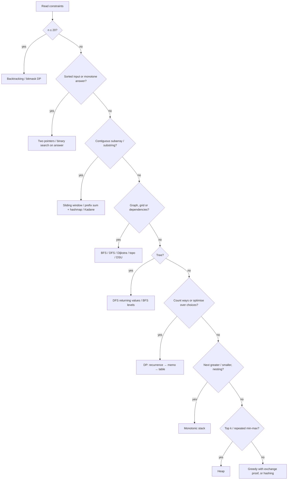

# Pattern Triggers

← [Striver course map](../../striver-a2z/README.md) · [Problem index](../../striver-a2z/PROBLEM_INDEX.md) · [Master cheat sheet](../../striver-a2z/MASTER_CHEATSHEET.md)

> [!abstract] What this is
> Use this page to go from a problem statement to a technique in under a minute. Read the **constraints** first, because they fix the complexity budget. Then scan the **phrases**, which usually name the pattern. Each row links to the part that teaches it.

**Sections:** [1. Constraint → complexity](#1-constraint--complexity) · [2. Arrays and strings](#2-arrays-and-strings) · [3. Searching and ordering](#3-searching-and-ordering) · [4. Stacks, queues and heaps](#4-stacks-queues-and-heaps) · [5. Recursion and DP](#5-recursion-and-dp) · [6. Trees](#6-trees) · [7. Graphs](#7-graphs) · [8. Bits and maths](#8-bits-and-maths) · [9. Design and streams](#9-design-and-streams) · [10. Decision flow](#10-decision-flow)

---

## 1. Constraint → complexity

A budget of about 10⁸ simple operations per second is a safe rule. Full detail is in [Part 5](../../striver-a2z/05-time-complexity/01-theory-with-examples.md).

| n up to | Budget | Typical techniques |
|---|---|---|
| ≤ 10–12 | O(n!) or O(nⁿ) | Permutations, brute-force backtracking ([Part 18](../../striver-a2z/18-recursion/README.md)) |
| ≤ 20 | O(2ⁿ · n) | Subsets, bitmask DP ([Part 32 §2](../../striver-a2z/32-beyond-the-sheet/02-advanced-dp-theory.md)) |
| ≤ 40 | O(2^(n/2)) | Meet in the middle ([Part 32 §4](../../striver-a2z/32-beyond-the-sheet/04-techniques-toolbox-theory.md)) |
| ≤ 100–500 | O(n³) | Floyd–Warshall, interval DP / MCM ([Part 27](../../striver-a2z/27-graphs/README.md), [Part 28](../../striver-a2z/28-dynamic-programming/README.md)) |
| ≤ 10³–5·10³ | O(n²) | 2D DP (LCS, edit distance), all pairs |
| ≤ 10⁵–10⁶ | O(n log n) | Sort, binary search, heap, Dijkstra, BIT/segment tree |
| ≤ 10⁷–10⁸ | O(n) | Two pointers, sliding window, prefix sums, hashing, monotonic stack, sieve |
| ≥ 10⁹ (a value, not a length) | O(log n) or O(√n) | Binary search on the answer, binary exponentiation, √n divisor loop, maths |
| 10¹⁸ | O(log n) or digit count | Digit DP, matrix exponentiation, closed form |

| Other constraint signal | Implication |
|---|---|
| "Answer modulo 10⁹+7" | Counting DP or combinatorics ([Part 31 §5](../../striver-a2z/31-maths/05-modular-arithmetic-and-combinatorics-theory.md)) |
| Values ≤ 10⁵ but n large | Counting array or bucket instead of a hashmap; sieve |
| Sum of n over tests ≤ 2·10⁵ | Per-test cost must be linear in that test's n |
| Grid m·n ≤ 10⁵ | BFS/DFS over cells, O(mn) |
| Q queries ≥ 10⁵ | Precompute (prefix, sparse table) or O(log n) per query ([Part 32 §1](../../striver-a2z/32-beyond-the-sheet/01-range-queries-theory.md)) |

---

## 2. Arrays and strings

| Phrase / shape | Technique | Part |
|---|---|---|
| Sorted array, pair or triplet with target sum | Two pointers from both ends | [14](../../striver-a2z/14-arrays/README.md), [22](../../striver-a2z/22-sliding-window-and-2-pointer/README.md) |
| Longest / shortest **contiguous** subarray or substring with a condition | Variable sliding window (expand right, shrink left) | [22](../../striver-a2z/22-sliding-window-and-2-pointer/01-sliding-window-theory.md) |
| **Count** subarrays with exactly K | `atMost(K) − atMost(K−1)` | [22](../../striver-a2z/22-sliding-window-and-2-pointer/README.md) |
| Subarray sum = K with negatives | Prefix sum + hashmap of counts | [14](../../striver-a2z/14-arrays/README.md), [15](../../striver-a2z/15-hashing/README.md) |
| Maximum subarray sum | Kadane | [14](../../striver-a2z/14-arrays/README.md) |
| Majority element (> n/2, > n/3) | Boyer–Moore voting | [14](../../striver-a2z/14-arrays/README.md) |
| Values in 1..n, find missing / duplicate | Index marking, cyclic sort, XOR, or sum formulas | [14](../../striver-a2z/14-arrays/README.md), [20](../../striver-a2z/20-bit-manipulation/README.md) |
| Next permutation, rotate in place | Reversal tricks | [14](../../striver-a2z/14-arrays/README.md) |
| Sort 0s/1s/2s | Dutch national flag (three pointers) | [14](../../striver-a2z/14-arrays/README.md) |
| Merge / insert / overlap intervals | Sort by start, then sweep | [21](../../striver-a2z/21-greedy-algorithms/README.md), [32 sweep](../../striver-a2z/32-beyond-the-sheet/04-techniques-toolbox-theory.md) |
| Anagram, frequency, "same characters" | 26-count array | [11](../../striver-a2z/11-basic-strings/README.md), [17](../../striver-a2z/17-strings-basic-medium/00-string-basics-theory.md) |
| Longest palindromic substring | Expand around centre; Manacher for O(n) | [17](../../striver-a2z/17-strings-basic-medium/README.md), [30 §12](../../striver-a2z/30-strings-advanced/01-string-hashing-and-matching-theory.md) |
| Find a pattern in a text | KMP / Z-function / rolling hash | [30](../../striver-a2z/30-strings-advanced/README.md) |
| Matrix spiral, rotate, set zeroes | Boundary pointers, transpose + reverse, first row/col as markers | [14](../../striver-a2z/14-arrays/README.md) |

---

## 3. Searching and ordering

| Phrase / shape | Technique | Part |
|---|---|---|
| Sorted or rotated-sorted array, find element / bound | Binary search, find the sorted half | [16](../../striver-a2z/16-binary-search/01-binary-search-templates.md) |
| "Minimise the maximum" / "maximise the minimum" | Binary search on the answer + greedy feasibility check | [16](../../striver-a2z/16-binary-search/README.md) (aggressive cows, book allocation, split array) |
| Smallest x such that f(x) holds, f monotone | Binary search on the answer | [16](../../striver-a2z/16-binary-search/17-koko-eating-bananas.md) |
| Peak, bitonic | Binary search on the slope | [16](../../striver-a2z/16-binary-search/24-find-peak-element.md) |
| Median / k-th of two sorted arrays | Binary search on the partition | [16](../../striver-a2z/16-binary-search/25-median-of-two-sorted-arrays.md) |
| Row- and column-sorted matrix | Staircase from a corner, or flatten the index | [16](../../striver-a2z/16-binary-search/README.md) |
| Count inversions / reverse pairs | Merge sort counting, or a BIT | [13](../../striver-a2z/13-sorting/00-sorting-theory.md), [14](../../striver-a2z/14-arrays/README.md) |
| K-th largest / smallest | Heap of size k or quickselect | [26](../../striver-a2z/26-heaps/README.md) |
| Locally optimal choice is provably safe (exchange argument) | Greedy after sorting | [21](../../striver-a2z/21-greedy-algorithms/01-greedy-fundamentals.md) |
| Max meetings / min platforms / activity selection | Sort by end time; sweep events | [21](../../striver-a2z/21-greedy-algorithms/README.md) |

---

## 4. Stacks, queues and heaps

| Phrase / shape | Technique | Part |
|---|---|---|
| Next / previous greater or smaller element | Monotonic stack | [23](../../striver-a2z/23-stack-and-queues/15-next-greater-element.md) |
| Sum of subarray minimums or ranges, largest rectangle in a histogram | Monotonic stack, contribution technique (PSE/NSE) | [23](../../striver-a2z/23-stack-and-queues/README.md) |
| Balanced brackets, undo, nested structure | Stack | [23](../../striver-a2z/23-stack-and-queues/08-balanced-parenthesis.md) |
| Expression evaluation or conversion | Stack with precedence | [23](../../striver-a2z/23-stack-and-queues/README.md) |
| Remove k digits, smallest lexicographic subsequence | Greedy monotonic stack | [23](../../striver-a2z/23-stack-and-queues/20-remove-k-digits.md) |
| Sliding window max / min | Monotonic deque | [23](../../striver-a2z/23-stack-and-queues/README.md) |
| Top k, k closest, k most frequent | Size-k heap | [26](../../striver-a2z/26-heaps/01-heap-theory.md) |
| Merge k sorted lists or arrays | Min-heap of heads | [26](../../striver-a2z/26-heaps/README.md) |
| Running median | Two heaps | [26](../../striver-a2z/26-heaps/README.md) |
| Task scheduling with cooldown, reorganise string | Max-heap + greedy | [26](../../striver-a2z/26-heaps/README.md) |

---

## 5. Recursion and DP

| Phrase / shape | Technique | Part |
|---|---|---|
| "All" subsets, permutations, combinations, partitions | Backtracking (pick / not pick) | [18](../../striver-a2z/18-recursion/01-subsequence-patterns.md) |
| Place items under constraints (N-Queens, Sudoku, colouring) | Backtracking with pruning | [18](../../striver-a2z/18-recursion/README.md) |
| "Number of ways", "min/max cost", "is it possible", with overlapping choices | DP: recursion → memo → tabulation → space | [28](../../striver-a2z/28-dynamic-programming/01-dp-theory.md) |
| Linear sequence, choose or skip each element | 1D DP (climbing stairs, house robber) | [28](../../striver-a2z/28-dynamic-programming/README.md) |
| Grid paths with obstacles or costs | 2D grid DP | [28](../../striver-a2z/28-dynamic-programming/README.md) |
| Target sum with items, capacity | Subset sum / 0-1 knapsack; unbounded if items repeat | [28](../../striver-a2z/28-dynamic-programming/README.md) |
| Two strings: common, edit, match, wildcard | DP on strings `dp[i][j]` | [28](../../striver-a2z/28-dynamic-programming/README.md) |
| Stock buy/sell with transactions or cooldown | State machine DP (day, holding, count) | [28](../../striver-a2z/28-dynamic-programming/README.md) |
| Increasing subsequence, chains, envelopes | LIS; O(n log n) with binary search | [28](../../striver-a2z/28-dynamic-programming/README.md) |
| Burst, merge, cut, partition a range | Interval / MCM DP by length | [28](../../striver-a2z/28-dynamic-programming/README.md) |
| Largest square or rectangle of 1s | DP on squares; histogram per row | [28](../../striver-a2z/28-dynamic-programming/README.md) |
| n ≤ 20, "visit all" | Bitmask DP | [32 §2](../../striver-a2z/32-beyond-the-sheet/02-advanced-dp-theory.md) |
| Count numbers in [L, R] with a digit property | Digit DP | [32 §3](../../striver-a2z/32-beyond-the-sheet/02-advanced-dp-theory.md) |
| Answer for every node as root | Rerooting | [32 §5](../../striver-a2z/32-beyond-the-sheet/02-advanced-dp-theory.md) |

---

## 6. Trees

| Phrase / shape | Technique | Part |
|---|---|---|
| Height, diameter, balanced, max path sum | Post-order DFS returning a value, updating a global | [24](../../striver-a2z/24-binary-trees/01-binary-tree-theory.md) |
| Level by level, zigzag, views, width | BFS with a level size; (column, level) maps for views | [24](../../striver-a2z/24-binary-trees/README.md) |
| Root-to-node path, LCA | DFS returning found/not found | [24](../../striver-a2z/24-binary-trees/README.md) |
| Build a tree from traversals | Inorder index map + preorder/postorder pointer | [24](../../striver-a2z/24-binary-trees/README.md) |
| Serialise / deserialise | Preorder with null markers, or BFS | [24](../../striver-a2z/24-binary-trees/README.md) |
| BST: search, floor/ceil, k-th smallest, validate | Use ordering; inorder is sorted; pass (min, max) bounds | [25](../../striver-a2z/25-binary-search-trees/01-bst-theory.md) |
| Two-sum in a BST, BST iterator | Inorder iterator with a stack | [25](../../striver-a2z/25-binary-search-trees/README.md) |
| Many LCA or k-th ancestor queries | Binary lifting | [32 §1](../../striver-a2z/32-beyond-the-sheet/03-advanced-trees-and-graphs-theory.md) |
| Subtree queries with updates | Euler tour + BIT | [32 §3](../../striver-a2z/32-beyond-the-sheet/03-advanced-trees-and-graphs-theory.md) |
| Prefix lookups, autocomplete, max XOR pair | Trie (binary trie for XOR) | [29](../../striver-a2z/29-tries/01-trie-theory.md) |

---

## 7. Graphs

| Phrase / shape | Technique | Part |
|---|---|---|
| Islands, regions, connected components, flood fill | DFS/BFS over a grid or adjacency list | [27](../../striver-a2z/27-graphs/03-traversal-techniques-bfs-dfs.md) |
| Nearest distance from many sources, "minutes to rot" | Multi-source BFS | [27](../../striver-a2z/27-graphs/09-rotten-oranges.md) |
| Shortest path, unit weights | BFS | [27](../../striver-a2z/27-graphs/22-shortest-path-unit-weights.md) |
| Shortest path, non-negative weights | Dijkstra (heap) | [27](../../striver-a2z/27-graphs/25-dijkstra.md) |
| Negative weights, detect a negative cycle, ≤ k edges | Bellman–Ford (k rounds for ≤ k stops) | [27](../../striver-a2z/27-graphs/32-bellman-ford.md), [27](../../striver-a2z/27-graphs/29-cheapest-flights-within-k-stops.md) |
| All-pairs shortest paths, n ≤ 400 | Floyd–Warshall | [27](../../striver-a2z/27-graphs/33-floyd-warshall.md) |
| Minimise the max edge on a path | Dijkstra with max, or binary search + BFS, or DSU | [27](../../striver-a2z/27-graphs/28-path-with-minimum-effort.md) |
| Weights only 0/1 | 0-1 BFS | [32 §5](../../striver-a2z/32-beyond-the-sheet/03-advanced-trees-and-graphs-theory.md) |
| Prerequisites, ordering, dependencies | Topological sort (Kahn); cycle ⇔ not all nodes popped | [27](../../striver-a2z/27-graphs/15-topological-sort-dfs-and-kahn.md) |
| Order of letters from a sorted dictionary | Topological sort on the derived edges | [27](../../striver-a2z/27-graphs/20-alien-dictionary.md) |
| Two-colouring, "split into two groups" | Bipartite check (BFS colouring) | [27](../../striver-a2z/27-graphs/14-bipartite-graph.md) |
| Dynamic connectivity, "are they connected after merges" | Disjoint set union | [27](../../striver-a2z/27-graphs/37-disjoint-set.md) |
| Connect everything at minimum cost | MST (Kruskal + DSU, or Prim) | [27](../../striver-a2z/27-graphs/02-mst-and-dsu-theory.md) |
| Critical connections, single points of failure | Bridges / articulation points (Tarjan low-link) | [27](../../striver-a2z/27-graphs/45-bridges-in-graph.md) |
| Strongly connected components | Kosaraju | [27](../../striver-a2z/27-graphs/44-kosarajus-algorithm.md) |
| Use every edge exactly once (itinerary) | Hierholzer | [32 §4](../../striver-a2z/32-beyond-the-sheet/03-advanced-trees-and-graphs-theory.md) |
| Word transformation | BFS on implicit graph (wildcard buckets) | [27](../../striver-a2z/27-graphs/23-word-ladder-i.md) |

---

## 8. Bits and maths

| Phrase / shape | Technique | Part |
|---|---|---|
| Every element twice except one | XOR all | [20](../../striver-a2z/20-bit-manipulation/09-single-number-i.md) |
| Every element thrice except one | Count bits mod 3 | [20](../../striver-a2z/20-bit-manipulation/10-single-number-ii.md) |
| Two unique numbers | XOR, split by the lowest set bit | [20](../../striver-a2z/20-bit-manipulation/11-single-number-iii.md) |
| Power of two, count set bits, lowest bit | `n & (n−1)`, `n & −n` | [20](../../striver-a2z/20-bit-manipulation/01-bits-and-tricks.md) |
| Enumerate subsets of ≤ 20 items | Mask from 0 to 2ⁿ − 1 | [20](../../striver-a2z/20-bit-manipulation/13-power-set.md) |
| XOR of 1..n or a range | Period-4 formula | [20](../../striver-a2z/20-bit-manipulation/14-xor-of-numbers-in-a-given-range.md) |
| Primes up to n, many factorisations | Sieve / smallest prime factor sieve | [31](../../striver-a2z/31-maths/01-sieve-theory.md) |
| Divisors, primality of one number | √n loop | [8](../../striver-a2z/08-basic-maths/README.md) |
| GCD, LCM, digit manipulation | Euclid, `% 10` peeling | [8](../../striver-a2z/08-basic-maths/README.md) |
| xⁿ, huge exponent | Binary exponentiation | [18](../../striver-a2z/18-recursion/02-pow-x-n.md), [31 §5](../../striver-a2z/31-maths/05-modular-arithmetic-and-combinatorics-theory.md) |
| nCr, paths in a grid, Catalan structures | Factorials + inverses mod p | [31 §5](../../striver-a2z/31-maths/05-modular-arithmetic-and-combinatorics-theory.md) |

---

## 9. Design and streams

| Phrase / shape | Technique | Part |
|---|---|---|
| LRU cache | Hashmap + doubly linked list | [23](../../striver-a2z/23-stack-and-queues/README.md) |
| LFU cache | key → node, freq → DLL, `minFreq` | [32 §7](../../striver-a2z/32-beyond-the-sheet/04-techniques-toolbox-theory.md) |
| Min stack | Pairs of (value, min) or an encoded difference | [23](../../striver-a2z/23-stack-and-queues/README.md) |
| Linked list cycle, middle, k-th from end | Fast/slow pointers | [19](../../striver-a2z/19-linked-list/README.md) |
| Reverse in groups, reorder, palindrome list | Reverse sub-lists, splice | [19](../../striver-a2z/19-linked-list/README.md) |
| Uniform sample from a stream | Reservoir sampling | [32 §4](../../striver-a2z/32-beyond-the-sheet/04-techniques-toolbox-theory.md) |
| Range sum / min with updates | Fenwick / segment tree | [32 §1](../../striver-a2z/32-beyond-the-sheet/01-range-queries-theory.md) |
| Batch range adds, read once | Difference array | [32 §2](../../striver-a2z/32-beyond-the-sheet/01-range-queries-theory.md) |

---

## 10. Decision flow

**If you're stuck:**
1. Write the brute force and its complexity.
2. Ask which work it repeats. Repeated lookups suggest hashing, repeated subproblems suggest DP, repeated min/max suggests a heap or deque.
3. Sort the input and see whether the problem gets easier.
4. Fix one element or endpoint and solve the rest.

---

**Interview track →** [Patterns master](../patterns-master.md) · [How to think](../HOW_TO_THINK.md) · [Interview judgment](../INTERVIEW_JUDGMENT.md)
