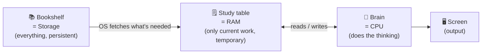
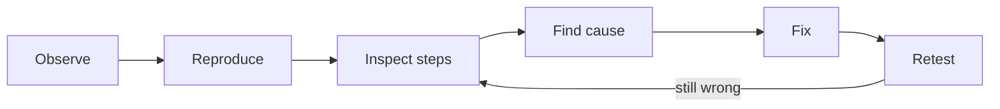
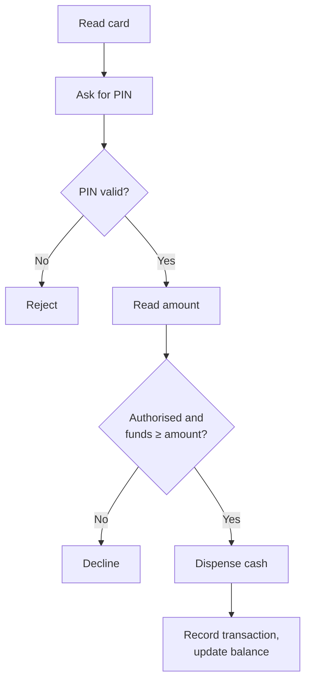

# 2. Programming and What Are Computers

← [Breaking the Myth](01-breaking-the-myth.md) · [Part 1 index](README.md) · Next → [How to Think Like a Programmer](03-how-to-think-like-a-programmer.md)

> [!abstract] What this covers
> **Core idea:** Programming is writing *precise, ordered* instructions. A computer runs them very fast and exactly as written. It never guesses what you meant.
> **You'll be able to:** explain hardware vs software, how storage, the OS, RAM and the CPU cooperate when an app runs, what bugs and debugging are, why programming languages exist, and how everyday systems (ATM, delivery, messaging) are just instructions plus decisions.
> **Source:** [takeuforward lesson](https://takeuforward.org/learning/dsa/programming-and-what-are-computers?category=fundamentals-of-programming&source=strivers-a2z-dsa-sheet) · **Time:** 40 min

**Sections:** [1. Programming = ordered instructions](#1-programming--ordered-instructions) · [2. What a computer is](#2-what-a-computer-is) · [3. Hardware vs software](#3-hardware-vs-software) · [4. Storage, OS, RAM, CPU](#4-storage-os-ram-cpu) · [5. The study-table model](#5-the-study-table-model) · [6. Programs, bugs, debugging](#6-programs-bugs-debugging) · [7. Why programming languages exist](#7-why-programming-languages-exist) · [8. Everyday systems as instruction flow](#8-everyday-systems-as-instruction-flow) · [9. What happens when you open Instagram](#9-what-happens-when-you-open-instagram) · [10. From user to builder](#10-from-user-to-builder) · [Key terms](#key-terms) · [Practice](#practice) · [Flashcards](#flashcards)

---

## 1. Programming = ordered instructions

**Programming** is writing precise, *ordered* instructions that a computer follows to finish a task.

Order is part of the meaning. Cooking rice is wash → add water → heat → wait → serve. Do "heat" before "add water" and the same steps fail.

| Property | Meaning | Violation example |
|---|---|---|
| **Precise** | Each step has exactly one interpretation | "Add some salt" → how much? |
| **Ordered** | Steps run in the sequence given | Display the total before calculating it |
| **Complete** | Every case has a defined action | No instruction for "payment failed" |
| **Finite** | The process ends | A loop whose condition never becomes false |

---

## 2. What a computer is

> **Computer = speed + obedience − common sense.**

A computer is a machine that runs stored instructions at speeds no human could match by hand. It does exactly what the instructions say:

- Ask it to delete the wrong folder and it will. It cannot infer "they probably meant the other one."
- Every missing rule is *your* bug, not the machine's misunderstanding.
- **Analogy:** a light switch. Flip it and the circuit responds the same way every time. The switch doesn't decide whether you *wanted* the light on.

> [!tip] Why this matters for DSA
> Because the computer never fills gaps, the algorithm must cover every input in the contract, including the boring ones: empty input, a single element, equal values, zero, negatives.

---

## 3. Hardware vs software

| | Hardware | Software |
|---|---|---|
| What | Physical parts | Programs and data |
| Examples | CPU, RAM chips, SSD/HDD, screen, keyboard, battery, camera | OS (Windows, macOS, Linux, Android, iOS), browser, calculator, camera app |
| Can you touch it? | Yes | No; it exists as stored data *on* hardware |
| Analogy | The body | The thoughts and behaviour |

On a phone, the screen and battery are hardware. Android and the camera app are software.

---

## 4. Storage, OS, RAM, CPU

| Component | Role | Key property |
|---|---|---|
| **Storage** (SSD/HDD) | Holds installed apps and saved data (photos, chats) | **Persistent:** survives power-off. Slow compared with RAM |
| **Operating system** | Manages apps and hardware: loads programs, hands out memory, controls device access and permissions | Middleman: apps ask the OS, they don't grab hardware directly |
| **RAM** | Fast, temporary working memory for the code and data in use *right now* | **Volatile:** wiped on power loss. Limited, so old items get evicted |
| **CPU** | Executes instructions: arithmetic, comparisons, decisions | Does the actual "thinking" |

**Caching:** reading something again from RAM is far faster than going back to storage. Programs keep hot data in memory for that reason, and the same idea later becomes memoisation and DP.

---

## 5. The study-table model

**Opening WhatsApp, step by step:**

1. The app files sit in **storage**.
2. The **OS** loads the needed code and recent data into **RAM**.
3. The **CPU** executes the instructions.
4. The screen shows chats and reacts to taps.
5. When you close the app, its RAM is reclaimed. Saved messages stay in storage.

**Volatile vs persistent:** unsaved edits exist only in RAM. Lose power and they're gone, which is why "Save" means "copy from RAM to storage."

| Upgrade | Helps with | Doesn't help with |
|---|---|---|
| More RAM | Many apps or large data open at once | How many files you can keep |
| More storage | More apps, photos, files saved | Speed of running apps |
| Faster CPU | Compute-heavy work | A slow *algorithm*; O(n²) on 10⁶ items stays slow |

---

## 6. Programs, bugs, debugging

- **Program:** a set of instructions. A calculator adds the numbers you enter. An alarm compares the current time with the set time and rings. A messaging app starts delivery when you tap Send.
- **Programmer:** understands the task and writes rules that cover *every* case. Missing cases don't fix themselves.
- **Bug:** a defect that causes wrong or unexpected behaviour: wrong step, wrong order, missing condition or flawed design.
  - *Chai example:* using salt instead of sugar. Every step is "executed correctly", but the instruction itself was wrong, so the tea is salty.
- **Debugging:** a systematic search for the cause.

> [!note]- History: the "first bug"
> In 1947 operators of the Harvard Mark II found a moth stuck in a relay and taped it into the logbook as the "first actual case of bug being found." The word "bug" for an engineering defect is older than that. The moth made it famous.

The full debugging method is in [Lesson 6](06-dry-runs-edge-cases-and-debugging.md).

---

## 7. Why programming languages exist

Processors only run **machine instructions** encoded in **binary** (0s and 1s). Writing an app in raw binary is possible but hopelessly impractical.

**Programming languages** (C++, Java, Python, …) are formal, readable ways to write instructions. Tools then translate them:

- **Compiler:** translates source code into an executable form ahead of time.
- **Interpreter / runtime:** runs code, or an intermediate form of it, and provides an execution environment.
- The exact route depends on the language implementation (details in [Lesson 7](07-programming-languages-and-choosing-a-path.md#3-what-happens-when-you-press-run)).

**Abstraction** means using something without managing every detail. Pressing a car's accelerator asks for speed without you timing fuel injection. A function like `sort(arr)` gives you sorting without rewriting it each time.

| Language | Common home |
|---|---|
| Python | Automation, data, AI/ML |
| Java | Backend, enterprise, Android |
| C / C++ | Systems, performance-critical code, competitive programming/DSA |
| JavaScript | Interactive websites, servers |
| Swift | Apple platforms |

The ecosystem (libraries, tools, community) changes how convenient a language is. It never changes whether your logic is right: a perfect translator still translates wrong logic faithfully.

---

## 8. Everyday systems as instruction flow

Every system has the same skeleton: **receive information → decide → act**.

**ATM withdrawal**

> [!warning] Edge case: concurrent withdrawals
> The balance is 500 and two requests for 400 arrive at the same moment. If each one independently sees "500 available", both are approved and 800 leaves a 500 account. The system must **coordinate** (lock or serialise the check-and-update) so that only one succeeds. Correctness can depend on *timing*, not just inputs.

| System | Flow |
|---|---|
| Messaging | Type → draft → Send → network request → server routes → recipient device receives → display + notification |
| Food delivery | Search → pick items → cart → total → payment → order sent → tracking. Every step has a condition (failed payment ≠ order placed) |
| Traffic lights | Controller changes states on timers and sensor input. *States* and *allowed transitions* must be exact: green never jumps straight to red without amber |

---

## 9. What happens when you open Instagram

1. The touchscreen detects the tap. Hardware and software register the input.
2. The OS identifies which app was tapped.
3. The needed code and data load from **storage → RAM**.
4. The **CPU** executes the startup instructions.
5. The app requests your feed over the **network**.
6. The received data is processed into posts and UI elements.
7. The screen draws the feed, then the app reacts to scrolls and taps.

**Lazy loading:** the whole app is *not* copied into RAM at launch. The code for the profile screen, for example, loads only when you open it. Loading only what's needed, when it's needed, is a design idea you will meet again.

---

## 10. From user to builder

**Use programs → understand how they work → write instructions → build programs.**

1. Learn **one** language well enough to turn ideas into working instructions.
2. Learn **DSA**: how to organise data, how to solve problems, and how to reason about efficiency.
3. **Build projects** that combine both.

Syntax is how you *express* a solution. Understanding the problem and defining what "solved" means comes first, whatever the language.

---

## Key terms

| Term | Meaning |
|---|---|
| Programming | Writing precise, ordered instructions to solve a task |
| Computer | Machine that executes stored instructions |
| Hardware / Software | Physical components / programs and data |
| CPU | Executes instructions |
| RAM | Fast, volatile working memory |
| Storage | Persistent memory for saved programs and data |
| Operating system | Manages apps and hardware resources |
| Program / Programmer | Set of instructions / person who writes them |
| Bug / Debugging | Defect causing wrong behaviour / finding, fixing and retesting its cause |
| Binary | Base-2 representation using 0 and 1 |
| Programming language | Formal language for writing program instructions |
| Abstraction | Interface that hides lower-level detail |

---

## Practice

1. Write the instruction flow (receive → decide → act) for a phone **alarm**, including snooze. What happens if the snooze limit is reached?
2. For a **vending machine**, list every decision point. Include "item out of stock" and "not enough money inserted."
3. A laptop has 8 GB RAM and 512 GB SSD. A user opens 40 browser tabs and it slows down. Which component is the bottleneck and why? Would a bigger SSD help?
4. Name a real bug where every step was "executed correctly" but the instruction itself was wrong (like salt for sugar).
5. In the concurrent-ATM scenario, write in plain English one rule that prevents double approval.

Answer sketch for #3 and #5

**#3:** RAM. Each tab keeps its code and data in working memory. When RAM fills, the OS swaps to the much slower storage. A bigger SSD doesn't add working memory.

**#5:** "Checking the balance and subtracting the amount must happen as one indivisible step per account. While one withdrawal is between check and update, any other withdrawal on that account waits."

---

## Flashcards

**Define programming in one line.** #flashcard
Writing precise, ordered instructions that a computer carries out to complete a task.

**"Computer = speed + obedience" — what is missing, and why does that matter?** #flashcard
Common sense or understanding of intent. The computer never fills gaps, so every case, including edge cases, must be written explicitly.

**RAM vs storage in one line each.** #flashcard
RAM is fast, temporary (volatile) working memory for what is running now. Storage is slower, persistent memory for installed apps and saved data.

**What does the operating system do when you open an app?** #flashcard
It identifies the app, loads the needed code and data from storage into RAM, allocates resources and permissions, and lets the CPU execute it.

**Study-table model: map bookshelf, table and brain.** #flashcard
Bookshelf = storage, study table = RAM, brain = CPU.

**Why can't a faster CPU rescue a bad algorithm?** #flashcard
Hardware speeds things up by a constant factor. An O(n²) algorithm on 10⁶ items still needs ~10¹² steps, while an O(n) one needs 10⁶.

**What is abstraction? Give a car and a code example.** #flashcard
Using something through a simple interface without managing its internals. Pressing the accelerator without controlling fuel injection; calling `sort(arr)` without writing the sort.

**Concurrent ATM withdrawals: what goes wrong and what is the fix?** #flashcard
Two requests both see enough balance and both are approved, overdrawing the account. Make check-and-update atomic per account (lock or serialise).

**Why does "Save" exist?** #flashcard
Edits live in volatile RAM. Saving copies them to persistent storage so they survive power loss or closing the app.
