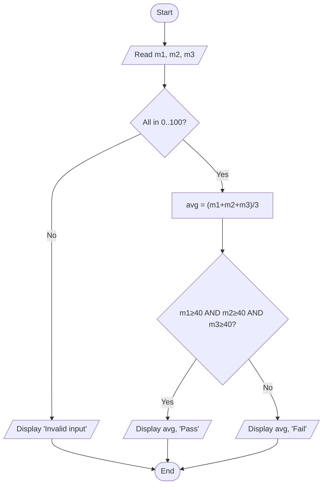
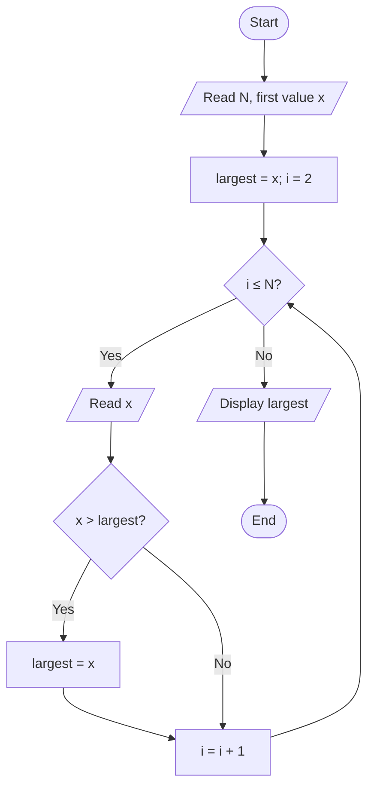
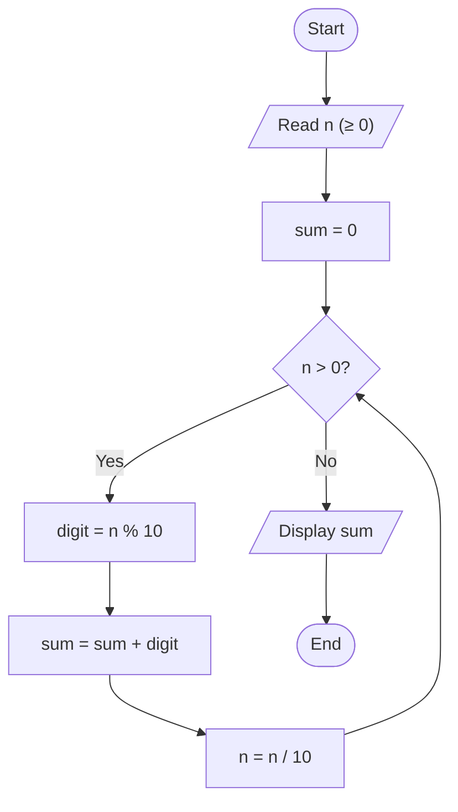
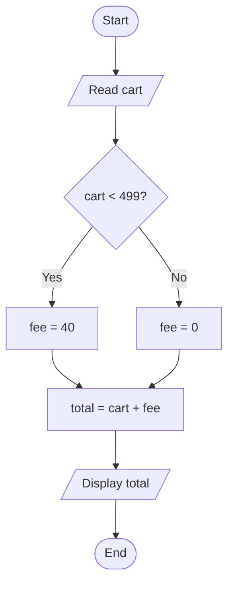
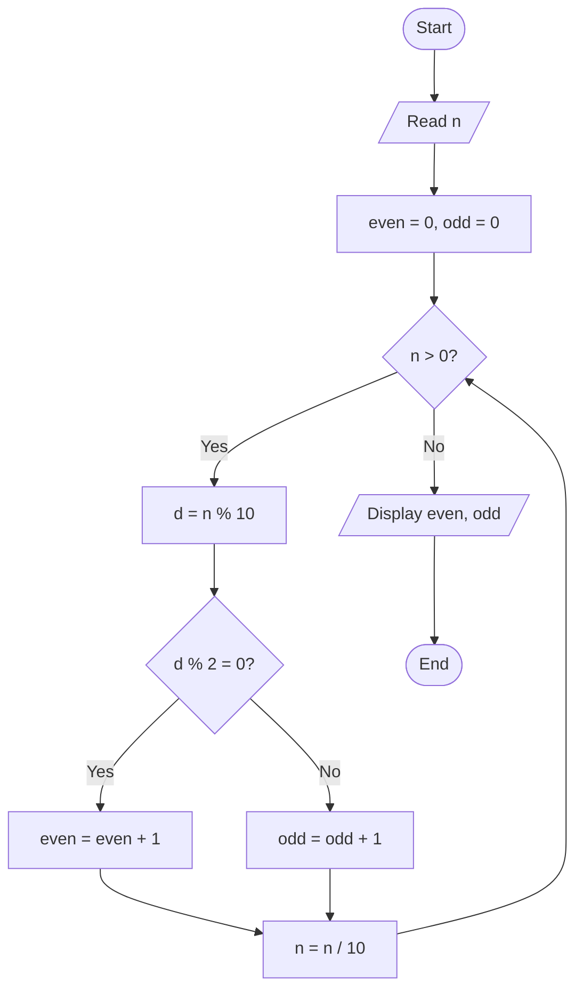

# 5. Flowchart Problem-Solving Lab

← [Flowcharts & Pseudocode](04-flowcharts-and-pseudocode.md) · [Part 1 index](README.md) · Next → [Dry Runs, Edge Cases & Debugging](06-dry-runs-edge-cases-and-debugging.md)

> [!abstract] What this covers
> **Core idea:** Eight worked problems that between them use every building block: validation, compound conditions, the champion method, ordered branches, accumulators, digit peeling, thresholds and slabs. Then a capstone you solve end to end.
> **You'll be able to:** go from a problem statement to a justified flowchart and pseudocode, and pick tests that break wrong versions.
> **Source:** [takeuforward lesson](https://takeuforward.org/learning/dsa/flowchart-problem-solving?category=fundamentals-of-programming&source=strivers-a2z-dsa-sheet) · **Time:** 90 min (draw each one yourself before reading the solution)

**Sections:** [Before you draw](#before-you-draw-seven-questions) · [P1 Marks with validation](#p1-marks-with-validation) · [P2 Largest of three](#p2-largest-of-three) · [P3 Grade bands](#p3-grade-bands) · [P4 Sum 1..N](#p4-sum-1n) · [P5 Digit sum](#p5-digit-sum) · [P6 Simple bill](#p6-simple-bill) · [P7 Delivery fee threshold](#p7-delivery-fee-threshold) · [P8 Electricity slabs](#p8-electricity-slabs) · [Capstone](#capstone-even-and-odd-digit-counter) · [Common mistakes](#common-mistakes) · [Key terms](#key-terms) · [Flashcards](#flashcards)

---

## Before you draw: seven questions

1. What is the **input**, and what makes it valid?
2. What is the **output**, and in what form?
3. Which **rules** link them? Underline the qualifiers.
4. Do I need **validation** before the business logic?
5. Are there **decisions**? In what order must they be checked?
6. Does anything **repeat**? What are its init, check, body and update?
7. Which **boundary** inputs could break it?

> [!tip] Justify every shape
> For each box, say *why* it's that shape and *why* it's in that place. "Diamond, because the path depends on whether the marks are valid. First, because averaging invalid marks is meaningless."

---

## P1. Marks with validation

**Task:** read three marks (0–100). If any mark is invalid, report an error. Otherwise print the average and Pass (all ≥ 40) or Fail.



**Validation vs business logic:** validation asks "is this input acceptable at all?" Business logic asks "given acceptable input, what is the answer?" Validation always comes first.

**Extension to N subjects:** use a running sum and a boolean flag.
```text
READ N
SET sum = 0, allPass = TRUE, i = 1
WHILE i <= N
    READ m
    IF m < 0 OR m > 100 THEN DISPLAY "Invalid"; STOP
    SET sum = sum + m
    IF m < 40 THEN SET allPass = FALSE
    SET i = i + 1
END WHILE
DISPLAY sum / N, (allPass ? "Pass" : "Fail")
```
`allPass` starts TRUE and any single failure turns it FALSE. This is the "every" pattern. (For "at least one", start FALSE and flip on a match.)

**Tests:** (-1, 50, 50) → Invalid · (101, 50, 50) → Invalid · (40, 40, 40) → Pass · (39, 100, 100) → Fail · (0, 0, 0) → Fail.

---

## P2. Largest of three

Compound conditions (`a >= b AND a >= c`, …) work if you use `>=`, but they grow as O(n²) comparisons and break when you write strict `>`. The **champion method** ([Lesson 3 §8](03-how-to-think-like-a-programmer.md#8-largest-of-three-the-champion-method)) generalises to a loop:



**Tests:** ties (7, 7, 2), all negative (-8, -3, -12), largest first, largest last, N = 1.

---

## P3. Grade bands

| Grade | Range |
|---|---|
| A | 90–100 |
| B | 75–89 |
| C | 60–74 |
| D | 40–59 |
| F | 0–39 |

```text
READ marks
IF marks < 0 OR marks > 100 THEN DISPLAY "Invalid"
ELSE IF marks >= 90 THEN DISPLAY "A"
ELSE IF marks >= 75 THEN DISPLAY "B"
ELSE IF marks >= 60 THEN DISPLAY "C"
ELSE IF marks >= 40 THEN DISPLAY "D"
ELSE DISPLAY "F"
END IF
```

**Why highest first?** By the time you reach `marks >= 75`, you already *know* `marks < 90`, so the upper bound is redundant. Check lowest first instead (`marks >= 40 → D`) and 95 is graded D, because the first true branch wins.

**Tests:** each boundary trio, e.g. 89/90/91, 74/75/76, 59/60/61, 39/40/41, plus 0, 100, −1 and 101.

---

## P4. Sum 1..N

Answer the four loop questions:

| Question | Answer |
|---|---|
| Initialise | `sum = 0` (0 is the **additive identity**), `i = 1` |
| Check | `i <= N` |
| Body | `sum = sum + i` |
| Update | `i = i + 1` |

N = 0 → the loop runs 0 times → sum = 0 ✅. Cross-check with the formula **N(N+1)/2**: N = 100 → 5050.

---

## P5. Digit sum

**Digit peeling:** `n % 10` gives the last digit and `n / 10` (integer division) drops it.



| Iter | n | digit | sum | n after |
|---|---|---|---|---|
| 1 | 472 | 2 | 2 | 47 |
| 2 | 47 | 7 | 9 | 4 |
| 3 | 4 | 4 | 13 | 0 |

**Input 0:** the loop never runs and sum = 0. Correct here, but beware: "count the digits of 0" with this loop gives 0, and the right answer is 1. Same loop shape, different edge case.

```cpp
int sum = 0; while (n > 0) { sum += n % 10; n /= 10; }
```
```java
int sum = 0; while (n > 0) { sum += n % 10; n /= 10; }
```
```python
s = 0
while n > 0:
    s += n % 10
    n //= 10          # // not /, which gives a float
```

---

## P6. Simple bill

**Task:** total = price₁ + price₂ + delivery fee.

Pure **sequence**: read → add → display. There are no diamonds because there are no decisions. **Don't invent rules** such as discounts or taxes that the problem never stated. Adding unrequested logic is a bug too.

---

## P7. Delivery fee threshold

**Rule:** ₹40 delivery if the cart is **below ₹499**. Free at ₹499 and above.



| cart | fee | total |
|---|---|---|
| 498 | 40 | 538 |
| **499** | **0** | **499** ← the boundary is the whole point |
| 500 | 0 | 500 |

---

## P8. Electricity slabs

| Units | Rate |
|---|---|
| First 100 | ₹2 |
| Next 100 (101–200) | ₹3 |
| Above 200 | ₹5 |

**Each slab's rate applies only to the units *inside* that slab.**

```text
READ units
IF units <= 100
    SET bill = units * 2
ELSE IF units <= 200
    SET bill = 100*2 + (units - 100) * 3
ELSE
    SET bill = 100*2 + 100*3 + (units - 200) * 5
END IF
DISPLAY bill
```

**250 units:** 100×2 + 100×3 + 50×5 = 200 + 300 + 250 = **₹750**.

> [!failure] Tempting wrong approach
> `250 × 5 = 1250`: charging every unit at the top slab's rate. That's how a flat-rate tier works, not a slab. Read the rule: "first 100 at…" means progressive.

**Tests:** 0, 100, 101, 200, 201 and 250. Check continuity at the boundaries: 100 → 200 and 101 → 203.

---

## Capstone: even and odd digit counter

**Task:** for a positive integer, count its even digits and its odd digits. **0 counts as even.**

Produce **every** deliverable yourself before opening the solution.

| Deliverable | Your answer |
|---|---|
| Contract (I/O, rules, constraints, edges) | |
| Plain-English algorithm | |
| Flowchart | |
| Pseudocode | |
| Trace for 24071 | |
| Edge cases | |
| Termination argument | |

<details><summary>Reference solution</summary>

**Contract:** Input: integer n > 0. Output: evenCount, oddCount. Rule: a digit d is even if d % 2 = 0 (so 0 is even). Edges: single digit (7), contains zeros (1000), all even (2468), all odd (1357).

**Algorithm:** repeatedly peel the last digit, classify it and drop it, until n is 0.



```text
READ n
SET even = 0, odd = 0
WHILE n > 0
    SET d = n MOD 10
    IF d MOD 2 = 0 THEN SET even = even + 1
    ELSE SET odd = odd + 1
    SET n = n / 10          // integer division
END WHILE
DISPLAY even, odd
```

**Trace 24071:**

| Iter | n | d | even/odd? | even | odd | n after |
|---|---|---|---|---|---|---|
| 1 | 24071 | 1 | odd | 0 | 1 | 2407 |
| 2 | 2407 | 7 | odd | 0 | 2 | 240 |
| 3 | 240 | 0 | even | 1 | 2 | 24 |
| 4 | 24 | 4 | even | 2 | 2 | 2 |
| 5 | 2 | 2 | even | 3 | 2 | 0 |

**Result:** 3 even, 2 odd ✅

**Edges:** 7 → (0, 1) · 1000 → (3, 1) · 2468 → (4, 0).
**If the input were 0:** the loop never runs and gives (0, 0), but 0 has one even digit. The contract excludes it (n > 0). To support it, special-case it or use a do-while.

**Termination:** n is a positive integer and `n / 10` strictly decreases it, so it must reach 0 after (number of digits) iterations.
</details>

---

## Common mistakes

- Doing business logic before validation.
- Checking grade bands lowest first, so higher marks fall into lower bands.
- Applying the top slab rate to all units.
- Using `>` at a "from X" threshold (free delivery *from* 499 means `cart >= 499`).
- Inventing rules the problem never stated.
- Using `/` instead of integer division for digit peeling (in Python, use `//`).
- Not checking the 0-iteration case.

---

## Key terms

| Term | Meaning |
|---|---|
| Validation | Checking that input is acceptable before using it |
| Boundary | The exact value where behaviour changes |
| Accumulator | Variable that builds a result over a loop (sum, product) |
| Counter | Accumulator that adds 1 per matching event |
| Identity | Starting value that doesn't change the result (0 for +, 1 for ×) |
| Slab | Range of values charged at its own rate |
| Trace | Step-by-step record of variable values |
| Termination | Argument that a loop must end |

---

## Flashcards

**Why does validation come before business logic?** #flashcard
Computing on invalid input (marks of 150, say) gives meaningless results. First decide whether the input is acceptable, then compute.

**Why are grade bands checked highest first?** #flashcard
The first true branch wins. Checking ≥ 90 first makes later upper bounds redundant. Checking ≥ 40 first would grade 95 as D.

**Boolean flag pattern for "every" vs "at least one"?** #flashcard
Every: start TRUE and set FALSE on any violation. At least one: start FALSE and set TRUE on any match.

**What are the digit-peeling operations?** #flashcard
`d = n % 10` takes the last digit, `n = n / 10` (integer division) removes it. Repeat while n > 0.

**Bill for 250 units with slabs 100@₹2, 100@₹3, rest@₹5?** #flashcard
200 + 300 + 250 = ₹750. Each rate applies only to the units inside its slab.

**Delivery is free from ₹499. What is the condition, and which test matters most?** #flashcard
Charge only if `cart < 499` (free when `cart >= 499`). The critical test is exactly 499.

**Why does the digit-counting loop terminate?** #flashcard
n is a positive integer and integer division by 10 strictly decreases it, so it reaches 0 after as many steps as n has digits.

**What does the digit loop return for input 0, and why does that matter?** #flashcard
The loop never runs. For digit sum that's correct (0), but for digit or even counts it gives 0 when the right answer is 1. Handle 0 explicitly when the contract allows it.
