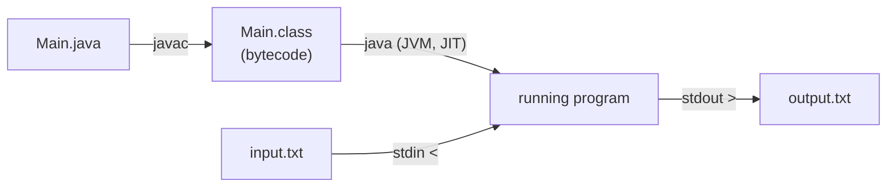

# 2. Learn Java

← [Learn C++](01-learn-cpp.md) · [Part 2 index](README.md) · Next → [Learn Python](03-learn-python.md)

> [!abstract] What this covers
> **Core idea:** Set up a one-keystroke **compile → run on `input.txt` → `output.txt`** loop for Java, then learn the DSA subset: primitives vs objects, fast I/O, control flow, methods (Java is always pass-by-value, but references are values), arrays, `String` vs `StringBuilder`, and the overflow / equality / boxing traps.
> **You'll be able to:** run Java 17+ from VS Code, write a fast-I/O template, pick `int` vs `long`, and avoid `==` on objects, string concatenation in loops, and `Integer` caching surprises.
> **Source:** [takeuforward lesson](https://takeuforward.org/learning/dsa/learn-java?category=language-basics&source=strivers-a2z-dsa-sheet) · **Time:** 2–3 h with practice

**Sections:** [1. Setup](#1-setup-jdk--vs-code) · [2. Program skeleton](#2-program-skeleton) · [3. Types](#3-primitive-types-and-ranges) · [4. Input/output](#4-inputoutput) · [5. Operators](#5-operators-and-their-traps) · [6. Control flow](#6-control-flow) · [7. Methods and references](#7-methods-pass-by-value-of-references) · [8. Arrays](#8-arrays) · [9. Strings](#9-string-vs-stringbuilder) · [10. Classes, wrappers, generics](#10-classes-wrappers-generics) · [11. DSA template](#11-dsa-template) · [Common mistakes](#common-mistakes) · [Practice](#practice) · [Flashcards](#flashcards)

---

## 1. Setup: JDK + VS Code



| Step | Action |
|---|---|
| 1 | Install a JDK (17 or 21 LTS): Temurin/Oracle/`brew install openjdk@21` |
| 2 | Verify: `java -version` and `javac -version` |
| 3 | VS Code: install **Extension Pack for Java** |
| 4 | Add the task below; open `Main.java`, `input.txt`, `output.txt` side by side; **Ctrl/Cmd + Shift + B** |

**Single-file shortcut (Java 11+):** `java Main.java < input.txt > output.txt` compiles in memory and runs. No `.class` file to clean up.

```json
{
  "version": "2.0.0",
  "tasks": [{
    "label": "Run Java",
    "type": "shell",
    "command": "java \"${file}\" < input.txt > output.txt",
    "options": { "cwd": "${fileDirname}" },
    "group": { "kind": "build", "isDefault": true }
  }]
}
```

Two-step version (faster repeated runs, needed when a file has several top-level classes):
`javac Main.java && java Main < input.txt > output.txt` (Windows **cmd**: same with `&&`; then `del Main.class` to clean).

> [!warning] File name = public class name
> `public class Main` must live in `Main.java`. Most judges require the class to be called `Main` (Codeforces accepts any; LeetCode uses `class Solution`).

---

## 2. Program skeleton

```java
import java.util.*;
import java.io.*;

public class Main {
    public static void main(String[] args) throws IOException {
        Scanner sc = new Scanner(System.in);
        int n = sc.nextInt();
        System.out.println(n * 2);
    }
}
```

| Piece | Meaning |
|---|---|
| `import java.util.*;` | `Scanner`, `ArrayList`, `HashMap`, `Arrays`, `Collections` |
| `public class Main` | Everything lives inside a class |
| `public static void main(String[] args)` | Entry point; `static` = no object needed |
| `throws IOException` | Needed when using `BufferedReader` |

---

## 3. Primitive types and ranges

| Type | Size | Range | Default (fields/arrays) |
|---|---|---|---|
| `boolean` | — | `true`/`false` | `false` |
| `char` | 2 B | 0…65535 (UTF-16, **unsigned**) | `'\u0000'` |
| `int` | 4 B | −2,147,483,648 … 2,147,483,647 | `0` |
| `long` | 8 B | ≈ ±9.22 × 10¹⁸ | `0L` |
| `double` | 8 B | ~15–16 digits | `0.0` |
| `byte`, `short`, `float` | 1, 2, 4 B | small | rarely needed |

Sizes are **fixed by the spec** on every platform (unlike C++). Integer overflow **wraps silently** (no UB, but still wrong).

- Literals: `long big = 10_000_000_000L;` (needs `L`), `1e9` is a `double`.
- Limits: `Integer.MAX_VALUE`, `Long.MIN_VALUE`.
- Overflow-safe product: `long p = (long) a * b;`. `Math.addExact` / `Math.multiplyExact` throw on overflow (handy for debugging).
- Char math: `int d = c - '0'; int idx = c - 'a'; char up = (char)(c - 'a' + 'A');` — the result of `char` arithmetic is `int`, so cast back.

---

## 4. Input/output

`Scanner` is simple but **slow** (regex-based). For 10⁵+ tokens use `BufferedReader` + `StringTokenizer`, and `PrintWriter`/`StringBuilder` for output.

```java
// Simple
Scanner sc = new Scanner(System.in);
int n = sc.nextInt(); long x = sc.nextLong(); String w = sc.next();
sc.nextLine();                       // consume leftover newline
String line = sc.nextLine();

// Fast
BufferedReader br = new BufferedReader(new InputStreamReader(System.in));
StringTokenizer st = new StringTokenizer(br.readLine());
int a = Integer.parseInt(st.nextToken());
PrintWriter out = new PrintWriter(new BufferedWriter(new OutputStreamWriter(System.out)));
out.println(a);
out.flush();                          // ⚠ forget this and nothing prints
```

| Situation | Do |
|---|---|
| Many lines of output | Append to `StringBuilder` or `PrintWriter`; print once |
| Formatting | `System.out.printf("%.6f%n", d);` or `String.format` |
| Read until EOF | `while ((line = br.readLine()) != null)` |

---

## 5. Operators and their traps

| Operator | Behaviour | Trap |
|---|---|---|
| `/` on ints | Truncates toward zero: `-7/2 = -3` | Use `(double) a / b` |
| `%` | Sign follows dividend: `-7 % 3 = -1` | `Math.floorMod(a, m)` gives non-negative for m > 0 |
| `==` on objects | Compares **references**, not contents | Use `.equals()` for `String`, `Integer`, etc. |
| `>>` vs `>>>` | Arithmetic (keeps sign) vs logical (fills 0) shift | `>>>` for unsigned bit work |
| `&&`, `\|\|` | Short-circuit | `if (i < n && a[i] > 0)` |
| `1 << 31` | Overflows to `Integer.MIN_VALUE` | `1L << k` |
| Compound `+=` | Implicit cast: `int x; x += 1.7;` compiles (x += 1) | Know it exists |

---

## 6. Control flow

Same as C++: `if / else if / else`, `for`, `while`, `do-while`, `break`, `continue`, and `switch` (works on `int`, `char`, `String`, enums). Java 14+ switch expression:

```java
int r = switch (op) {
    case '+' -> a + b;
    case '-' -> a - b;
    default -> 0;
};
```

**Labelled break** exits nested loops (no `goto` needed):
```java
outer:
for (int i = 0; i < n; i++)
    for (int j = 0; j < m; j++)
        if (g[i][j] == target) break outer;
```

Enhanced for: `for (int v : arr) { … }` — `v` is a **copy** for primitives; assigning to it doesn't change the array.

---

## 7. Methods: pass-by-value (of references)

Java passes **everything by value**. For objects, the value passed is the **reference**, so:

| Inside the method you… | Caller sees it? |
|---|---|
| Modify a primitive parameter `x++` | ❌ |
| Modify the object's contents `arr[0] = 5`, `list.add(3)` | ✅ (same object) |
| Reassign the parameter `arr = new int[5]` | ❌ (only the local copy of the reference changes) |

```java
static void inc(int x) { x++; }              // no effect on caller
static void fill(int[] a) { a[0] = 99; }     // caller's array changes
static void swap(int[] a, int i, int j) { int t = a[i]; a[i] = a[j]; a[j] = t; }
```

To "return" several values: return an array/object, or mutate a passed-in array (e.g. `int[] ans = new int[1]` used as an out-parameter in recursion).

Methods called from `main` must be `static` (or create an object). Recursion depth: the default thread stack overflows around ~10⁴–10⁵ frames → `StackOverflowError`. Fix by iterating, or run `solve()` in `new Thread(null, runnable, "", 1 << 26).start()`.

---

## 8. Arrays

```java
int[] a = new int[n];               // zero-filled
int[] b = {3, 1, 2};
int[][] g = new int[r][c];
a.length;                            // field, not method
Arrays.fill(a, -1);
Arrays.sort(b);                      // dual-pivot quicksort for primitives
Arrays.toString(b);                  // "[1, 2, 3]" for debugging
int[] copy = Arrays.copyOf(b, b.length);
int[] part = Arrays.copyOfRange(b, 1, 3);   // [1, 3)
```

- Out of bounds → `ArrayIndexOutOfBoundsException` (good: loud failure).
- `int[] c = b;` copies the **reference**; both names see the same array.
- Dynamic size → `ArrayList<Integer>` (Part 6).

> [!warning] `Arrays.sort(int[])` worst case
> Primitive sort is quicksort-based; adversarial tests on some judges hit O(n²). Shuffle first, or sort `Integer[]`/`ArrayList` (merge-sort based, O(n log n) guaranteed, but slower constants).

---

## 9. String vs StringBuilder

`String` is **immutable**: every `s += c` builds a new string → O(n²) in a loop.

```java
String s = "hello";
s.length(); s.charAt(0); s.substring(1, 3);   // [1, 3)
s.indexOf("lo"); s.equals(t); s.compareTo(t);
s.toCharArray(); String.valueOf(chars);
s.split(" "); String.join(",", parts);
Integer.parseInt("42"); String.valueOf(42);

StringBuilder sb = new StringBuilder();
sb.append('a').append(42);
sb.reverse(); sb.setCharAt(0, 'z'); sb.deleteCharAt(sb.length() - 1);
String res = sb.toString();
```

| Need | Use |
|---|---|
| Read-only text, map keys | `String` |
| Build / modify char by char | `StringBuilder` or `char[]` |
| Sort a string's characters | `char[] c = s.toCharArray(); Arrays.sort(c); new String(c)` |

---

## 10. Classes, wrappers, generics

```java
class Node {
    int val; Node next;
    Node(int v) { val = v; }
}

class Pair {                          // Java has no built-in pair for DSA
    int a, b;
    Pair(int a, int b) { this.a = a; this.b = b; }
}
// or: record Pair(int a, int b) {}   (Java 16+, auto equals/hashCode)
```

**Wrapper classes:** collections hold objects, so `int` is auto-**boxed** to `Integer`.

| Trap | Example | Fix |
|---|---|---|
| `==` on `Integer` | `Integer a = 1000, b = 1000; a == b` → **false** (cached only −128…127) | `a.equals(b)` or `a.intValue() == b` |
| Null unboxing | `int x = map.get(k);` when key missing → `NullPointerException` | `map.getOrDefault(k, 0)` |
| Boxing cost | `ArrayList<Integer>` of 10⁶ elements is ~4–5× the memory of `int[]` | Prefer primitive arrays in hot paths |

**Generics:** `ArrayList<Integer>` not `ArrayList<int>`; type parameters must be objects.

---

## 11. DSA template

```java
import java.util.*;
import java.io.*;

public class Main {
    public static void main(String[] args) throws IOException {
        BufferedReader br = new BufferedReader(new InputStreamReader(System.in));
        PrintWriter out = new PrintWriter(new BufferedWriter(new OutputStreamWriter(System.out)));
        int t = Integer.parseInt(br.readLine().trim());
        while (t-- > 0) {
            int n = Integer.parseInt(br.readLine().trim());
            StringTokenizer st = new StringTokenizer(br.readLine());
            long sum = 0;
            for (int i = 0; i < n; i++) sum += Long.parseLong(st.nextToken());
            out.println(sum);
        }
        out.flush();
    }
}
```

**LeetCode-style:** implement a method inside `class Solution { public int f(int[] nums) { … } }`.

---

## Common mistakes

1. `==` on `String`/`Integer` instead of `.equals()`.
2. `String +=` inside loops → O(n²). Use `StringBuilder`.
3. `int` overflow on `a * b` → cast one operand to `long`.
4. Forgetting `out.flush()` with `PrintWriter`.
5. `Scanner` on 10⁶ numbers → TLE.
6. `sc.nextInt()` then `sc.nextLine()` returns `""` (leftover newline).
7. Assigning to the loop variable in enhanced-for and expecting the array to change.
8. Unboxing a `null` from a map.
9. `arr.length` vs `str.length()` vs `list.size()` — three different spellings.
10. Deep recursion → `StackOverflowError`.

---

## Practice

1. Fast-read n ≤ 10⁶ ints and print their sum. Which reader, which sum type?
2. Predict: `Integer a = 127, b = 127; a == b` and the same with 128.
3. Write `static void reverse(int[] a)` in place. Why does it work without returning?
4. Why does `static void reset(int[] a) { a = new int[a.length]; }` not clear the caller's array?
5. Build the string "0,1,2,…,99999" efficiently.
6. Compute `Math.floorMod(-7, 3)` and `-7 % 3`.

<details><summary>Answer sketches</summary>

**#1:** `BufferedReader` + `StringTokenizer`; `long` (10⁶ × 2.1 × 10⁹ overflows `int`).

**#2:** `true` (cached), `false` (distinct objects).

**#3:** The method receives a copy of the reference to the *same* array; swapping elements mutates that array.

**#4:** Reassigning the parameter changes only the local reference. Use `Arrays.fill(a, 0)`.

**#5:** `StringBuilder` with `append(i).append(',')`, then remove the trailing comma.

**#6:** `2` and `-1`.
</details>

---

## Key terms

| Term | Meaning |
|---|---|
| JDK / JRE / JVM | Dev kit (javac + tools) / runtime / virtual machine that runs bytecode |
| Bytecode | Platform-independent `.class` instructions |
| JIT | Compiles hot bytecode to native code at runtime |
| Boxing / unboxing | Automatic `int` ↔ `Integer` conversion |
| Immutable | Can't be changed after creation (`String`) |
| Garbage collector | Frees unreachable objects automatically |

---

## Flashcards

**How do you run a single Java file without a separate compile step?** #flashcard
`java Main.java < input.txt` (Java 11+).

**Is Java pass-by-value or pass-by-reference?** #flashcard
Always by value. For objects, the value is a reference, so mutations to the object are visible but reassigning the parameter is not.

**Why does `Integer a = 1000, b = 1000; a == b` give false?** #flashcard
`==` compares references; only −128…127 are cached. Use `.equals()`.

**Why is `s += c` in a loop slow in Java?** #flashcard
`String` is immutable, so each `+=` copies the whole string → O(n²). Use `StringBuilder`.

**What's the fast-input combo in Java?** #flashcard
`BufferedReader` + `StringTokenizer` (+ `PrintWriter` and `flush()` for output).

**How do you get a non-negative modulo in Java?** #flashcard
`Math.floorMod(a, m)`.

**How do you avoid overflow in `a * b` with int operands?** #flashcard
`(long) a * b` — cast before the multiplication.

**What happens on out-of-bounds array access in Java vs C++?** #flashcard
Java throws `ArrayIndexOutOfBoundsException`; C++ is undefined behaviour (may silently corrupt).

**Why use `getOrDefault` on a `HashMap<Integer,Integer>`?** #flashcard
`get` returns `null` for missing keys; unboxing `null` to `int` throws `NullPointerException`.

**Interview track →** [L3 Cheatsheet](../../00-L3-EXECUTION-META/L3_CHEATSHEET.md)
