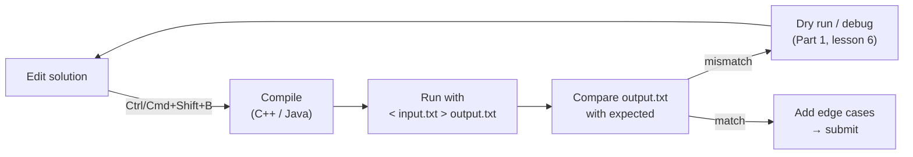

# Part 2: Language Basics

← [Striver course map](../README.md)

> [!abstract] What this part covers
> **Goal:** Get a one-keystroke **edit → run on `input.txt` → read `output.txt`** loop working, then learn only the slice of your language that DSA uses: types and overflow, fast I/O, operators, control flow, functions (value vs reference), arrays, strings, and a reusable template.
> **Prereqs:** [Part 1](../01-fundamentals-of-programming/README.md), especially [choosing a language](../01-fundamentals-of-programming/07-programming-languages-and-choosing-a-path.md). **Time:** ~2–3 h for **one** language. Read the other two only for the comparison table below.
> **Outcome:** You can read input, pick an overflow-safe type from constraints, pass data into functions without accidental copies or aliasing, and submit with a template that won't TLE on I/O.

---

## Lessons

| # | Lesson | Core idea in one line | Source |
|---|---|---|---|
| 1 | [Learn C++](01-learn-cpp.md) | g++ setup, fast I/O, `long long`, references, `vector`/`string`, template | [link](https://takeuforward.org/learning/dsa/learn-cpp?category=language-basics&source=strivers-a2z-dsa-sheet) |
| 2 | [Learn Java](02-learn-java.md) | JDK setup, BufferedReader I/O, `long`, `.equals` vs `==`, `StringBuilder`, template | [link](https://takeuforward.org/learning/dsa/learn-java?category=language-basics&source=strivers-a2z-dsa-sheet) |
| 3 | [Learn Python](03-learn-python.md) | `sys.stdin` I/O, `//` and `%` semantics, aliasing, recursion limit, speed, template | [link](https://takeuforward.org/learning/dsa/learn-python?category=language-basics&source=strivers-a2z-dsa-sheet) |

---

## The dev loop this part builds

---

## Part 2 cheat sheet: C++ vs Java vs Python

| Concept | C++ | Java | Python |
|---|---|---|---|
| Run | `g++ -std=c++17 -O2 a.cpp && ./a.out < in` | `java Main.java < in` | `python3 a.py < in` |
| 64-bit int | `long long` | `long` | `int` (unbounded) |
| Max sentinel | `INT_MAX`, `LLONG_MAX` | `Integer.MAX_VALUE` | `float('inf')` |
| Safe product | `1LL * a * b` | `(long) a * b` | `a * b` |
| `-7 / 2` | `-3` (truncate) | `-3` | `-7 // 2 = -4` (floor); `/` gives `-3.5` |
| `-7 % 3` | `-1` | `-1` (`Math.floorMod` → 2) | `2` |
| Fast input | `ios::sync_with_stdio(false); cin.tie(nullptr);` | `BufferedReader` + `StringTokenizer` | `sys.stdin.readline` / `sys.stdin.buffer.read().split()` |
| Fast output | `'\n'` not `endl` | `PrintWriter` + `flush()` / `StringBuilder` | `"\n".join(out)` once |
| Dynamic array | `vector<int> a(n)` | `ArrayList<Integer>` / `int[]` | `list` `[0] * n` |
| 2D array | `vector<vector<int>> g(r, vector<int>(c))` | `new int[r][c]` | `[[0]*c for _ in range(r)]` |
| Size | `a.size()` (unsigned!) | `arr.length`, `s.length()`, `list.size()` | `len(a)` |
| String mutable? | ✅ `s[i] = 'x'` | ❌ use `StringBuilder` / `char[]` | ❌ use `list` + `"".join` |
| Pass array to function | Copy by default → use `vector<int>&` | Reference value (mutations visible) | Reference (mutations visible) |
| Hash map | `unordered_map<int,int>` | `HashMap<Integer,Integer>` | `dict` / `defaultdict` |
| Equality trap | — | `==` on objects compares references | `is` vs `==` |
| Recursion depth | ~10⁵–10⁶ (stack size) | ~10⁴–10⁵ → `StackOverflowError` | 1000 → `setrecursionlimit` |
| Ops/sec (rough) | ~10⁸ | ~10⁸ (after JIT warm-up) | ~10⁷ |

### Picking an integer type from constraints

| Largest value the answer can reach | Type |
|---|---|
| ≤ 2 × 10⁹ | `int` |
| ≤ 9 × 10¹⁸ (sums of 10⁵ values ≤ 10⁹, products of two ≤ 10⁹) | `long long` / `long` |
| Larger | Modular arithmetic (`% 1_000_000_007`), or Python int |

---

## Mastery checklist

- [ ] One-keystroke run on `input.txt` → `output.txt` works in your editor
- [ ] Write your template from memory in under 2 minutes
- [ ] Read T test cases, each with n numbers, using fast I/O
- [ ] Choose `int` vs 64-bit from constraints and spot an overflowing product
- [ ] Predict `-7 / 2` and `-7 % 3` in your language
- [ ] Explain why a function modifying an array does or doesn't affect the caller in your language
- [ ] Build a string of 10⁵ characters in O(n)
- [ ] Know your language's recursion-depth limit and the workaround

**Interview track →** [L3 Cheatsheet](../../00-L3-EXECUTION-META/L3_CHEATSHEET.md) · [Interview Judgment](../../03-patterns/INTERVIEW_JUDGMENT.md)

Next part → [Logic Building (Patterns)](../03-logic-building-patterns/README.md)
