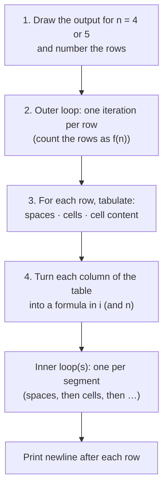

# 1. Pattern Logic Building: Easy and Medium

← [Part 3 index](README.md) · Next → [Hard](02-hard.md)

> [!abstract] What this covers
> **Core idea:** Every pattern is a **grid**. The outer loop walks rows; for each row you answer three questions: *how many columns*, *what goes in column j*, and *what precedes it (spaces)*. Write those as formulas in the row number `i`, and the code writes itself.
> **You'll be able to:** derive the inner-loop bounds and cell content for squares, right triangles, inverted triangles, number/letter triangles and centred pyramids without trial and error.
> **Source:** [takeuforward lesson](https://takeuforward.org/learning/dsa/easy-and-medium?category=logic-building-patterns&source=strivers-a2z-dsa-sheet) · **Time:** 60–90 min

**Sections:** [1. Why patterns](#1-why-patterns-matter) · [2. The 4-step method](#2-the-4-step-method) · [3. Row table](#3-the-row-table) · [4. Shapes catalogue](#4-shape-catalogue-easy) · [5. What goes in a cell](#5-what-goes-in-a-cell) · [6. Leading spaces: pyramids](#6-leading-spaces-centred-pyramids) · [7. Two loops vs one formula](#7-counters-that-live-across-rows) · [8. Indexing: 0 or 1](#8-0-based-vs-1-based-rows) · [Common mistakes](#common-mistakes) · [Practice](#practice) · [Flashcards](#flashcards)

---

## 1. Why patterns matter

Patterns are not interview questions. They're **nested-loop training**:

| Skill trained | Shows up later in |
|---|---|
| Outer loop = one unit of work, inner loop = its details | Matrix traversal, 2D DP |
| Expressing a bound as a function of the outer variable (`j ≤ i`) | Triangular loops: pairs `i < j`, bubble sort, gap DP |
| Translating a visual into a formula | Spiral matrix, rotation, index mapping |
| Off-by-one discipline | Binary search, windows, everything |
| Dry-running a loop on paper | [Part 1, lesson 6](../01-fundamentals-of-programming/06-dry-runs-edge-cases-and-debugging.md) |

---

## 2. The 4-step method



> [!tip] The universal skeleton
> ```text
> for i in rows:
>     for each segment in the row (spaces, stars, numbers, spaces…):
>         for j in 1..length_of_segment(i):
>             print content(i, j)
>     print newline
> ```

---

## 3. The row table

**Example:** right-angled triangle, n = 4.
```text
*
**
***
****
```

| Row i (1-based) | Stars |
|---|---|
| 1 | 1 |
| 2 | 2 |
| 3 | 3 |
| 4 | 4 |

The stars column equals `i`, so the inner loop is `for j in 1..i`. That is the whole method. Every harder pattern just has more columns in the table.

```cpp
for (int i = 1; i <= n; i++) {
    for (int j = 1; j <= i; j++) cout << '*';
    cout << '\n';
}
```

---

## 4. Shape catalogue (easy)

| Shape (n = 4) | Rows | Cells in row i (1-based) | Pattern # |
|---|---|---|---|
| Square `****` × 4 | n | n | [1](../04-patterns/01-pattern-1.md) |
| Right triangle (grows) | n | i | [2](../04-patterns/02-pattern-2.md) |
| Inverted right triangle | n | n − i + 1 | [5](../04-patterns/05-pattern-5.md) |
| Centred pyramid | n | 2i − 1 (after n − i spaces) | [7](../04-patterns/07-pattern-7.md) |
| Inverted pyramid | n | 2(n − i) + 1 (after i − 1 spaces) | [8](../04-patterns/08-pattern-8.md) |
| Half diamond (grows then shrinks) | 2n − 1 | i ≤ n ? i : 2n − i | [10](../04-patterns/10-pattern-10.md) |

**Inversion rule:** to flip a growing shape upside down, replace `i` with `n − i + 1` in every formula.

---

## 5. What goes in a cell

Once the shape is fixed, the **content** is a second, independent formula.

| Content (n = 4) | Example row 3 | Formula for cell j in row i | Pattern # |
|---|---|---|---|
| Constant star | `***` | `'*'` | 2 |
| Column number | `123` | `j` | [3](../04-patterns/03-pattern-3.md) |
| Row number | `333` | `i` | [4](../04-patterns/04-pattern-4.md) |
| Column number, shrinking | `12` | `j` (bound n − i + 1) | [6](../04-patterns/06-pattern-6.md) |
| Letter by column | `ABC` | `'A' + j − 1` | [14](../04-patterns/14-pattern-14.md) |
| Letter by row | `CCC` | `'A' + i − 1` | [16](../04-patterns/16-pattern-16.md) |
| Alternating bit | `101` | `(i + j) % 2 == 0 ? 1 : 0` | [11](../04-patterns/11-pattern-11.md) |
| Running counter | `4 5 6` | `num++` (declared outside both loops) | [13](../04-patterns/13-pattern-13.md) |

> [!tip] Separate shape from content
> Get the shape right with stars first. Then swap `'*'` for the content formula. Debugging two things at once is how people get stuck.

---

## 6. Leading spaces: centred pyramids

n = 4:
```text
   *
  ***
 *****
*******
```

| Row i | Leading spaces | Stars | Trailing spaces (optional) |
|---|---|---|---|
| 1 | 3 | 1 | 3 |
| 2 | 2 | 3 | 2 |
| 3 | 1 | 5 | 1 |
| 4 | 0 | 7 | 0 |
| **Formula** | **n − i** | **2i − 1** | **n − i** |

**Sanity check:** every row's total width = (n − i) + (2i − 1) + (n − i) = **2n − 1**, a constant. If your widths don't sum to a constant, a formula is wrong.

```cpp
for (int i = 1; i <= n; i++) {
    for (int s = 1; s <= n - i; s++) cout << ' ';
    for (int j = 1; j <= 2 * i - 1; j++) cout << '*';
    cout << '\n';
}
```

Trailing spaces are invisible on screen, but some judges compare output exactly. Follow the expected output; most accept either.

---

## 7. Counters that live across rows

Pattern 13 (n = 4):
```text
1
2 3
4 5 6
7 8 9 10
```

The content doesn't depend on (i, j) alone in an obvious way, so keep a counter that **survives** across rows:

```cpp
int num = 1;                     // outside BOTH loops
for (int i = 1; i <= n; i++) {
    for (int j = 1; j <= i; j++) cout << num++ << ' ';
    cout << '\n';
}
```

Closed form (for the curious): the first number in row i is `1 + (i − 1)i / 2`, the triangular number offset.

---

## 8. 0-based vs 1-based rows

| | 1-based `i = 1..n` | 0-based `i = 0..n−1` |
|---|---|---|
| Right triangle cells | `i` | `i + 1` |
| Pyramid spaces | `n − i` | `n − i − 1` |
| Pyramid stars | `2i − 1` | `2i + 1` |
| Inverted triangle | `n − i + 1` | `n − i` |

Pick one convention for the whole pattern and rebuild the row table in it. Mixing them is the #1 off-by-one source. Patterns read more naturally 1-based; arrays are 0-based.

---

## Common mistakes

1. Newline inside the inner loop (every cell on its own line) or missing entirely (everything on one line).
2. Counter declared inside the outer loop, so it resets every row.
3. Mixing 0- and 1-based formulas.
4. `2*i - 1` written as `2*(i - 1)` → even counts, pyramid looks lopsided.
5. Printing `"* "` (star + space) when the expected output is `"*"`, or vice versa. This doubles the width of a pyramid.
6. Letters: `'A' + j` in C++ prints an **int**; cast `(char)('A' + j)`.
7. Not testing n = 1 (a single cell) and n = 0 (no output).

---

## Practice

1. Fill the row table (spaces, stars) for an inverted pyramid with n = 4 and derive formulas in 0-based `i`.
2. Print a right triangle of **even** numbers: `2`, `2 4`, `2 4 6`, …
3. Print n rows where row i has i copies of the letter `'A' + n − i`.
4. Print a right-aligned triangle (stars hug the right edge).
5. Without running it, how many characters (excluding newlines) does the centred pyramid print in total?

<details><summary>Answer sketches</summary>

**#1:** rows (0-based) 0..3 → spaces `i`, stars `2(n − i) − 1`.

**#2:** cell j prints `2 * j`, bound `j ≤ i`.

**#3:** content is `(char)('A' + n − i)` (1-based i): row 1 prints `D`, row 4 prints `AAAA` for n = 4.

**#4:** spaces `n − i`, stars `i`.

**#5:** stars = 1 + 3 + … + (2n − 1) = n²; leading spaces = 0 + 1 + … + (n − 1) = n(n − 1)/2. Total = n² + n(n − 1)/2 (ignoring trailing spaces).
</details>

---

## Key terms

| Term | Meaning |
|---|---|
| Row table | Per-row tabulation of segment lengths and content; formulas are read off its columns |
| Segment | A contiguous run in a row (spaces, stars, numbers) — one inner loop each |
| Width invariant | Sum of segment lengths per row is constant for centred shapes |
| Inversion | Replace `i` with `n − i + 1` to flip a pattern vertically |

---

## Flashcards

**What does the outer loop represent in any pattern?** #flashcard
One row. The inner loop(s) print that row's segments.

**What are the three questions to answer for each row?** #flashcard
How many leading spaces, how many cells, and what each cell contains — each as a formula in i.

**Formulas for a centred star pyramid (1-based)?** #flashcard
Spaces `n − i`, stars `2i − 1`. Width is constant at 2n − 1.

**How do you flip a growing pattern upside down?** #flashcard
Replace i with n − i + 1 in every formula.

**Where must a counter like `num` in the increasing-number triangle be declared?** #flashcard
Outside both loops, so it keeps counting across rows.

**What's the alternating-bit cell formula (1, 01, 101 …)?** #flashcard
`(i + j) % 2 == 0 ? 1 : 0` — the parity of the cell's position.

**Why get the shape right with stars before content?** #flashcard
Shape (bounds) and content (formula) are independent; debugging them separately halves the search space.

**Interview track →** [How to Think](../../03-patterns/HOW_TO_THINK.md)
