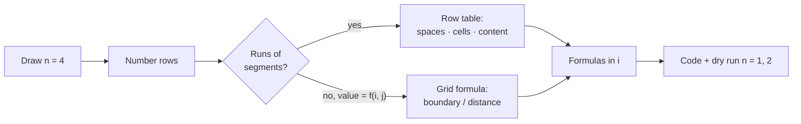

# Part 3: Logic Building (Patterns)

← [Striver course map](../README.md)

> [!abstract] What this part covers
> **Goal:** Learn a repeatable method for turning any printed pattern into nested loops: number the rows, tabulate each row's segments, read off formulas in `i`, and print. Then extend it with composition, mirroring, boundary tests and distance formulas for the hard ones.
> **Prereqs:** [Part 2](../02-language-basics/README.md) (loops and printing in your language). **Time:** ~2.5 h.
> **Outcome:** You can solve every one of the [22 patterns in Part 4](../04-patterns/README.md) by deriving formulas, not by trial and error.

---

## Lessons

| # | Lesson | Core idea in one line | Source |
|---|---|---|---|
| 1 | [Easy and Medium](01-easy-and-medium.md) | Row table → bounds and content as formulas in i; pyramids via `n − i` spaces and `2i − 1` stars | [link](https://takeuforward.org/learning/dsa/easy-and-medium?category=logic-building-patterns&source=strivers-a2z-dsa-sheet) |
| 2 | [Hard](02-hard.md) | Composition, mirroring, hollow boundary tests, distance formulas | [link](https://takeuforward.org/learning/dsa/hard?category=logic-building-patterns&source=strivers-a2z-dsa-sheet) |

---

## The method

---

## Part 3 cheat sheet

| Shape / trick | Formula (1-based row i) |
|---|---|
| Right triangle | cells `i` |
| Inverted | replace i with `n − i + 1` |
| Centred pyramid | spaces `n − i`, stars `2i − 1`, width `2n − 1` |
| Inverted pyramid | spaces `i − 1`, stars `2(n − i) + 1` |
| Rise then fall over 2n − 1 rows | `n − |n − i|` |
| Number crown gap | `2(n − i)` |
| Alternating bits | `(i + j) % 2 == 0 ? 1 : 0` |
| Letters | `(char)('A' + k)` |
| Counter across rows | declare outside both loops |
| Hollow | print iff on a boundary row/column |
| Concentric square | `n − min(i, j, S−1−i, S−1−j)`, S = 2n − 1 |
| Complexity | O(total characters printed) time, O(1) space |

---

## Mastery checklist

- [ ] Derive spaces/stars formulas for a pyramid in both 0- and 1-based indexing
- [ ] Turn any growing pattern upside down by substitution
- [ ] Print a mirrored row (alpha hill) without repeating the peak
- [ ] Write the hollow-rectangle boundary test from memory
- [ ] Explain the concentric square via ring distance
- [ ] Solve all 22 patterns in Part 4 in under 5 minutes each

**Interview track →** [How to Think](../../03-patterns/HOW_TO_THINK.md) · [Matrix deep-dive](../../01-data-structures/04-matrix.md)

Next part → [Patterns](../04-patterns/README.md)
