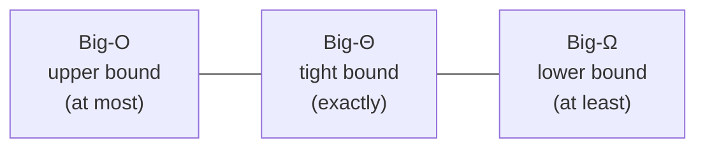
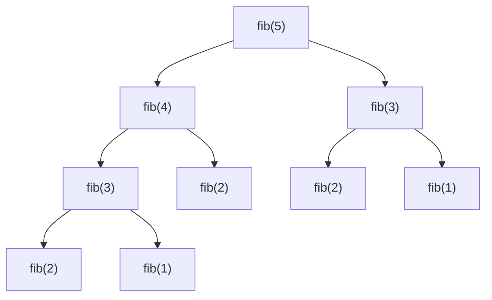

# 1. Time Complexity: Theory with Examples

← [Part 5 index](README.md) · Next → [Part 6: Standard Libraries & Collections](../06-standard-libraries-and-collections/README.md)

> [!abstract] What this covers
> **Core idea:** Time complexity is **how the number of basic steps grows with input size n**. We don't count seconds; we count steps, keep the dominant term, and drop constants. Big-O is an upper bound on that growth, usually for the **worst case**.
> **You'll be able to:** derive the complexity of loops, nested loops, halving loops, recursion and amortised operations; read constraints to pick a target complexity; and estimate auxiliary vs total space.
> **Source:** [takeuforward lesson](https://takeuforward.org/learning/dsa/theory-with-examples?category=time-complexity&source=strivers-a2z-dsa-sheet) · **Time:** 90 min

**Sections:** [1. Why not seconds](#1-why-not-measure-seconds) · [2. Counting rules](#2-the-counting-rules) · [3. Big-O, Ω, Θ](#3-big-o-big-omega-big-theta) · [4. Best / average / worst](#4-best-average-worst-case) · [5. Loop catalogue](#5-loop-catalogue) · [6. Recursion](#6-recursion) · [7. Amortised](#7-amortised-analysis) · [8. Space](#8-space-complexity) · [9. Constraints → target](#9-constraints--target-complexity) · [10. Growth ladder](#10-growth-ladder) · [Common mistakes](#common-mistakes) · [Practice](#practice) · [Flashcards](#flashcards)

---

## 1. Why not measure seconds?

The same code takes different times on a laptop, a judge server or an old phone, and under different loads. Seconds measure the **machine**; we want to measure the **algorithm**.

So we count **basic operations** (assignment, comparison, arithmetic, array access, each taking constant time) as a function of input size `n`, and ask how that count **grows** as n → ∞.

| n | 10 | 10³ | 10⁵ | 10⁶ |
|---|---|---|---|---|
| Algorithm A: 100n steps | 10³ | 10⁵ | 10⁷ | 10⁸ |
| Algorithm B: n² steps | 10² | 10⁶ | 10¹⁰ | 10¹² |

B is faster for n = 10. A wins from n = 100 onwards, and at n = 10⁵ B is 1000× slower. **Growth beats constants for large n.** That is the whole argument for Big-O.

---

## 2. The counting rules

| Rule | Example | Result |
|---|---|---|
| **Worst case** by default | linear search: target absent | O(n) |
| **Drop constants** | 3n + 5 | O(n) |
| **Drop lower-order terms** | n² + 100n + 7 | O(n²) |
| **Sequential blocks add** | loop n, then loop m | O(n + m) |
| **Nested blocks multiply** | loop n inside loop m | O(n · m) |
| **Different inputs keep different letters** | two arrays of sizes n, m | O(n + m), **not** O(n) |
| **Branches: take the worse** | `if` O(n) `else` O(n²) | O(n²) |

> [!warning] Don't collapse n and m
> `for a in A: for b in B:` is O(n·m). Calling it O(n²) is wrong when |A| and |B| are independent — and interviewers notice.

**Dry run: counting exactly, then simplifying.**
```cpp
int sum = 0;                         // 1
for (int i = 0; i < n; i++)          // n + 1 comparisons, n increments
    for (int j = 0; j < n; j++)      // n · (n + 1) comparisons, n² increments
        sum += a[i][j];              // n² additions
```
Exact count ≈ 3n² + 3n + 2 → keep the dominant term, drop the constant → **O(n²)**.

---

## 3. Big-O, Big-Omega, Big-Theta

| Notation | Meaning | Informal reading |
|---|---|---|
| **O(g(n))** | f(n) ≤ c · g(n) for all n ≥ n₀ | grows **at most** like g |
| **Ω(g(n))** | f(n) ≥ c · g(n) for all n ≥ n₀ | grows **at least** like g |
| **Θ(g(n))** | both O and Ω | grows **exactly** like g |



- Bubble sort is O(n²), and also (truthfully but uselessly) O(n³). In interviews, "O" means **the tightest bound you can state** — effectively Θ.
- Notation ≠ case. "Worst case is Θ(n²)" and "best case is Θ(n)" are both precise statements about insertion sort.
- Comparison sorting has a **lower bound** of Ω(n log n): no comparison sort can beat it in the worst case.

---

## 4. Best, average, worst case

Linear search for `x` in an array of n elements:

| Case | When | Steps |
|---|---|---|
| Best | `x` is at index 0 | O(1) |
| Average | `x` uniformly placed | ~n/2 → O(n) |
| Worst | `x` absent or at the end | O(n) |

**Why worst case is the default:** it's a guarantee. A judge's hidden tests (and production traffic) will find the worst case. Average case is used when stated, e.g. hash map O(1) *average*, quicksort O(n log n) *average*.

---

## 5. Loop catalogue

| # | Code shape | Iterations | Complexity |
|---|---|---|---|
| 1 | `for i in 0..n−1` | n | O(n) |
| 2 | `for i in 0..n−1 step 2` | n/2 | O(n) |
| 3 | `for i in 0..n−1: for j in 0..n−1` | n² | O(n²) |
| 4 | `for i in 0..n−1: for j in i..n−1` (triangular) | n(n+1)/2 | O(n²) |
| 5 | `for i = 1; i < n; i *= 2` | log₂ n | O(log n) |
| 6 | `for i = n; i > 0; i /= 2` | log₂ n | O(log n) |
| 7 | `for i in 0..n−1: for j = 1; j < n; j *= 2` | n log n | O(n log n) |
| 8 | `for i = 1; i * i <= n; i++` | √n | O(√n) |
| 9 | `for i in 1..n: for j = i; j <= n; j += i` (harmonic) | n(1 + 1/2 + … + 1/n) | O(n log n) |
| 10 | `for i = 2; i < n; i = i * i` | log log n | O(log log n) |
| 11 | `for i in 1..n: for j in 1..i: for k in 1..j` | n³/6 | O(n³) |
| 12 | Two pointers `l`, `r` moving inward, never back | ≤ n total | O(n) |
| 13 | Inner `while` that advances a pointer shared across outer iterations | ≤ n total | O(n) (not n²!) |

**Why #5 is log n.** After k iterations, i = 2ᵏ. The loop stops when 2ᵏ ≥ n → k = log₂ n. Any loop that **multiplies or divides by a constant** is logarithmic; the base doesn't matter in Big-O (log₂ n = log₁₀ n / log₁₀ 2, a constant factor).

**Why #9 is n log n.** Inner loop runs n/i times. Σ n/i = n · Hₙ ≈ n ln n. This is the cost of the Sieve of Eratosthenes-style "for every i, visit its multiples" loop (the sieve itself is O(n log log n) because it only starts from primes).

**Why #13 is O(n).** Count total pointer movement, not iterations per outer loop:
```cpp
int j = 0;
for (int i = 0; i < n; i++)
    while (j < n && cond(i, j)) j++;   // j only ever moves forward
```
`j` increments at most n times **in total** across all outer iterations → O(n + n) = O(n). This is why sliding window and two pointers are linear.

> [!tip] The universal recipe
> 1. Write down how the loop variable changes (+1, ×2, ÷2, +i …).
> 2. Solve "after k steps, the variable reaches the bound" for k.
> 3. For nested loops, **sum** the inner iterations over all outer values — don't just multiply the maxima when the inner bound depends on the outer variable (it usually still gives the right Big-O, but #9 and #13 are where multiplying lies).

---

## 6. Recursion

Complexity of a recursive function = **(number of calls) × (work per call)**, or solve a recurrence.

| Function | Recurrence | Calls tree | Complexity |
|---|---|---|---|
| `f(n) = f(n−1) + O(1)` (factorial, sum 1..n) | T(n) = T(n−1) + 1 | a chain of n | O(n) |
| `f(n) = f(n/2) + O(1)` (binary search) | T(n) = T(n/2) + 1 | a chain of log n | O(log n) |
| `f(n) = 2f(n/2) + O(n)` (merge sort) | T(n) = 2T(n/2) + n | log n levels × n work | O(n log n) |
| `f(n) = f(n−1) + f(n−2)` (naive Fibonacci) | T(n) = T(n−1) + T(n−2) + 1 | binary tree of depth n | O(2ⁿ) (tight: O(φⁿ), φ ≈ 1.618) |
| `f(n) = 2f(n−1)` (subsets) | T(n) = 2T(n−1) + 1 | 2ⁿ leaves | O(2ⁿ) |
| Permutations of n | T(n) = n · T(n−1) | n! leaves | O(n · n!) with copying |


`fib(3)` is computed twice and `fib(2)` three times. Memoisation collapses the tree to n distinct calls → **O(n)**. That's the entire motivation for dynamic programming ([Part 28](../28-dynamic-programming/README.md)).

**Master theorem (for T(n) = a·T(n/b) + O(nᵈ)):**

| Compare | Result | Example |
|---|---|---|
| d > log_b a | O(nᵈ) | T = T(n/2) + n → O(n) |
| d = log_b a | O(nᵈ log n) | merge sort: a = 2, b = 2, d = 1 → O(n log n) |
| d < log_b a | O(n^(log_b a)) | T = 4T(n/2) + n → O(n²) |

**Recursion space** = maximum depth of the call stack × space per frame. Factorial: O(n). Binary search (recursive): O(log n). Merge sort: O(log n) stack + O(n) buffer.

---

## 7. Amortised analysis

Some operations are occasionally expensive but **cheap on average over a sequence**.

**Dynamic array push (`vector::push_back`, `ArrayList.add`, `list.append`):**

When the array is full, allocate double the capacity and copy everything. A single push can cost O(n). But over n pushes, the copies cost 1 + 2 + 4 + … + n < 2n in total, so the **amortised** cost per push is O(1).

| Push # | 1 | 2 | 3 | 4 | 5 | 6 | 7 | 8 | 9 |
|---|---|---|---|---|---|---|---|---|---|
| Capacity before | 0 | 1 | 2 | 4 | 4 | 8 | 8 | 8 | 8 |
| Copies | 0 | 1 | 2 | 0 | 4 | 0 | 0 | 0 | 8 |

Other amortised O(1) operations: hash-map insert (rehash on growth), monotonic stack push/pop (each element pushed and popped once), union-find with path compression (≈ O(α(n))).

> [!warning] Amortised ≠ average
> **Average** is over random inputs (and can be beaten by adversarial input, e.g. hash collisions). **Amortised** is a guarantee over any sequence of operations.

---

## 8. Space complexity

| Term | Includes | Example: merge sort |
|---|---|---|
| **Auxiliary space** | Extra memory your algorithm allocates (buffers, hash maps, recursion stack) | O(n) buffer + O(log n) stack = O(n) |
| **Total space** | Auxiliary + the input itself | O(n) |

Interviewers almost always mean **auxiliary** space. State it explicitly: "O(1) extra space, excluding the output".

| Allocation | Space |
|---|---|
| A few scalar variables | O(1) |
| Array / hash map of size n | O(n) |
| 2D DP table n × m | O(n·m) |
| Recursion depth d | O(d) — **counts even if you allocate nothing** |
| The output array you must return | Usually excluded; say so |

**Modifying the input** to save space (e.g. marking visited cells in the grid) makes space O(1), but mention that it destroys the input — it's a trade-off, not a free win.

---

## 9. Constraints → target complexity

Judges allow roughly **10⁸ simple operations per second** (C++/Java; Python ≈ 10⁷). Time limits are typically 1–2 s. Read `n`'s bound and work backwards:

| Max n | Target complexity | Typical techniques |
|---|---|---|
| ≤ 10 | O(n!), O(n · n!) | permutations, brute force |
| ≤ 20 | O(2ⁿ), O(n · 2ⁿ) | subsets, bitmask DP |
| ≤ 100 | O(n³), O(n⁴) small | Floyd–Warshall, 3D DP |
| ≤ 500 | O(n³) | interval DP |
| ≤ 5 × 10³ | O(n²) | 2D DP, all pairs |
| ≤ 10⁵ – 10⁶ | O(n log n), O(n) | sorting, binary search, heap, two pointers, hashing |
| ≤ 10⁸ | O(n), careful constants | linear scan, sieve |
| ≤ 10¹⁸ | O(log n), O(√n), O(1) | binary search on answer, math, fast power |

> [!tip] Use constraints as a hint
> A constraint of n ≤ 20 almost shouts "exponential is fine — think subsets". n ≤ 10⁵ rules out O(n²) immediately. Do this check **before** you start coding. See [L3 Cheatsheet §6–7](../../00-L3-EXECUTION-META/L3_CHEATSHEET.md).

**Worked estimate.** n = 10⁵, your idea is O(n²) → 10¹⁰ ops → ~100 s. TLE. O(n log n) → 10⁵ × 17 ≈ 1.7 × 10⁶ ops → milliseconds ✅.

---

## 10. Growth ladder

```text
O(1) < O(log log n) < O(log n) < O(√n) < O(n) < O(n log n) < O(n²) < O(n³) < O(2ⁿ) < O(n!) < O(nⁿ)
```

| n | log₂ n | n log₂ n | n² | 2ⁿ |
|---|---|---|---|---|
| 10 | 3.3 | 33 | 100 | 1024 |
| 20 | 4.3 | 86 | 400 | ~10⁶ |
| 10³ | 10 | 10⁴ | 10⁶ | astronomic |
| 10⁵ | 17 | 1.7 × 10⁶ | 10¹⁰ | — |
| 10⁶ | 20 | 2 × 10⁷ | 10¹² | — |

Library operations you'll use constantly:

| Operation | Complexity |
|---|---|
| Sort | O(n log n) |
| Hash map get/put | O(1) average, O(n) worst |
| Balanced BST / `map` / `TreeMap` get/put | O(log n) |
| Heap push/pop | O(log n); peek O(1); build from array O(n) |
| String concatenation in a loop (Java `+`, Python `+=` on immutable str) | O(n²) total — use a builder/join |
| `list.insert(0, x)` / `vector.insert(begin)` | O(n) — use a deque |
| `x in list` | O(n); `x in set` O(1) average |

---

## Common mistakes

1. Calling two independent inputs both "n" → O(n²) instead of O(n·m), or O(n) instead of O(n + m).
2. Counting nested loops as O(n²) when the inner pointer never resets (two pointers, sliding window are O(n)).
3. Forgetting recursion-stack space ("my DFS is O(1) space").
4. Ignoring hidden costs: string slicing/concatenation, `list.pop(0)`, copying a vector passed by value, `substr` inside a loop.
5. Saying hash maps are O(1) without "average".
6. Writing O(2n) or O(n/2) — constants are dropped.
7. Assuming log means log₁₀ — the base doesn't matter in Big-O; in CS it's usually base 2.

---

## Practice

1. Complexity of `for (i = n; i > 1; i /= 3)`?
2. `for i in 0..n−1: for j in 0..i*i−1` — complexity?
3. `for i in 1..n: for j in 1..n step i` — complexity?
4. `T(n) = 3T(n/3) + O(1)` — solve it.
5. A function sorts the array, then does a binary search for each of the n elements. Complexity?
6. Constraints: n ≤ 2000, q ≤ 2000 queries. Is O(n · q) fine? Is O(n² · q)?
7. Recursive DFS on a linked-list-shaped tree with 10⁵ nodes in Python — what goes wrong?

<details><summary>Answer sketches</summary>

**#1:** O(log₃ n) = O(log n).

**#2:** Σ i² = n³/3 → O(n³).

**#3:** inner runs n/i times → harmonic sum → O(n log n).

**#4:** a = 3, b = 3, d = 0 → d < log₃ 3 = 1 → O(n).

**#5:** O(n log n) sort + n × O(log n) searches = O(n log n).

**#6:** n · q = 4 × 10⁶ ✅. n² · q = 8 × 10⁹ ❌.

**#7:** recursion depth 10⁵ exceeds Python's default limit (1000) → `RecursionError`. Use `sys.setrecursionlimit` + bigger thread stack, or an iterative DFS with an explicit stack.
</details>

---

## Key terms

| Term | Meaning |
|---|---|
| Time complexity | Growth rate of the operation count as a function of input size |
| Big-O / Ω / Θ | Upper / lower / tight asymptotic bound |
| Worst case | The input that maximises the steps; default for Big-O statements |
| Amortised | Cost averaged over a worst-case sequence of operations |
| Auxiliary space | Extra memory beyond the input, including recursion stack |
| Recurrence | Equation expressing T(n) in terms of T on smaller inputs |
| Harmonic sum | 1 + 1/2 + … + 1/n ≈ ln n |

---

## Flashcards

**Why do we drop constants and lower-order terms?** #flashcard
For large n the dominant term decides growth; constants depend on the machine and implementation, not the algorithm.

**Complexity of a loop that doubles its variable until n?** #flashcard
O(log n) — after k steps the variable is 2ᵏ, and 2ᵏ = n gives k = log₂ n.

**Two nested loops where the inner pointer never resets — complexity?** #flashcard
O(n): count total pointer movement, which is at most n across all outer iterations.

**`for i in 1..n: for j = i; j ≤ n; j += i` — complexity?** #flashcard
O(n log n): Σ n/i is n times the harmonic number.

**Naive recursive Fibonacci — time and space?** #flashcard
Time O(2ⁿ) (tight O(φⁿ)); space O(n) for the stack depth. Memoised: O(n) time.

**Why is `push_back` O(1) amortised?** #flashcard
Capacity doubles on overflow; total copying over n pushes is < 2n, so the average per push is constant.

**Max n for O(n²) within ~1 s?** #flashcard
About 10⁴ (10⁸ ops). n ≤ 10⁵ needs O(n log n) or better.

**Does recursion count toward space complexity?** #flashcard
Yes — the call stack uses O(max depth) space even if the function allocates nothing.

**Average vs amortised?** #flashcard
Average: expected over random inputs. Amortised: guaranteed average over any sequence of operations.

**Interview track →** [L3 Cheatsheet §6–7 (Big-O)](../../00-L3-EXECUTION-META/L3_CHEATSHEET.md) · [Interview Judgment](../../03-patterns/INTERVIEW_JUDGMENT.md)
