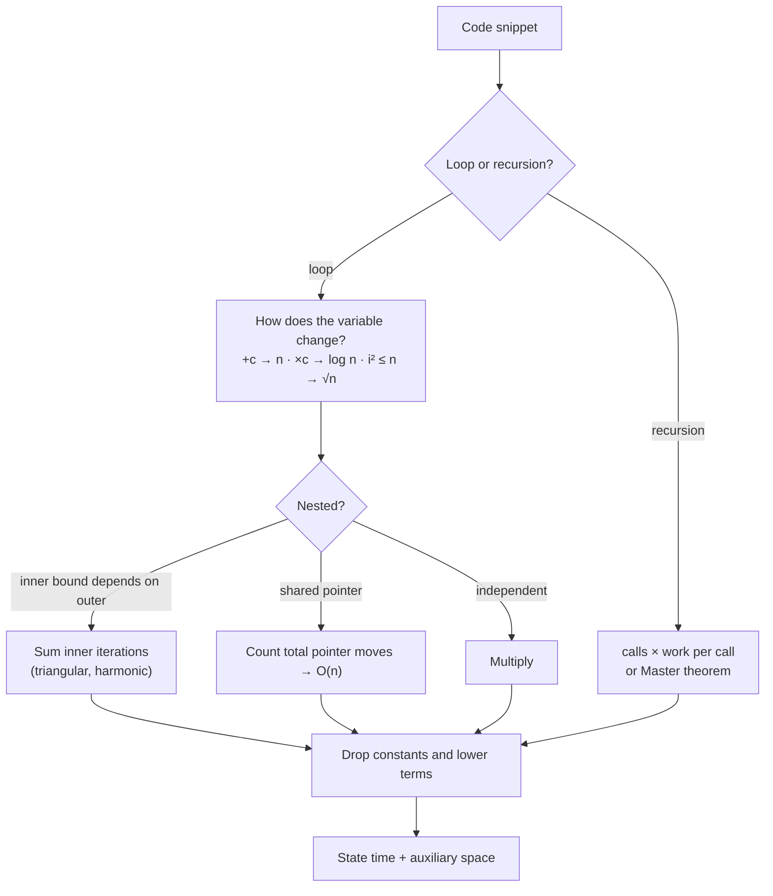

# Part 5: Time Complexity

← [Striver course map](../README.md)

> [!abstract] What this part covers
> **Goal:** Analyse any loop, recursion or data-structure operation in Big-O, state time **and** space, and turn a problem's constraints into a target complexity before writing code.
> **Prereqs:** [Part 4](../04-patterns/README.md) (nested loops). **Time:** ~1.5 h.
> **Outcome:** You can look at n ≤ 10⁵ and immediately rule out O(n²), and you can justify why a two-pointer loop with a nested `while` is still O(n).

---

## Lessons

| # | Lesson | Core idea in one line | Source |
|---|---|---|---|
| 1 | [Theory with Examples](01-theory-with-examples.md) | Count steps, keep the dominant term; loops, recursion, amortised, space, constraints | [link](https://takeuforward.org/learning/dsa/theory-with-examples?category=time-complexity&source=strivers-a2z-dsa-sheet) |

---

## How to analyse any snippet

---

## Part 5 cheat sheet

| Pattern | Complexity |
|---|---|
| Single loop, step +c | O(n) |
| Loop ×2 or ÷2 | O(log n) |
| `i * i ≤ n` | O(√n) |
| Nested independent | O(n·m) |
| Triangular `j ≥ i` | O(n²) |
| Harmonic `j += i` | O(n log n) |
| Two pointers / sliding window | O(n) |
| T(n) = T(n/2) + 1 | O(log n) |
| T(n) = 2T(n/2) + n | O(n log n) |
| T(n) = 2T(n−1) + 1 | O(2ⁿ) |
| n ≤ 20 / 10³ / 10⁵ / 10¹⁸ | 2ⁿ / n² / n log n / log n |

---

## Mastery checklist

- [ ] Give the complexity of each row of the [loop catalogue](01-theory-with-examples.md#5-loop-catalogue) without looking
- [ ] Explain why a nested `while` with a non-resetting pointer is O(n)
- [ ] Solve T(n) = aT(n/b) + nᵈ with the Master theorem
- [ ] Explain amortised O(1) for dynamic array push
- [ ] Always state auxiliary space, including recursion depth
- [ ] Map a constraint (n ≤ 10, 20, 10³, 10⁵, 10⁹) to a target complexity

**Interview track →** [L3 Cheatsheet](../../00-L3-EXECUTION-META/L3_CHEATSHEET.md) · [Interview Judgment](../../03-patterns/INTERVIEW_JUDGMENT.md)

Next part → [Standard Libraries & Collections](../06-standard-libraries-and-collections/README.md)
