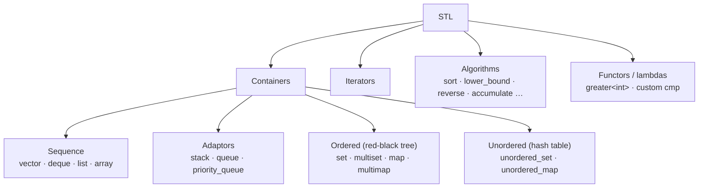
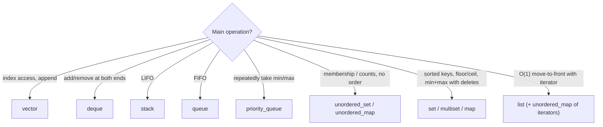

# 1. C++ STL

← [Part 6 index](README.md) · Next → [Java Collections](02-java-collections.md)

> [!abstract] What this covers
> **Core idea:** The STL has four parts: **containers** (where data lives), **iterators** (how you walk it), **algorithms** (`sort`, `lower_bound`, … that work on any iterator range), and **functors/lambdas** (custom comparisons). Pick the container from the operation you need most and its complexity, not from habit.
> **You'll be able to:** choose between `vector`, `deque`, `list`, `set`, `map`, `unordered_map`, `priority_queue`, `stack` and `queue`; know every operation's cost; write custom comparators; and use the 15 algorithms that appear in nearly every DSA solution.
> **Source:** [takeuforward lesson](https://takeuforward.org/learning/dsa/stl?category=standard-libraries-and-collections&source=strivers-a2z-dsa-sheet) · **Time:** 2 h

**Sections:** [1. Map of the STL](#1-map-of-the-stl) · [2. pair & tuple](#2-pair-and-tuple) · [3. vector](#3-vector) · [4. deque & list](#4-deque-and-list) · [5. Adaptors](#5-adaptors-stack-queue-priority_queue) · [6. Ordered containers](#6-ordered-containers-set-multiset-map) · [7. Unordered containers](#7-unordered-containers) · [8. Iterators](#8-iterators) · [9. Algorithms](#9-algorithms) · [10. Comparators](#10-custom-comparators) · [11. Choosing](#11-choosing-a-container) · [Common mistakes](#common-mistakes) · [Practice](#practice) · [Flashcards](#flashcards)

---

## 1. Map of the STL



Headers: `<vector> <deque> <list> <stack> <queue> <set> <map> <unordered_set> <unordered_map> <algorithm> <numeric> <utility>`. (`bits/stdc++.h` includes everything on GCC but **not** on macOS clang — know the real headers.)

---

## 2. pair and tuple

```cpp
pair<int, string> p = {1, "a"};
p.first; p.second;
auto [id, name] = p;                       // C++17 structured binding

pair<int, pair<int, int>> nested = {1, {2, 3}};
nested.second.first;                       // 2

tuple<int, int, int> t = {1, 2, 3};
get<0>(t);
auto [a, b, c] = t;
```

Pairs compare **lexicographically**: first by `.first`, ties by `.second`. That's why `sort(vector<pair<…>>)` and `priority_queue<pair<int,int>>` "just work" for (distance, node), (value, index) and so on.

---

## 3. vector

A dynamic array: contiguous memory, amortised O(1) push at the back.

```cpp
vector<int> v;                   // empty
vector<int> v(5);                // {0,0,0,0,0}
vector<int> v(5, 7);             // {7,7,7,7,7}
vector<int> v = {3, 1, 2};
vector<vector<int>> g(n, vector<int>(m, 0));   // n × m grid

v.push_back(4);   v.emplace_back(4);     // emplace constructs in place
v.pop_back();
v.size(); v.empty(); v.back(); v.front(); v[i]; v.at(i);   // at() bounds-checks
v.insert(v.begin() + 1, 9);              // O(n)
v.erase(v.begin() + 1);                  // O(n)
v.erase(v.begin() + l, v.begin() + r);   // erase [l, r)
v.clear();                               // size 0, capacity kept
v.resize(10); v.reserve(1000);
```

| Operation | Cost |
|---|---|
| `v[i]`, `back`, `push_back`, `pop_back` | O(1) (push amortised) |
| `insert`/`erase` in the middle or front | O(n) |
| Search (unsorted) | O(n) |
| Copy (`auto w = v;`, pass by value) | O(n) |

> [!warning] Pass by reference
> `void f(vector<int> v)` copies the whole vector on every call. In recursion that's an O(n) hidden cost per call. Use `const vector<int>& v` (read-only) or `vector<int>& v` (modify).

---

## 4. deque and list

| | `deque<int>` | `list<int>` |
|---|---|---|
| Structure | Chunks of arrays | Doubly linked list |
| `push_front` / `pop_front` | O(1) | O(1) |
| `push_back` / `pop_back` | O(1) | O(1) |
| Random access `d[i]` | O(1) | ❌ |
| Insert in middle (with iterator) | O(n) | O(1) |
| Use for | sliding-window max, 0-1 BFS | LRU cache (with `unordered_map<key, iterator>`) |

```cpp
deque<int> d; d.push_front(1); d.push_back(2); d.front(); d.back(); d.pop_front();
list<int> l;  l.push_front(1); l.push_back(2); l.splice(l.begin(), l, it);   // O(1) move to front
```

---

## 5. Adaptors: stack, queue, priority_queue

Adaptors wrap a sequence container and expose a restricted interface. **No iteration, no indexing.**

```cpp
stack<int> st;  st.push(1); st.top(); st.pop(); st.size(); st.empty();
queue<int> q;   q.push(1);  q.front(); q.back(); q.pop();

priority_queue<int> maxh;                              // max-heap (default)
priority_queue<int, vector<int>, greater<int>> minh;   // min-heap
maxh.push(5); maxh.top(); maxh.pop();

priority_queue<pair<int,int>, vector<pair<int,int>>, greater<>> pq;   // Dijkstra: (dist, node)
```

| Operation | stack / queue | priority_queue |
|---|---|---|
| push | O(1) | O(log n) |
| pop | O(1) | O(log n) |
| top / front | O(1) | O(1) |
| Build from n items | — | O(n) via constructor `priority_queue<int> pq(v.begin(), v.end())` |

> [!warning] `pop()` returns void
> Read `top()` / `front()` first, then `pop()`. Calling `top()` on an empty stack or heap is undefined behaviour — check `empty()`.

---

## 6. Ordered containers: set, multiset, map

Balanced BST (red-black tree). Keys are kept **sorted**; every operation is O(log n).

```cpp
set<int> s = {5, 1, 3};          // {1, 3, 5}, unique
s.insert(2); s.erase(3); s.count(5); s.find(5) != s.end();
*s.begin();  *s.rbegin();        // min, max
s.lower_bound(x);                // first element >= x
s.upper_bound(x);                // first element >  x

multiset<int> ms = {1, 1, 2};
ms.erase(1);                     // ⚠️ removes ALL 1s
ms.erase(ms.find(1));            // removes ONE 1

map<string, int> m;
m["a"]++;                        // inserts "a" → 0 if absent, then increments
m.count("b");                    // 0/1, does NOT insert
for (auto& [k, val] : m) {}      // iterates in sorted key order
```

| Operation | set / map | multiset |
|---|---|---|
| insert, erase(key), find, count | O(log n) | O(log n) (`count` is O(log n + k)) |
| min / max | O(1) via `begin`/`rbegin` | O(1) |
| lower_bound / upper_bound | O(log n) | O(log n) |
| In-order iteration | O(n) | O(n) |

> [!tip] When to reach for `set`/`map` over hashing
> When you need **order**: smallest/largest, "next greater key", range queries, a sliding window that must report its min and max (`multiset`). Otherwise `unordered_*` is faster.

---

## 7. Unordered containers

Hash tables. **Average** O(1) for insert/find/erase, **worst** O(n) on collisions. No ordering.

```cpp
unordered_map<int, int> freq;
for (int x : a) freq[x]++;
if (freq.count(k)) {}
unordered_set<int> seen;
seen.insert(x); seen.contains(x);   // contains() is C++20; use count() before that
```

| | `map` | `unordered_map` |
|---|---|---|
| Structure | red-black tree | hash table |
| find/insert | O(log n) | O(1) avg, O(n) worst |
| Ordered iteration | ✅ | ❌ |
| Key requirement | `<` defined | `std::hash` defined (no `pair` key by default) |

`unordered_map<pair<int,int>, int>` doesn't compile without a custom hash. Use `map<pair<int,int>, int>`, or encode the pair as a single `long long` key (`r * cols + c`).

---

## 8. Iterators

An iterator is a generalised pointer into a container.

```cpp
for (auto it = v.begin(); it != v.end(); ++it) cout << *it;   // end() is ONE PAST the last
for (auto it = v.rbegin(); it != v.rend(); ++it) {}          // reverse
for (int x : v) {}                                           // range-for (copy)
for (int& x : v) x *= 2;                                     // range-for (modify)
int idx = it - v.begin();                                    // iterator → index (random-access only)
auto nxt = next(it), prv = prev(it);
```

| Category | Containers | Supports |
|---|---|---|
| Random access | vector, deque, array | `it + k`, `it2 − it1`, `<` |
| Bidirectional | list, set, map | `++`, `--` only |
| Forward | unordered_* | `++` only |

> [!warning] Iterator invalidation
> `push_back` may reallocate a vector and invalidate **all** iterators/references. `erase` invalidates the erased iterator. Inside a loop: `it = m.erase(it);` not `m.erase(it); ++it;`.

---

## 9. Algorithms

All take a half-open range `[first, last)`.

| Algorithm | What | Cost |
|---|---|---|
| `sort(v.begin(), v.end())` | ascending | O(n log n) |
| `sort(v.rbegin(), v.rend())` / `sort(…, greater<int>())` | descending | O(n log n) |
| `stable_sort` | keeps equal elements' order | O(n log n) |
| `reverse(b, e)` | reverse in place | O(n) |
| `*max_element(b, e)` / `*min_element` | value; drop `*` for the iterator | O(n) |
| `accumulate(b, e, 0LL)` (`<numeric>`) | sum — **use `0LL` for long long** | O(n) |
| `count(b, e, x)` | occurrences of x | O(n) |
| `find(b, e, x)` | iterator to first x or `e` | O(n) |
| `binary_search(b, e, x)` | bool, sorted range | O(log n) |
| `lower_bound(b, e, x)` | first ≥ x | O(log n) |
| `upper_bound(b, e, x)` | first > x | O(log n) |
| `next_permutation(b, e)` | next lexicographic order; false after the last | O(n) |
| `unique(b, e)` | moves duplicates of **adjacent** equals to the end; returns new end | O(n) |
| `fill(b, e, val)` / `iota(b, e, start)` | fill / 0, 1, 2 … | O(n) |
| `__builtin_popcount(x)` / `__builtin_popcountll` | count set bits (GCC/clang) | O(1) |
| `swap(a, b)`, `max({a, b, c})`, `min` | — | O(1) |

```cpp
// Count of x in a sorted vector, O(log n):
int cnt = upper_bound(v.begin(), v.end(), x) - lower_bound(v.begin(), v.end(), x);

// Deduplicate:
sort(v.begin(), v.end());
v.erase(unique(v.begin(), v.end()), v.end());

// All permutations in order:
sort(s.begin(), s.end());
do { cout << s << '\n'; } while (next_permutation(s.begin(), s.end()));
```

---

## 10. Custom comparators

A comparator `cmp(a, b)` returns **true if a should come before b**. It must be a strict weak ordering: `cmp(a, a)` must be false (never `<=`).

```cpp
// Sort by second ascending, ties by first descending
sort(v.begin(), v.end(), [](const pair<int,int>& a, const pair<int,int>& b) {
    if (a.second != b.second) return a.second < b.second;
    return a.first > b.first;
});

// priority_queue: comparator is "lower priority" — the REVERSE of what you'd expect
auto cmp = [](const pair<int,int>& a, const pair<int,int>& b) { return a.second > b.second; };
priority_queue<pair<int,int>, vector<pair<int,int>>, decltype(cmp)> pq(cmp);   // min by .second

// set with a custom order
struct ByLen { bool operator()(const string& a, const string& b) const {
    return a.size() != b.size() ? a.size() < b.size() : a < b; } };
set<string, ByLen> s;
```

> [!warning] Heap comparator is inverted
> `sort` with `a < b` → ascending. `priority_queue` with `a < b` → **max**-heap (largest on top). To get a min-heap, use `>` / `greater<>`.

---

## 11. Choosing a container



---

## Common mistakes

1. `m[key]` on a lookup inserts a default value — use `count`/`find` to check existence.
2. `multiset::erase(value)` removes all copies.
3. `accumulate(v.begin(), v.end(), 0)` overflows for large sums: the accumulator type is `int`.
4. Comparators with `<=` → undefined behaviour / crashes in `sort`.
5. `v.size() - 1` when `v` is empty: `size()` is unsigned, so it wraps to a huge number. Cast: `(int)v.size() - 1`.
6. Passing containers by value in recursive functions.
7. `unique` without sorting first only removes adjacent duplicates.
8. Calling `top()`/`front()`/`back()` on an empty container.

---

## Practice

1. Given a vector of (name, score), sort by score descending, ties by name ascending.
2. Keep the k largest elements from a stream using a heap. Which heap and why?
3. Count elements in a sorted vector in the range [l, r] in O(log n).
4. You need the min and max of a sliding window with deletions. Which container?
5. Why does `for (int i = 0; i < v.size() - 1; i++)` crash on an empty vector?

<details><summary>Answer sketches</summary>

**#1:** lambda: `a.second != b.second ? a.second > b.second : a.first < b.first`.

**#2:** a **min**-heap of size k; if the new element beats `top()`, pop and push. The top is the k-th largest. O(n log k).

**#3:** `upper_bound(…, r) − lower_bound(…, l)`.

**#4:** `multiset<int>`: `*begin()`, `*rbegin()`, `erase(find(x))` — all O(log n). (A monotonic deque is O(1) amortised but needs two deques for min and max.)

**#5:** `v.size() − 1` is `size_t`; for an empty vector it becomes 2⁶⁴ − 1, so the loop runs and reads out of bounds.
</details>

---

## Key terms

| Term | Meaning |
|---|---|
| Container | Object that stores elements (vector, map …) |
| Adaptor | Restricted interface on top of a container (stack, queue, priority_queue) |
| Iterator | Generalised pointer; `end()` is one past the last element |
| Half-open range | `[first, last)` — includes first, excludes last |
| Strict weak ordering | Comparator rule: irreflexive, transitive; never use `<=` |
| Amortised O(1) | `push_back` is O(1) averaged over many pushes despite occasional reallocation |

---

## Flashcards

**Default `priority_queue<int>` — min or max?** #flashcard
Max-heap. Min-heap: `priority_queue<int, vector<int>, greater<int>>`.

**`set` vs `unordered_set` complexity?** #flashcard
`set`: O(log n), sorted. `unordered_set`: O(1) average, O(n) worst, unordered.

**What do `lower_bound` and `upper_bound` return?** #flashcard
Iterator to the first element ≥ x and > x respectively (sorted range, O(log n)).

**How do you erase a single copy from a multiset?** #flashcard
`ms.erase(ms.find(x))` — `ms.erase(x)` removes all copies.

**Why does `m[key]` cause bugs on lookups?** #flashcard
It inserts the key with a default value if absent. Use `m.count(key)` or `m.find(key)`.

**How do you deduplicate a vector?** #flashcard
`sort`, then `v.erase(unique(v.begin(), v.end()), v.end())`.

**What must a comparator never do?** #flashcard
Return true for equal elements (no `<=`); it must be a strict weak ordering.

**Container for an LRU cache in C++?** #flashcard
`list<pair<key,val>>` + `unordered_map<key, list::iterator>`; `splice` moves to front in O(1).

**Interview track →** [L3 Cheatsheet](../../00-L3-EXECUTION-META/L3_CHEATSHEET.md) · [Hashing deep-dive](../../01-data-structures/02-hashing.md) · [Heap deep-dive](../../01-data-structures/10-heap.md)
