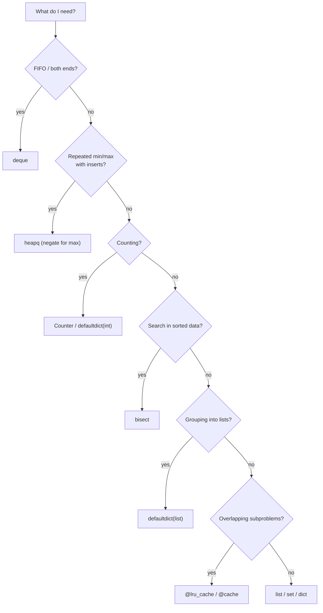

# 4. Python Libraries: Part 2 (Standard Library)

← [Python Libraries Part 1](03-python-libraries-part-1.md) · [Part 6 index](README.md) · Next → [Part 7: Concept Basics](../07-concept-basics/README.md)

> [!abstract] What this covers
> **Core idea:** Python has no built-in queue, heap, ordered map or binary search — they live in the standard library. `collections`, `heapq`, `bisect`, `itertools`, `functools` and `math` fill those gaps and are fair game in every interview.
> **You'll be able to:** pick the right module for a queue, frequency map, heap, sorted-array search, memoisation or combinatorics; know each one's costs and traps; and map them to their C++/Java equivalents.
> **Source:** [takeuforward lesson](https://takeuforward.org/learning/dsa/python-libraries-part-2?category=standard-libraries-and-collections&source=strivers-a2z-dsa-sheet) · **Time:** 90 min

**Sections:** [1. Map of modules](#1-map-of-modules) · [2. collections.deque](#2-collectionsdeque) · [3. Counter](#3-counter) · [4. defaultdict & OrderedDict](#4-defaultdict-and-ordereddict) · [5. heapq](#5-heapq) · [6. bisect](#6-bisect) · [7. functools](#7-functools) · [8. itertools](#8-itertools) · [9. math](#9-math) · [10. sys & fast I/O](#10-sys-and-fast-io) · [11. Ordered map gap](#11-the-ordered-map-gap) · [12. Choosing](#12-choosing-a-structure) · [Common mistakes](#common-mistakes) · [Practice](#practice) · [Flashcards](#flashcards)

---

## 1. Map of modules

| Need | Python | C++ | Java |
|---|---|---|---|
| Queue / deque | `collections.deque` | `deque`, `queue` | `ArrayDeque` |
| Stack | `list` (`append`/`pop`) | `stack` | `ArrayDeque` |
| Frequency map | `collections.Counter` | `unordered_map<T,int>` | `HashMap.merge` |
| Map with default | `collections.defaultdict` | `map[k]` auto-inserts | `computeIfAbsent` |
| Min-heap | `heapq` on a list | `priority_queue` + `greater<>` | `PriorityQueue` |
| Binary search on sorted list | `bisect` | `lower_bound` / `upper_bound` | `Collections.binarySearch` |
| Memoisation | `functools.lru_cache` / `cache` | manual array/map | manual |
| Custom comparator | `functools.cmp_to_key` | comparator lambda | `Comparator` |
| Permutations / combinations | `itertools` | `next_permutation` | manual |
| Ordered map / set | ❌ (`sortedcontainers` is third-party) | `map`, `set` | `TreeMap`, `TreeSet` |

---

## 2. collections.deque

Doubly-ended queue: O(1) at both ends.

```python
from collections import deque
q = deque([start])
q.append(x); q.appendleft(x)
q.pop(); q.popleft()
q[0]; q[-1]; len(q)
q.rotate(k)                     # right by k (negative = left)
window = deque(maxlen=k)        # oldest drops automatically
```

| Operation | Cost |
|---|---|
| `append`, `appendleft`, `pop`, `popleft` | O(1) |
| `q[0]`, `q[-1]` | O(1) |
| `q[i]` in the middle | **O(n)** |

BFS template:

```python
q = deque([src]); seen = {src}
while q:
    u = q.popleft()
    for v in adj[u]:
        if v not in seen:
            seen.add(v); q.append(v)
```

Monotonic deque (sliding-window max) stores **indices**, pops expired ones from the left and smaller values from the right — see [Sliding Window](../../02-algorithms/04-sliding-window.md).

---

## 3. Counter

A `dict` subclass for counting hashables.

```python
from collections import Counter
c = Counter("banana")           # {'a': 3, 'n': 2, 'b': 1}
c['z']                          # 0 — missing keys read as 0 (and are NOT inserted)
c[x] += 1
c.most_common(2)                # [('a', 3), ('n', 2)]  — O(n log k)
Counter(s) == Counter(t)        # anagram check, O(n)
c1 + c2; c1 - c2                # add / subtract, drops counts ≤ 0
c1 & c2; c1 | c2                # min / max of counts
c.total()                       # sum of counts (3.10+)
```

> [!warning] Zero counts stay in a Counter
> After `c[x] -= 1` hits 0, the key remains, so `len(c)` counts it. In "number of distinct in window" problems, `del c[x]` when it reaches 0.

---

## 4. defaultdict and OrderedDict

```python
from collections import defaultdict, OrderedDict
adj = defaultdict(list)
for u, v in edges:
    adj[u].append(v); adj[v].append(u)

groups = defaultdict(list)
for w in words:
    groups[tuple(sorted(w))].append(w)      # group anagrams

cnt = defaultdict(int)                      # cnt[x] += 1 works directly
```

> [!danger] Reading a missing key inserts it
> `if adj[x]:` on a `defaultdict` creates `adj[x] = []`. Iterating while doing that raises RuntimeError, and counting `len(adj)` gives wrong results. Use `x in adj` or `adj.get(x, [])` for read-only checks.

**OrderedDict** keeps insertion order (plain dicts do too since 3.7) but adds `move_to_end(k, last=True)` and `popitem(last=False)` in O(1) — exactly what an **LRU cache** needs:

```python
class LRUCache:
    def __init__(self, cap): self.cap, self.d = cap, OrderedDict()
    def get(self, k):
        if k not in self.d: return -1
        self.d.move_to_end(k); return self.d[k]
    def put(self, k, v):
        self.d[k] = v; self.d.move_to_end(k)
        if len(self.d) > self.cap: self.d.popitem(last=False)
```

In an interview, expect to be asked to build it from a hashmap + doubly-linked list as well.

---

## 5. heapq

Functions that treat a plain `list` as a **binary min-heap** (`h[0]` is the smallest).

```python
import heapq
h = []
heapq.heappush(h, x)
heapq.heappop(h)              # smallest
h[0]                          # peek
heapq.heapify(a)              # in place, O(n)
heapq.heappushpop(h, x)       # push then pop, faster than both
heapq.heapreplace(h, x)       # pop then push
heapq.nlargest(k, a); heapq.nsmallest(k, a, key=…)
```

| Operation | Cost |
|---|---|
| `heappush`, `heappop` | O(log n) |
| `h[0]` | O(1) |
| `heapify` | **O(n)** |
| `nlargest(k, a)` | O(n log k) |

**Max-heap:** push `-x`, pop and negate. (For non-numbers, wrap in a class with a reversed `__lt__`.)

**Tuples order lexicographically**, so `(dist, node)` gives Dijkstra ordering. Add a tie-breaker when the payload isn't comparable:

```python
heapq.heappush(h, (dist, counter, node))      # counter = itertools.count() value
```

**Top-k largest pattern:** keep a min-heap of size k; if `x > h[0]`, `heapreplace`. Result: O(n log k) time, O(k) space.

> [!warning] No decrease-key
> heapq can't update a priority. Push a new entry and skip stale ones on pop: `if d > dist[u]: continue` (lazy deletion).

---

## 6. bisect

Binary search on a **sorted** list.

```python
import bisect
bisect.bisect_left(a, x)      # first index with a[i] >= x   (C++ lower_bound)
bisect.bisect_right(a, x)     # first index with a[i] >  x   (C++ upper_bound)
bisect.insort(a, x)           # insert keeping order: O(log n) search + O(n) shift
bisect.bisect_left(a, x, lo, hi)
bisect.bisect_left(a, x, key=f)   # 3.10+
```

| Question | Expression |
|---|---|
| Is x present? | `i = bisect_left(a, x); i < len(a) and a[i] == x` |
| Count of x | `bisect_right(a, x) - bisect_left(a, x)` |
| Count of elements < x | `bisect_left(a, x)` |
| Count of elements ≤ x | `bisect_right(a, x)` |
| Largest element < x | `a[bisect_left(a, x) - 1]` if the index ≥ 0 |
| Smallest element > x | `a[bisect_right(a, x)]` if the index < len |

Classic use: **LIS in O(n log n)** — keep `tails`; for each x, `tails[bisect_left(tails, x)] = x` (or append).

> [!tip] Know how to write it by hand
> Interviewers often want binary search coded manually. `bisect` is fine as a sub-step once you've shown you can — see [Part 16: Binary Search](../16-binary-search/README.md).

---

## 7. functools

```python
from functools import lru_cache, cache, cmp_to_key, reduce

@lru_cache(maxsize=None)        # or @cache (3.9+)
def dp(i, j):
    if i == n or j == m: return 0
    return max(dp(i + 1, j), dp(i, j + 1))
dp.cache_clear()                # between test cases

def cmp(a, b):                  # negative: a first; positive: b first
    return -1 if a + b > b + a else (1 if a + b < b + a else 0)
nums_s.sort(key=cmp_to_key(cmp))          # "largest number" problem

reduce(lambda x, y: x * y, a, 1)          # product
```

| Trap | Why | Fix |
|---|---|---|
| Arguments must be hashable | lists can't be cached | pass tuples or indices |
| Recursion depth | `lru_cache` adds frames; depth ≈ n | `sys.setrecursionlimit`, or bottom-up DP |
| Memory | caches every state forever | fine for interview sizes; `cache_clear()` |
| Nested function caching | redefined per call → fresh cache | intended in LeetCode methods; good |

---

## 8. itertools

```python
from itertools import permutations, combinations, product, accumulate, groupby, count, chain, combinations_with_replacement
list(permutations([1, 2, 3]))         # 6 tuples, lexicographic if input sorted
list(combinations([1, 2, 3], 2))      # (1,2) (1,3) (2,3)
list(product([0, 1], repeat=3))       # all 8 bit-tuples
list(accumulate([1, 2, 3, 4]))        # [1, 3, 6, 10]  — prefix sums
list(accumulate(a, max))              # running max
[(k, len(list(g))) for k, g in groupby("aaabcc")]   # run-length: [('a',3),('b',1),('c',2)]
chain.from_iterable(lists)            # flatten one level
```

| Function | Count produced |
|---|---|
| `permutations(n)` | n! |
| `combinations(n, k)` | C(n, k) |
| `product(…, repeat=k)` over m items | mᵏ |

> [!warning] Interviewers want the recursion
> `permutations` solves "Permutations" in one line — and tells the interviewer nothing. Use itertools for brute-force checkers or sub-steps; write backtracking yourself for the asked problem ([Part 18](../18-recursion/README.md)).

`groupby` groups only **consecutive** equal keys — sort first if you want global groups.

---

## 9. math

```python
import math
math.gcd(a, b); math.lcm(a, b)        # lcm 3.9+; gcd accepts many args 3.9+
math.isqrt(n)                         # exact integer √n — use instead of int(math.sqrt(n))
math.comb(n, k); math.perm(n, k); math.factorial(n)
math.inf; -math.inf
math.ceil(x); math.floor(x); math.log2(x); math.log10(x)
pow(b, e, m)                          # built-in modular power
pow(a, -1, m)                         # modular inverse, m prime or coprime (3.8+)
(a + b - 1) // b                      # integer ceil, no floats
```

> [!danger] Floats lie for big integers
> `int(math.sqrt(10**18 - 1))` can be off by one; `math.isqrt` is exact. Similarly `math.ceil(a / b)` loses precision for large a — use `-(-a // b)` or `(a + b - 1) // b`.

---

## 10. sys and fast I/O

```python
import sys
sys.setrecursionlimit(10**6)          # deep DFS/memo; may still segfault on the C stack
input = sys.stdin.readline            # fast line reads; strip the '\n' for strings
data = sys.stdin.buffer.read().split()   # read everything at once — fastest
sys.stdout.write("\n".join(map(str, out)) + "\n")
```

For very deep recursion, run the solver in a thread with a larger stack (`threading.stack_size(1 << 27)`) or convert to an explicit stack.

---

## 11. The ordered-map gap

Python's standard library has **no balanced BST** (no `TreeMap` / `std::map`). Options when you need floor/ceiling with inserts and deletes:

| Need | Workaround |
|---|---|
| Static sorted data, many queries | sort once + `bisect` |
| Inserts + min/max only | `heapq` (with lazy deletion) |
| Inserts + floor/ceil, small n | `bisect.insort` (O(n) insert, fast in practice to ~10⁵) |
| Full ordered map | `sortedcontainers.SortedList` / `SortedDict` (on LeetCode, not stdlib) |
| Prefix counts over a value range | Fenwick tree / coordinate compression |

Say the trade-off out loud: "In C++ I'd use a `std::set`; in Python I'll use a heap with lazy deletion, which keeps it O(log n)."

---

## 12. Choosing a structure



---

## Common mistakes

1. `list.pop(0)` instead of `deque.popleft()`.
2. Expecting `heapq` to be a max-heap.
3. Pushing `(priority, obj)` where equal priorities compare uncomparable objects → `TypeError`.
4. Reading `defaultdict[k]` to test existence (inserts the key).
5. Leaving zero counts in a `Counter` and using `len()`.
6. `lru_cache` on a function taking a list.
7. Using `bisect` on an unsorted list.
8. `int(math.sqrt(n))` for big n.
9. Using `itertools.permutations` when the interviewer asked you to generate permutations.

---

## Practice

1. Top-k frequent elements in O(n log k).
2. Kth largest in a stream: design `add(x)` returning the current kth largest.
3. Count elements in a sorted array within `[lo, hi]`.
4. Group anagrams.
5. Number of distinct elements in every window of size k.
6. Why does `heapq.heappush(h, (3, node_a)); heapq.heappush(h, (3, node_b))` crash for `ListNode`s, and how do you fix it?

<details><summary>Answer sketches</summary>

**#1:** `c = Counter(a)`; `heapq.nlargest(k, c, key=c.get)` — O(n log k). Bucket sort by frequency gives O(n).

**#2:** keep a min-heap of size k; push x, pop if size > k; answer `h[0]`. O(log k) per add.

**#3:** `bisect_right(a, hi) - bisect_left(a, lo)`.

**#4:** `defaultdict(list)` keyed by `tuple(sorted(w))` or a 26-count tuple.

**#5:** sliding window with a Counter; on leaving, decrement and `del` at 0; answer `len(c)` per window. O(n).

**#6:** equal priorities make Python compare the second items; `ListNode` has no `<`. Use `(val, i, node)` with a unique index i.
</details>

---

## Key terms

| Term | Meaning |
|---|---|
| deque | Double-ended queue, O(1) at both ends |
| Counter | dict subclass counting hashables; missing keys read as 0 |
| defaultdict | dict that builds a default value for missing keys on access |
| heapq | min-heap functions over a plain list |
| bisect_left / right | First index ≥ x / > x in a sorted list |
| lru_cache | Decorator memoising a function by its (hashable) arguments |
| Lazy deletion | Leave outdated heap entries; skip them when popped |

---

## Flashcards

**How do you get a max-heap with heapq?** #flashcard
Push negated values (`-x`) and negate on pop.

**Cost of `heapify` vs n pushes?** #flashcard
O(n) vs O(n log n).

**`bisect_left` vs `bisect_right`?** #flashcard
First index with a[i] ≥ x vs first with a[i] > x (C++ lower_bound vs upper_bound).

**Count of x in a sorted list?** #flashcard
`bisect_right(a, x) - bisect_left(a, x)`.

**What does reading a missing key on a defaultdict do?** #flashcard
Inserts it with the default value.

**What can't lru_cache memoise?** #flashcard
Calls with unhashable arguments such as lists or dicts — pass tuples or indices.

**How does heapq handle priority updates?** #flashcard
It doesn't; push a new entry and skip stale ones on pop (lazy deletion).

**Python's replacement for TreeMap?** #flashcard
None in stdlib. Use sort + bisect, heapq with lazy deletion, or `sortedcontainers` where allowed.

**Interview track →** [L3 Cheatsheet](../../00-L3-EXECUTION-META/L3_CHEATSHEET.md) · [Hashing deep-dive](../../01-data-structures/02-hashing.md) · [Heap deep-dive](../../01-data-structures/10-heap.md)
