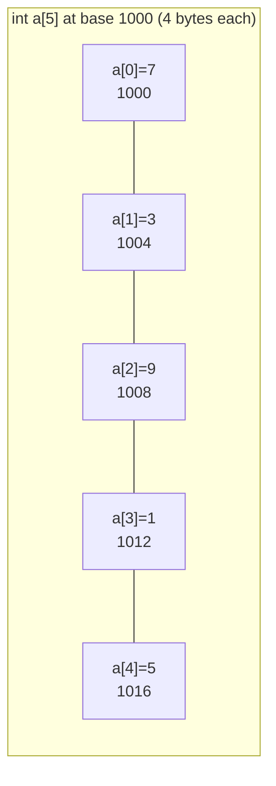
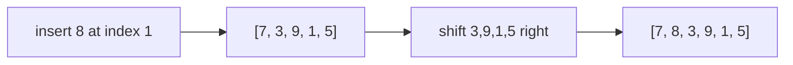

# 2. Basic Arrays

← [Basic Maths](01-basic-maths.md) · [Part 7 index](README.md) · Next → [Basic Hashing](03-basic-hashing.md)

> [!abstract] What this covers
> **Core idea:** An array is a **contiguous block** of same-sized elements, so element i lives at `base + i × size`. That one formula explains O(1) access, O(n) insert/delete in the middle, cache-friendliness and why arrays are 0-indexed.
> **You'll be able to:** declare and traverse arrays in C++/Java/Python, reason about static vs dynamic arrays, handle 2D arrays and row-major order, and recognise the core traversal patterns every array problem builds on.
> **Source:** [takeuforward lesson](https://takeuforward.org/learning/dsa/basic-arrays-hashing-and-strings?category=concept-basics&source=strivers-a2z-dsa-sheet) · **Time:** 45 min

**Sections:** [1. Memory model](#1-memory-model) · [2. Declaring](#2-declaring-arrays) · [3. Operation costs](#3-operation-costs) · [4. Static vs dynamic](#4-static-vs-dynamic) · [5. 2D arrays](#5-2d-arrays) · [6. Traversal patterns](#6-traversal-patterns) · [7. Passing arrays](#7-passing-arrays-to-functions) · [Common mistakes](#common-mistakes) · [Practice](#practice) · [Flashcards](#flashcards)

---

## 1. Memory model



**Address of a[i] = base + i × sizeof(element)** — one multiply and one add, regardless of n → **O(1) random access**.

- **0-indexing** falls out of the formula: a[0] is at offset 0.
- **Cache-friendly:** the CPU loads neighbours together, so sequential scans are much faster than pointer-chasing (linked lists).
- **Fixed element size:** all elements share one type (or are references, as in Python lists and Java `Object[]`).

---

## 2. Declaring arrays

| | C++ | Java | Python |
|---|---|---|---|
| Fixed, zeroed | `int a[n] = {0};` (prefer `vector`) | `int[] a = new int[n];` (auto 0) | `a = [0] * n` |
| Literal | `int a[] = {1, 2, 3};` | `int[] a = {1, 2, 3};` | `a = [1, 2, 3]` |
| Dynamic | `vector<int> a(n, 0);` | `ArrayList<Integer> a = new ArrayList<>();` | `list` is already dynamic |
| Length | `a.size()` / `sizeof(a)/sizeof(a[0])` | `a.length` / `list.size()` | `len(a)` |
| Default values | **garbage** for local raw arrays | 0 / false / null | whatever you fill |

> [!danger] Uninitialised C++ arrays
> A local `int a[100];` holds garbage. Global arrays are zero-initialised. `vector<int> a(n)` is always zeroed.

**Out-of-bounds:** C++ → undefined behaviour (silent wrong answers or crashes); Java → `ArrayIndexOutOfBoundsException`; Python → `IndexError` (but negative indices wrap around silently!).

---

## 3. Operation costs

| Operation | Cost | Why |
|---|---|---|
| Read/write `a[i]` | O(1) | address formula |
| Linear search | O(n) | may scan everything |
| Binary search (sorted) | O(log n) | halves each step |
| Insert/delete at end (dynamic) | O(1) amortised | no shifting |
| Insert/delete at index i | O(n − i) | shift the tail |
| Insert/delete at front | O(n) | shift everything |



---

## 4. Static vs dynamic

| | Static (`int a[n]`, `int[]`) | Dynamic (`vector`, `ArrayList`, `list`) |
|---|---|---|
| Size | fixed at creation | grows |
| Growth | — | when full, allocate ~2× and copy |
| push_back | — | O(1) amortised, occasional O(n) |
| Overhead | none | capacity slack |

Doubling makes appends amortised O(1): copying costs 1 + 2 + 4 + … + n < 2n total over n pushes (see [Part 5 §7](../05-time-complexity/01-theory-with-examples.md)).

---

## 5. 2D arrays

```cpp
vector<vector<int>> g(n, vector<int>(m, 0));   // C++
int[][] g = new int[n][m];                     // Java
g = [[0] * m for _ in range(n)]                # Python
```

**Row-major:** C/C++ store row 0, then row 1, … so `a[i][j]` sits at `base + (i·m + j)·size`. Iterate `i` outer, `j` inner for cache-friendly access.

**Flattening:** cell `(i, j)` ↔ index `k = i·m + j`; back: `i = k / m`, `j = k % m`. Used for binary search on a matrix and union-find on grids.

**4-neighbour moves:**

```cpp
int dr[] = {-1, 1, 0, 0}, dc[] = {0, 0, -1, 1};
for (int d = 0; d < 4; d++) {
    int r = i + dr[d], c = j + dc[d];
    if (r >= 0 && r < n && c >= 0 && c < m) { /* visit */ }
}
```

More in the [Matrix deep-dive](../../01-data-structures/04-matrix.md).

---

## 6. Traversal patterns

Every array problem in Parts 9 and 14 reuses a few loops:

| Pattern | Shape | Example |
|---|---|---|
| Accumulate | one pass, running value | sum, max, count odd |
| Compare neighbours | `a[i]` vs `a[i−1]` | is sorted, count changes |
| Two ends | `l = 0, r = n−1`, move inward | reverse, palindrome |
| Read/write pointer | `w` writes kept elements | remove duplicates, move zeros |
| Prefix | `p[i] = p[i−1] + a[i]` | range sums in O(1) |
| Frequency | hash/count array | duplicates, majority |
| Nested pairs | `i < j` | brute-force pairs, O(n²) |

```cpp
// accumulate: largest element
int best = a[0];
for (int i = 1; i < n; i++) best = max(best, a[i]);

// two ends: reverse in place
for (int l = 0, r = n - 1; l < r; l++, r--) swap(a[l], a[r]);
```

> [!tip] Initialise "best" from the data
> Starting `max = 0` breaks on all-negative arrays. Use `a[0]`, `INT_MIN`, or `-inf`.

---

## 7. Passing arrays to functions

| Language | What's passed | Mutation visible to caller? |
|---|---|---|
| C++ raw array | pointer to first element (size lost!) | yes |
| C++ `vector<int> v` | **full copy** — O(n) | no |
| C++ `vector<int>& v` | reference | yes |
| C++ `const vector<int>& v` | read-only reference | — |
| Java `int[] a` | reference (by value) | yes; reassigning `a` isn't |
| Python `list` | reference to the object | yes; rebinding isn't |

> [!warning] Copying in recursion
> Passing `vector<int>` by value in a recursive function copies it every call. Use `&` unless you intentionally need a copy.

---

## Common mistakes

1. Off-by-one: `i <= n` instead of `i < n`.
2. Initialising max/min to 0.
3. Uninitialised local arrays in C++.
4. Passing vectors by value in hot functions.
5. Modifying an array while iterating with a for-each (Java `ConcurrentModificationException` on lists).
6. Python negative indices hiding `-1` bugs.
7. Mixing up `n` (rows) and `m` (cols) in 2D bounds.

---

## Practice

1. Address of `a[7]` when base = 2000, ints of 4 bytes?
2. Second-largest element in one pass (distinct values).
3. Convert flat index 17 to (row, col) in a 4 × 6 matrix.
4. Why is inserting at the front of an array O(n) but at the front of a deque O(1)?
5. Write a loop counting how many times consecutive elements change direction (up→down or down→up).

<details><summary>Answer sketches</summary>

**#1:** 2000 + 7·4 = 2028.

**#2:** keep `first`, `second = -inf`; if `x > first`: `second = first; first = x`; elif `x > second`: `second = x`.

**#3:** row = 17 / 6 = 2, col = 17 % 6 = 5.

**#4:** an array must shift all n elements; a deque is a ring buffer (or blocks) with a movable start index.

**#5:** for i in 1..n−2: if `(a[i]−a[i−1]) * (a[i+1]−a[i]) < 0`, count++ (skip zero differences as needed).
</details>

---

## Key terms

| Term | Meaning |
|---|---|
| Contiguous | Elements stored back-to-back in memory |
| Random access | Reading any index in O(1) |
| Dynamic array | Array that resizes (typically doubling) |
| Row-major | 2D storage row by row |
| Amortised O(1) | Average cost over many operations, despite occasional expensive ones |

---

## Flashcards

**Why is array access O(1)?** #flashcard
Address = base + i × size — computed directly.

**Cost of inserting at index i?** #flashcard
O(n − i) — the tail shifts right.

**Why is push_back amortised O(1)?** #flashcard
Capacity doubles, so total copy cost over n pushes is < 2n.

**Flat index of (i, j) in an n × m grid?** #flashcard
i·m + j; back: i = k / m, j = k % m.

**Default value of a local C++ `int a[10]`?** #flashcard
Garbage (undefined). Globals and `vector` are zeroed.

**C++ vector parameter without `&`?** #flashcard
Copies the whole vector: O(n) per call.

**Interview track →** [L3 Cheatsheet](../../00-L3-EXECUTION-META/L3_CHEATSHEET.md) · [Array deep-dive](../../01-data-structures/01-array.md) · [Matrix deep-dive](../../01-data-structures/04-matrix.md)
