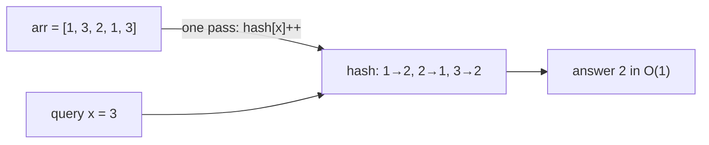
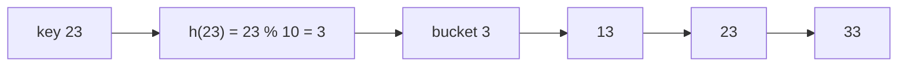
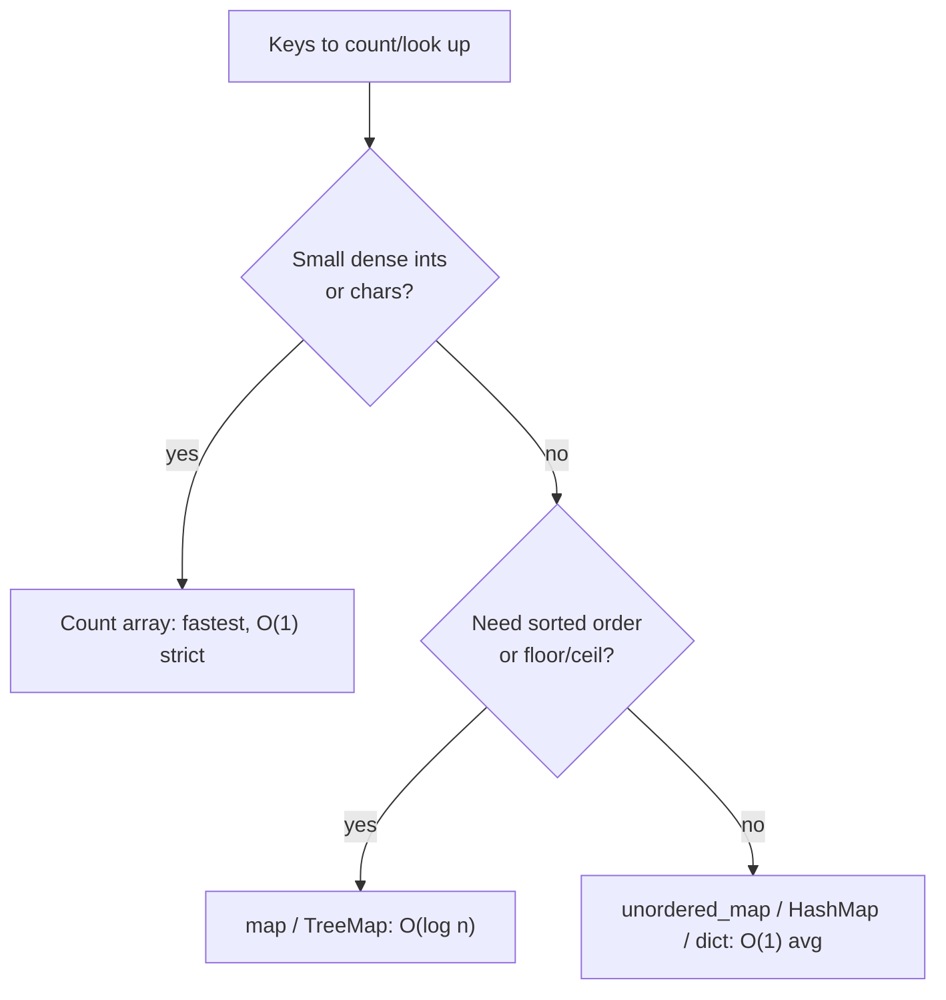

# 3. Basic Hashing

← [Basic Arrays](02-basic-arrays.md) · [Part 7 index](README.md) · Next → [Basic String](04-basic-string.md)

> [!abstract] What this covers
> **Core idea:** Hashing is **pre-computing** answers so each query is O(1). Count once into a table, then look up. Small dense keys → a plain **count array**; large or sparse keys → a **hash map**. A hash function maps each key to a bucket; collisions are resolved by chaining or probing.
> **You'll be able to:** turn O(n·q) "how many times does x appear" into O(n + q), choose array vs map vs ordered map, count characters with `c - 'a'`, explain how a hash table works and why its worst case is O(n).
> **Source:** [takeuforward lesson](https://takeuforward.org/learning/dsa/basic-hashing?category=concept-basics&source=strivers-a2z-dsa-sheet) · **Time:** 60 min

**Sections:** [1. Why hash](#1-why-hash) · [2. Count arrays](#2-count-arrays) · [3. Character hashing](#3-character-hashing) · [4. Hash maps](#4-hash-maps) · [5. How a hash table works](#5-how-a-hash-table-works) · [6. Choosing](#6-choosing-a-structure) · [7. Patterns](#7-hashing-patterns) · [Common mistakes](#common-mistakes) · [Practice](#practice) · [Flashcards](#flashcards)

---

## 1. Why hash

**Problem:** array of n numbers, q queries "how many times does x appear?"

| Approach | Per query | Total |
|---|---|---|
| Scan the array each query | O(n) | O(n · q) — 10¹⁰ for n = q = 10⁵ ❌ |
| Pre-compute counts once, then look up | O(1) | **O(n + q)** ✅ |



---

## 2. Count arrays

When keys are integers in a small range `[0, K]`, use an array indexed by the value.

```cpp
int hash[MAXV + 1] = {0};          // global, or vector<int>(MAXV + 1)
for (int x : arr) hash[x]++;       // pre-compute
while (q--) { cin >> x; cout << hash[x] << '\n'; }   // fetch
```

| Key range | Fits as an array? |
|---|---|
| ≤ 10⁶ ints locally in `main` | ⚠️ stack may overflow — declare **globally** or use `vector` |
| ≤ 10⁷ ints globally | ✅ (~40 MB) |
| ≤ 10⁸ bools globally | ✅ (`bitset`/`vector<bool>` ~12 MB) |
| up to 10⁹ or negative | ❌ → hash map (or offset/coordinate-compress) |

Negative values in a small range: shift by an offset, `hash[x + OFFSET]++`.

---

## 3. Character hashing

Characters are small integers (ASCII 0–255), so a 26- or 256-slot array is ideal.

```cpp
int cnt[26] = {0};
for (char c : s) cnt[c - 'a']++;       // 'a'→0 … 'z'→25 (lowercase only)

int all[256] = {0};
for (unsigned char c : s) all[c]++;    // any ASCII char
```

| Char | ASCII | `c - 'a'` |
|---|---|---|
| 'a' | 97 | 0 |
| 'b' | 98 | 1 |
| 'z' | 122 | 25 |
| 'A' | 65 | — (use `c - 'A'`) |
| '0' | 48 | `c - '0'` = digit value |

Uses: anagrams, first unique char, ransom note, permutation-in-string windows. O(n) time, **O(1)** space (fixed 26).

---

## 4. Hash maps

When keys are large, sparse, negative, strings or tuples:

| | C++ | Java | Python |
|---|---|---|---|
| Unordered map | `unordered_map<int,int> m; m[x]++;` | `m.merge(x, 1, Integer::sum);` | `d[x] = d.get(x, 0) + 1` / `Counter` |
| Ordered map | `map<int,int>` | `TreeMap` | — (sort keys) |
| Look-up | `m.count(x)` / `m.find(x)` | `m.containsKey(x)` / `getOrDefault` | `x in d` / `d.get(x, 0)` |
| Iterate | `for (auto& [k, v] : m)` | `for (var e : m.entrySet())` | `for k, v in d.items()` |

| | Unordered (hash) | Ordered (tree) |
|---|---|---|
| insert / find / erase | **O(1) avg**, O(n) worst | O(log n) always |
| Iteration order | arbitrary | sorted by key |
| Floor / ceil queries | ❌ | ✅ |
| Key requirement | hashable | comparable |

> [!warning] `m[x]` inserts in C++
> `if (m[x] > 0)` creates key x with value 0. Use `m.count(x)` or `m.find(x) != m.end()` for read-only checks.

---

## 5. How a hash table works



1. **Hash function** maps key → integer → bucket `h(k) % capacity`. Common toy: **division method** `k % size`; real libraries use stronger mixing.
2. **Collision:** two keys in one bucket.
   - **Chaining:** each bucket holds a list (C++ `unordered_map`, Java `HashMap` — which switches long chains to a red-black tree).
   - **Open addressing:** probe the next slots (Python `dict`).
3. **Load factor** α = n / buckets. When α exceeds ~0.75–1, the table **rehashes** to ~2× buckets: O(n) occasionally, amortised O(1).
4. **Worst case:** all keys in one bucket → O(n) per operation. Adversarial inputs can force this against `unordered_map`'s default hash (custom hash/salt defeats it in contests).

---

## 6. Choosing a structure



---

## 7. Hashing patterns

| Pattern | Idea | Example |
|---|---|---|
| Frequency count | count then query | highest/lowest frequency element |
| Seen set | `if x in seen` before inserting | contains duplicate, two-sum |
| Complement lookup | look for `target − x` | two sum in O(n) |
| Prefix-sum map | store prefix sums seen | subarray sum = k ([Part 15](../15-hashing/README.md)) |
| Signature key | canonical form as key | group anagrams (sorted string / count tuple) |
| Index map | value → last index | longest substring without repeats |

---

## Common mistakes

1. Huge local count arrays → stack overflow.
2. Count array with negative or > range values.
3. `m[x]` read-inserting in C++; `defaultdict` read-inserting in Python.
4. `c - 'a'` on uppercase/digits → negative index.
5. Assuming `unordered_map` iteration is sorted.
6. Claiming hash maps are O(1) worst case.

---

## Practice

1. arr = [5, 2, 5, 9, 2, 5]: build the frequency map; which element has the highest and lowest frequency?
2. Two strings: is t an anagram of s, in O(n) time, O(1) extra space?
3. Values up to 10⁹, n = 10⁵. Count array or map? Why?
4. Insert keys 15, 25, 35, 7 into a 10-bucket table with `k % 10` and chaining. Draw the buckets.
5. When would you pick `map` over `unordered_map` despite the log factor?

<details><summary>Answer sketches</summary>

**#1:** {5: 3, 2: 2, 9: 1} → highest 5, lowest 9.

**#2:** `cnt[26]`: ++ for s, −− for t; all zero ⇒ anagram (check lengths first).

**#3:** map — a 10⁹-slot array needs 4 GB.

**#4:** bucket 5: 15 → 25 → 35; bucket 7: 7.

**#5:** need sorted iteration, floor/ceiling, predictable worst case, or keys without a good hash (e.g. `pair` in C++ without a custom hasher).
</details>

---

## Key terms

| Term | Meaning |
|---|---|
| Pre-computation | Doing work once so queries are cheap |
| Hash function | Maps a key to a bucket index |
| Collision | Two keys hashing to the same bucket |
| Chaining | Bucket stores a list of entries |
| Open addressing | Probe other slots on collision |
| Load factor | Entries ÷ buckets; triggers rehash |
| Rehash | Grow the table and re-insert all entries |

---

## Flashcards

**When is a count array better than a hash map?** #flashcard
Small dense integer/char keys: strictly O(1), no hashing overhead.

**Index for a lowercase char c?** #flashcard
`c - 'a'` (0–25).

**Hash map average vs worst case?** #flashcard
O(1) average, O(n) worst (all keys collide).

**Two ways to resolve collisions?** #flashcard
Chaining (lists per bucket) and open addressing (probing).

**Why might a 10⁶-int array crash inside main?** #flashcard
Stack size limit; declare globally or use a heap-allocated vector.

**`unordered_map` vs `map` complexity?** #flashcard
O(1) avg vs O(log n) guaranteed (sorted).

**Interview track →** [L3 Cheatsheet](../../00-L3-EXECUTION-META/L3_CHEATSHEET.md) · [Hashing deep-dive](../../01-data-structures/02-hashing.md)
