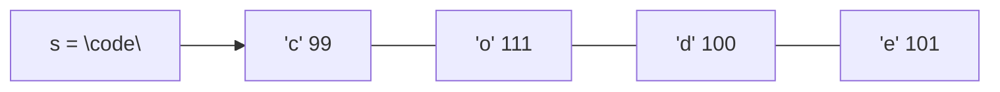

# 4. Basic String

← [Basic Hashing](03-basic-hashing.md) · [Part 7 index](README.md) · Next → [Part 8: Basic Maths problems](../08-basic-maths/README.md)

> [!abstract] What this covers
> **Core idea:** A string is an array of characters, and characters are small integers. That means every array technique applies (two pointers, count arrays, sliding windows), plus a few string-specific costs: **immutability** in Java/Python, **O(len) substring/compare**, and character arithmetic via ASCII.
> **You'll be able to:** read and build strings efficiently in C++/Java/Python, convert between chars and digits/letters, know the cost of substring/concat/compare, and recognise the starter string patterns.
> **Source:** [takeuforward lesson](https://takeuforward.org/learning/dsa/basic-string?category=concept-basics&source=strivers-a2z-dsa-sheet) · **Time:** 45 min

**Sections:** [1. Representation](#1-representation) · [2. Characters as numbers](#2-characters-as-numbers) · [3. Language API](#3-language-api) · [4. Immutability & building](#4-immutability-and-building) · [5. Operation costs](#5-operation-costs) · [6. Input](#6-reading-input) · [7. Starter patterns](#7-starter-patterns) · [Common mistakes](#common-mistakes) · [Practice](#practice) · [Flashcards](#flashcards)

---

## 1. Representation

| Language | Type | Mutable? | Notes |
|---|---|---|---|
| C | `char[]` ending in `'\0'` | yes | length = scan to the null terminator |
| C++ | `std::string` | **yes** | stores length; `s[i] = 'x'` is O(1) |
| Java | `String` | **no** | `char[]` / `StringBuilder` to edit |
| Python | `str` | **no** | `list(s)` to edit, `''.join` to rebuild |



**Substring** = contiguous (`"od"` in `"code"`); **subsequence** = order kept, gaps allowed (`"ce"`). A string of length n has n(n+1)/2 non-empty substrings and 2ⁿ subsequences.

---

## 2. Characters as numbers

| Range | ASCII | Convert |
|---|---|---|
| `'0'`–`'9'` | 48–57 | digit = `c - '0'`; char = `'0' + d` |
| `'A'`–`'Z'` | 65–90 | index = `c - 'A'` |
| `'a'`–`'z'` | 97–122 | index = `c - 'a'` |
| case flip | differ by 32 | `c ^ 32`, or `tolower` / `toupper` |
| space | 32 | |

```cpp
isdigit(c); isalpha(c); isalnum(c); isupper(c); islower(c); tolower(c); toupper(c);
```

Java: `Character.isDigit(c)`, `Character.toLowerCase(c)`. Python: `c.isdigit()`, `c.lower()`, `ord(c)`, `chr(x)`.

---

## 3. Language API

| Task | C++ | Java | Python |
|---|---|---|---|
| Length | `s.size()` | `s.length()` | `len(s)` |
| Char at | `s[i]` | `s.charAt(i)` | `s[i]` |
| Substring | `s.substr(pos, len)` | `s.substring(l, r)` (r excl.) | `s[l:r]` |
| Find | `s.find(t)` → `npos` | `s.indexOf(t)` → −1 | `s.find(t)` → −1 |
| Concat | `s + t`, `s += t` | `s + t`, `StringBuilder` | `s + t`, `''.join` |
| Compare | `s == t`, `s < t` | `s.equals(t)`, `compareTo` | `s == t`, `s < t` |
| Reverse | `reverse(s.begin(), s.end())` | `new StringBuilder(s).reverse()` | `s[::-1]` |
| Split | `stringstream` + `>>` | `s.split(" ")` (regex!) | `s.split()` |
| Number ↔ string | `stoi`, `to_string` | `Integer.parseInt`, `String.valueOf` | `int(s)`, `str(x)` |
| Sort chars | `sort(s.begin(), s.end())` | `char[] a = s.toCharArray(); Arrays.sort(a)` | `''.join(sorted(s))` |

> [!danger] Java `==` on strings
> `==` compares references. `"ab" == new String("ab")` is false. Always `s.equals(t)`.

> [!warning] C++ `substr` takes a length, Java `substring` takes an end index
> `s.substr(2, 3)` = 3 chars starting at 2; `s.substring(2, 3)` = 1 char.

---

## 4. Immutability and building

In Java/Python, `s = s + c` creates a **new** string and copies everything → n appends cost O(n²).

| Language | Efficient builder |
|---|---|
| C++ | `string res; res += c;` (mutable, amortised O(1)) or `push_back` |
| Java | `StringBuilder sb; sb.append(c); sb.toString();` |
| Python | `parts.append(c); ''.join(parts)` |

```java
StringBuilder sb = new StringBuilder();
for (char c : s.toCharArray()) if (Character.isLetter(c)) sb.append(c);
String cleaned = sb.toString();
```

> [!tip] C++ pitfall: `res = res + c`
> Even in C++, `res = res + c` builds a temporary copy each time (O(n²)). Use `res += c`.

---

## 5. Operation costs

| Operation | Cost |
|---|---|
| `s[i]` | O(1) |
| Length | O(1) (C `strlen`: O(n)) |
| Substring of length k | **O(k)** — copies |
| Compare two strings | O(min(len)) |
| Concatenate | O(len s + len t) |
| `find(t)` | O(n·m) naive worst; use KMP/Z for O(n + m) ([Part 30](../30-strings-advanced/README.md)) |
| Hashing a string key | O(len) |
| Sort characters | O(n log n), or O(n + 26) with counting |

Using strings as map keys or comparing them inside a loop multiplies by their length — count it in your complexity.

---

## 6. Reading input

| Language | One word | Whole line |
|---|---|---|
| C++ | `cin >> s;` | `getline(cin, s);` |
| Java | `sc.next()` | `sc.nextLine()` (or `BufferedReader.readLine()`) |
| Python | `input().split()[0]` | `input()` |

> [!warning] Mixing `cin >>` and `getline`
> `cin >> n;` leaves the newline in the buffer, so the next `getline` reads an empty line. Call `cin.ignore()` first. Java's `nextInt()` + `nextLine()` has the same trap.

---

## 7. Starter patterns

| Pattern | Idea | Example |
|---|---|---|
| Two ends | `l`, `r` move inward | reverse, palindrome check |
| Count array | `cnt[c - 'a']` | anagram, first unique character |
| Build new | builder + filter | remove spaces, reverse words |
| Expand from centre | grow while `s[l] == s[r]` | longest palindromic substring |
| Sliding window | window + counts | longest substring without repeats |
| Signature | sorted string / counts as key | group anagrams |

```cpp
bool isPalindrome(const string& s) {
    int l = 0, r = (int)s.size() - 1;
    while (l < r) if (s[l++] != s[r--]) return false;
    return true;
}
```

---

## Common mistakes

1. Java `==` instead of `.equals`.
2. O(n²) concatenation in a loop.
3. `s.size() - 1` underflows for an empty C++ string (`size_t` is unsigned) — cast to `int`.
4. `substr(pos, len)` vs `substring(begin, end)` confusion.
5. `cin >>` followed by `getline`.
6. Forgetting uppercase/digits when using `c - 'a'`.
7. Ignoring O(len) costs of substrings and comparisons in complexity analysis.

---

## Practice

1. Convert `"4096"` to an int without library calls.
2. Count vowels and consonants in a sentence (ignore non-letters).
3. Check whether a string is a palindrome ignoring case and non-alphanumerics.
4. Why does `for i in range(n): s += t[i]` risk O(n²) in Python, and what's the fix?
5. How many substrings does `"abcd"` have? How many subsequences (including empty)?

<details><summary>Answer sketches</summary>

**#1:** `x = 0; for c in s: x = x * 10 + (c - '0')` → 4096.

**#2:** lowercase each char; if `isalpha`: vowel if in `"aeiou"`, else consonant.

**#3:** two pointers; skip non-alnum on each side; compare `tolower`.

**#4:** each `+=` may copy the whole string. Collect into a list and `''.join`.

**#5:** 4·5/2 = 10 substrings; 2⁴ = 16 subsequences.
</details>

---

## Key terms

| Term | Meaning |
|---|---|
| Immutable string | Cannot be changed in place; edits create a new string |
| Substring | Contiguous slice |
| Subsequence | Characters in order, gaps allowed |
| ASCII | 7-bit character encoding (0–127) |
| StringBuilder | Mutable buffer for building strings in O(total length) |
| Lexicographic order | Dictionary order, compared char by char |

---

## Flashcards

**Digit value of char c?** #flashcard
`c - '0'`.

**Why avoid `s += c` loops in Java/Python?** #flashcard
Strings are immutable; each append copies → O(n²). Use StringBuilder / `''.join`.

**Cost of taking a substring of length k?** #flashcard
O(k) — it copies.

**How do you compare strings in Java?** #flashcard
`s.equals(t)`, not `==`.

**Substrings vs subsequences of a length-n string?** #flashcard
n(n+1)/2 non-empty substrings; 2ⁿ subsequences.

**Upper ↔ lower case with ASCII?** #flashcard
They differ by 32: `c ^ 32` flips the case of a letter.

**Interview track →** [L3 Cheatsheet](../../00-L3-EXECUTION-META/L3_CHEATSHEET.md) · [String deep-dive](../../01-data-structures/03-string.md) · [String Algorithms](../../02-algorithms/02-string-algorithms.md)
