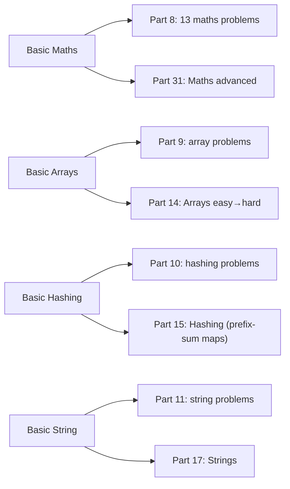

# Part 7: Concept Basics

← [Striver course map](../README.md)

> [!abstract] What this part covers
> **Goal:** Build the four foundations that Parts 8–11 drill: number manipulation, array mechanics, hashing for O(1) lookups, and string handling.
> **Prereqs:** [Part 5](../05-time-complexity/README.md), [Part 6](../06-standard-libraries-and-collections/README.md). **Time:** ~3.5 h.
> **Outcome:** You can peel digits, find divisors in O(√n), choose a count array vs hash map, and build strings without O(n²) concatenation.

---

## Lessons

| # | Lesson | Core idea in one line | Source |
|---|---|---|---|
| 1 | [Basic Maths](01-basic-maths.md) | `%10` / `/10` digit peeling, √n divisor pairs, primes and sieve, Euclid GCD, modulo rules | [link](https://takeuforward.org/learning/dsa/basic-maths?category=concept-basics&source=strivers-a2z-dsa-sheet) |
| 2 | [Basic Arrays](02-basic-arrays.md) | Contiguous memory → O(1) access, O(n) middle insert; 2D row-major; traversal patterns | [link](https://takeuforward.org/learning/dsa/basic-arrays-hashing-and-strings?category=concept-basics&source=strivers-a2z-dsa-sheet) |
| 3 | [Basic Hashing](03-basic-hashing.md) | Pre-compute counts; count array for small keys, hash map otherwise; collisions | [link](https://takeuforward.org/learning/dsa/basic-hashing?category=concept-basics&source=strivers-a2z-dsa-sheet) |
| 4 | [Basic String](04-basic-string.md) | Strings are char arrays; ASCII arithmetic, immutability, builder pattern, costs | [link](https://takeuforward.org/learning/dsa/basic-string?category=concept-basics&source=strivers-a2z-dsa-sheet) |

---

## How the basics feed later parts

---

## Part 7 cheat sheet

| Need | Tool | Cost |
|---|---|---|
| Last digit / drop digit | `n % 10`, `n / 10` | O(1) each; all digits O(log n) |
| Reverse a number | `rev = rev*10 + d` (watch overflow) | O(log n) |
| All divisors | pairs `(i, n/i)` for `i*i ≤ n` | O(√n) |
| Is prime | trial division to √n | O(√n) |
| All primes ≤ N | sieve | O(N log log N) |
| GCD / LCM | Euclid; `a / g * b` | O(log min) |
| Array access / middle insert | address formula / shift | O(1) / O(n) |
| Count small keys | `cnt[x]++`, `cnt[c-'a']++` | O(1) |
| Count large keys | `unordered_map` / `HashMap` / `dict` | O(1) avg |
| Build a string | `+=` (C++), `StringBuilder`, `''.join` | O(total) |

---

## Mastery checklist

- [ ] Write digit-count, reverse, and palindrome-number loops including n = 0 and overflow handling
- [ ] List divisors of n in O(√n) without duplicating √n
- [ ] Write Euclid's GCD and a safe LCM
- [ ] Explain why array access is O(1) and middle insertion is O(n)
- [ ] Choose count array vs hash map vs ordered map for a given key range
- [ ] Explain chaining, load factor and the O(n) worst case of hashing
- [ ] Build strings in O(n) in your language; know `substr` vs `substring`

**Interview track →** [L3 Cheatsheet](../../00-L3-EXECUTION-META/L3_CHEATSHEET.md) · [Hashing deep-dive](../../01-data-structures/02-hashing.md) · [String deep-dive](../../01-data-structures/03-string.md)

Next part → [Basic Maths problems](../08-basic-maths/README.md)
