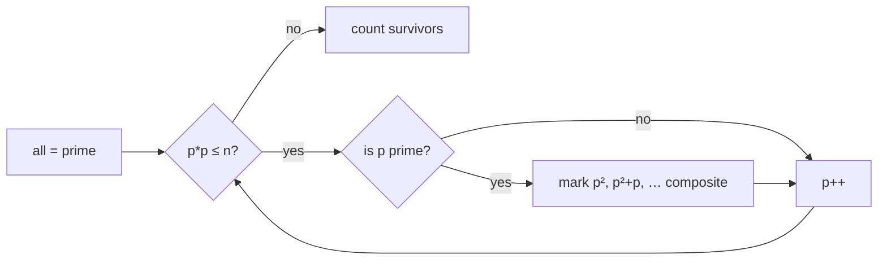

# 10. Count of Prime Numbers till N

← [Check for Prime Number](09-check-for-prime-number.md) · [Part 8 index](README.md) · Next → [GCD of Two Numbers](11-gcd-of-two-numbers.md)

> [!abstract] Problem at a glance
> **Task:** Count the primes in `[1, n]`.
> **Key insight:** Sieve of Eratosthenes: cross out the multiples of each prime starting at `p²`. What survives is prime. O(n log log n).
> **Difficulty:** Medium · **Pattern:** Sieve · **Also on:** LC 204 (counts primes < n)
> **Source:** [takeuforward problem](https://takeuforward.org/learning/dsa/count-of-prime-numbers-till-n?category=basic-maths&source=strivers-a2z-dsa-sheet) · **Time:** 20 min

**Sections:** [1. Problem](#1-problem) · [2. Approaches at a glance](#2-approaches-at-a-glance) · [3. Brute — test each number](#3-brute--test-each-number) · [4. Optimal — Sieve of Eratosthenes](#4-optimal--sieve-of-eratosthenes) · [Edge cases](#edge-cases) · [Common mistakes](#common-mistakes) · [Follow-ups](#follow-ups) · [Flashcards](#flashcards)

---

## 1. Problem

Given `n`, return the number of primes `p` with `2 ≤ p ≤ n`.

| Input | Output | Why |
|---|---|---|
| `n = 6` | `3` | 2, 3, 5 |
| `n = 10` | `4` | 2, 3, 5, 7 |
| `n = 1` | `0` |  |
| `n = 2` | `1` |  |

**Constraints:** `1 ≤ n ≤ 10⁶` (`10⁷` is still fine in C++).

---

## 2. Approaches at a glance

| Approach | Idea | Time | Space |
|---|---|---|---|
| Brute — test each number | isPrime(i) for i in 2..n | O(n√n) | O(1) |
| Optimal — Sieve of Eratosthenes | mark multiples from p² | O(n log log n) | O(n) |

> [!tip] Interview angle
> Name both costs. Per-number trial division is O(n√n); the sieve is O(n log log n), essentially linear. Say why marking starts at p²: smaller multiples `k·p` with `k < p` were already crossed out by the smaller prime factor of `k`.

---

## 3. Brute — test each number

**Intuition.** Reuse the √n primality test on every number. For n = 10⁶ that's about 10⁹ operations, too slow.

```python
def count_primes_brute(n):
    def ok(x):
        if x < 2:
            return False
        i = 2
        while i * i <= x:
            if x % i == 0:
                return False
            i += 1
        return True
    return sum(ok(i) for i in range(2, n + 1))
```

**Complexity:** time **O(n√n)**, space **O(1)**.

---

## 4. Optimal — Sieve of Eratosthenes

**Intuition.** Assume everything from 2 up is prime. Walk `p` from 2. If `p` is still unmarked, it's prime, so mark `p², p² + p, …` as composite. You can stop once `p² > n`: any composite ≤ n has a prime factor ≤ √n and has already been marked.

**Algorithm**

1. `is = [True] * (n + 1)`; `is[0] = is[1] = False`.
2. For `p = 2` while `p * p ≤ n`: if `is[p]`, set `is[m] = False` for `m = p², p² + p, …, ≤ n`.
3. Return the count of `True` values.

**Dry run** — `n = 20`

| p | crosses out |
|---|---|
| 2 | 4 6 8 10 12 14 16 18 20 |
| 3 | 9 15 (12, 18 already gone) |
| 4 | skip — composite |
| 5 | 25 > 20 → stop |

Survivors: 2 3 5 7 11 13 17 19 → **8**.



**Why log log n:** the total work is `n · Σ_{p ≤ √n} 1/p`, and the sum of prime reciprocals grows like `log log n`.

**C++**
```cpp
int countPrimes(int n) {
    if (n < 2) return 0;
    vector<bool> is(n + 1, true);
    is[0] = is[1] = false;
    for (long long p = 2; p * p <= n; p++)
        if (is[p])
            for (long long m = p * p; m <= n; m += p) is[m] = false;
    return count(is.begin(), is.end(), true);
}
```

**Java**
```java
static int countPrimes(int n) {
    if (n < 2) return 0;
    boolean[] comp = new boolean[n + 1];
    int cnt = 0;
    for (long p = 2; p * p <= n; p++)
        if (!comp[(int) p])
            for (long m = p * p; m <= n; m += p) comp[(int) m] = true;
    for (int i = 2; i <= n; i++) if (!comp[i]) cnt++;
    return cnt;
}
```

**Python**
```python
def count_primes(n):
    if n < 2:
        return 0
    is_p = [True] * (n + 1)
    is_p[0] = is_p[1] = False
    p = 2
    while p * p <= n:
        if is_p[p]:
            is_p[p * p :: p] = [False] * len(range(p * p, n + 1, p))
        p += 1
    return sum(is_p)
```

**Complexity:** time **O(n log log n)**, space **O(n)** — the marking work is n·Σ1/p ≈ n log log n; the boolean array is O(n). Python's slice assignment does the inner loop in C.

---

## Edge cases

- `n < 2` → 0. Guard it before you allocate or index `is[1]`.
- LC 204 counts primes **strictly less than** n, so shift by one.
- `p * p` overflows a 32-bit int for p > 46340; use a 64-bit loop variable.

---

## Common mistakes

1. Starting marking at `2p` instead of `p²`. It's still correct, just slower.
2. Running the outer loop to `n` instead of `√n`. Also correct but wasteful.
3. Allocating `n` instead of `n + 1` slots, which drops `n` itself.

---

## Follow-ups

1. Smallest prime factor (SPF) sieve for fast factorisation.
2. Primes in a range `[L, R]` with R up to 10¹², R − L ≤ 10⁶.
3. Linear sieve.

<details><summary>Answer sketches</summary>

**#1:** Store `spf[m] = p` the first time `m` is marked. Factorise any `x ≤ n` in O(log x) by repeatedly dividing by `spf[x]`.

**#2:** Segmented sieve: sieve primes up to √R, then mark their multiples inside the window `[L, R]`.

**#3:** Each composite is marked exactly once, by its smallest prime factor. O(n), and it produces the SPF table as a by-product.
</details>

---

## Flashcards

**Sieve complexity?** #flashcard
O(n log log n) time, O(n) space.

**Why start sieve marking at p²?** #flashcard
Every k·p with k < p has a prime factor smaller than p, so it was already crossed out.

**Number of primes ≤ 10⁶?** #flashcard
78 498.

**Outer loop bound for the sieve?** #flashcard
p·p ≤ n.

**Interview track →** [Math & number theory](../../02-algorithms/18-math-and-number-theory.md) · [Concept: basic maths](../07-concept-basics/01-basic-maths.md)
