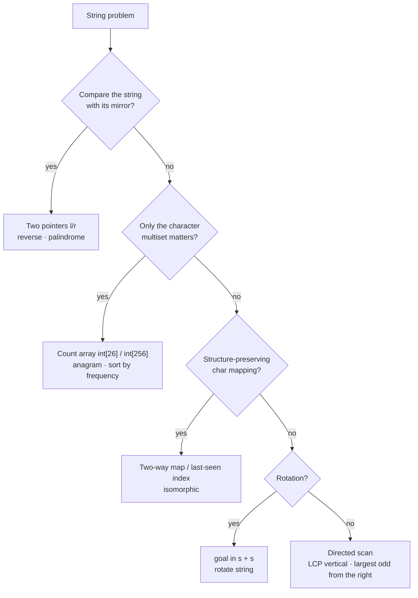

# Part 11: Basic Strings

← [Striver course map](../README.md)

> [!abstract] What this part covers
> **Goal:** Make the four string moves reflexive: two pointers from both ends, a fixed-size count array, a character-to-character mapping, and the `s + s` rotation trick.
> **Prereqs:** [Concept: basic strings](../07-concept-basics/04-basic-string.md), [Basic Hashing](../10-basic-hashing/README.md). **Time:** ~3 h.
> **Outcome:** You can solve each of the 8 problems in O(n) with the right primitive, and you know each language's string pitfalls: immutability, `==` vs `.equals`, and the char arithmetic.

---

## Problems

| # | Problem | Difficulty | Key insight | Optimal | Source |
|---|---|---|---|---|---|
| 1 | [Reverse a String](01-reverse-a-string.md) | Easy | This is the array reverse from Part 9 on chars: swap `s[l]` and `s[r]`, move inward, stop at `l ≥ r`. | O(n) | [link](https://takeuforward.org/learning/dsa/reverse-a-string-ii?category=basic-strings&source=strivers-a2z-dsa-sheet) |
| 2 | [Palindrome Check](02-palindrome-check.md) | Easy | Compare `s[l]` with `s[r]` while moving inward. The first mismatch means false, and you never build a reversed copy. | O(n) | [link](https://takeuforward.org/learning/dsa/palindrome-check?category=basic-strings&source=strivers-a2z-dsa-sheet) |
| 3 | [Largest Odd Number in a String](03-largest-odd-number-in-a-string.md) | Easy | A number is odd iff its last digit is odd. The largest candidate starts as far left as possible and ends at the **rightmost** odd digit. Then strip the leading zeros. | O(n) | [link](https://takeuforward.org/learning/dsa/largest-odd-number-in-a-string?category=basic-strings&source=strivers-a2z-dsa-sheet) |
| 4 | [Longest Common Prefix](04-longest-common-prefix.md) | Easy | Scan column by column (vertical scan). Stop at the first column where any string ends or has a different char than `strs[0]`. | O(S) total chars | [link](https://takeuforward.org/learning/dsa/longest-common-prefix?category=basic-strings&source=strivers-a2z-dsa-sheet) |
| 5 | [Isomorphic Strings](05-isomorphic-strings.md) | Easy | The mapping must be a bijection. Recording the last-seen index of each char in both strings, and requiring the two to agree at every step, checks both directions at once. | O(n) | [link](https://takeuforward.org/learning/dsa/isomorphic-string?category=basic-strings&source=strivers-a2z-dsa-sheet) |
| 6 | [Rotate String](06-rotate-string.md) | Easy | Every rotation of `s` is a length-n window of `s + s`. So the answer is `len(s) == len(goal) and goal in s + s`. | O(n) with KMP; O(n²) worst case naive | [link](https://takeuforward.org/learning/dsa/rotate-string?category=basic-strings&source=strivers-a2z-dsa-sheet) |
| 7 | [Valid Anagram](07-valid-anagram.md) | Easy | Anagrams have identical character counts. Increment for `s` and decrement for `t` in one `int[26]`, then check that it's all zero. | O(n) | [link](https://takeuforward.org/learning/dsa/valid-anagram?category=basic-strings&source=strivers-a2z-dsa-sheet) |
| 8 | [Sort Characters by Frequency](08-sort-characters-by-frequency.md) | Medium | Count, then bucket by frequency: `bucket[f]` holds the chars that occur `f` times. Walking the buckets from `n` down to 1 emits the answer in O(n) with no comparison sort. | O(n + Σ) | [link](https://takeuforward.org/learning/dsa/sort-characters-by-frequency?category=basic-strings&source=strivers-a2z-dsa-sheet) |

---

## Which string primitive?

---

## Part 11 cheat sheet

| Problem | Primitive | Time / Space |
|---|---|---|
| Reverse string (in place) | two pointers, swap | O(n) / O(1) |
| Palindrome check | two pointers, compare | O(n) / O(1) |
| Largest odd number | scan from the right for an odd digit, strip leading zeros | O(n) / O(1) extra |
| Longest common prefix | vertical scan column by column | O(total chars) / O(1) |
| Isomorphic strings | last-seen index per char, both strings | O(n) / O(Σ) |
| Rotate string | `len equal and goal in s + s` | O(n) with KMP |
| Valid anagram | `cnt[c] += 1` for s, `-= 1` for t, all zero | O(n) / O(26) |
| Sort by frequency | count + bucket by frequency | O(n) / O(n) |

**Language traps:** strings are immutable in Python and Java, so build with a list / `StringBuilder`, not `+=` in a loop (O(n²)). Java compares strings with `.equals`, never `==`. Use `c - 'a'` to index a lowercase char.

---

## Mastery checklist

- [ ] Reverse and palindrome-check with two pointers, no extra string
- [ ] Explain why `goal in s + s` decides rotation
- [ ] Show why isomorphism needs both directions (`badc` vs `baba`)
- [ ] Pick `int[26]` vs `int[256]` vs a hashmap from the alphabet
- [ ] Build output strings in O(n): list + join / StringBuilder
- [ ] State the tie-break used for sort-by-frequency

**Interview track →** [Strings deep-dive](../../01-data-structures/03-string.md) · [String algorithms](../../02-algorithms/02-string-algorithms.md) · [Concept: basic strings](../07-concept-basics/04-basic-string.md)

Next part → [Basic Recursion](../12-basic-recursion/README.md)
