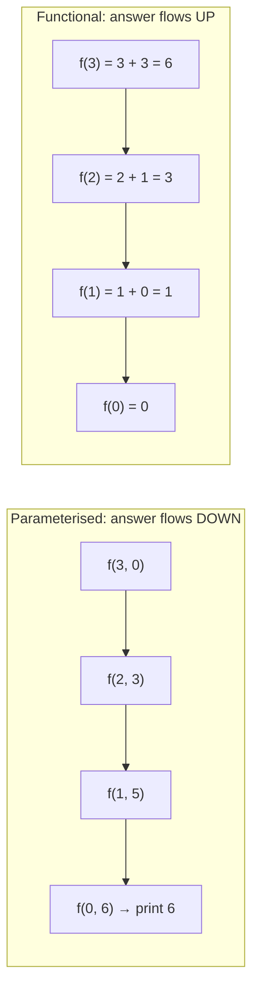

# 2. Recursion Concepts with Parameters

← [Recursion Theory](01-recursion-theory.md) · [Part 12 index](README.md) · Next → [Sum of First N Numbers](03-sum-of-first-n-numbers.md)

> [!abstract] What this covers
> **Core idea:** There are two ways to carry a result through recursion. **Parameterised** recursion carries a running answer *down* as an argument, and the base case holds it. **Functional** recursion *returns* the answer *up* and combines it on the way back. Choosing between them, and knowing how each language passes arguments, is the whole skill.
> **You'll be able to:** write sum and factorial both ways, decide which style a problem needs, use extra index parameters such as `(l, r)` instead of slicing, and avoid the pass-by-value and aliasing traps in C++, Java and Python.
> **Source:** [takeuforward lesson](https://takeuforward.org/learning/dsa/recursion-concepts-with-parameters?category=basic-recursion&source=strivers-a2z-dsa-sheet) · **Time:** 40 min

**Sections:** [1. Two styles](#1-two-styles) · [2. Parameterised](#2-parameterised-recursion) · [3. Functional](#3-functional-recursion) · [4. Which to use](#4-which-to-use) · [5. Index parameters, not slices](#5-index-parameters-not-slices) · [6. How arguments are passed](#6-how-arguments-are-passed) · [7. Multiple recursive calls](#7-multiple-recursive-calls) · [Common mistakes](#common-mistakes) · [Practice](#practice) · [Key terms](#key-terms) · [Flashcards](#flashcards)

---

## 1. Two styles



| | Parameterised | Functional |
|---|---|---|
| Answer lives in | an argument (`acc`) | the return value |
| Work happens | before the call | after the call returns |
| Base case does | uses/prints/returns `acc` | returns the identity (0, 1, true…) |
| Tail call? | yes | no, the combine is pending |
| Becomes a loop | trivially | needs rethinking |

---

## 2. Parameterised recursion

```python
def sum_param(i, acc):
    if i < 1:
        print(acc)          # or return acc
        return
    sum_param(i - 1, acc + i)

sum_param(3, 0)             # 6
```

```cpp
void sumParam(int i, long long acc) {
    if (i < 1) { cout << acc << "\n"; return; }
    sumParam(i - 1, acc + i);
}
```

```java
static void sumParam(int i, long acc) {
    if (i < 1) { System.out.println(acc); return; }
    sumParam(i - 1, acc + i);
}
```

Factorial is the same shape: `fact(i, acc)` → base `i <= 1: acc`, recurse `fact(i − 1, acc * i)`, initial `acc = 1`.

---

## 3. Functional recursion

```python
def sum_func(n):
    if n == 0:
        return 0
    return n + sum_func(n - 1)
```

```cpp
long long sumFunc(int n) { return n == 0 ? 0 : n + sumFunc(n - 1); }
```

```java
static long sumFunc(int n) { return n == 0 ? 0 : n + sumFunc(n - 1); }
```

Factorial: `fact(n) = 1 if n <= 1 else n * fact(n − 1)`. It overflows `int` at 13! and `long` at 21!.

---

## 4. Which to use

| Situation | Style |
|---|---|
| Must **return** a value to the caller (most interview functions) | Functional |
| Building a path, a subset or a string along the way (backtracking) | Parameterised (`path` argument) |
| Combine needs results from **several** children (tree height, fib) | Functional |
| "Print all …" | Parameterised |
| Want to convert to a loop later | Parameterised (accumulator = loop variable) |

You can always mix them: pass parameters down and return values up, e.g. `count_paths(r, c)` returns a count while `r, c` move.

---

## 5. Index parameters, not slices

```python
# ✗ O(n) copy per call → O(n²) total
def rsum(a):
    return 0 if not a else a[0] + rsum(a[1:])

# ✓ pass an index → O(n) total
def rsum(a, i=0):
    return 0 if i == len(a) else a[i] + rsum(a, i + 1)
```

For two-ended problems (reverse, palindrome) pass `(l, r)` and recurse on `(l + 1, r − 1)`. The base case is `l >= r`.

---

## 6. How arguments are passed

| Language | Primitives | Containers / objects | Recursion consequence |
|---|---|---|---|
| C++ | by value (copy) | **by value unless `&`** | `void f(vector<int> a)` copies the vector at every call → O(n) per call. Use `vector<int>& a`. |
| Java | by value | the reference is copied; the **object is shared** | Edits to an array are visible to the caller; reassigning the parameter isn't. |
| Python | everything is a reference to an object | lists are shared, ints/strs are immutable | `path.append(x)` mutates the shared list, so undo with `pop()` after the call or pass `path + [x]`. |

```python
def collect(i, n, path, out):
    if i > n:
        out.append(path[:])     # copy! otherwise every entry aliases the same list
        return
    path.append(i)
    collect(i + 1, n, path, out)
    path.pop()                   # undo, so the caller sees its old state
```

> [!warning] The classic aliasing bug
> `out.append(path)` without a copy: at the end every entry points to the same (now empty) list. Always store `path[:]` / `new ArrayList<>(path)` / `vector` copy (C++ `push_back(path)` already copies).

---

## 7. Multiple recursive calls

When the combine needs two or more subanswers, use functional recursion and expect a branching recursion tree.

```python
def fib(n):
    if n <= 1:
        return n
    return fib(n - 1) + fib(n - 2)    # 2 calls → O(φⁿ) time, O(n) stack
```

Execution is **depth-first**: `fib(n − 1)` runs **completely**, all its subtree, before `fib(n − 2)` starts. That order matters whenever you print or mutate shared state between the calls.

---

## Common mistakes

1. Parameterised recursion that is expected to **return** but doesn't propagate: `f(i − 1, acc + i)` without `return` in a function meant to return `acc`.
2. Wrong identity in the base case (0 for a product → always 0).
3. Slicing arrays or strings in each call (O(n²)).
4. C++: passing a `vector`/`string` by value in a deep recursion, making it O(n) per call and possibly O(n²) memory.
5. Python/Java: mutating a shared list without undoing it, or storing it without copying.
6. `int` accumulator for factorial or large sums. Use `long long` / `long`.

---

## Practice

1. Write factorial in both styles. What's the initial accumulator?
2. Convert `sum_param(i, acc)` into a `while` loop.
3. Why is `rsum(a[1:])` O(n²)?
4. What prints? `def f(n): if n == 0: return; print(n); f(n − 1); print(n)` with `f(2)`.
5. Write a recursive `count(a, i, x)` that returns how many times `x` occurs in `a[i:]`.

<details><summary>Answer sketches</summary>

**#1:** functional `n * f(n − 1)`, base `n <= 1 → 1`; parameterised `f(i − 1, acc * i)`, start `acc = 1`.

**#2:** `acc = 0; while i >= 1: acc += i; i -= 1`. The parameters become loop variables.

**#3:** each slice copies `n − 1, n − 2, …` elements → Σ = O(n²).

**#4:** `2 1 1 2`.

**#5:** `return 0 if i == len(a) else (a[i] == x) + count(a, i + 1, x)`.
</details>

---

## Key terms

| Term | Meaning |
|---|---|
| Parameterised recursion | Running answer passed down as an argument |
| Functional recursion | Answer returned up and combined after the call |
| Accumulator | The argument holding the partial answer |
| Identity | Base-case value neutral for the combine (0 for +, 1 for ×) |
| Aliasing | Two names referring to the same mutable object |
| Undo step | Reverting a shared mutation after the recursive call |

---

## Flashcards

**Parameterised vs functional recursion?** #flashcard
Parameterised: answer passed down in an argument. Functional: answer returned up and combined.

**Which style becomes a loop trivially?** #flashcard
Parameterised (tail-recursive accumulator).

**Why avoid slicing in recursion?** #flashcard
Each slice copies → O(n²). Pass indices.

**C++ vector parameter in recursion?** #flashcard
Pass by reference (`vector<int>&`), or every call copies it.

**Storing a path list in Python results?** #flashcard
Append a copy (`path[:]`), then undo with `pop()` after the call.

**Interview track →** [Recursion deep-dive](../../02-algorithms/09-recursion.md) · [Backtracking](../../02-algorithms/12-backtracking.md) · [Recursion & DP masterclass](../../03-patterns/RECURSION_AND_DP_MASTERCLASS.md)
