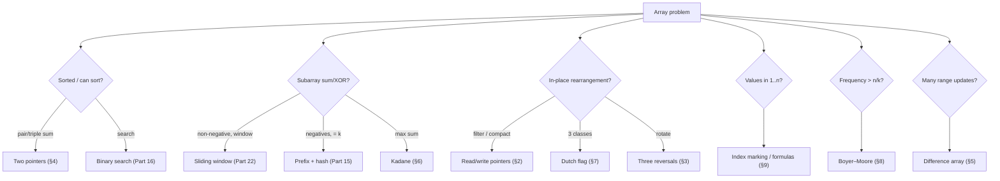

# 0. Array Techniques

← [Part 14 index](README.md) · Next → [Linear Search](01-linear-search.md)

> [!abstract] What this covers
> **Core idea:** About ten techniques solve almost every array problem in this part. Learn them as *named moves*, each with its invariant, and a new problem becomes a matter of picking the right move instead of inventing an algorithm.
> **You'll be able to:** write the read/write-pointer compaction, the three-reversal rotation, prefix and difference arrays, Kadane, the 3-way partition, Boyer–Moore voting and index-sign marking from memory, each with its invariant, and traverse or transform a matrix in place.
> **Source:** enrichment for the [Arrays category](https://takeuforward.org/learning/dsa/linear-search?category=easy&source=strivers-a2z-dsa-sheet). The problems in this part apply each technique. · **Time:** 50 min

**Sections:** [1. Cost model](#1-cost-model) · [2. Read/write pointers](#2-readwrite-pointers) · [3. Reversal tricks](#3-reversal-tricks) · [4. Two pointers on sorted data](#4-two-pointers-on-sorted-data) · [5. Prefix and difference arrays](#5-prefix-and-difference-arrays) · [6. Kadane](#6-kadane) · [7. Partitioning](#7-partitioning) · [8. Voting](#8-voting) · [9. Index as hash](#9-index-as-hash) · [10. Matrix moves](#10-matrix-moves) · [11. Technique map](#11-technique-map)

---

## 1. Cost model

| Operation | Static array | Dynamic array (`vector` / `ArrayList` / `list`) |
|---|---|---|
| Access `a[i]` | O(1) | O(1) |
| Append | — | O(1) amortised (capacity doubling) |
| Insert / erase in middle | O(n) | O(n) |
| Search unsorted | O(n) | O(n) |
| Search sorted | O(log n) | O(log n) |

"In place" means O(1) extra space. Constraints like n ≤ 10⁵ allow O(n log n), and n ≤ 10⁶ wants O(n). Contiguous memory makes linear scans very cache-friendly, so an O(n) scan over an array beats a hash map in practice.

---

## 2. Read/write pointers

**Invariant:** `a[0..w)` is the finished output, and `r` scans the input. Keep `a[r]` if it passes the test: `a[w++] = a[r]`.

| Problem | Keep condition | After the loop |
|---|---|---|
| Remove element `val` | `a[r] != val` | length = `w` |
| Remove duplicates (sorted) | `w == 0 or a[r] != a[w-1]` | length = `w` |
| At most 2 copies (sorted) | `w < 2 or a[r] != a[w-2]` | length = `w` |
| Move zeros to end | `a[r] != 0`, **swap** instead of copy | zeros end up at the tail |

The output is stable, and each element is written at most once.

---

## 3. Reversal tricks

Rotate left by `k` (with `k %= n` first) using three reversals: `rev(0, k−1)`, `rev(k, n−1)`, then `rev(0, n−1)`. Rotating right by k is the same as rotating left by `n − k`.

Why it works: write `a = A B`. Then `rev(rev(A) rev(B)) = B A`. It takes O(n) time and O(1) space.

Reversal also shows up in: next permutation (reverse the suffix), rotate matrix (transpose then reverse each row), and reverse words in a string (reverse everything, then each word).

---

## 4. Two pointers on sorted data

- **Opposite ends** (pair sum, 3Sum, 4Sum, container with most water): if the sum is too small, move `l++`; if too big, move `r--`.
  - Why it is correct: when `a[l] + a[r] < t`, `a[l]` can't pair with any index `≤ r`, so discarding `l` loses nothing.
- **Same direction on two arrays** (union, intersection, merge): advance whichever side has the smaller element. Handle duplicates by skipping equal runs.
- **k-Sum template:** sort, fix `k − 2` indices with outer loops (skipping duplicates), then do an opposite-ends two-pointer pass. This is O(n^(k−1)).

---

## 5. Prefix and difference arrays

**Prefix sums:** `P[0] = 0` and `P[i+1] = P[i] + a[i]`. Then `sum(l..r) = P[r+1] − P[l]` in O(1) after O(n) preprocessing. The same idea works with XOR (`xor(l..r) = X[r+1] ^ X[l]`), or with counts of a property.

**Prefix + hash map** (Part 15) answers "subarray with sum k" when values can be negative. Look up `P − k` among the earlier prefixes. Seed the map with `{0: 1}` when counting, or `{0: −1}` when finding the longest.

**Difference array** (range updates, then point queries):
```text
D = zeros(n + 1)
add v on [l, r]:  D[l] += v;  D[r + 1] -= v      # O(1) per update
final a[i] = prefix sum of D up to i               # O(n) once
```
Uses: car pooling, corporate flight bookings, counting how many intervals cover each point, and range increment queries.

**2D prefix sums:** `S[i+1][j+1] = a[i][j] + S[i][j+1] + S[i+1][j] − S[i][j]`. The sum of the rectangle `(r1, c1)..(r2, c2)` is `S[r2+1][c2+1] − S[r1][c2+1] − S[r2+1][c1] + S[r1][c1]`.

**Prefix max / suffix max:** these give "best element to the left/right of i" in O(1). Examples: leaders in an array (suffix max), trapping rain water, and best time to buy and sell stock (prefix min).

---

## 6. Kadane

`cur = max(a[i], cur + a[i])` and `best = max(best, cur)`. In words: **extend the previous subarray if that helps, otherwise restart at i.**

- To recover the subarray, record `start` whenever you restart, and update the answer's bounds whenever `best` improves.
- If every value is negative, the answer is the largest single element. Initialise `best = a[0]`, not 0.
- **Maximum product subarray:** track both `maxEnding` and `minEnding`, because a negative value swaps them. An alternative is to take the best of the prefix and suffix products, resetting at zeros.
- **Circular max subarray:** `max(kadane, total − minKadane)`. If every value is negative, return plain Kadane.

---

## 7. Partitioning

**Dutch national flag** (0s, 1s, 2s, or `< p`, `= p`, `> p`). Pointers `lo`, `mid` and `hi` maintain four regions: `[0, lo)` holds 0s, `[lo, mid)` holds 1s, `[mid, hi]` is unknown, and `(hi, n)` holds 2s.
```text
while mid ≤ hi:
  a[mid] == 0 → swap(lo++, mid++)
  a[mid] == 1 → mid++
  a[mid] == 2 → swap(mid, hi--)      # don't advance mid: the swapped-in value is unknown
```

**Stable partition by sign** (rearrange by sign): use an O(n) output array with separate even and odd write indices. An in-place *stable* version needs O(n log n) or O(n²).

**Lomuto / Hoare partition:** the building block of quicksort and quickselect (Part 13).

---

## 8. Voting

**Boyer–Moore majority (> n/2):**
```text
cand, cnt = ?, 0
for x: if cnt == 0: cand = x
       cnt += (x == cand) ? 1 : -1
verify cand with a second pass if a majority is not guaranteed
```
**Why it works:** each mismatch cancels one copy of the candidate against one other element. A true majority can't be fully cancelled.

**Extended version (> n/3):** keep two candidates and two counters, decrement both on a mismatch, and **always verify** at the end. At most `k − 1` elements can appear more than n/k times.

---

## 9. Index as hash

When the values lie in `[1, n]`, the array can serve as its own hash table:

| Trick | How | Problem |
|---|---|---|
| Sum / XOR formula | `missing = n(n+1)/2 − Σa`, or the XOR of `1..n` with every element | Missing number |
| Two equations | `S − Sₙ = x − y` and `S² − S²ₙ = x² − y²` | Repeating and missing (Part 14) |
| Sign marking | negate `a[|v|−1]`; if it is already negative, `v` is a duplicate | Find all duplicates |
| Cyclic placement | swap `a[i]` into slot `a[i]−1` until it is in place | First missing positive |

To avoid overflow in the sum formulas, use 64-bit integers or the XOR version.

---

## 10. Matrix moves

| Task | Technique |
|---|---|
| Spiral order | Four boundaries `top, bottom, left, right`; check `top ≤ bottom` / `left ≤ right` before the reverse legs |
| Rotate 90° clockwise in place | Transpose (`swap(a[i][j], a[j][i])` for `j > i`), then reverse each row |
| Rotate counter-clockwise | Transpose, then reverse each column (or reverse the rows first, then transpose) |
| Set matrix zeroes in O(1) space | Use row 0 and column 0 as markers, with a separate flag for column 0; fill bottom-up |
| Search a row- and column-sorted matrix | Start at the top-right corner: go left if the value is too big, down if too small. O(m + n) |
| Fully sorted matrix | Treat it as a 1D array, `idx → (idx / n, idx % n)`, and binary search |
| Diagonals | `i − j` is constant on a main diagonal, `i + j` on an anti-diagonal |
| 4/8 neighbours | Direction arrays `dr = {-1,0,1,0}`, `dc = {0,1,0,-1}` |

---

## 11. Technique map



---

## Common mistakes

| Mistake | Fix |
|---|---|
| Rotating without `k %= n` | Normalise first; k may be bigger than n |
| Kadane with `best = 0` on an all-negative array | Initialise `best = a[0]` |
| Dutch flag advancing `mid` after swapping with `hi` | Only `hi--`; recheck `a[mid]` |
| Boyer–Moore without verification when no majority is guaranteed | Second counting pass |
| `n(n+1)/2` overflow in `int` | 64-bit or XOR |
| Spiral printing the middle row twice | Guard the reverse legs with `top ≤ bottom` and `left ≤ right` |
| Set-zeroes overwriting markers too early | Process row 0 and column 0 last |

---

## Practice

<details><summary>1. Rotate [1,2,3,4,5,6,7] right by 3 using reversals.</summary>

Right by 3 is the same as left by 4. `rev(0..3)` gives [4,3,2,1,5,6,7]. `rev(4..6)` gives [4,3,2,1,7,6,5]. `rev(all)` gives [5,6,7,1,2,3,4].
</details>

<details><summary>2. Apply +2 on [1,3] and +5 on [2,4] to a zero array of length 5.</summary>

D = [0,2,5,0,−2,−5], and its prefix sums give [0,2,7,7,5].
</details>

<details><summary>3. Why can't sliding window solve "count subarrays with sum k" when there are negatives?</summary>

Extending the window no longer increases the sum monotonically, so the shrink rule fails. Use prefix sums with a hash map.
</details>

<details><summary>4. Run Boyer–Moore on [2,2,1,1,1,2,2].</summary>

cand 2 (cnt 1), 2 (2), 1 (1), 1 (0), then 1 becomes the candidate (1), 2 (0), then 2 becomes the candidate (1). The final candidate is 2, and the check (4 of 7) confirms it.
</details>

<details><summary>5. Rotate a matrix counter-clockwise in place.</summary>

Transpose, then reverse each column. Equivalently, reverse each row first and then transpose.
</details>

<details><summary>6. Find the duplicate and missing numbers in O(1) extra space.</summary>

Solve the sum and sum-of-squares equations. Alternatively, XOR everything with 1..n and split by the lowest set bit.
</details>

<details><summary>7. Find the max sum of a circular subarray.</summary>

`max(kadane, total − minSubarray)`. If every value is negative, return `kadane`.
</details>

---

## Key terms

| Term | Meaning |
|---|---|
| Invariant | Statement true before and after each loop iteration |
| Prefix sum | `P[i]` = sum of the first i elements |
| Difference array | Array whose prefix sum reconstructs the original; supports O(1) range updates |
| Leader | Element greater than everything to its right |
| Inversion | i < j with a[i] > a[j] |

---

## Flashcards

**Rotate left by k in O(1) space?** #flashcard
`k %= n`, then reverse `[0, k)`, reverse `[k, n)`, then reverse everything.

**Range sum after O(n) preprocessing?** #flashcard
`P[r+1] − P[l]`, with `P[0] = 0`.

**Range update +v on [l, r] in O(1)?** #flashcard
`D[l] += v`, `D[r+1] -= v`; take prefix sums at the end.

**Kadane recurrence?** #flashcard
`cur = max(a[i], cur + a[i])`, `best = max(best, cur)`.

**Dutch flag rule for a 2?** #flashcard
`swap(a[mid], a[hi--])` and do not advance `mid`.

**Majority > n/3: how many candidates?** #flashcard
Two, and always verify them.

**Rotate a matrix 90° clockwise in place?** #flashcard
Transpose, then reverse each row.

**First missing positive in O(1) space?** #flashcard
Cyclic placement of `v` into slot `v − 1`, then find the first slot with `a[i] ≠ i + 1`.

---

**Interview track →** [Array deep-dive](../../01-data-structures/01-array.md) · [Matrix deep-dive](../../01-data-structures/04-matrix.md) · [Two pointers](../../02-algorithms/03-two-pointers.md)
