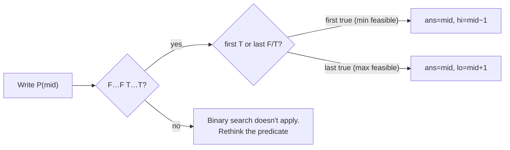
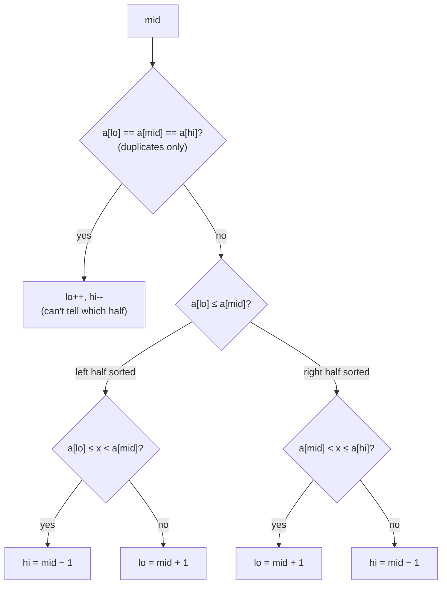

# 1. Binary Search Templates

← [Part 16 index](README.md) · Next → [Binary Search](02-binary-search.md)

> [!abstract] What this covers
> **Core idea:** Binary search doesn't need a sorted array. It needs a yes/no question whose answers over the search range look like `F F F T T T`. Every problem in this part asks you to find where the `T`s start (first true) or where they end (last true). The two templates below solve all 32 problems. Only the range and the predicate change.
> **You'll be able to:** write first-true and last-true without off-by-one bugs; pick between `lo ≤ hi` and `lo < hi`; avoid overflow in `mid`; turn "minimise the maximum" and "maximise the minimum" into binary search on the answer; handle rotated halves; and search over real numbers.
> **Source:** [takeuforward lesson](https://takeuforward.org/learning/dsa/search-x-in-sorted-array?category=fundamentals&source=strivers-a2z-dsa-sheet) (this note is a synthesis of the whole part) · **Time:** 40 min

**Sections:** [1. The predicate view](#1-the-predicate-view) · [2. Template A: closed loop with ans](#2-template-a-closed-loop-with-ans) · [3. Template B: half-open loop](#3-template-b-half-open-loop) · [4. Overflow-safe mid](#4-overflow-safe-mid) · [5. Bounds family](#5-bounds-family) · [6. Rotated arrays](#6-rotated-arrays) · [7. Binary search on answer](#7-binary-search-on-answer) · [8. Real-valued search](#8-real-valued-search) · [9. Library calls](#9-library-calls) · [Common mistakes](#common-mistakes) · [Practice](#practice) · [Key terms](#key-terms) · [Flashcards](#flashcards)

---

## 1. The predicate view

Pick a predicate `P(i)` that is **monotone** over the range: once it becomes true, it stays true.

```
i     :  0  1  2  3  4  5  6
a[i]  :  2  4  4  7  9  9 12
a[i] ≥ 7 : F  F  F  T  T  T  T     ← first true = 3 = lower_bound(7)
a[i] ≤ 4 : T  T  T  F  F  F  F     ← last true  = 2 = floor(4) index
```

| Question | Predicate | Find |
|---|---|---|
| lower_bound(x) | `a[i] ≥ x` | first true |
| upper_bound(x) | `a[i] > x` | first true |
| floor(x) | `a[i] ≤ x` | last true |
| Koko speed | `hours(k) ≤ h` | first true over `k` |
| Aggressive cows | `canPlace(d)` | last true over `d` |
| Peak element | `a[i] > a[i + 1]` | not globally monotone, but `[lo, hi]` always holds a peak, so the halving still works |



If you can't say what the predicate is and why it's monotone, you're guessing. Say it aloud in the interview.

---

## 2. Template A: closed loop with ans

The interval `[lo, hi]` includes both ends. Record the best answer seen so far. This is Striver's style throughout the course, and the safest one for interviews.

**First true** (smallest `i` with `P(i)`):

```python
def first_true(lo, hi, P):
    ans = hi + 1                 # "none" sentinel
    while lo <= hi:
        mid = lo + (hi - lo) // 2
        if P(mid):
            ans, hi = mid, mid - 1   # mid works; look for a smaller one
        else:
            lo = mid + 1
    return ans
```

**Last true** (largest `i` with `P(i)`, when `P` is `T…T F…F`):

```python
def last_true(lo, hi, P):
    ans = lo - 1
    while lo <= hi:
        mid = lo + (hi - lo) // 2
        if P(mid):
            ans, lo = mid, mid + 1   # mid works; look for a bigger one
        else:
            hi = mid - 1
    return ans
```

```cpp
int firstTrue(int lo, int hi, function<bool(int)> P) {
    int ans = hi + 1;
    while (lo <= hi) {
        int mid = lo + (hi - lo) / 2;
        if (P(mid)) { ans = mid; hi = mid - 1; }
        else lo = mid + 1;
    }
    return ans;
}
```

```java
static int firstTrue(int lo, int hi, IntPredicate P) {
    int ans = hi + 1;
    while (lo <= hi) {
        int mid = lo + (hi - lo) / 2;
        if (P.test(mid)) { ans = mid; hi = mid - 1; }
        else lo = mid + 1;
    }
    return ans;
}
```

**Why it terminates:** each step moves `lo` up or `hi` down by at least 1 (both updates use `mid ± 1`), so the interval shrinks every time.

**When it ends:** `lo = hi + 1`. In first-true, `lo` is the answer too, which is why many people return `lo` instead of keeping `ans`.

---

## 3. Template B: half-open loop

The interval is `[lo, hi)`, or `[lo, hi]` where `hi` is known to be valid. Loop `while lo < hi`, set `hi = mid` on true. No `ans` variable is needed.

```python
def first_true_b(lo, hi, P):     # searches [lo, hi); returns hi if none
    while lo < hi:
        mid = lo + (hi - lo) // 2
        if P(mid):
            hi = mid
        else:
            lo = mid + 1
    return lo
```

| | Template A | Template B |
|---|---|---|
| Loop | `while lo <= hi` | `while lo < hi` |
| On true | `ans = mid; hi = mid − 1` | `hi = mid` |
| On false | `lo = mid + 1` | `lo = mid + 1` |
| Ends with | `lo = hi + 1` | `lo == hi` |
| Best for | exact match, BS on answer | peak, min in rotated, `mid + 1` access |

**Never mix them.** `while lo <= hi` with `hi = mid` loops forever when `lo == hi == mid`.

**Last true with Template B** needs the upper mid, `mid = lo + (hi − lo + 1) / 2`, with `lo = mid` on true. Otherwise `lo = mid` never moves when `hi = lo + 1`. Prefer Template A for last-true problems.

---

## 4. Overflow-safe mid

| Expression | Problem |
|---|---|
| `(lo + hi) / 2` | `lo + hi` overflows `int` when both are near 2³¹ (C++ UB, Java negative) |
| `lo + (hi − lo) / 2` | Safe when `lo ≤ hi` |
| `(lo + hi) >>> 1` | Java only: unsigned shift fixes the overflow |
| `(lo + hi) // 2` | Python: ints are unbounded, no issue |

Overflow also hides **inside the predicate**:

- `mid * mid` in square root → use `long long`, or compare `mid ≤ x / mid`.
- `mid^n` in nth root → stop multiplying once it exceeds `m`.
- `Σ ⌈a[i] / mid⌉` in Koko → accumulate in `long long`.
- `Σ arr` as `hi` in split array / painters → can exceed 2³¹.

---

## 5. Bounds family

Everything about a value `x` in a sorted array follows from two calls.

| Want | Formula |
|---|---|
| First index ≥ x (lower_bound) | `lb(x)` |
| First index > x (upper_bound) | `ub(x)` |
| Search insert position | `lb(x)` |
| Ceil value | `a[lb(x)]` if `lb(x) < n` |
| Floor value | `a[ub(x) − 1]` if `ub(x) > 0` |
| First occurrence | `lb(x)` if `a[lb(x)] == x` else −1 |
| Last occurrence | `ub(x) − 1` if that index holds x |
| Count of x | `ub(x) − lb(x)` |
| Count in `[l, r]` | `ub(r) − lb(l)` |

---

## 6. Rotated arrays

A sorted array rotated at some pivot: `[4 5 6 7 0 1 2]`. For any `mid`, **at least one half is sorted**.



| Problem | Trick |
|---|---|
| Search (distinct) | Check whether x lies in the sorted half; go there or to the other half |
| Search (duplicates) | Add the `lo++, hi--` shrink. Worst case O(n): `[1 1 1 1 0 1 1]` |
| Minimum | The sorted half's first element is a candidate; take it and go to the other half |
| Rotation count | Index of the minimum |

---

## 7. Binary search on answer

When the question asks for a **minimum or maximum value** and you can check "is value `v` achievable?" quickly, search over `v`.

**Recognise it by:** "minimum capacity / speed / days / largest sum so that…", "maximise the minimum distance", constraints with values up to 10⁹ but `n ≤ 10⁵`.

**Recipe:**

1. **Range.** Smallest value that could work and largest that surely works. State why aloud.
2. **Check.** Usually a greedy O(n) pass.
3. **Monotonicity.** "If `v` works, does `v + 1` work?" Yes → min-of-max (first true). Reverse → max-of-min (last true).
4. **Complexity.** O(check · log(range)).

| Problem | Range | Check | Direction |
|---|---|---|---|
| Square root | `[1, x]` | `mid² ≤ x` | last true |
| Nth root | `[1, m]` | `midⁿ` vs `m` | exact |
| Smallest divisor | `[1, max]` | `Σ ⌈a/d⌉ ≤ t` | first true |
| Koko | `[1, max]` | `Σ ⌈p/k⌉ ≤ h` | first true |
| Bouquets | `[min, max]` | bouquets formed by day `d` ≥ m | first true |
| Ship / painters / books / split | `[max, Σ]` | greedy groups ≤ limit | first true |
| Aggressive cows | `[1, max − min]` | greedy cows placed ≥ k | last true |
| Kth missing | index space `[0, n − 1]` | `a[i] − (i + 1) < k` | last true → `k + hi + 1` |
| Gas stations | `[0, maxgap]` reals | stations needed ≤ k | first true, 100 iters |
| Matrix median | `[min, max]` values | `count(≤ v) > nm/2` | first true |

**Why the greedy check is right (partition family):** pack each group as full as the cap allows. Any valid solution with fewer groups can be split further without raising the max. So "greedy groups ≤ limit" is equivalent to "some valid split exists".

---

## 8. Real-valued search

Answers that are real numbers (gas stations, square root to 6 decimals, physics-style problems):

```python
lo, hi = 0.0, float(upper)
for _ in range(100):          # each iteration halves the range
    mid = (lo + hi) / 2
    if P(mid):
        hi = mid
    else:
        lo = mid
return hi
```

- Use a **fixed iteration count**, not `while hi − lo > 1e−6`. With a large range, doubles may stop changing before the gap gets that small, so the loop never ends.
- 100 iterations shrink any range by 2¹⁰⁰, far below double precision.
- Don't use `mid ± 1`. That's for integers only.

---

## 9. Library calls

| | C++ | Java | Python |
|---|---|---|---|
| lower_bound | `lower_bound(a.begin(), a.end(), x) - a.begin()` | no direct call; write it | `bisect_left(a, x)` |
| upper_bound | `upper_bound(...)` | write it | `bisect_right(a, x)` |
| Exact search | `binary_search(...)` → bool | `Arrays.binarySearch(a, x)` → index or `−(insertion) − 1`, any duplicate | `bisect_left` + check |
| Ordered set | `set::lower_bound` | `TreeSet.ceiling / floor / higher / lower` | `sortedcontainers` (not stdlib) |

In an interview, write the loop yourself unless they say libraries are fine. Mention the library call so they know you know it.

---

## Common mistakes

1. Mixing templates: `while lo <= hi` with `hi = mid` → infinite loop.
2. `lo = mid` with the lower mid → infinite loop when `hi = lo + 1`.
3. `(lo + hi) / 2` overflow in C++/Java, or overflow inside the predicate (`mid * mid`, sum of loads).
4. Wrong range in BS on answer: starting at 0 or 1 when the true minimum is `max(arr)`, or using `max` instead of `max − min` for cows.
5. Going the wrong way: min-of-max goes **left** on true, max-of-min goes **right**.
6. Rotated with duplicates: forgetting the `lo++, hi--` case, which makes the sorted-half test wrong.
7. Returning `lo` from Template A when you needed "−1 if not found". Check `lo < n && a[lo] == x`.
8. Epsilon loops for real answers.

---

## Practice

1. Write `last_true` using Template B. What must change about `mid`?
2. In `[1 2 2 2 5 7]`, compute `lb(2)`, `ub(2)`, the count of 2, `floor(4)` and `ceil(6)`.
3. Koko with `piles = [3, 6, 7, 11], h = 8`. What range do you search, and what is the answer?
4. Why does searching a rotated array with duplicates become O(n) worst case? Give an input.
5. You need `√2` to 9 decimals. How many iterations does `[0, 2]` need?
6. Which direction do you go on true for "minimum number of days to make m bouquets"? For "maximum sweetness of the smallest piece after k cuts" (LC 1231)?

<details><summary>Answer sketches</summary>

**#1:** `mid = lo + (hi − lo + 1) / 2`. On true `lo = mid`, else `hi = mid − 1`. Return `lo` after checking `P(lo)`.

**#2:** `lb(2) = 1`, `ub(2) = 4`, count 3, floor(4) = 2 (index `ub(4) − 1 = 3`), ceil(6) = 7.

**#3:** `[1, 11]`. Answer 4: hours = 1 + 2 + 2 + 3 = 8.

**#4:** In `[1 1 1 1 0 1 1]` with `lo`, `mid`, `hi` all equal to 1, you can't tell which half holds the 0. You can only shrink both ends by one, so n/2 steps in the worst case.

**#5:** Need `2 / 2^k < 10⁻⁹`, so `k ≥ 31`. 100 is plenty.

**#6:** Bouquets: min feasible → left (`hi = mid − 1`). LC 1231: maximise the minimum → right (`lo = mid + 1`).
</details>

---

## Key terms

| Term | Meaning |
|---|---|
| Monotone predicate | Once true, stays true over the range (`F…F T…T`) |
| First true / last true | The boundary index you're searching for |
| lower_bound / upper_bound | First index with `a[i] ≥ x` / `a[i] > x` |
| Closed interval | `[lo, hi]`, loop `while lo ≤ hi` |
| Half-open interval | `[lo, hi)`, loop `while lo < hi` |
| BS on answer | Searching over possible answer values with a feasibility check |
| Min of max / max of min | The two shapes of BS on answer, going left / right on true |
| Partition search | Binary search over a cut position (median of two arrays) |

---

## Flashcards

**What does binary search actually need?** #flashcard
A monotone predicate (`F…F T…T`) over the range — not a sorted array.

**Template A first-true update on true?** #flashcard
`ans = mid; hi = mid − 1` (loop `while lo ≤ hi`).

**Template B first-true update on true?** #flashcard
`hi = mid` (loop `while lo < hi`, return `lo`).

**Overflow-safe mid?** #flashcard
`lo + (hi − lo) / 2`; Java also `(lo + hi) >>> 1`.

**Count of x in a sorted array?** #flashcard
`upper_bound(x) − lower_bound(x)`.

**Rotated array — key fact at every mid?** #flashcard
At least one half is sorted; check whether the target lies in it.

**Min-of-max vs max-of-min — direction on true?** #flashcard
Min-of-max: go left. Max-of-min: go right.

**Range for ship / split / books / painters?** #flashcard
`[max(arr), Σ arr]`.

**Real-valued binary search loop?** #flashcard
Fixed ~100 iterations, `hi = mid` / `lo = mid`.

**Interview track →** [Binary search deep-dive](../../02-algorithms/11-binary-search.md) · [Binary search walkthroughs](../../coding/algorithms/11-binary-search.md)
