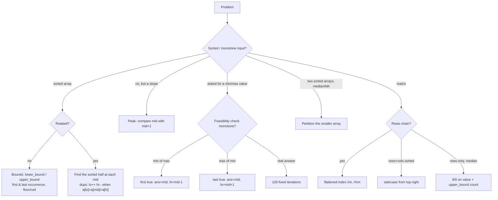

# Part 16: Binary Search

← [Striver course map](../README.md)

> [!abstract] What this part covers
> **Goal:** Make binary search mechanical: one template for "first true", one for "last true", and the habit of asking "what monotone yes/no question can I ask?" — on indices, on rotated halves, on answers, on partitions and on values.
> **Prereqs:** [Arrays](../14-arrays/README.md) · [Sorting](../13-sorting/README.md) **Time:** ~10 h.
> **Outcome:** Write lower/upper bound without off-by-one bugs, handle rotated arrays with duplicates, recognise "minimise the max / maximise the min" as binary search on answer, and do the median-of-two-arrays partition from memory.

---

## Theory

| # | Lesson | What you get | Source |
|---|---|---|---|
| 1 | [Binary Search Templates](01-binary-search-templates.md) | Closed vs half-open loops, first-true / last-true, overflow-safe mid, BS on answer, rotated arrays, real-valued search | [link](https://takeuforward.org/learning/dsa/search-x-in-sorted-array?category=fundamentals&source=strivers-a2z-dsa-sheet) |

Read these first; the problems below apply them.

---

## Problems

| # | Problem | Difficulty | Key insight | Optimal | Source |
|---|---|---|---|---|---|
| | **Fundamentals** | | | | |
| 2 | [Search X in Sorted Array](02-binary-search.md) | Easy | Compare with the middle element and throw away the half that cannot contain the target. Each step halves the range, so ≤ ⌈log₂(n + 1)⌉ comparisons. | O(log n) | [link](https://takeuforward.org/learning/dsa/search-x-in-sorted-array?category=fundamentals&source=strivers-a2z-dsa-sheet) |
| 3 | [Lower Bound](03-lower-bound.md) | Easy | Keep `ans = n`. When `nums[mid] ≥ x`, `mid` is a candidate — record it and look left for a smaller one. Otherwise go right. This "record and keep searching" shape solves every first/last-true question. | O(log n) | [link](https://takeuforward.org/learning/dsa/lower-bound-?category=fundamentals&source=strivers-a2z-dsa-sheet) |
| 4 | [Upper Bound](04-upper-bound.md) | Easy | Identical to lower bound with `≥` replaced by `>`. `upper_bound(x) − lower_bound(x)` counts occurrences of `x`. | O(log n) | [link](https://takeuforward.org/learning/dsa/upper-bound?category=fundamentals&source=strivers-a2z-dsa-sheet) |
| | **Logic building — 1D arrays** | | | | |
| 5 | [Search Insert Position](05-search-insert-position.md) | Easy | Both answers are the same number: the first index with `nums[i] ≥ target`. It's lower bound, unchanged. | O(log n) | [link](https://takeuforward.org/learning/dsa/search-insert-position?category=logic-building&source=strivers-a2z-dsa-sheet) |
| 6 | [Floor and Ceil in Sorted Array](06-floor-and-ceil.md) | Easy | Ceil is the value at lower bound. Floor is a mirror search: when `nums[mid] ≤ x`, record it and go right (last true of a T…T F…F predicate). | O(log n) | [link](https://takeuforward.org/learning/dsa/floor-and-ceil-in-sorted-array?category=logic-building&source=strivers-a2z-dsa-sheet) |
| 7 | [First and Last Occurrence](07-first-and-last-occurrence.md) | Easy | First = lower bound (if it holds target). Last = upper bound − 1. Or write one search with a flag: on a match, record and keep going left (first) or right (last). | O(log n) | [link](https://takeuforward.org/learning/dsa/first-and-last-occurrence?category=logic-building&source=strivers-a2z-dsa-sheet) |
| 8 | [Search in Rotated Sorted Array I](08-search-in-rotated-sorted-array-i.md) | Medium | Any `mid` splits the array into two halves and **at least one of them is sorted** (`nums[lo] ≤ nums[mid]` → left is sorted). Check whether the target lies inside the sorted half's range; if yes go there, else go to the other half. | O(log n) | [link](https://takeuforward.org/learning/dsa/search-in-rotated-sorted-array-i?category=logic-building&source=strivers-a2z-dsa-sheet) |
| 9 | [Search in Rotated Sorted Array II](09-search-in-rotated-sorted-array-ii.md) | Medium | Same "sorted half" logic — except when `nums[lo] == nums[mid] == nums[hi]` you can't tell which half is sorted. Then just drop both ends (`lo++`, `hi−−`); neither is the target since it equals `nums[mid]`, already checked. | O(log n) average, O(n) worst | [link](https://takeuforward.org/learning/dsa/search-in-rotated-sorted-array-2?category=logic-building&source=strivers-a2z-dsa-sheet) |
| 10 | [Find Minimum in Rotated Sorted Array](10-minimum-in-rotated-sorted-array.md) | Medium | Compare `nums[mid]` with `nums[hi]`. If `nums[mid] > nums[hi]`, the drop (and the minimum) is strictly right of `mid`; otherwise `mid` is on the lower ramp, so the minimum is at `mid` or left of it. | O(log n) | [link](https://takeuforward.org/learning/dsa/find-minimum-in-rotated-sorted-array?category=logic-building&source=strivers-a2z-dsa-sheet) |
| 11 | [Find Out How Many Times the Array Is Rotated](11-rotation-count.md) | Easy | The rotation count is the **index of the minimum**. Same binary search as the previous problem, return `lo` instead of `nums[lo]`. | O(log n) | [link](https://takeuforward.org/learning/dsa/find-out-how-many-times-the-array-is-rotated?category=logic-building&source=strivers-a2z-dsa-sheet) |
| 12 | [Single Element in a Sorted Array](12-single-element-in-sorted-array.md) | Medium | Before the single element, pairs start at **even** indices (`nums[2i] == nums[2i+1]`); after it, they start at odd indices. At an even `mid`, if `nums[mid] == nums[mid + 1]` the single is to the right; otherwise it's at `mid` or left. | O(log n) | [link](https://takeuforward.org/learning/dsa/single-element-in-sorted-array?category=logic-building&source=strivers-a2z-dsa-sheet) |
| 13 | [Count Occurrences in a Sorted Array](13-count-occurrences.md) | Easy | `upper_bound(target) − lower_bound(target)`. Two O(log n) searches, no presence check needed (absent → both bounds equal → 0). | O(log n) | [link](https://takeuforward.org/learning/dsa/count-occurrences-in-a-sorted-array?category=logic-building&source=strivers-a2z-dsa-sheet) |
| | **Binary search on answers** | | | | |
| 14 | [Find Square Root of a Number](14-square-root.md) | Easy | `mid² ≤ n` is true for small `mid` and false for large — monotone. The answer is the **last true** in `[0, n]`. Compute `mid * mid` in 64-bit (or compare `mid ≤ n / mid`). | O(log n) | [link](https://takeuforward.org/learning/dsa/find-square-root-of-a-number?category=on-answers&source=strivers-a2z-dsa-sheet) |
| 15 | [Find Nth Root of a Number](15-nth-root.md) | Medium | Binary search `x` in `[1, m]`. Compute `midⁿ` with early exit: stop multiplying as soon as the product exceeds `m` — no overflow and no floating point. | O(n log m) | [link](https://takeuforward.org/learning/dsa/find-nth-root-of-a-number?category=on-answers&source=strivers-a2z-dsa-sheet) |
| 16 | [Find the Smallest Divisor](16-smallest-divisor.md) | Medium | Larger `d` → every ceiling shrinks → sum is non-increasing. So feasibility is F…F T…T in `d ∈ [1, max(nums)]`; find the first true. | O(n log max) | [link](https://takeuforward.org/learning/dsa/find-the-smallest-divisor?category=on-answers&source=strivers-a2z-dsa-sheet) |
| 17 | [Koko Eating Bananas](17-koko-eating-bananas.md) | Medium | Hours needed at speed `k` = `Σ ⌈pile / k⌉`, non-increasing in `k`. Binary search the smallest `k ∈ [1, max(piles)]` with hours ≤ h. Structurally identical to the smallest divisor. | O(n log max) | [link](https://takeuforward.org/learning/dsa/koko-eating-bananas?category=on-answers&source=strivers-a2z-dsa-sheet) |
| 18 | [Minimum Days to Make M Bouquets](18-minimum-days-to-make-m-bouquets.md) | Medium | By day `d` the bloomed set only grows, so `bouquets(d)` is non-decreasing. Binary search `d ∈ [min, max]` of bloomDay; check counts runs of consecutive bloomed flowers, adding `run / k`. | O(n log(max − min)) | [link](https://takeuforward.org/learning/dsa/minimum-days-to-make-m-bouquets?category=on-answers&source=strivers-a2z-dsa-sheet) |
| 19 | [Capacity to Ship Packages Within D Days](19-ship-within-days.md) | Medium | Range `[max(w), Σw]`: below max a package never fits, at Σw it all ships in one day. Check = greedy: fill the current day until the next package overflows, then start a new day. Days needed is non-increasing in capacity. | O(n log Σw) | [link](https://takeuforward.org/learning/dsa/capacity-to-ship-packages-within-d-days?category=on-answers&source=strivers-a2z-dsa-sheet) |
| 20 | [Kth Missing Positive Number](20-kth-missing-positive-number.md) | Easy | Missing count before index `i` is `arr[i] − (i + 1)`, and it's non-decreasing. Binary search the first index where missing ≥ k; the answer is `lo + k` (with `lo` = that index). | O(log n) | [link](https://takeuforward.org/learning/dsa/kth-missing-positive-number?category=on-answers&source=strivers-a2z-dsa-sheet) |
| 21 | [Painter's Partition](21-painters-partition.md) | Hard | Same as shipping packages with `days = k`: binary search the max load in `[max, Σ]`, greedy-count painters needed. | O(n log Σ) | [link](https://takeuforward.org/learning/dsa/painters-partition?category=on-answers&source=strivers-a2z-dsa-sheet) |
| | **FAQs** | | | | |
| 22 | [Aggressive Cows](22-aggressive-cows.md) | Hard | If a gap `d` is achievable, every smaller gap is too — T…T F…F. Sort stalls, binary search the **last true** `d ∈ [1, max − min]`; the check greedily places each cow at the first stall ≥ previous + d. | O(n log n + n log range) | [link](https://takeuforward.org/learning/dsa/aggressive-cows?category=faqs&source=strivers-a2z-dsa-sheet) |
| 23 | [Book Allocation Problem](23-book-allocation-problem.md) | Hard | Exactly ship-within-days: binary search the max pages `[max, Σ]`, greedy-count students needed. The only extra is the `m > n` guard, because every student must get a book. | O(n log Σ) | [link](https://takeuforward.org/learning/dsa/book-allocation-problem?category=faqs&source=strivers-a2z-dsa-sheet) |
| 24 | [Find Peak Element](24-find-peak-element.md) | Medium | Compare `nums[mid]` with `nums[mid + 1]`. If it's rising, a peak exists to the right (the slope must come down by `nums[n] = −∞`). Otherwise `mid` or something left of it is a peak. Binary search on the slope, not on values. | O(log n) | [link](https://takeuforward.org/learning/dsa/find-peak-element?category=faqs&source=strivers-a2z-dsa-sheet) |
| 25 | [Median of 2 Sorted Arrays](25-median-of-two-sorted-arrays.md) | Hard | Binary search how many elements `c1` the **left half** takes from the smaller array; `c2 = half − c1` come from the other. The split is correct when `l1 ≤ r2` and `l2 ≤ r1`. Median comes from `max(l1, l2)` and `min(r1, r2)`. | O(log min(n₁, n₂)) | [link](https://takeuforward.org/learning/dsa/median-of-2-sorted-arrays?category=faqs&source=strivers-a2z-dsa-sheet) |
| 26 | [Kth Element of 2 Sorted Arrays](26-kth-element-of-two-sorted-arrays.md) | Medium | Same partition search as the median, with left-half size `k`. Bound `c1 ∈ [max(0, k − n₂), min(k, n₁)]` so `c2 = k − c1` stays valid. Answer = `max(l1, l2)`. | O(log min(n₁, n₂)) | [link](https://takeuforward.org/learning/dsa/kth-element-of-2-sorted-arrays?category=faqs&source=strivers-a2z-dsa-sheet) |
| 27 | [Minimize Max Distance to Gas Station](27-minimise-max-distance-to-gas-station.md) | Hard | Binary search on a **real** answer `d`: a gap `g` needs `⌈g / d⌉ − 1` new stations to bring every piece ≤ d. Total needed is non-increasing in `d`. Iterate a fixed number of times (≈100) instead of comparing with an epsilon. | O(n · 100) | [link](https://takeuforward.org/learning/dsa/minimise-max-distance-to-gas-stations?category=faqs&source=strivers-a2z-dsa-sheet) |
| 28 | [Split Array — Largest Sum](28-split-array-largest-sum.md) | Hard | Third name for the same problem (Book Allocation, Painter's Partition). Binary search the largest sum `[max, Σ]` with the greedy part counter. | O(n log Σ) | [link](https://takeuforward.org/learning/dsa/split-array---largest-sum?category=faqs&source=strivers-a2z-dsa-sheet) |
| | **2D arrays** | | | | |
| 29 | [Find Row with Maximum 1's](29-row-with-maximum-ones.md) | Easy | In a sorted 0/1 row, ones = `m − lower_bound(row, 1)`. Do that per row: O(n log m). Or walk a staircase from the top-right: O(n + m). | O(n log m) | [link](https://takeuforward.org/learning/dsa/find-row-with-maximum-1's?category=2d-arrays&source=strivers-a2z-dsa-sheet) |
| 30 | [Search in a 2D Matrix](30-search-in-a-2d-matrix.md) | Medium | The matrix is one sorted array of length `n·m` laid out row by row. Binary search index `i ∈ [0, nm − 1]` and read `mat[i / m][i % m]`. | O(log(n · m)) | [link](https://takeuforward.org/learning/dsa/search-in-a-2d-matrix?category=2d-arrays&source=strivers-a2z-dsa-sheet) |
| 31 | [Search in 2D Matrix II](31-search-in-2d-matrix-ii.md) | Medium | Start at the top-right. It's the largest in its row and smallest in its column, so one comparison eliminates a whole row (too small → down) or column (too big → left). O(n + m). | O(n + m) | [link](https://takeuforward.org/learning/dsa/search-in-2d-matrix-ii?category=2d-arrays&source=strivers-a2z-dsa-sheet) |
| 32 | [Find Peak Element II](32-find-peak-element-ii.md) | Hard | Binary search **columns**. In column `mid`, take the row `r` of its maximum. That cell beats its up/down neighbours. If the left neighbour is bigger, a peak exists in the left half; if the right is bigger, in the right half; else it's a peak. O(n log m). | O(n log m) | [link](https://takeuforward.org/learning/dsa/find-peak-element-ii?category=2d-arrays&source=strivers-a2z-dsa-sheet) |
| 33 | [Matrix Median](33-matrix-median.md) | Hard | Binary search on the **value** `x ∈ [min, max]`. `count(≤ x)` = Σ `upper_bound(row, x)`, monotone in `x`. The median is the smallest `x` with count > nm/2. | O(n log m · log(max − min)) | [link](https://takeuforward.org/learning/dsa/matrix-median?category=2d-arrays&source=strivers-a2z-dsa-sheet) |

---

## Which binary search?

---

## Part 16 cheat sheet

| Shape | Range | Predicate | On true | Return |
|---|---|---|---|---|
| lower_bound (first ≥ x) | `[0, n)` | `a[mid] ≥ x` | `ans = mid, hi = mid − 1` | `ans` (init `n`) |
| upper_bound (first > x) | `[0, n)` | `a[mid] > x` | `ans = mid, hi = mid − 1` | `ans` (init `n`) |
| Rotated search | `[0, n)` | which half is sorted, is x in it | shrink to that half | index / −1 |
| Min in rotated | `[0, n)` | left half sorted → `ans = min(ans, a[lo])`, go right | — | `ans` |
| Min of max (ship, split, books, koko) | `[max, Σ]` / `[1, max]` | `need(mid) ≤ limit` | `ans = mid, hi = mid − 1` | `ans` |
| Max of min (cows) | `[1, max − min]` | `place(mid) ≥ k` | `ans = mid, lo = mid + 1` | `ans` |
| Real answer (gas stations) | `[0, maxgap]` | `need(mid) ≤ k` | `hi = mid` | `hi` after 100 iters |
| Two arrays median / kth | `c1 ∈ [0, n₁]` | `l1 ≤ r2 && l2 ≤ r1` | done | from `l*`, `r*` |
| Matrix median | `[min, max]` | `count(≤ mid) > nm/2` | `hi = mid − 1` | `lo` |

**Facts interviewers test:** `mid = lo + (hi − lo) / 2` avoids overflow (Java: `(lo + hi) >>> 1`). With `while lo ≤ hi`, both updates must be `mid ± 1`; with `while lo < hi` and `hi = mid`, the loop ends on `lo == hi` — mixing the two causes infinite loops. Sortedness isn't required, only a predicate that is `F…F T…T` (or which half holds an answer). For BS on answer, state the range bounds aloud (why `max(arr)` and not 0) and the check's cost: total O(check · log range). Rotated with duplicates degrades to O(n) worst case (`[1,1,1,0,1]`). For real-valued answers, loop a fixed number of times rather than `while hi − lo > ε`.

---

## Mastery checklist

- [ ] Write lower_bound and upper_bound from memory, and derive floor/ceil, first/last occurrence and count from them
- [ ] Search a rotated array, with and without duplicates, and say why duplicates make it O(n) worst case
- [ ] Find the minimum and the rotation count of a rotated array
- [ ] Find the single element in a sorted array of pairs using even/odd index parity
- [ ] Write the BS-on-answer skeleton and fill in the check for Koko, ship, bouquets, divisor, painters
- [ ] Do aggressive cows and explain why max-of-min goes right on true
- [ ] Explain median of two sorted arrays: half size, why the smaller array, the ±∞ sentinels
- [ ] Pick between flattened search, staircase, and value search for a matrix

**Interview track →** [Binary search deep-dive](../../02-algorithms/11-binary-search.md) · [Binary search walkthroughs](../../coding/algorithms/11-binary-search.md)

Next part → [Strings (Basic and Medium)](../17-strings-basic-medium/README.md)
