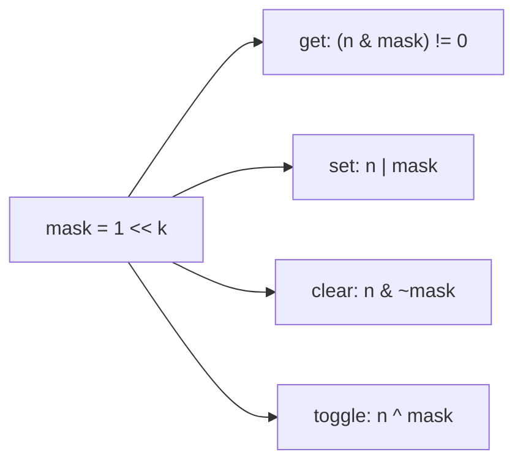

# 1. Bits and Tricks

← [Part 20 index](README.md) · Next → [Check if the i-th Bit is Set](02-check-if-the-i-th-bit-is-set.md)

> [!abstract] What this covers
> **Core idea:** An integer is a fixed-width array of bits that the CPU can read, write and combine **32 or 64 slots at a time** in one instruction. Most of the tricks in this part come from a handful of identities: `x ^ x = 0`, `n & (n − 1)` clears the lowest set bit, and `−x = ~x + 1`.
> **You'll be able to:** convert between decimal and binary; explain two's complement and why `INT_MIN` is special; use the six bitwise operators and both shifts correctly; get, set, clear and toggle bit k; apply the lowest-bit one-liners; reason with XOR; enumerate subsets and submasks with masks; avoid the precedence, overflow and shift pitfalls in C++/Java/Python.
> **Source:** [takeuforward lesson](https://takeuforward.org/learning/dsa/introduction-to-bits-and-tricks?category=theory&source=strivers-a2z-dsa-sheet) · **Time:** 45 min

**Sections:** [1. Binary representation](#1-binary-representation) · [2. Two's complement](#2-twos-complement) · [3. Operators](#3-operators) · [4. Shifts](#4-shifts) · [5. Single-bit operations](#5-single-bit-operations) · [6. Lowest-bit tricks](#6-lowest-bit-tricks) · [7. XOR](#7-xor) · [8. Masks as sets](#8-masks-as-sets) · [9. Language pitfalls](#9-language-pitfalls) · [Common mistakes](#common-mistakes) · [Practice](#practice) · [Key terms](#key-terms) · [Flashcards](#flashcards)

---

## 1. Binary representation

`n = Σ bᵢ · 2ⁱ`, with bit 0 the **least significant bit (LSB)**. An n-bit unsigned number covers `0 … 2ⁿ − 1`.

| Decimal → binary | Binary → decimal |
|---|---|
| Repeatedly divide by 2; remainders read **bottom-up** | Sum the place values of the set bits |
| 13 → 6 r1 → 3 r0 → 1 r1 → 0 r1 ⇒ `1101` | `1101` = 8 + 4 + 0 + 1 = 13 |

```python
def to_binary(n):              # n ≥ 0
    if n == 0:
        return "0"
    s = []
    while n:
        s.append(str(n & 1))   # same as n % 2
        n >>= 1                # same as n // 2
    return "".join(reversed(s))

def to_decimal(s):
    n = 0
    for ch in s:
        n = n * 2 + (ch == '1')   # or n = (n << 1) | bit
    return n
```

Both are O(log n): a number n has `⌊log₂ n⌋ + 1` bits. **Built-ins:** `bin(n)`, `int(s, 2)`, `n.bit_length()` (Python); `bitset<32>(n)`, `stoi(s, nullptr, 2)` (C++); `Integer.toBinaryString(n)`, `Integer.parseInt(s, 2)` (Java).

**Powers of two you should recognise on sight:** 2¹⁰ = 1024 ≈ 10³, 2²⁰ ≈ 10⁶, 2³⁰ ≈ 10⁹, 2³¹ − 1 = 2 147 483 647 (INT_MAX), 2⁶³ − 1 ≈ 9.2 · 10¹⁸ (LLONG_MAX).

---

## 2. Two's complement

Signed integers use **two's complement**: the top bit has weight **−2ⁿ⁻¹** instead of +2ⁿ⁻¹. For 32 bits the range is `[−2³¹, 2³¹ − 1]`.

**Negation:** `−x = ~x + 1` (flip every bit, add one).

| Value | 8-bit pattern | How |
|---|---|---|
| 5 | `0000 0101` | |
| ~5 | `1111 1010` | flip |
| −5 | `1111 1011` | flip + 1 |
| −1 | `1111 1111` | all ones |
| −128 (MIN) | `1000 0000` | only the sign bit |
| 127 (MAX) | `0111 1111` | |

Why this encoding: addition and subtraction work the same for signed and unsigned (just wrap modulo 2ⁿ), there is one zero, and `x + (−x)` = `x + ~x + 1` = `1…1 + 1` = 0.

**INT_MIN is its own negation:** `~(1000…0) + 1 = 0111…1 + 1 = 1000…0`. So `−INT_MIN`, `abs(INT_MIN)` and `INT_MIN / −1` overflow. This is the root of the special cases in [Divide Two Integers](12-divide-two-integers.md) and [Single Number III](11-single-number-iii.md).

**One's complement** (just flip bits) has two zeros and isn't used for integers on modern hardware; it's why the operation `~x` equals `−x − 1`.

---

## 3. Operators

| Op | Name | Bit rule | Example (`a = 1100`, `b = 1010`) |
|---|---|---|---|
| `&` | AND | 1 iff both 1 | `1000` |
| `\|` | OR | 1 iff at least one 1 | `1110` |
| `^` | XOR | 1 iff different | `0110` |
| `~` | NOT | flip | `~a = …0011` (= −13) |
| `<<` | left shift | move left, fill 0 | `a << 1 = 11000` |
| `>>` | right shift | move right | `a >> 2 = 0011` |

Mental model: **AND = filter** (keep bits where the mask is 1), **OR = turn on**, **XOR = flip where the mask is 1**, **NOT = complement**.

**Precedence (C, C++, Java):** `~` > arithmetic > shifts > relational (`<` `>`) > equality (`==` `!=`) > `&` > `^` > `|` > `&&` > `||`. So `x & 1 == 0` means `x & (1 == 0)` = `x & 0` = 0. **Always parenthesise bitwise expressions.** Python puts the comparisons *below* the bitwise operators, so `x & 1 == 0` is fine there, but it's a bad habit to carry into C++/Java.

---

## 4. Shifts

| Shift | Effect (non-negative x) | Caveats |
|---|---|---|
| `x << k` | `x · 2ᵏ` | overflows when bits leave the top; `1 << 31` is INT_MIN in int, UB in C++ if it changes the sign (pre-C++20) |
| `x >> k` | `⌊x / 2ᵏ⌋` | for negative signed x: **arithmetic** shift (fills with 1s), = floor division, so `−7 >> 1 = −4` (while `−7 / 2 = −3`) |
| `x >>> k` (Java only) | logical shift: fills with 0 | `−1 >>> 28 = 15` |

- Shift count must be `< width`: `1 << 32` on int is UB in C++ and is `1 << 0 = 1` in Java (count taken mod 32). Use `1LL << k` / `1L << k` for k ≥ 31.
- In Python ints are unbounded: `1 << 100` works, `>>` is always floor division, and there's no `>>>`.
- `(lo + hi) >>> 1` (Java) is an overflow-free midpoint — the same trick as `lo + (hi − lo) / 2`.

---

## 5. Single-bit operations



| Op | Expression | Why |
|---|---|---|
| Get bit k | `(n >> k) & 1` | move bit k to position 0, keep it |
| Set bit k | `n \| (1 << k)` | OR with 1 forces 1, OR with 0 keeps |
| Clear bit k | `n & ~(1 << k)` | mask is all 1s except at k |
| Toggle bit k | `n ^ (1 << k)` | XOR with 1 flips, with 0 keeps |
| Assign bit k to b | `(n & ~(1 << k)) \| (b << k)` | clear then set |
| Low k bits | `n & ((1 << k) − 1)` | = `n mod 2ᵏ` for n ≥ 0 |
| Clear bits ≥ k | same as above | |
| Clear bits < k | `n & ~((1 << k) − 1)` | = `n & (−1 << k)` |

```cpp
bool get(int n, int k)  { return (n >> k) & 1; }
int  set(int n, int k)  { return n | (1 << k); }
int  clr(int n, int k)  { return n & ~(1 << k); }
int  flip(int n, int k) { return n ^ (1 << k); }
```

Problems: [Check i-th bit](02-check-if-the-i-th-bit-is-set.md), [Odd check](03-check-if-a-number-is-odd.md).

---

## 6. Lowest-bit tricks

Write `n = P 1 0…0` (some prefix P, the lowest set bit, then t zeros). Then:

| Expression | Result pattern | Meaning |
|---|---|---|
| `n − 1` | `P 0 1…1` | lowest set bit → 0, zeros below → 1 |
| `n & (n − 1)` | `P 0 0…0` | **clear lowest set bit** |
| `−n = ~n + 1` | `~P 1 0…0` | prefix flipped, low part same |
| `n & −n` | `0 1 0…0` | **isolate lowest set bit** |
| `n \| (n − 1)` | `P 1 1…1` | fill the trailing zeros |
| `n ^ (n − 1)` | `0 1 1…1` | mask of lowest set bit and below |

And mirrored for the lowest **unset** bit, writing `n = P 0 1…1`:

| Expression | Meaning |
|---|---|
| `n \| (n + 1)` | **set lowest unset bit** |
| `n & (n + 1)` | clear trailing ones |
| `~n & (n + 1)` | isolate lowest unset bit |

**Uses:**
- **Power of two:** `n > 0 && (n & (n − 1)) == 0` (exactly one set bit). → [Power of 2](04-check-if-a-number-is-power-of-2.md)
- **Popcount (Kernighan):** `while n: n &= n − 1; c++` — runs once per set bit. → [Count set bits](05-count-the-number-of-set-bits.md)
- **Iterate set bits:** `while m: low = m & −m; …; m ^= low`.
- **Fenwick tree:** `i += i & −i` / `i −= i & −i`.
- **Split two singles:** partition by `x & −x`. → [Single Number III](11-single-number-iii.md)

**Built-ins:** `__builtin_popcount(x)` / `__builtin_popcountll`, `__builtin_ctz` (trailing zeros, UB for 0), `__builtin_clz`; Java `Integer.bitCount`, `Integer.numberOfTrailingZeros`, `Integer.highestOneBit`, `Integer.lowestOneBit`; Python `x.bit_count()` (3.10+), `x.bit_length()`, `(x & −x).bit_length() − 1` for ctz.

---

## 7. XOR

| Identity | Consequence |
|---|---|
| `x ^ 0 = x` | 0 is the identity |
| `x ^ x = 0` | every value is its own inverse — **pairs cancel** |
| commutative, associative | order doesn't matter; XOR a whole array in any order |
| `a ^ b = c ⇔ a = b ^ c` | you can "undo" an XOR |
| `a ^ b` = addition without carry | `a + b = (a ^ b) + 2·(a & b)` |
| `a ^ b` has 1s where a, b differ | Hamming distance = popcount(a ^ b) |

**Patterns built on these:**

| Pattern | Problem |
|---|---|
| XOR all, pairs cancel | [Single Number I](09-single-number-i.md), missing number |
| XOR mask of differences | [Min bit flips](08-minimum-bit-flips-to-convert-number.md) |
| XOR swap | [Swap two numbers](07-swap-two-numbers.md) |
| Prefix XOR: `xor(l..r) = px[r] ^ px[l−1]` | [XOR of L…R](14-xor-of-numbers-in-a-given-range.md), subarrays with XOR k |
| XOR all → split by a differing bit | [Single Number III](11-single-number-iii.md) |
| Doesn't cancel triples → count bits mod 3 | [Single Number II](10-single-number-ii.md) |
| Maximise `a ^ b` greedily from the top bit | Max XOR pair → binary trie (Part 29) |

**XOR of 0…n** repeats with period 4 — `n, 1, n + 1, 0` for `n mod 4 = 0, 1, 2, 3` — because each aligned block `4k … 4k + 3` XORs to 0.

---

## 8. Masks as sets

An n-bit mask is a subset of `{0, …, n − 1}`: bit i set ⇔ i is in the set.

| Set operation | Mask operation |
|---|---|
| ∅ / full set | `0` / `(1 << n) − 1` |
| add / remove / contains i | `m \| 1<<i` / `m & ~(1<<i)` / `m >> i & 1` |
| union / intersection | `a \| b` / `a & b` |
| difference a \ b | `a & ~b` |
| complement (within n bits) | `m ^ ((1 << n) − 1)` |
| symmetric difference | `a ^ b` |
| size | popcount(m) |
| is a ⊆ b | `(a & b) == a` |

**All subsets of n elements:** `for mask in 0 … 2ⁿ − 1` — O(n · 2ⁿ). Feasible for n ≤ ~20 (10⁶ masks). → [Power Set](13-power-set.md)

**All submasks of m** (descending, including m, excluding 0):

```python
s = m
while s:
    process(s)
    s = (s - 1) & m      # drop to the next smaller submask
process(0)
```

Summed over every m in `0 … 2ⁿ − 1`, this is **O(3ⁿ)** — each element is in m and s, in m only, or in neither. It's the loop at the heart of bitmask DP (TSP, partitioning into groups).

**Gray code:** `g(i) = i ^ (i >> 1)` — consecutive codes differ in exactly one bit.

---

## 9. Language pitfalls

| Pitfall | C++ | Java | Python |
|---|---|---|---|
| `1 << 31` | INT_MIN (UB before C++20 for signed) | INT_MIN | 2147483648 |
| `1 << 40` | UB — use `1LL << 40` | `1 << 8` (count mod 32) — use `1L` | fine |
| `>>` on negatives | arithmetic | arithmetic; `>>>` logical | floor (always arithmetic) |
| `−INT_MIN`, `abs(INT_MIN)` | UB / overflow | stays INT_MIN | no limit |
| `x & 1 == 0` | wrong (precedence) | compile error (int & boolean) | correct |
| `~x` | `−x − 1` | `−x − 1` | `−x − 1` (infinite 1s to the left) |
| Popcount | `__builtin_popcount` | `Integer.bitCount` | `x.bit_count()` / `bin(x).count('1')` |
| Fixed-width ops | `unsigned`, `uint32_t` | `int` wraps; `long` | mask with `& 0xFFFFFFFF` |

**Python and negative numbers:** Python ints behave as if they have infinitely many sign bits, so `bin(−5)` is `'-0b101'`, not two's complement, and loops like `while n: n >>= 1` never end for negative n. To work in 32-bit:

```python
MASK = 0xFFFFFFFF
x &= MASK                                   # view as unsigned 32-bit
signed = x - (1 << 32) if x >> 31 else x   # back to signed
```

**`n % 2` vs `n & 1`:** in C++/Java `−3 % 2 == −1`, so `n % 2 == 1` misses negative odd numbers; `n & 1` doesn't. Compilers already turn `n / 2`, `n % 2` (for unsigned) and `n * 8` into shifts — use the bitwise form for clarity of intent, not speed.

---

## Common mistakes

- Forgetting parentheses: `if (n & mask == 0)` in C++/Java.
- `1 << k` for k ≥ 31 in a 32-bit int; writing `1 << k` when you need `1LL << k`.
- Looping `while (n) n >>= 1` on a negative signed int — arithmetic shift refills with 1s forever (use `>>>` or `unsigned`).
- Power-of-two check without `n > 0`.
- Comparing `(n & (1 << k)) == 1` — the result is 2ᵏ, compare with `!= 0`.
- Taking `abs()` or negating INT_MIN.
- In Python, expecting `~x` to be a 32-bit unsigned flip (it's `−x − 1`), or forgetting the 32-bit sign conversion.
- Using bitmask enumeration for n > ~25.

## Practice

1. Without a loop, return the value of the highest set bit of a positive 32-bit n.
2. Count the bits that must change to turn 29 into 15.
3. Reverse the bits of a 32-bit unsigned integer (LC 190).
4. Given n, return the number with its bits in positions [l, r] (inclusive) cleared.
5. Why does `x ^ (x >> 1)` produce a Gray code?
6. Add two integers without `+` or `−` (LC 371).

<details><summary>Answer sketches</summary>

1. Smear: `n |= n>>1; n |= n>>2; n |= n>>4; n |= n>>8; n |= n>>16;` then `n − (n >> 1)`. Or `1 << (31 − __builtin_clz(n))`, or `Integer.highestOneBit(n)`.
2. `29 ^ 15 = 11101 ^ 01111 = 10010` → popcount 2.
3. Loop 32 times: `res = (res << 1) | (n & 1); n >>= 1`. O(1)-ish alternative: swap halves, then quarters, … with masks `0xFFFF0000`, `0xFF00FF00`, `0xF0F0F0F0`, `0xCCCCCCCC`, `0xAAAAAAAA`.
4. `mask = ((1 << (r − l + 1)) − 1) << l`; return `n & ~mask`.
5. Going from i to i + 1 flips a run of trailing 1s plus one 0; XOR with the shifted copy cancels everything in that run except one position, so exactly one output bit changes.
6. `while b: carry = (a & b) << 1; a ^= b; b = carry` (sum without carry plus carry). In Python, mask to 32 bits each step and convert the sign at the end.

</details>

## Key terms

| Term | Meaning |
|---|---|
| LSB / MSB | Least / most significant bit (bit 0 / bit w − 1) |
| Two's complement | Signed encoding where `−x = ~x + 1`; top bit weight −2ʷ⁻¹ |
| Mask | Integer whose set bits select positions to test, set, clear or flip |
| Popcount / Hamming weight | Number of set bits |
| Hamming distance | Number of positions where two numbers differ = popcount(a ^ b) |
| Arithmetic vs logical shift | Right shift that copies the sign bit vs fills with 0 |
| Lowbit | `x & −x`, the lowest set bit alone |
| Submask | Mask s with `s & m == s` |

## Flashcards

**−x in two's complement?** #flashcard
`~x + 1`; so `~x = −x − 1`.

**Why does negating INT_MIN overflow?** #flashcard
INT_MIN = `100…0`; `~` gives INT_MAX, `+1` wraps back to INT_MIN. 2³¹ isn't representable.

**Get / set / clear / toggle bit k?** #flashcard
`(n >> k) & 1`, `n | 1<<k`, `n & ~(1<<k)`, `n ^ 1<<k`.

**n & (n − 1) and n & −n?** #flashcard
Clear the lowest set bit; isolate the lowest set bit.

**Set the lowest unset bit?** #flashcard
`n | (n + 1)`.

**Why must you parenthesise `n & mask` in C++/Java comparisons?** #flashcard
`==`/`!=` bind tighter than `&`, `^`, `|`.

**Arithmetic vs logical right shift?** #flashcard
Arithmetic copies the sign bit (`>>` on signed); logical fills with 0 (`>>>` in Java, `>>` on unsigned in C++).

**Three XOR facts used everywhere?** #flashcard
`x ^ 0 = x`, `x ^ x = 0`, commutative and associative.

**a + b in terms of XOR and AND?** #flashcard
`(a ^ b) + 2·(a & b)` — sum without carry plus the carry.

**Enumerate all submasks of m; total cost over all m?** #flashcard
`s = (s − 1) & m` until 0; O(3ⁿ).

**Python: make x a signed 32-bit value?** #flashcard
`x &= 0xFFFFFFFF`; if `x >> 31`, subtract 2³².

**Interview track →** [Bit manipulation deep-dive](../../02-algorithms/17-bit-manipulation.md)
