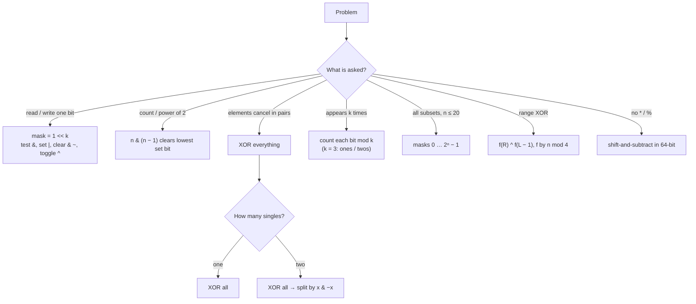

# Part 20: Bit Manipulation

← [Striver course map](../README.md)

> [!abstract] What this part covers
> **Goal:** Treat an integer as a 32-slot boolean array: read, write and count slots in O(1), and recognise when XOR cancellation, `n & (n − 1)` or a bitmask replaces a hash map, a loop or a recursion.
> **Prereqs:** [Basic Maths](../08-basic-maths/README.md) · [Recursion](../18-recursion/README.md) **Time:** ~5 h.
> **Outcome:** Write get/set/clear/toggle and the lowest-bit one-liners without thinking, explain two's complement and the INT_MIN traps, solve the Single Number family I–III, divide without `/`, and enumerate subsets with masks.

---

## Theory

| # | Lesson | What you get | Source |
|---|---|---|---|
| 1 | [Bits and Tricks](01-bits-and-tricks.md) | Binary and two's complement, operators and shifts, get/set/clear/toggle, n & (n−1), x & −x, XOR identities, masks and subsets, language pitfalls | [link](https://takeuforward.org/learning/dsa/introduction-to-bits-and-tricks?category=theory&source=strivers-a2z-dsa-sheet) |

Read these first; the problems below apply them.

---

## Problems

| # | Problem | Difficulty | Key insight | Optimal | Source |
|---|---|---|---|---|---|
| | **Bit fundamentals** | | | | |
| 2 | [Check if the i-th Bit is Set](02-check-if-the-i-th-bit-is-set.md) | Easy | Build a mask with only bit k set (`1 << k`) and AND it with n, or shift n right by k and look at the last bit. Both are O(1). | O(1) | [link](https://takeuforward.org/learning/dsa/check-if-the-i-th-bit-is-set-or-not?category=bit-fundamentals&source=strivers-a2z-dsa-sheet) |
| 3 | [Check if a Number is Odd](03-check-if-a-number-is-odd.md) | Easy | Every power of two except 2⁰ is even, so parity is decided entirely by bit 0: `n & 1`. In two's complement this also works for negatives. | O(1) | [link](https://takeuforward.org/learning/dsa/check-if-a-number-is-odd-or-not?category=bit-fundamentals&source=strivers-a2z-dsa-sheet) |
| 4 | [Check if a Number is Power of 2](04-check-if-a-number-is-power-of-2.md) | Easy | A power of two has exactly one set bit. `n − 1` flips that bit to 0 and all bits below it to 1, so `n & (n − 1) == 0` exactly when n has one set bit — plus the guard `n > 0`. | O(1) | [link](https://takeuforward.org/learning/dsa/check-if-a-number-is-power-of-2-or-not?category=bit-fundamentals&source=strivers-a2z-dsa-sheet) |
| 5 | [Count the Number of Set Bits](05-count-the-number-of-set-bits.md) | Easy | Brian Kernighan: `n &= n − 1` deletes one set bit per iteration, so the loop runs popcount(n) times instead of 32. | O(popcount) | [link](https://takeuforward.org/learning/dsa/count-the-number-of-set-bits?category=bit-fundamentals&source=strivers-a2z-dsa-sheet) |
| 6 | [Set the Rightmost Unset Bit](06-set-the-rightmost-unset-bit.md) | Easy | `n + 1` flips the trailing 1s to 0 and the lowest 0 to 1. ORing with n restores the trailing 1s, leaving exactly the lowest 0 set: `n | (n + 1)`. | O(1) | [link](https://takeuforward.org/learning/dsa/set-the-rightmost-unset-bit?category=bit-fundamentals&source=strivers-a2z-dsa-sheet) |
| 7 | [Swap Two Numbers](07-swap-two-numbers.md) | Easy | XOR is its own inverse: `a ^= b; b ^= a; a ^= b` — after step 2, `b = b ^ (a ^ b) = a`; after step 3, `a = (a ^ b) ^ a = b`. | O(1) | [link](https://takeuforward.org/learning/dsa/swap-two-numbers?category=bit-fundamentals&source=strivers-a2z-dsa-sheet) |
| | **Problems** | | | | |
| 8 | [Minimum Bit Flips to Convert Number](08-minimum-bit-flips-to-convert-number.md) | Easy | XOR marks exactly the positions that differ; each one needs one flip. Answer = popcount(start ^ goal). | O(popcount) | [link](https://takeuforward.org/learning/dsa/minimum-bit-flips-to-convert-number?category=problems&source=strivers-a2z-dsa-sheet) |
| 9 | [Single Number I](09-single-number-i.md) | Easy | XOR all elements: pairs cancel (`x ^ x = 0`), order doesn't matter (commutative, associative), and the survivor is the single number. | O(n) | [link](https://takeuforward.org/learning/dsa/single-number---i?category=problems&source=strivers-a2z-dsa-sheet) |
| 10 | [Single Number II](10-single-number-ii.md) | Medium | XOR no longer cancels triples. Count each bit position across all numbers: a bit belongs to the single number iff its count isn't a multiple of 3. The `ones`/`twos` state machine does that count mod 3 for all 32 bits at once. | O(n) | [link](https://takeuforward.org/learning/dsa/single-number---ii?category=problems&source=strivers-a2z-dsa-sheet) |
| 11 | [Single Number III](11-single-number-iii.md) | Medium | XOR of all = a ^ b ≠ 0, so a and b differ in at least one bit. Pick the lowest set bit of `a ^ b`, split the array by that bit — a and b land in different groups and every pair lands together — then XOR each group. | O(n) | [link](https://takeuforward.org/learning/dsa/single-number---iii?category=problems&source=strivers-a2z-dsa-sheet) |
| 12 | [Divide Two Integers](12-divide-two-integers.md) | Medium | Repeated subtraction is O(quotient). Instead subtract the largest `divisor · 2ᵏ` (built by left shifts) that fits — that's long division in base 2, O(log² n) or O(log n). | O(log² n) | [link](https://takeuforward.org/learning/dsa/divide-two-numbers-without-multiplication-and-division?category=problems&source=strivers-a2z-dsa-sheet) |
| 13 | [Power Set (Bit Manipulation)](13-power-set.md) | Medium | Masks 0 … 2ⁿ − 1 are in one-to-one correspondence with subsets: bit i of the mask says whether `nums[i]` is included. | O(n·2ⁿ) | [link](https://takeuforward.org/learning/dsa/power-set-bit-manipulation?category=problems&source=strivers-a2z-dsa-sheet) |
| 14 | [XOR of Numbers in a Given Range](14-xor-of-numbers-in-a-given-range.md) | Medium | Prefix XOR f(n) = 0 ^ 1 ^ … ^ n follows a period-4 pattern: n, 1, n + 1, 0 for n mod 4 = 0, 1, 2, 3. Then XOR(L…R) = f(R) ^ f(L − 1), just like prefix sums. | O(1) | [link](https://takeuforward.org/learning/dsa/xor-of-numbers-in-a-given-range?category=problems&source=strivers-a2z-dsa-sheet) |

---

## Which bit trick?

---

## Part 20 cheat sheet

| Goal | Expression | Note |
|---|---|---|
| Test bit k | `(n >> k) & 1` | or `(n & (1 << k)) != 0` |
| Set / clear / toggle bit k | `n \| 1<<k` · `n & ~(1<<k)` · `n ^ 1<<k` | |
| Odd? | `n & 1` | correct for negatives |
| Clear lowest set bit | `n & (n − 1)` | Kernighan, power of 2 |
| Isolate lowest set bit | `n & −n` | unsigned in C++ for INT_MIN |
| Set lowest unset bit | `n \| (n + 1)` | |
| Power of 2 | `n > 0 && !(n & (n − 1))` | guard `n > 0` |
| Low k bits mask | `(1 << k) − 1` | `n mod 2ᵏ` = `n & mask` |
| XOR 0…n | `[n, 1, n+1, 0][n % 4]` | |
| Swap | `a ^= b; b ^= a; a ^= b` | breaks if aliased |
| Submasks of m | `s = (s − 1) & m` | O(3ⁿ) over all m |

**Facts interviewers test:** `&`, `|`, `^` bind **looser** than `==` in C/C++/Java — always parenthesise. `>>` is arithmetic on signed ints (fills with the sign bit); Java has `>>>` for logical shift. `1 << 31` overflows a signed int; use `1L`/`1LL`/`1u`. `−INT_MIN` and `abs(INT_MIN)` overflow. Python ints are unbounded — emulate 32-bit with `& 0xFFFFFFFF` and convert back by subtracting 2³² when ≥ 2³¹.

---

## Mastery checklist

- [ ] Convert decimal ⇄ binary by hand and compute the two's complement of a negative number
- [ ] Write get / set / clear / toggle bit k and explain operator precedence pitfalls
- [ ] Explain why n & (n − 1) clears the lowest set bit and use it for power-of-two and popcount
- [ ] Solve Single Number I, II (bit count mod 3 and ones/twos) and III (split by lowest set bit)
- [ ] Divide two integers with shifts, handling INT_MIN / −1
- [ ] Generate the power set with masks and enumerate submasks
- [ ] Derive the XOR 0…n period-4 pattern

**Interview track →** [Bit manipulation deep-dive](../../02-algorithms/17-bit-manipulation.md)

Next part → [Greedy Algorithms](../21-greedy-algorithms/README.md)
