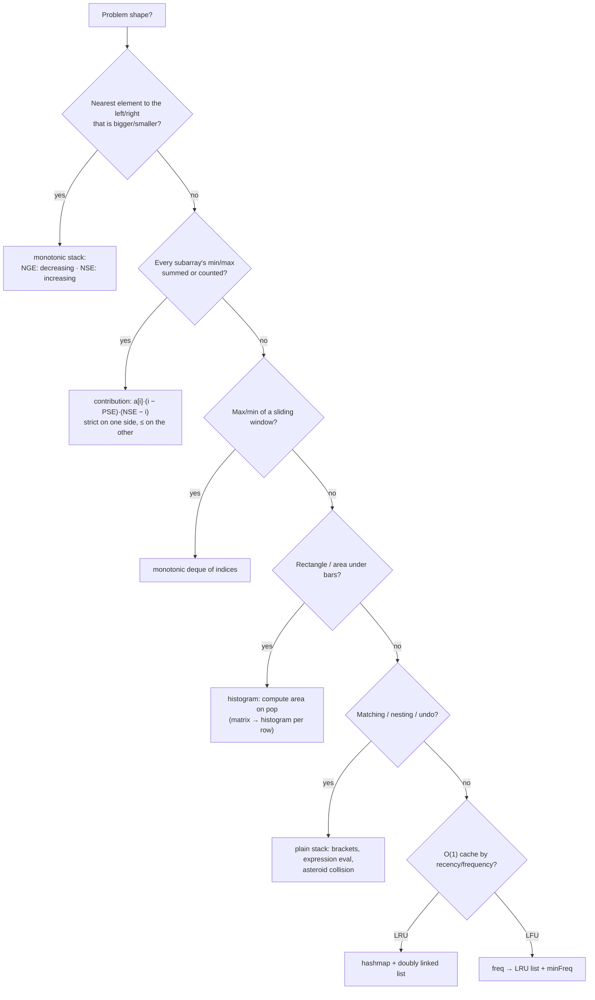

# Part 23: Stack / Queues

← [Striver course map](../README.md)

> [!abstract] What this part covers
> **Goal:** Implement stacks and queues on any substrate, convert between infix/prefix/postfix, and recognise every monotonic-stack shape (next/previous greater/smaller, contribution counting, histogram) plus the classic stack/queue design problems (min stack, LRU, LFU).
> **Prereqs:** [Arrays](../14-arrays/README.md) · [Linked List](../19-linked-list/README.md) **Time:** ~10 h.
> **Outcome:** Write stack/queue from arrays, linked lists and each other; solve NGE/NSE/PSE variants, asteroid collision, sum of subarray minimums/ranges, remove K digits, histogram, maximal rectangle, trapping rain water, sliding window max, stock span, celebrity, LRU and LFU in optimal time, and justify each amortised O(n) bound.

---

## Theory

| # | Lesson | What you get | Source |
|---|---|---|---|
| 1 | [Stacks & Queues: Implementations, Monotonic Stacks and Design](01-stack-queue-implementation-theory.md) | LIFO/FIFO contracts, array/circular-buffer/linked-list implementations, stack↔queue simulation and amortised cost, deque, expression notation, monotonic stack/deque templates, contribution technique, design-problem recipes | [link](https://takeuforward.org/learning/dsa/implementation-using-different-ds?category=implementation&source=strivers-a2z-dsa-sheet) |

Read these first; the problems below apply them.

---

## Problems

| # | Problem | Difficulty | Key insight | Optimal | Source |
|---|---|---|---|---|---|
| | **Implementation** | | | | |
| 2 | [Implement Stack using Arrays](02-implement-stack-using-arrays.md) | Easy | One index `t` marks the top element. `push` writes at `++t` and `pop` reads at `t--`. A fixed array overflows, so double the capacity when it is full. Each element is copied O(1) times on average, so push is **amortised** O(1). | O(1) amortised | [link](https://takeuforward.org/learning/dsa/implement-stack-using-arrays?category=implementation&source=strivers-a2z-dsa-sheet) |
| 3 | [Implement Queue using Arrays](03-implement-queue-using-arrays.md) | Easy | Use a **circular buffer**. Keep `front` and `count`; the back slot is `(front + count) % cap`. Both ends move forward modulo `cap`, so nothing ever shifts. When it's full, copy into a 2× buffer in queue order. | O(1) amortised | [link](https://takeuforward.org/learning/dsa/implement-queue-using-arrays?category=implementation&source=strivers-a2z-dsa-sheet) |
| 4 | [Implement Stack using Queue](04-implement-stack-using-queue.md) | Easy | Make **push** the expensive operation. After enqueuing `x`, rotate the `size − 1` older elements from the front to the back. `x` is now at the front, so `pop` and `top` are plain queue `pop` and `front`. | push O(n), pop O(1) | [link](https://takeuforward.org/learning/dsa/implement-stack-using-queue?category=implementation&source=strivers-a2z-dsa-sheet) |
| 5 | [Implement Queue using Stack](05-implement-queue-using-stack.md) | Easy | Use two stacks: `in` for pushes and `out` for pops. When `out` is empty, pour all of `in` into it, which reverses the order so the oldest is on top. Each element is moved **at most once**, so every operation is amortised O(1). | O(1) amortised | [link](https://takeuforward.org/learning/dsa/implement-queue-using-stack?category=implementation&source=strivers-a2z-dsa-sheet) |
| 6 | [Implement stack using Linkedlist](06-implement-stack-using-linkedlist.md) | Easy | The **head** of the list is the top. Push allocates a node pointing to the old head; pop unlinks the head. No resizing and no wasted capacity, at the cost of one pointer per element and worse cache locality. | O(1) per op | [link](https://takeuforward.org/learning/dsa/implement-stack-using-linkedlist?category=implementation&source=strivers-a2z-dsa-sheet) |
| 7 | [Implement queue using Linkedlist](07-implement-queue-using-linkedlist.md) | Easy | Keep **two** pointers: dequeue at `head`, enqueue after `tail`. In a singly linked list, removal is O(1) only at the head and insertion is O(1) at either end (with a tail pointer). That forces head = front and tail = back. | O(1) per op | [link](https://takeuforward.org/learning/dsa/implement-queue-using-linkedlist?category=implementation&source=strivers-a2z-dsa-sheet) |
| 8 | [Balanced Paranthesis](08-balanced-parenthesis.md) | Easy | The most recently opened bracket must close first, which is exactly LIFO. Push each opener. On a closer, the stack top must be its matching opener. At the end the stack must be empty. | O(n) | [link](https://takeuforward.org/learning/dsa/balanced-paranthesis?category=implementation&source=strivers-a2z-dsa-sheet) |
| | **Prefix, infix and postfix conversions** | | | | |
| 9 | [Infix to Postfix Conversion](09-infix-to-postfix-conversion.md) | Medium | This is **shunting-yard**. Operands go straight to the output. An operator first pops every stacked operator that binds at least as tightly, then pushes itself. `^` is right-associative, so on equal precedence it does **not** pop. A `)` pops back to the matching `(`. | O(n) | [link](https://takeuforward.org/learning/dsa/infix-to-postfix-conversion?category=expression-conversions&source=strivers-a2z-dsa-sheet) |
| 10 | [Infix to Prefix Conversion](10-infix-to-prefix-conversion.md) | Medium | Reverse the string and swap `(` with `)`. Run shunting-yard with **flipped associativity**: pop on equal precedence only for `^`. Then reverse the output. Reversal turns left-associative chains into right-associative ones, which is why the tie rule flips. | O(n) | [link](https://takeuforward.org/learning/dsa/infix-to-prefix-conversion?category=expression-conversions&source=strivers-a2z-dsa-sheet) |
| 11 | [Prefix to Infix Conversion](11-prefix-to-infix-conversion.md) | Medium | Scan **right to left**. Operands are pushed. An operator pops `a` (top = left operand) then `b`, and pushes `(a op b)`. Right-to-left order means the left operand is the one pushed last. | O(n²) strings · O(n) with a tree | [link](https://takeuforward.org/learning/dsa/prefix-to-infix-conversion?category=expression-conversions&source=strivers-a2z-dsa-sheet) |
| 12 | [Prefix to Postfix Conversion](12-prefix-to-postfix-conversion.md) | Medium | Scan **right to left** with a stack of finished sub-expressions. An operator pops `a` (left) and `b` (right) and pushes `a + b + op`. Both notations are parenthesis-free, so no precedence is involved. | O(n²) strings · O(n) with a tree | [link](https://takeuforward.org/learning/dsa/prefix-to-postfix-conversion?category=expression-conversions&source=strivers-a2z-dsa-sheet) |
| 13 | [Postfix to Infix Conversion](13-postfix-to-infix-conversion.md) | Medium | Scan **left to right**. An operator pops `b` first (the **right** operand, pushed last), then `a`, and pushes `(a op b)`. | O(n²) strings · O(n) with a tree | [link](https://takeuforward.org/learning/dsa/postfix-to-infix-conversion?category=expression-conversions&source=strivers-a2z-dsa-sheet) |
| 14 | [Postfix to Prefix Conversion](14-postfix-to-prefix-conversion.md) | Medium | Scan **left to right**. An operator pops `b` (right) then `a` (left) and pushes `op + a + b`. This is the mirror of prefix → postfix. | O(n²) strings · O(n) with a tree | [link](https://takeuforward.org/learning/dsa/postfix-to-prefix-conversion?category=expression-conversions&source=strivers-a2z-dsa-sheet) |
| | **Monotonic stack** | | | | |
| 15 | [Next Greater Element](15-next-greater-element.md) | Medium | Scan **right to left** and keep a stack that **decreases from bottom to top**. Before answering for `a[i]`, pop every element `≤ a[i]`: those can never be anyone's answer again, because `a[i]` is both closer and at least as big. What remains on top is the answer. Then push `a[i]`. | O(n) | [link](https://takeuforward.org/learning/dsa/next-greater-element?category=monotonic-stack&source=strivers-a2z-dsa-sheet) |
| 16 | [Next Greater Element - 2](16-next-greater-element-ii.md) | Medium | Pretend the array is written twice: scan `i` from `2n−1` down to 0 using `a[i % n]`. The first pass (indices `n…2n−1`) only fills the stack with the 'wrapped-around' candidates; answers are recorded only for `i < n`. | O(n) | [link](https://takeuforward.org/learning/dsa/next-greater-element---2?category=monotonic-stack&source=strivers-a2z-dsa-sheet) |
| 17 | [Asteroid Collision](17-asteroid-collision.md) | Medium | A collision happens only when a **left-mover meets a right-mover that came before it**. Keep survivors on a stack. A new negative asteroid repeatedly smashes positive tops smaller than itself; equal sizes destroy both; a bigger positive top destroys the newcomer. | O(n) | [link](https://takeuforward.org/learning/dsa/asteroid-collision?category=monotonic-stack&source=strivers-a2z-dsa-sheet) |
| 18 | [Sum of Subarray Minimums](18-sum-of-subarray-minimums.md) | Medium | Flip it around: count how many subarrays have `arr[i]` as their minimum. If `L` = distance to the previous **smaller** element and `R` = distance to the next **smaller-or-equal** element, then `arr[i]` is the min of exactly `L·R` subarrays. Answer = `Σ arr[i]·L·R`. Using strict on one side and non-strict on the other counts ties exactly once. | O(n) | [link](https://takeuforward.org/learning/dsa/sum-of-subarray-minimums?category=monotonic-stack&source=strivers-a2z-dsa-sheet) |
| 19 | [Sum of Subarray Ranges](19-sum-of-subarray-ranges.md) | Medium | Linearity: Σ(max − min) = Σ max − Σ min. Each part is a contribution sum. `arr[i]` is the max of `(i − pge)·(nge − i)` subarrays and the min of `(i − pse)·(nse − i)`, with the same strict/non-strict tie split as in Sum of Subarray Minimums. | O(n) | [link](https://takeuforward.org/learning/dsa/sum-of-subarray-ranges?category=monotonic-stack&source=strivers-a2z-dsa-sheet) |
| 20 | [Remove K Digits](20-remove-k-digits.md) | Medium | Greedy from the left: a digit followed by a smaller digit should be removed, because lowering an earlier position beats anything later. A **non-decreasing stack** does this. Pop while `top > d` and `k > 0`. Any `k` left over is removed from the end. Strip leading zeros; empty means `"0"`. | O(n) | [link](https://takeuforward.org/learning/dsa/remove-k-digits?category=monotonic-stack&source=strivers-a2z-dsa-sheet) |
| 21 | [Next Smaller Element](21-next-smaller-element.md) | Medium | Mirror of NGE: keep the stack **increasing** from bottom to top. Scanning right to left, pop everything `≥ a[i]`; the remaining top is the nearest strictly smaller value. Paired with previous-smaller, this is the building block for histograms, contribution sums and span problems. | O(n) | [link](https://takeuforward.org/learning/dsa/next-smaller-element?category=monotonic-stack&source=strivers-a2z-dsa-sheet) |
| | **FAQs** | | | | |
| 22 | [Implement Min Stack](22-implement-min-stack.md) | Medium | The minimum only changes on push or pop, so **remember it per level**. Store `(x, min so far)` pairs. For O(1) extra space: when pushing `x < min`, store the **encoded** value `2x − min` (always `< x`) and set `min = x`. A popped value below `min` signals that the min must be restored: `min = 2·min − stored`. | O(1) all ops | [link](https://takeuforward.org/learning/dsa/implement-min-stack?category=faqs&source=strivers-a2z-dsa-sheet) |
| 23 | [Sliding Window Maximum](23-sliding-window-maximum.md) | Hard | Keep a **deque of indices whose values are decreasing**. A new element evicts smaller ones from the back: they're older *and* smaller, so they can never be a window max again. The front is the current max; drop it when it slides out of the window. | O(n) | [link](https://takeuforward.org/learning/dsa/sliding-window-maximum?category=faqs&source=strivers-a2z-dsa-sheet) |
| 24 | [Trapping Rainwater](24-trapping-rainwater.md) | Hard | Water above bar `i` = `min(maxLeft[i], maxRight[i]) − h[i]`. With **two pointers**, move the side with the smaller bar: that side's water is decided by its own running max, because the other side is already known to be at least as tall. | O(n) | [link](https://takeuforward.org/learning/dsa/trapping-rainwater?category=faqs&source=strivers-a2z-dsa-sheet) |
| 25 | [Largest rectangle in a histogram](25-largest-rectangle-in-a-histogram.md) | Hard | The best rectangle has some bar `i` as its **shortest** bar, and it stretches from just after the previous smaller bar to just before the next smaller one: area `h[i]·(nse − pse − 1)`. In one pass: when a bar is **popped** from an increasing stack, the incoming index is its NSE and the new top is its PSE. | O(n) | [link](https://takeuforward.org/learning/dsa/largest-rectangle-in-a-histogram?category=faqs&source=strivers-a2z-dsa-sheet) |
| 26 | [Maximum Rectangles](26-maximal-rectangle.md) | Hard | Treat each row as the **floor of a histogram**: `heights[j]` = number of consecutive 1s ending at this row in column `j` (reset to 0 on a 0). Then the answer is the max over rows of Largest Rectangle in Histogram. | O(R·C) | [link](https://takeuforward.org/learning/dsa/maximum-rectangles?category=faqs&source=strivers-a2z-dsa-sheet) |
| 27 | [Stock span problem](27-stock-span-problem.md) | Medium | Span = distance to the **previous greater** price. Online version: keep a stack of `(price, span)` with decreasing prices. When today's price arrives, pop every entry `≤` it and **absorb** their spans; push today's total. | O(1) amortised | [link](https://takeuforward.org/learning/dsa/stock-span-problem?category=faqs&source=strivers-a2z-dsa-sheet) |
| 28 | [The Celebrity Problem](28-celebrity-problem.md) | Medium | One query `knows(a, b)` **eliminates one person**: if `a` knows `b`, `a` isn't the celebrity; otherwise `b` isn't. So n − 1 queries leave one candidate. Then verify it with 2(n − 1) queries, because a celebrity might not exist. | O(n) | [link](https://takeuforward.org/learning/dsa/celebrity-problem?category=faqs&source=strivers-a2z-dsa-sheet) |
| 29 | [LRU Cache](29-lru-cache.md) | Hard | Recency order needs O(1) **move-to-front** and O(1) **remove-from-back**: a **doubly linked list**. Finding a key's node in O(1) needs a **hashmap key → node**. Sentinel head/tail nodes remove all the null checks. | O(1) per op | [link](https://takeuforward.org/learning/dsa/lru-cache?category=faqs&source=strivers-a2z-dsa-sheet) |
| 30 | [LFU Cache](30-lfu-cache.md) | Hard | Group keys into **buckets by frequency**, each bucket an LRU list. Track `minFreq`. An access moves a key from bucket `f` to `f + 1`; if bucket `f` empties and `f == minFreq`, `minFreq++`. Eviction takes the LRU key of bucket `minFreq`. A new key always resets `minFreq = 1`. | O(1) per op | [link](https://takeuforward.org/learning/dsa/lfu-cache?category=faqs&source=strivers-a2z-dsa-sheet) |
| 31 | [Number of Greater Elements to the Right](31-count-greater-to-the-right.md) | Medium | Unlike NGE, a monotonic stack doesn't help here: you need a **count**, not the nearest one. Per query it's an O(n) scan. To answer all indices at once, use **merge sort**: when merging two sorted halves and placing a left element `x`, every remaining right element is `> x`, so add their count to `x`'s answer. | O(n log n + q) | [link](https://takeuforward.org/learning/dsa/number-of-greater-elements-to-the-right?category=faqs&source=strivers-a2z-dsa-sheet) |

---

## Which stack/queue tool?

---

## Part 23 cheat sheet

| Problem shape | Stack order (bottom → top) | Pop when | Answer read |
|---|---|---|---|
| Next greater (right) | decreasing | `top ≤ x` | top after popping, else −1 |
| Next smaller (right) | increasing | `top ≥ x` | top after popping |
| Previous greater / stock span | decreasing | `top ≤ x` | `i − top index` |
| Circular NGE | decreasing, iterate `2n` | `top ≤ a[i % n]` | fill only for `i < n` |
| Sum of subarray mins | increasing | PSE strict, NSE `≤` | `a[i]·left·right` |
| Histogram | increasing (+ sentinel 0) | `h[top] ≥ cur` | `h[t]·(i − newTop − 1)` |
| Remove K digits | increasing | `top > d` and `k > 0` | strip leading 0s, drop tail if k left |
| Asteroid collision | survivors | `top > 0 > x` and `|top| < |x|` | remaining stack |
| Sliding window max | deque decreasing | back `≤ x`; front `≤ i − k` | front |

**Amortised O(n):** every index is pushed once and popped at most once, so all the inner `while` loops together do ≤ n pops. **Indices, not values,** whenever you need distances or expiry. **Ties:** pick strict on one side and non-strict on the other so each subarray is counted exactly once.

---

## Mastery checklist

- [ ] Implement a stack and a circular-buffer queue with arrays, and both with a linked list
- [ ] Implement a queue with two stacks and argue amortised O(1)
- [ ] Convert infix → postfix with precedence and associativity rules
- [ ] Write next greater element (and circular variant) from memory
- [ ] Explain the contribution technique and the tie-breaking rule for sum of subarray minimums
- [ ] Solve largest rectangle in histogram in one pass with a sentinel
- [ ] Prove the trapping-rain-water two-pointer rule
- [ ] Write sliding window maximum with a deque of indices
- [ ] Implement min stack with the 2x − min encoding
- [ ] Code LRU (hashmap + DLL) in under 15 minutes; explain LFU's minFreq updates

**Interview track →** [Stack deep-dive](../../01-data-structures/05-stack.md) · [Queue deep-dive](../../01-data-structures/06-queue.md)

Next part → [Binary Trees](../24-binary-trees/README.md)
