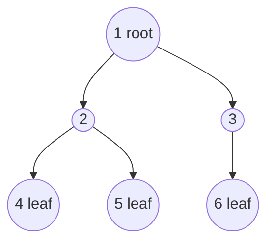
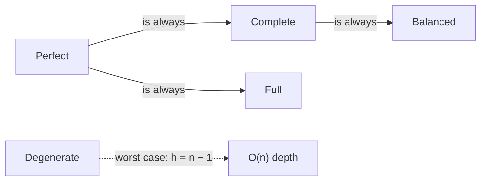
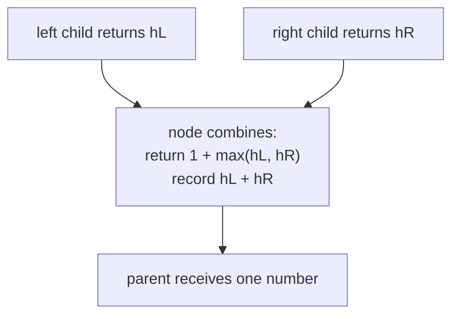
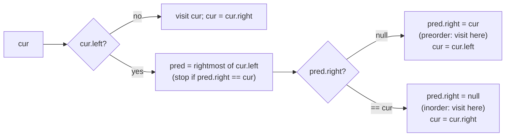

# 1. Binary Trees: Terminology, Representation and Traversal Templates

← [Part 24 index](README.md) · Next → [Inorder Traversal](02-inorder-traversal.md)

> [!abstract] What this covers
> **Core idea:** A binary tree is a recursive structure: a node plus two (possibly empty) binary trees. Almost every problem in this part is solved by one of five templates:
> 1. A **DFS order** (pre, in or post).
> 2. **BFS by level**.
> 3. **Post-order information passing**: each child returns a summary, and the parent combines the two.
> 4. **Coordinate-tagged BFS**: carry a column/row with each node.
> 5. **Parent map + BFS**: treat the tree as an undirected graph.
>
> **You'll be able to:** use the vocabulary precisely (depth vs height, complete vs full vs perfect); state the node-count bounds; write every traversal recursively and iteratively; recognise which template a problem needs; reason about O(h) vs O(w) space; explain why inorder + one other traversal determines a tree, and how Morris achieves O(1) space.
> **Source:** [Striver: Binary Trees, Introduction](https://takeuforward.org/learning/dsa/introduction-?category=theory-and-traversals&source=strivers-a2z-dsa-sheet) · **Time:** 60 min

**Sections:** [1. Vocabulary](#1-vocabulary) · [2. Types of binary trees](#2-types-of-binary-trees) · [3. Representation](#3-representation) · [4. Depth-first traversals](#4-depth-first-traversals) · [5. Breadth-first traversal](#5-breadth-first-traversal) · [6. Post-order information passing](#6-post-order-information-passing) · [7. Coordinates: views and verticals](#7-coordinates-views-and-verticals) · [8. Trees as graphs: parent maps](#8-trees-as-graphs-parent-maps) · [9. Construction and serialisation](#9-construction-and-serialisation) · [10. Morris traversal](#10-morris-traversal) · [11. Complexity rules of thumb](#11-complexity-rules-of-thumb) · [Common mistakes](#common-mistakes) · [Practice](#practice) · [Key terms](#key-terms) · [Flashcards](#flashcards)

---

## 1. Vocabulary



| Term | Meaning (on the tree above, `[1,2,3,4,5,null,6]`) |
|---|---|
| Root | the only node with no parent (1) |
| Leaf | a node with no children (4, 5, 6) |
| Internal node | a node with ≥ 1 child (1, 2, 3) |
| Parent / child / sibling | 2 is the parent of 4 and 5; 4 and 5 are siblings |
| Ancestor / descendant | 1 is an ancestor of every node; 6 is a descendant of 3 and 1 |
| Edge | parent–child link; a tree with n nodes has **n − 1** edges |
| Depth of a node | edges from the root down to it (root = 0; 4 has depth 2) |
| Height of a node | edges on the longest path down to a leaf (leaf = 0; root = 2) |
| Height of the tree | height of the root. Striver and LC 104 count **nodes** instead (answer 3). State your convention. |
| Level | set of nodes with the same depth |
| Subtree | a node together with all its descendants |
| Degree | number of children (0, 1 or 2 here) |

**Depth goes down from the root, height goes up from the leaves.** Interview questions say "max depth" (LC 104) and mean the number of nodes on the longest root-to-leaf path. That's the same number as height + 1 in edges.

---

## 2. Types of binary trees

| Type | Definition | Example shape |
|---|---|---|
| **Full** (proper / strict) | every node has 0 or 2 children | `[1,2,3,4,5]` |
| **Complete** | every level full except possibly the last, which is filled **left to right** | `[1,2,3,4,5,6]`, which is a heap's shape |
| **Perfect** | all internal nodes have 2 children *and* all leaves are at the same depth | `[1,2,3,4,5,6,7]` |
| **Balanced** (height-balanced) | at every node, the left and right heights differ by ≤ 1 | AVL invariant; height is O(log n) |
| **Degenerate** (skewed) | every node has ≤ 1 child, so it's effectively a linked list | `[1,null,2,null,3]` |



**Counting facts** (h = height in edges):

| Fact | Formula |
|---|---|
| Max nodes at level d | `2^d` |
| Max nodes in a tree of height h | `2^(h+1) − 1` (perfect) |
| Min height with n nodes | `⌈log₂(n + 1)⌉ − 1` |
| Leaves in a full tree with i internal nodes | `i + 1` |
| Null child pointers in any tree with n nodes | `n + 1` (2n slots, n − 1 used by edges) |

The last fact explains why serialisation with null markers writes `2n + 1` tokens. It is also why Morris always finds a free `right` pointer to thread through.

---

## 3. Representation

**Pointer (linked) representation** is the default in interviews:

```python
class TreeNode:
    def __init__(self, val=0, left=None, right=None):
        self.val, self.left, self.right = val, left, right
```

```cpp
struct TreeNode {
    int val; TreeNode *left, *right;
    TreeNode(int v) : val(v), left(nullptr), right(nullptr) {}
};
```

```java
class TreeNode {
    int val; TreeNode left, right;
    TreeNode(int v) { val = v; }
}
```

**Array representation** suits complete trees (heaps, segment trees). With 0-indexing, node `i` has children `2i + 1` and `2i + 2`, and its parent is `(i − 1) // 2`. With 1-indexing the children are `2i` and `2i + 1`, and the parent is `i // 2`. It wastes space on sparse trees: a skewed tree of height h needs `2^(h+1)` slots.

**LeetCode's level-order list** `[1,2,3,null,null,4,5]` is not the heap array. Children of null nodes are **omitted**, not padded. Building a tree from it is a BFS: the queue holds the created nodes, and each dequeued node consumes the next two tokens.

```python
from collections import deque

def build(vals):
    if not vals or vals[0] is None:
        return None
    root = TreeNode(vals[0])
    q, i = deque([root]), 1
    while q and i < len(vals):
        n = q.popleft()
        if i < len(vals) and vals[i] is not None:
            n.left = TreeNode(vals[i]); q.append(n.left)
        i += 1
        if i < len(vals) and vals[i] is not None:
            n.right = TreeNode(vals[i]); q.append(n.right)
        i += 1
    return root
```

The width of an index-based level (as in Max Width) uses the heap numbering even though the input list doesn't. Those are two different numberings, so don't mix them.

---

## 4. Depth-first traversals

| Order | Visit sequence | On `[1,2,3,4,5,null,6]` | Typical use |
|---|---|---|---|
| Preorder | **Root**, L, R | 1 2 4 5 3 6 | copy/serialise, root-first construction, paths from root |
| Inorder | L, **Root**, R | 4 2 5 1 3 6 | sorted order in a BST, construction split point |
| Postorder | L, R, **Root** | 4 5 2 6 3 1 | delete/free, anything that needs children's results first |

The recursive versions differ only in where the `visit` line goes:

```python
def dfs(node):
    if not node:
        return
    # preorder: visit here
    dfs(node.left)
    # inorder: visit here
    dfs(node.right)
    # postorder: visit here
```

**Iterative templates** (memorise them; they come back in BST iterator, kth smallest and validate BST):

| Order | Stack recipe |
|---|---|
| Preorder | push root; pop, visit, push **right then left** |
| Inorder | push the left spine; pop, visit, move to right child, push its left spine |
| Postorder (2 stacks) | preorder with **left then right** pushed gives Root-R-L; reverse it to get L-R-Root |
| Postorder (1 stack) | inorder-style descent; before popping, if the top has an unvisited right child, go right; track `last` visited |
| All three in one pass | stack of `(node, state)`; state 1 → pre, push left; 2 → in, push right; 3 → post |

```python
def inorder(root):
    res, st, cur = [], [], root
    while cur or st:
        while cur:
            st.append(cur)
            cur = cur.left
        cur = st.pop()
        res.append(cur.val)
        cur = cur.right
    return res
```

```cpp
vector<int> inorder(TreeNode* root) {
    vector<int> res; stack<TreeNode*> st; TreeNode* cur = root;
    while (cur || !st.empty()) {
        while (cur) { st.push(cur); cur = cur->left; }
        cur = st.top(); st.pop();
        res.push_back(cur->val);
        cur = cur->right;
    }
    return res;
}
```

```java
List<Integer> inorder(TreeNode root) {
    List<Integer> res = new ArrayList<>(); Deque<TreeNode> st = new ArrayDeque<>(); TreeNode cur = root;
    while (cur != null || !st.isEmpty()) {
        while (cur != null) { st.push(cur); cur = cur.left; }
        cur = st.pop();
        res.add(cur.val);
        cur = cur.right;
    }
    return res;
}
```

**Space:** O(h) for the recursion or explicit stack. That's O(log n) when balanced and O(n) when skewed. In Python, a skewed tree of 10⁴ nodes exceeds the default recursion limit (1000), which is a real reason to prefer the iterative form.

---

## 5. Breadth-first traversal

The **level-size loop** turns a plain BFS into a per-level BFS. Snapshot `len(q)` before processing, and exactly that many nodes belong to the current level.

```python
from collections import deque

def level_order(root):
    if not root:
        return []
    res, q = [], deque([root])
    while q:
        level = []
        for _ in range(len(q)):
            n = q.popleft()
            level.append(n.val)
            if n.left:  q.append(n.left)
            if n.right: q.append(n.right)
        res.append(level)
    return res
```

| Variant | Change to the template |
|---|---|
| Zigzag / spiral | reverse every other `level` (or fill it from the end) |
| Right view / left view | take the last / first node of each level |
| Level averages, max per level | aggregate `level` |
| Max width | enqueue `(node, idx)` with children `2i+1`, `2i+2`; width = last − first + 1; normalise by subtracting the level's first index to avoid overflow |
| Min depth | return at the first leaf dequeued (BFS finds the shallowest first) |

**Space:** O(w), where w is the maximum width, up to ⌈n/2⌉ on the last level of a perfect tree. DFS is O(h) and BFS is O(w): for a balanced tree DFS uses less memory, and for a skewed tree BFS does.

---

## 6. Post-order information passing

This is the most important template in the part. Each call **returns a summary of its subtree** to its parent. Any answer that bends through a node (and so can't be returned upward) is **recorded in an outer variable**.



| Problem | Returns upward | Recorded at the node |
|---|---|---|
| Max depth | `1 + max(l, r)` | — |
| Balanced | height, or `−1` if unbalanced (short-circuit) | — |
| Diameter | height `1 + max(l, r)` | `best = max(best, l + r)` (edges) |
| Max path sum | `val + max(0, l, r)` (one branch, negatives dropped) | `best = max(best, val + max(0,l) + max(0,r))` |
| Same tree / symmetric | bool from paired recursion `(a, b)` | — |
| LCA | `p`/`q`/LCA node or null | both sides non-null → this node is the LCA |
| Children-sum property | (top-down pass, then fix up bottom-up) | — |

```python
def diameter(root):
    best = 0
    def h(n):
        nonlocal best
        if not n:
            return 0
        l, r = h(n.left), h(n.right)
        best = max(best, l + r)
        return 1 + max(l, r)
    h(root)
    return best
```

**Why "return one, record two":** a parent can extend only a path that goes *down one side*, because a path can't fork. The bent path through a node is a complete candidate answer that no ancestor can extend.

**The −1 sentinel trick:** for balanced trees, return −1 to mean "already unbalanced". The O(n²) height-per-node check then becomes one O(n) pass.

---

## 7. Coordinates: views and verticals

Give the root column 0. Moving left decreases the column by 1, and moving right increases it by 1. Row = depth.

```text
            1 (c0)
          /      \
      2 (c−1)    3 (c+1)
      /   \          \
  4 (c−2) 5 (c0)    6 (c+2)
```

| Problem | Traversal | Rule |
|---|---|---|
| Vertical order (LC 987) | any, collecting `(col, row, val)` | sort by col, then row, then value |
| Top view | **BFS** with col | keep the **first** node seen per column |
| Bottom view | BFS with col | keep the **last** node seen per column (overwrite) |
| Left / right view | BFS by level (or DFS with depth) | first / last per level; DFS: record when `depth == len(res)` |
| Boundary | three passes | left edge (no leaves) + all leaves (L→R) + right edge reversed (no leaves) |

**Why BFS for top/bottom views:** BFS visits shallower nodes first. DFS can reach a deep node in some column before a shallower one, so it would need row comparisons to get the same answer.

---

## 8. Trees as graphs: parent maps

Some problems radiate outward from a **target node**: all nodes at distance K, or the time to burn the whole tree. A child pointer can't move up, so:

1. DFS/BFS once to build `parent[node]`.
2. BFS from the target over three neighbours each (`left`, `right`, `parent`), with a `visited` set.
3. Stop at radius K (distance K), or count the BFS layers until the queue empties (burn time).

```python
from collections import deque

def distance_k(root, target, k):
    parent, st = {root: None}, [root]
    while st:
        n = st.pop()
        for c in (n.left, n.right):
            if c:
                parent[c] = n
                st.append(c)
    q, seen = deque([target]), {target}
    for _ in range(k):
        for _ in range(len(q)):
            n = q.popleft()
            for nb in (n.left, n.right, parent[n]):
                if nb and nb not in seen:
                    seen.add(nb)
                    q.append(nb)
    return [n.val for n in q]
```

**Alternatives worth naming:** a single DFS that returns "distance to target in this subtree" avoids the map but is harder to get right under pressure. **Root-to-node paths** (two DFS paths, then the last common node) is the brute-force LCA.

---

## 9. Construction and serialisation

**Which pairs determine a tree uniquely (distinct values)?**

| Pair | Unique? | Why |
|---|---|---|
| Inorder + preorder | ✅ | preorder gives the root; inorder splits left/right |
| Inorder + postorder | ✅ | postorder gives the root (last); inorder splits |
| Inorder + level order | ✅ | first level-order element in the inorder range is that range's root |
| Preorder + postorder | ❌ (✅ if full) | a one-child node can't be placed left vs right |
| Any single traversal | ❌ | unless null markers are included |

**Build recipe (pre + in):** `root = pre[pL]`, `k = pos[root]`, left size = `k − iL`. Recurse on the bounds. A hash map from value to inorder index makes it O(n). Slicing or a linear search makes it O(n²).

**Serialisation:** any traversal **with null markers** is self-delimiting. A tree with n nodes has n + 1 null slots, so the encoding has 2n + 1 tokens. Use a delimiter so that negative and multi-digit values parse. For a BST, preorder alone (without nulls) is enough, because the value bounds decide where each subtree ends.

---

## 10. Morris traversal

Morris inorder gets O(1) extra space by temporarily threading each node's **inorder predecessor** (the rightmost node of its left subtree) back to the node:



- **Time O(n):** each edge on a predecessor path is walked at most twice, once to create the thread and once to remove it.
- **Restores the tree:** each thread is removed on the second visit.
- **Not thread-safe:** the tree is mutated while the traversal runs.
- **Uses:** O(1)-space kth smallest, recover BST, validate BST, and the flatten-to-list trick.

---

## 11. Complexity rules of thumb

| Situation | Time | Space |
|---|---|---|
| Any single DFS/BFS | O(n) | DFS O(h), BFS O(w) |
| Height computed at every node, naively | O(n²) skewed, O(n log n) balanced | O(h) |
| Vertical order with sorting | O(n log n) | O(n) |
| Count nodes in a complete tree | O(log² n) | O(log n) |
| Build from two traversals with a map | O(n) | O(n) |
| Morris | O(n) | O(1) |

`h` ranges from `log₂ n` (balanced) to `n` (skewed). When an interviewer asks for space complexity, give both cases.

---

## Common mistakes

- **Depth vs height, edges vs nodes:** mixing conventions mid-problem. Pick one and say it out loud.
- **Diameter in nodes vs edges:** LC 543 wants edges, which is `l + r` when height counts nodes.
- **Max path sum:** returning `val + l + r` upward (a path can't fork), or not clamping negative branches to 0.
- **Max path sum initial value:** starting `best` at 0 fails when every value is negative. Start at −∞ or `root.val`.
- **BFS level loop:** using `len(q)` in the loop condition instead of snapshotting it.
- **Top view with DFS:** a deeper node overwrites a shallower one in the same column.
- **Max width:** index overflow on deep trees. Normalise per level.
- **Parent-map BFS:** forgetting `visited`, which bounces between child and parent forever.
- **Construction:** slicing arrays (O(n²)), or off-by-one in the preorder split.
- **Morris:** missing `pred.right != cur` in the predecessor walk (infinite loop), or leaving threads in place.
- **Python recursion:** a skewed tree with 10⁴ nodes overflows the default limit. Go iterative or call `sys.setrecursionlimit`.

---

## Practice

<details><summary>1. Preorder, inorder and postorder of <code>[1,2,3,null,4,5,6]</code>?</summary>

Tree: 1 → (2, 3); 2 → (null, 4); 3 → (5, 6).
Pre `1 2 4 3 5 6` · In `2 4 1 5 3 6` · Post `4 2 5 6 3 1`.
</details>

<details><summary>2. A tree has 10 nodes. How many null child pointers?</summary>

`n + 1 = 11`: there are 20 child slots and 9 edges.
</details>

<details><summary>3. Is every complete tree full? Is every full tree complete?</summary>

Neither. `[1,2,3,4]` is complete but not full (node 2 has one child). `[1,2,3,null,null,4,5]` is full but not complete (the last level isn't filled left to right).
</details>

<details><summary>4. Max nodes in a binary tree of height 4 (edges)?</summary>

`2^5 − 1 = 31`.
</details>

<details><summary>5. Rebuild the tree from pre <code>[3,9,20,15,7]</code> and in <code>[9,3,15,20,7]</code>.</summary>

Root 3; inorder splits into [9] | [15,20,7]. Right subtree: root 20, split [15] | [7]. Result: `[3,9,20,null,null,15,7]`.
</details>

<details><summary>6. Why does max path sum return <code>val + max(0, l, r)</code> but record <code>val + max(0,l) + max(0,r)</code>?</summary>

The parent can extend only a single downward branch, since a path can't fork. The two-branch path bends at this node, so it is a complete candidate that no ancestor can extend.
</details>

<details><summary>7. Top view of <code>[1,2,3,null,4,null,null,null,5]</code>?</summary>

Columns: 2 at c−1, 1 at c0, 3 at c+1, 4 at c0 (depth 2), 5 at c+1 (depth 3). Taking the first per column in BFS order gives `[2, 1, 3]`.
</details>

<details><summary>8. DFS or BFS for a perfect tree of 10⁶ nodes, if memory is tight?</summary>

DFS: O(h) = ~20 frames, against BFS's ~5·10⁵ queued nodes on the last level.
</details>

---

## Key terms

| Term | Meaning |
|---|---|
| Depth / height | edges from the root / edges to the deepest leaf |
| Full / complete / perfect | 0-or-2 children / filled left to right / all levels full |
| Balanced | subtree heights differ by ≤ 1 at every node |
| Degenerate | every node has ≤ 1 child (a linked list) |
| Inorder predecessor | rightmost node of the left subtree |
| Level-size loop | BFS that snapshots `len(q)` to process exactly one level |
| Post-order information passing | children return summaries; the parent combines them and records global answers |
| Vertical column | horizontal distance from the root (left −1, right +1) |
| Parent map | `node → parent` dictionary that turns the tree into an undirected graph |
| Null marker | sentinel token for a missing child in serialisation |
| Morris thread | temporary `pred.right → cur` link used instead of a stack |

---

## Flashcards

**Depth vs height of a node?** #flashcard
Depth: edges from the root down to it. Height: edges from it down to its deepest leaf.

**Max nodes in a binary tree of height h (edges)?** #flashcard
`2^(h+1) − 1`.

**Null pointers in a binary tree with n nodes?** #flashcard
`n + 1`.

**Complete binary tree definition?** #flashcard
All levels full except possibly the last, which is filled left to right.

**Heap array: children and parent of index i (0-indexed)?** #flashcard
Children `2i+1`, `2i+2`; parent `(i−1)//2`.

**Iterative preorder: push order?** #flashcard
Pop and visit, then push right, then left.

**Iterative postorder with two stacks?** #flashcard
Do Root-R-L (push left then right), then reverse.

**BFS level-size loop: why snapshot `len(q)`?** #flashcard
Children are appended during the loop; the snapshot is exactly the current level's count.

**DFS vs BFS space?** #flashcard
DFS O(h), BFS O(w).

**Diameter: what is returned and what is recorded?** #flashcard
Return the height `1 + max(l, r)`; record `l + r`.

**Max path sum: return value?** #flashcard
`val + max(0, l, r)`: a single branch with negatives clamped.

**Why BFS for top view?** #flashcard
It visits shallower nodes first, so the first node seen per column is the top one.

**Distance K from a target node: technique?** #flashcard
Build a parent map, then BFS over left/right/parent with a visited set for K layers.

**Which traversal pairs reconstruct a unique tree?** #flashcard
Inorder plus preorder, postorder or level order. Pre + post only for full trees.

**Morris inorder: where is the output?** #flashcard
When cur has no left child, or when the thread back to cur is removed.

**Interview track →** [Tree deep-dive](../../01-data-structures/08-tree.md)
