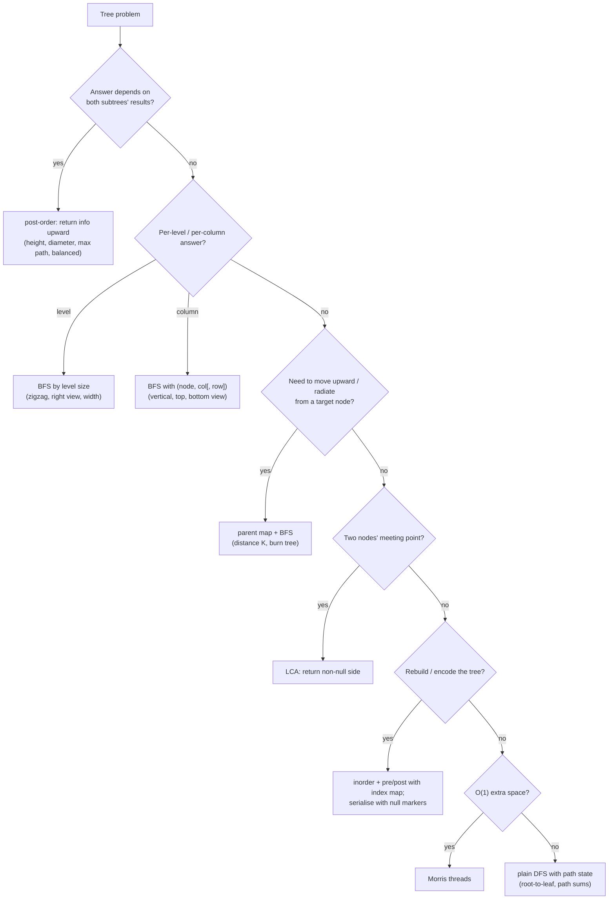

# Part 24: Binary Trees

← [Striver course map](../README.md)

> [!abstract] What this part covers
> **Goal:** Traverse a binary tree every way (recursive, iterative, level order, Morris), solve the classic height/diameter/path-sum family with one post-order template, handle the view/vertical/boundary problems with coordinate-tagged BFS, and build, serialise and flatten trees.
> **Prereqs:** [Recursion](../18-recursion/README.md) · [Stack / Queues](../23-stack-and-queues/README.md) **Time:** ~12 h.
> **Outcome:** Write all traversals iteratively from memory; solve diameter, max path sum, LCA, burn tree, distance K, vertical order, max width; build a tree from pre/post + inorder; serialise with null markers; do Morris inorder in O(1) space.

---

## Theory

| # | Lesson | What you get | Source |
|---|---|---|---|
| 1 | [Binary Trees: Terminology, Representation and Traversal Templates](01-binary-tree-theory.md) | Node/edge/height/depth vocabulary, tree types (full, complete, perfect, balanced, degenerate), array vs pointer representation, DFS/BFS traversal templates, the post-order 'return info upward' pattern, coordinate-tagged BFS, parent maps, and complexity rules of thumb. | [link](https://takeuforward.org/learning/dsa/introduction-?category=theory-and-traversals&source=strivers-a2z-dsa-sheet) |

Read these first; the problems below apply them.

---

## Problems

| # | Problem | Difficulty | Key insight | Optimal | Source |
|---|---|---|---|---|---|
| | **Traversals** | | | | |
| 2 | [Inorder Traversal](02-inorder-traversal.md) | Easy | Recursively it's three lines. Iteratively: keep pushing the left spine onto a stack. When you can't go left any more, pop a node, visit it, and move to its right child. The stack holds exactly the ancestors whose left subtree you are still inside. | O(n) | [link](https://takeuforward.org/learning/dsa/inorder-traversal?category=theory-and-traversals&source=strivers-a2z-dsa-sheet) |
| 3 | [Preorder Traversal](03-preorder-traversal.md) | Easy | Iterative preorder is the simplest stack traversal. Pop, visit, then push **right before left** so that left is popped first. | O(n) | [link](https://takeuforward.org/learning/dsa/preorder-traversal?category=theory-and-traversals&source=strivers-a2z-dsa-sheet) |
| 4 | [Postorder Traversal](04-postorder-traversal.md) | Easy | The hard iterative traversal: a node may be visited only after **both** subtrees are done. When you look at the stack top, you need to know whether you just came back from its right child. Track the `last` visited node: visit the top if it has no right child or `top.right == last`. Otherwise go right. | O(n) | [link](https://takeuforward.org/learning/dsa/postorder-traversal?category=theory-and-traversals&source=strivers-a2z-dsa-sheet) |
| 5 | [Level Order Traversal](05-level-order-traversal.md) | Medium | BFS with a queue. To split by level, read `len(queue)` **before** processing: exactly that many nodes belong to the current level, and everything they enqueue belongs to the next. | O(n) | [link](https://takeuforward.org/learning/dsa/level-order-traversal?category=theory-and-traversals&source=strivers-a2z-dsa-sheet) |
| 6 | [Pre, Post, Inorder in one traversal](06-all-traversals-in-one-pass.md) | Medium | Push `(node, state)`. State 1 → record in **pre**, bump to 2, push left. State 2 → record in **in**, bump to 3, push right. State 3 → record in **post** and pop. Every node passes through 1→2→3, the same three moments at which recursion 'touches' a node. | O(n) | [link](https://takeuforward.org/learning/dsa/pre,-post,-inorder-in-one-traversal?category=theory-and-traversals&source=strivers-a2z-dsa-sheet) |
| | **Medium problems** | | | | |
| 7 | [Maximum Depth in BT](07-maximum-depth.md) | Easy | `depth(n) = 1 + max(depth(left), depth(right))`, with `depth(null) = 0`. This is the template for every bottom-up tree problem: ask the children, combine, return. | O(n) | [link](https://takeuforward.org/learning/dsa/maximum-depth-in-bt?category=medium-problems&source=strivers-a2z-dsa-sheet) |
| 8 | [Check if two trees are identical or not](08-same-tree.md) | Easy | Both null → true. Exactly one null → false. Otherwise the values must match **and** the left subtrees and the right subtrees must be identical. Short-circuit on the first mismatch. | O(min(n, m)) | [link](https://takeuforward.org/learning/dsa/check-if-two-trees-are-identical-or-not?category=medium-problems&source=strivers-a2z-dsa-sheet) |
| 9 | [Check for balanced binary tree](09-balanced-binary-tree.md) | Easy | Compute height bottom-up and use **−1 as an 'unbalanced' sentinel**. Once any subtree is unbalanced, the −1 propagates to the root and no more work is needed. One pass, O(n). | O(n) | [link](https://takeuforward.org/learning/dsa/check-for-balanced-binary-tree?category=medium-problems&source=strivers-a2z-dsa-sheet) |
| 10 | [Diameter of Binary Tree](10-diameter-of-binary-tree.md) | Easy | Every path has a single highest node. At that node its length is `height(left) + height(right)`. Compute heights in postorder and update a global best with `hl + hr` at every node. The return value (height) and the answer (diameter) are different quantities. | O(n) | [link](https://takeuforward.org/learning/dsa/diameter-of-binary-tree?category=medium-problems&source=strivers-a2z-dsa-sheet) |
| 11 | [Maximum path sum](11-binary-tree-maximum-path-sum.md) | Hard | Same skeleton as diameter. Each node returns its best **downward** gain, `val + max(0, gainL, gainR)` (a negative branch is dropped, never extended). At each node, record `val + max(0, gainL) + max(0, gainR)` as a candidate for the path that bends there. | O(n) | [link](https://takeuforward.org/learning/dsa/maximum-path-sum-?category=medium-problems&source=strivers-a2z-dsa-sheet) |
| 12 | [Check for symmetrical BTs](12-symmetric-tree.md) | Easy | Compare the left and right subtrees as mirrors. `mirror(a, b)` holds when `a.val == b.val`, `mirror(a.left, b.right)` and `mirror(a.right, b.left)`. It's *same tree* with the second tree's children swapped. | O(n) | [link](https://takeuforward.org/learning/dsa/check-for-symmetrical-bts?category=medium-problems&source=strivers-a2z-dsa-sheet) |
| 13 | [Children Sum Property in Binary Tree](13-children-sum-property.md) | Medium | You can't decrease, so fix the deficit **on the way down**. If the children's sum is less than the node, raise the children to the node's value. Otherwise raise the node to the children's sum. Recurse. On the way **up**, set `node = left + right`. Because the children were raised to at least the parent's value, the final sum never ends up below what the parent needed. | O(n) | [link](https://takeuforward.org/learning/dsa/children-sum-property-in-binary-tree?category=medium-problems&source=strivers-a2z-dsa-sheet) |
| | **FAQs** | | | | |
| 14 | [Zig Zag Traversal Of Binary Tree](14-zigzag-level-order.md) | Medium | Run the normal level-size BFS. Children are always enqueued left before right. Only the **order of writing** each level changes: reverse it, or fill it from the back, on odd levels. Changing the enqueue order instead corrupts the levels below. | O(n) | [link](https://takeuforward.org/learning/dsa/zig-zag-traversal-of-binary-tree?category=faqs&source=strivers-a2z-dsa-sheet) |
| 15 | [Boundary Traversal of a Binary Tree](15-boundary-traversal.md) | Medium | Split it into three independent walks and stitch them together. (1) Left edge: from `root.left`, prefer left and fall back to right, skipping leaves. (2) Leaves: any DFS that visits left before right. (3) Right edge: from `root.right`, prefer right and fall back to left, skipping leaves, then **reversed**. The root is added once, and only skipped by the leaves step if it is itself a leaf. | O(n) | [link](https://takeuforward.org/learning/dsa/boundary-traversal-of-a-binary-tree?category=faqs&source=strivers-a2z-dsa-sheet) |
| 16 | [Vertical Order Traversal](16-vertical-order-traversal.md) | Hard | Label each node with `(col, row)` during any traversal, then **sort by (col, row, val)** and group by col. The tie-breaking rule (same row and column → smaller value first) is what makes it 'Hard'. BFS alone doesn't give it. | O(n log n) | [link](https://takeuforward.org/learning/dsa/vertical-order-traversal?category=faqs&source=strivers-a2z-dsa-sheet) |
| 17 | [Top View of Binary Tree](17-top-view.md) | Medium | BFS with horizontal distance (HD). The **first** node BFS reaches in a column is the topmost, so record it only if the column is new. BFS, not DFS: a DFS can reach a deeper node in a column before a shallower one. | O(n) | [link](https://takeuforward.org/learning/dsa/top-view-of-binary-tree?category=faqs&source=strivers-a2z-dsa-sheet) |
| 18 | [Bottom view of Binary Tree](18-bottom-view.md) | Medium | It's the top view with the update rule flipped: **overwrite on every visit**. BFS visits deeper nodes later, and within a level from left to right, so the last write per column is the bottom-most node, with ties going to the right-most one, matching GfG. | O(n) | [link](https://takeuforward.org/learning/dsa/bottom-view-of-binary-tree?category=faqs&source=strivers-a2z-dsa-sheet) |
| 19 | [Right/Left View of Binary Tree](19-right-left-view.md) | Medium | DFS with depth, visiting the preferred side first. The first node you meet at a new depth (`depth == len(res)`) is the visible one. For the right view go right-first; for the left view go left-first. It's O(h) space, beating BFS's O(w). | O(n) | [link](https://takeuforward.org/learning/dsa/right-left-view-of-binary-tree?category=faqs&source=strivers-a2z-dsa-sheet) |
| 20 | [Print root to node path in BT](20-root-to-leaf-paths.md) | Medium | DFS with a shared `path` list: **push on entry, pop on exit** (backtracking). At a leaf, copy the path into the answer. Copy only at leaves, not at every node, to keep it O(n·h) rather than O(n²). | O(n·h) (copies at leaves) | [link](https://takeuforward.org/learning/dsa/print-root-to-node-path-in-bt?category=faqs&source=strivers-a2z-dsa-sheet) |
| 21 | [LCA in BT](21-lowest-common-ancestor.md) | Medium | Ask each subtree: 'do you contain p or q?' Return the node itself if it **is** p or q. If both sides return non-null, this node is where the paths split, so it's the LCA. Otherwise pass up whichever side is non-null. | O(n) | [link](https://takeuforward.org/learning/dsa/lca-in-bt?category=faqs&source=strivers-a2z-dsa-sheet) |
| 22 | [Maximum width of a Binary Tree](22-maximum-width.md) | Medium | Number nodes as in a heap: root `i`, children `2i+1`, `2i+2`. The width of a level is `last − first + 1`. Indices double every level and overflow after ~64 levels, so **renormalise**: subtract the level's first index before computing children. | O(n) | [link](https://takeuforward.org/learning/dsa/maximum-width-of-a-binary-tree?category=faqs&source=strivers-a2z-dsa-sheet) |
| 23 | [Print all the Nodes at a distance of K in a BT](23-all-nodes-distance-k.md) | Medium | A tree is an undirected graph whose edges to parents are missing. **Add parent pointers** (one BFS/DFS into a hash map), then BFS from `target` for `k` rounds, moving to left, right and parent with a visited set. | O(n) | [link](https://takeuforward.org/learning/dsa/print-all-the-nodes-at-a-distance-of-k-in-a-bt?category=faqs&source=strivers-a2z-dsa-sheet) |
| 24 | [Minimum time taken to burn the BT from a given Node](24-burn-binary-tree.md) | Hard | The answer is the **eccentricity** of the start node, its farthest distance in the tree. Build parent pointers and run a level BFS from the start. The number of rounds after the first is the answer. | O(n) | [link](https://takeuforward.org/learning/dsa/minimum-time-taken-to-burn-the-bt-from-a-given-node?category=faqs&source=strivers-a2z-dsa-sheet) |
| 25 | [Count total Nodes in a COMPLETE BT](25-count-complete-tree-nodes.md) | Medium | Measure the leftmost and rightmost depths. If they are equal, the subtree is **perfect** with `2^h − 1` nodes, so stop. Otherwise recurse into both children: `1 + count(L) + count(R)`. At every level at least one of the two children is perfect, so there are O(log n) recursive calls, each costing O(log n). | O(log² n) | [link](https://takeuforward.org/learning/dsa/count-total-nodes-in-a-complete-bt?category=faqs&source=strivers-a2z-dsa-sheet) |
| 26 | [Flatten Binary Tree to LinkedList](26-flatten-binary-tree.md) | Medium | O(1) space, Morris-style. At each node with a left child, find the **rightmost node of the left subtree** (the last node of the left part in preorder), hang the current right subtree there, move the left subtree to the right and null out left. Then step right. | O(n) | [link](https://takeuforward.org/learning/dsa/flatten-binary-tree-to-linkedlist?category=faqs&source=strivers-a2z-dsa-sheet) |
| | **Construction problems** | | | | |
| 27 | [Requirements needed to construct a unique BT](27-unique-bt-requirements.md) | Easy | Preorder and postorder each tell you **where the root is** (first or last element) but not where the left subtree ends. Inorder tells you **how the remaining nodes split around the root**. You need both kinds of information, so the answer is yes iff one of the two is inorder and the other is pre or post. | O(1) | [link](https://takeuforward.org/learning/dsa/requirements-needed-to-construct-a-unique-bt?category=construction-problems&source=strivers-a2z-dsa-sheet) |
| 28 | [Construct a BT from Preorder and Inorder](28-build-from-preorder-inorder.md) | Medium | `pre[0]` is the root. Its position `k` in inorder splits inorder into left (`k − inL` nodes) and right. Those sizes slice preorder the same way. A **hash map value → inorder index** makes each lookup O(1), so the whole build is O(n). Passing index bounds instead of slicing avoids O(n²). | O(n) | [link](https://takeuforward.org/learning/dsa/construct-a-bt-from-preorder-and-inorder?category=construction-problems&source=strivers-a2z-dsa-sheet) |
| 29 | [Construct a BT from Postorder and Inorder](29-build-from-postorder-inorder.md) | Medium | It mirrors the preorder version: the root is `post[pR]`. With the left size `k − iL`, the left subtree is `post[pL .. pL+left−1]` and the right is `post[pL+left .. pR−1]`. In the global-pointer variant, consume postorder **from the back** and build the **right subtree first**. | O(n) | [link](https://takeuforward.org/learning/dsa/construct-a-bt-from-postorder-and-inorder?category=construction-problems&source=strivers-a2z-dsa-sheet) |
| 30 | [Serialize and De-serialize BT](30-serialize-deserialize.md) | Hard | A traversal **with explicit null markers** is self-delimiting, so one sequence is enough and you don't need inorder. Level order with `#` for null (Striver's version) or preorder with `#` both work. The decoder replays the same traversal, consuming one token per slot. | O(n) | [link](https://takeuforward.org/learning/dsa/serialize-and-de-serialize-bt?category=construction-problems&source=strivers-a2z-dsa-sheet) |
| | **Traversal in constant space (Morris)** | | | | |
| 31 | [Morris Inorder Traversal](31-morris-inorder.md) | Medium | Use the null `right` pointer of each node's **inorder predecessor** (the rightmost node of its left subtree) as a temporary **thread back to the node**. First visit: no thread yet, so create it and go left. Second visit, arriving through the thread: remove it, output the node and go right. | O(n) | [link](https://takeuforward.org/learning/dsa/morris-inorder-traversal-?category=traversal-in-constant-space&source=strivers-a2z-dsa-sheet) |
| 32 | [Morris Preorder Traversal](32-morris-preorder.md) | Medium | It's identical to Morris inorder except for **when you output**. In preorder a node is visited before its left subtree, so output at the moment the thread is **created**, not when it is removed. Nodes without a left child are still output immediately. | O(n) | [link](https://takeuforward.org/learning/dsa/morris-preorder-traversal-?category=traversal-in-constant-space&source=strivers-a2z-dsa-sheet) |

---

## Which binary-tree technique?

---

## Part 24 cheat sheet

| Problem | Template | Key state | Complexity |
|---|---|---|---|
| Inorder / pre / post (iterative) | stack | left spine (in), push right then left (pre), 2 stacks or last-visited (post) | O(n) / O(h) |
| Level order, zigzag, right view | BFS by `len(q)` | level size, direction flag | O(n) / O(w) |
| Height, balanced, diameter | post-order | return height; update global answer | O(n) / O(h) |
| Max path sum | post-order | return `val + max(0, l, r)`; answer `val + max(0,l) + max(0,r)` | O(n) |
| Vertical / top / bottom view | BFS with column (and row) | `col → nodes` map; first/last seen | O(n log n) |
| LCA | post-order | return node if p/q found; both sides non-null → root | O(n) |
| Max width | BFS with indices | index `2i+1`, `2i+2`, normalised per level | O(n) |
| Distance K, burn tree | parent map + BFS | visited set, radius | O(n) |
| Count complete nodes | compare left/right heights | perfect → `2^h − 1` | O(log² n) |
| Build from pre/post + in | divide & conquer | inorder index map | O(n) |
| Serialise | BFS/DFS with `#` | null markers | O(n) |
| Morris | predecessor threads | `pred.right == cur`? | O(n) / O(1) |

**Height convention:** decide up front whether an empty tree has height 0 or −1, and keep to it. **Global answer vs return value:** the post-order pattern returns what the *parent* needs (a single path) and updates a separate answer (which may bend through the node).

---

## Mastery checklist

- [ ] Write iterative inorder, preorder and postorder from memory
- [ ] Do level order with the level-size loop; adapt it to zigzag and right view
- [ ] Solve height, balanced, diameter and max path sum with one post-order template
- [ ] Explain why max path sum returns one branch but records both
- [ ] Implement vertical order with (col, row, value) ordering
- [ ] Write LCA in a binary tree and explain the 'non-null side' return
- [ ] Use a parent map + BFS for distance K and burn tree
- [ ] Count nodes in a complete tree in O(log² n)
- [ ] Build a tree from preorder + inorder with an index map
- [ ] Serialise/deserialise with null markers; state why one traversal suffices
- [ ] Write Morris inorder and explain the thread and the O(n) bound

**Interview track →** [Tree deep-dive](../../01-data-structures/08-tree.md)

Next part → [Binary Search Trees](../25-binary-search-trees/README.md)
