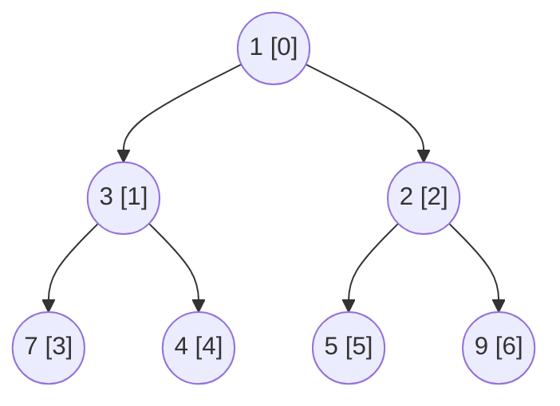
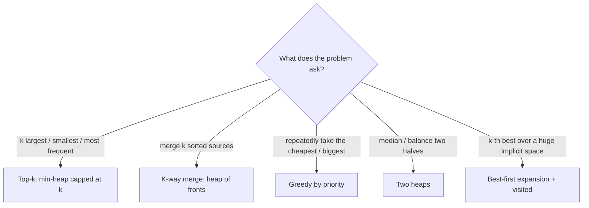

# 1. Heaps: Array Layout, Sift Operations, Build-Heap and Priority Queues

← [Part 26 index](README.md) · Next → [Heapify Algorithm](02-heapify-algorithm.md)

> [!abstract] What this covers
> **Core idea:** A heap is a **complete binary tree** stored in an array, where every parent is ≤ its children (min-heap) or ≥ them (max-heap). Being complete means no pointers are needed and the height is ⌊log₂ n⌋. The heap property is weak: it only orders parent and child, not siblings. That's why it can be fixed in O(log n) after each change. You get:
> 1. **O(1) peek** at the min (or max).
> 2. **O(log n) push and pop**, done by sifting one element along one root-to-leaf path.
> 3. **O(n) build** from an unsorted array.
>
> **You'll be able to:** write the index formulas from memory; implement sift up and sift down; explain why bottom-up build is O(n) and not O(n log n); write heap sort in place; use `priority_queue` / `PriorityQueue` / `heapq` correctly, including custom comparators and max-heaps in Python; recognise the five heap patterns in a problem statement.
> **Source:** [Striver: Heaps theory](https://takeuforward.org/learning/dsa/heaps-theory?category=theory-and-implementation&source=strivers-a2z-dsa-sheet) · **Time:** 50 min

**Sections:** [1. Complete tree in an array](#1-complete-tree-in-an-array) · [2. The heap property](#2-the-heap-property) · [3. Sift up (push)](#3-sift-up-push) · [4. Sift down (pop)](#4-sift-down-pop) · [5. Build-heap in O(n)](#5-build-heap-in-on) · [6. Heap sort](#6-heap-sort) · [7. Library priority queues](#7-library-priority-queues) · [8. Heap vs BST vs sorted array](#8-heap-vs-bst-vs-sorted-array) · [9. The five heap patterns](#9-the-five-heap-patterns) · [10. Deletion and decrease-key](#10-deletion-and-decrease-key) · [Common mistakes](#common-mistakes) · [Practice](#practice) · [Key terms](#key-terms) · [Flashcards](#flashcards)

---

## 1. Complete tree in an array

A **complete** binary tree has every level full except possibly the last, which is filled left to right. If you number the nodes level by level, there are no gaps, so the tree fits exactly into `a[0 … n−1]`.



Array: `[1, 3, 2, 7, 4, 5, 9]`

| | 0-indexed | 1-indexed |
|---|---|---|
| parent(i) | `(i − 1) / 2` | `i / 2` |
| left(i) | `2i + 1` | `2i` |
| right(i) | `2i + 2` | `2i + 1` |
| leaves | `i ≥ n/2` | `i > n/2` |
| last internal node | `n/2 − 1` | `n/2` |
| height | `⌊log₂ n⌋` | `⌊log₂ n⌋` |

- 1-indexed formulas are bit shifts (`i >> 1`, `i << 1`, `i << 1 | 1`), which is why textbooks like them. Interviews and every library use 0-indexed.
- Half the nodes are leaves. Build-heap skips them, and that is where its O(n) comes from.

---

## 2. The heap property

**Min-heap:** `a[parent(i)] ≤ a[i]` for every `i > 0`. Max-heap: flip the sign.

What it **does** give you:
- The root is the minimum.
- Every root-to-leaf path is sorted.
- Every subtree is itself a heap.

What it **does not** give you:
- Any order between siblings or cousins. `[1, 3, 2]` and `[1, 2, 3]` are both valid.
- Sorted array order: a heap is **not** sorted, and an inorder traversal means nothing.
- Fast search. Finding an arbitrary value takes O(n).

Checking it takes O(n): verify `a[i] ≤ a[2i+1]` and `a[i] ≤ a[2i+2]` for every internal `i` (see [Check if an array is a min-heap](06-check-if-an-array-represents-a-min-heap.md)).

---

## 3. Sift up (push)

To insert, append the value at the end, which keeps the tree complete. Then swap it with its parent while it's smaller. Only one path is touched, so this is O(log n).

```python
def push(h, x):
    h.append(x)
    i = len(h) - 1
    while i > 0 and h[(i - 1) // 2] > h[i]:
        p = (i - 1) // 2
        h[i], h[p] = h[p], h[i]
        i = p
```

Example: push 0 into `[1,3,2,7,4,5,9]`. It lands at index 7 (child of 7), swaps with 7 → index 3, swaps with 3 → index 1, swaps with 1 → root. Result `[0,1,2,3,4,5,9,7]`.

**Same routine, other uses:** sift up is also how *decrease-key* works. If a value shrinks in a min-heap it can only violate the property toward its parent.

---

## 4. Sift down (pop)

To remove the root, move the **last** element into the root and shrink the array. Then swap it with its **smaller child** while that child is smaller. This is O(log n).

```python
def sift_down(h, i, n):
    while True:
        l, r, s = 2 * i + 1, 2 * i + 2, i
        if l < n and h[l] < h[s]: s = l
        if r < n and h[r] < h[s]: s = r
        if s == i: return
        h[i], h[s] = h[s], h[i]
        i = s

def pop(h):
    top = h[0]
    h[0] = h[-1]
    h.pop()
    if h: sift_down(h, 0, len(h))
    return top
```

- **Swap with the smaller child**, not just any smaller child. Otherwise the bigger child becomes the parent of the smaller one, which breaks the property.
- Sift down is the [Heapify](02-heapify-algorithm.md) operation. It also handles *increase-key* in a min-heap.
- **Replace top** (pop, then push) in one sift is `heapq.heapreplace`. It's faster than doing the two separately.

---

## 5. Build-heap in O(n)

**Top-down** (push each element): O(n log n).

**Bottom-up (Floyd):** leaves are already heaps. Call `sift_down(i)` for `i = n/2 − 1` down to `0`. When node `i` is processed, both its subtrees are already heaps, so one sift down fixes it.

```python
def build_heap(a):
    for i in range(len(a) // 2 - 1, -1, -1):
        sift_down(a, i, len(a))
```

**Why O(n):** a node at height `h` sifts at most `h` levels, and there are at most `⌈n / 2^(h+1)⌉` nodes at height `h`.

```
Σ_h  n/2^(h+1) · h   =   n/2 · Σ_h h/2^h   ≤   n/2 · 2   =   n
```

Most nodes are near the bottom and sift almost nothing. The few near the top sift far, but there are only a handful of them. Top-down build is the opposite: most nodes sit near the bottom and sift **up** the full height.

| Build | Work per node | Total |
|---|---|---|
| Top-down (n pushes) | depth ≈ log n for most nodes | O(n log n) |
| Bottom-up (sift down) | height ≈ 0 for most nodes | **O(n)** |

`heapq.heapify`, `make_heap`, and `priority_queue(first, last)` are all bottom-up. Java's `new PriorityQueue<>(collection)` is too, but repeated `offer` calls are not.

---

## 6. Heap sort

1. Build a **max**-heap in place: O(n).
2. For `end = n−1 … 1`: swap `a[0]` (the current max) with `a[end]`, then `sift_down(0)` within `a[0 … end−1]`.

The sorted suffix grows from the right. Overall: **O(n log n) worst case, O(1) extra space, not stable**.

| | Quick sort | Merge sort | Heap sort |
|---|---|---|---|
| Worst case | O(n²) | O(n log n) | O(n log n) |
| Extra space | O(log n) | O(n) | **O(1)** |
| Stable | no | yes | no |
| Cache behaviour | excellent | good | poor (jumps around the array) |

Introsort (C++ `std::sort`) uses quicksort and **falls back to heap sort** when recursion gets too deep. That's where heap sort earns its keep in practice. Full code: [Heap Sort](08-heap-sort.md).

---

## 7. Library priority queues

| | C++ | Java | Python |
|---|---|---|---|
| Default | **max**-heap `priority_queue<int>` | **min**-heap `PriorityQueue<Integer>` | **min**-heap, functions on a list (`heapq`) |
| Min-heap | `priority_queue<int, vector<int>, greater<int>>` | default | default |
| Max-heap | default | `new PriorityQueue<>(Collections.reverseOrder())` | push `-x` (or wrap in a class with an inverted `__lt__`) |
| Push / pop / top | `push`, `pop` (returns void), `top` | `offer`, `poll`, `peek` | `heappush`, `heappop`, `h[0]` |
| Build O(n) | `priority_queue pq(v.begin(), v.end())` | `new PriorityQueue<>(list)` | `heapify(list)` |
| Custom order | comparator returns true if `a` goes **below** `b` | `(a, b) -> …` returns a negative number if `a` comes out first | tuples `(key, tiebreak, item)` |
| Top-k helpers | `nth_element`, `partial_sort` | — | `nlargest`, `nsmallest`, `merge` |

**Comparator traps:**
- In C++, `priority_queue` puts the element that is "largest" by the comparator on top. So `greater<>` gives a **min**-heap, and a lambda `a.val > b.val` gives a min-heap by `val`.
- In Java, `(a, b) -> a - b` overflows on extreme ints. Use `Integer.compare(a, b)`.
- In Python, tuples compare element by element. If two first keys tie and the next element is an object with no `<`, you get a `TypeError`. Add an increasing counter as a tiebreaker.
- Max-heap of tuples in Python: negate the numeric key only, `(-count, word)`. Note that this also reverses the order for ties, which may or may not be what you want.

---

## 8. Heap vs BST vs sorted array

| Operation | Binary heap | Balanced BST (`set`/`TreeMap`) | Sorted array |
|---|---|---|---|
| Min / max | O(1) one end only | O(log n) both ends | O(1) both ends |
| Insert | O(log n) | O(log n) | O(n) |
| Delete min | O(log n) | O(log n) | O(1) or O(n) |
| Delete arbitrary | O(n) find (O(log n) with an index map) | O(log n) | O(n) |
| Search | O(n) | O(log n) | O(log n) |
| k-th smallest | O(k log n) | O(log n) with subtree sizes | O(1) |
| Build | **O(n)** | O(n log n) | O(n log n) |
| Memory / constants | array, smallest | pointers, larger | array |

**Rule of thumb:** if you only ever need **one end**, use a heap. If you need both ends, deletion of arbitrary items, or floor/ceil queries, use an ordered set or map. The sliding-window maximum is a deque problem, not a heap problem. A heap with lazy deletion also works there, at O(n log n).

---

## 9. The five heap patterns



| Pattern | Invariant | Cost | Problems |
|---|---|---|---|
| **Top-k** | min-heap of the k best so far; root = k-th best | O(n log k) | [Kth largest](09-k-th-largest-element-in-an-array.md), [stream](10-kth-largest-in-a-stream.md), [top-k frequent](20-top-k-frequent-elements.md) |
| **K-way merge** | one entry per source: its current front | O(N log k) | [Merge k lists](12-merge-k-sorted-lists.md), [k-sorted array](11-sort-k-sorted-array.md), [Twitter](16-design-twitter.md) |
| **Greedy by priority** | always act on the current extreme | O(n log n) | [Connect sticks](17-minimum-cost-to-connect-sticks.md), [task scheduler](14-task-scheduler.md), [hand of straights](15-hand-of-straights.md), Dijkstra, Prim |
| **Two heaps** | max-heap low half, min-heap high half, sizes differ by ≤ 1 | O(log n) per insert | [Median of stream](19-find-median-from-data-stream.md), sliding median, IPO |
| **Best-first expansion** | pop the best, push its successors; mark visited | O(K log K) | [Max sum combinations](18-maximum-sum-combination.md), k smallest pairs, k-th in a sorted matrix |

**Top-k direction rule:** to keep the k **largest**, use a **min**-heap, because the element you evict is the smallest of the kept set. To keep the k smallest, use a max-heap.

**Heap vs quickselect for top-k:** quickselect is O(n) expected, but it needs the whole array in memory and mutates it. The heap is O(n log k), works on a stream, and uses O(k) memory.

---

## 10. Deletion and decrease-key

The library heaps don't support "remove this element" or "change this key". Three workarounds:

1. **Lazy deletion:** keep a `deleted` counter or set. When a popped or peeked top is marked deleted, discard it and look again. This is the standard trick for sliding-window median and for Dijkstra (skip the entry if `d > dist[u]`).
2. **Indexed heap:** a hand-written heap plus `pos[item]`, the item's position in the array. Delete or update by sifting at `pos` in O(log n). This is what Dijkstra with decrease-key uses in textbooks.
3. **Ordered set** (`std::set`, `TreeSet` of pairs): supports O(log n) erase directly, at higher constant cost.

Deleting index `i` in a hand-written heap: move the last element into `i`, shrink the array, then sift **both** up and down at `i`, because the moved element might be smaller or larger than the one it replaced.

---

## Common mistakes

- **Heap = sorted array:** only the root is guaranteed. `h[1]` is not the second smallest. It's one of `h[1]` and `h[2]`.
- **Wrong heap direction for top-k:** a max-heap of everything works, but it's O(n) memory and slower than a min-heap capped at k.
- **Sift down swapping with the wrong child:** you must swap with the smaller child (min-heap), otherwise the property breaks.
- **Build-heap loop starting at `n−1` or going upward:** start at `n/2 − 1` and go **down** to 0. Going 0 → n/2 doesn't work, because children must be heaps first.
- **Calling `O(n log n)` build-heap "O(n)":** that's only true for bottom-up.
- **C++ comparator direction:** `greater` gives a min-heap. Also, `pq.pop()` returns nothing, so read `top()` first.
- **Java `a - b` comparator:** it overflows. Use `Integer.compare`.
- **Python max-heap:** forgetting to negate on the way out as well as on the way in.
- **Python ties on non-comparable objects:** add a counter tiebreaker.
- **Modifying an element inside a library heap:** this silently corrupts it. Push a new entry and lazy-delete the old one instead.
- **Heap for "delete arbitrary" or "both ends":** use an ordered set.

---

## Practice

<details><summary>1. Is <code>[2, 5, 3, 6, 7, 4, 8]</code> a min-heap? A max-heap?</summary>

Min-heap: check 2 ≤ 5, 3; 5 ≤ 6, 7; 3 ≤ 4, 8. **Yes.** Not a max-heap: the root isn't the max.
</details>

<details><summary>2. Push 1 into the min-heap <code>[2, 5, 3, 6, 7, 4, 8]</code>.</summary>

Append at index 7, whose parent is index 3 (value 6). 1 < 6 → swap → index 3, parent index 1 (value 5) → swap → index 1, parent index 0 (value 2) → swap → root. Result: `[1, 2, 3, 5, 7, 4, 8, 6]`.
</details>

<details><summary>3. Pop from <code>[1, 2, 3, 5, 7, 4, 8, 6]</code>.</summary>

Move the last element (6) to the root: `[6, 2, 3, 5, 7, 4, 8]`. Children 2 and 3, smaller is 2 → swap → index 1. Children 5 and 7, smaller is 5 < 6 → swap → index 3, which is now a leaf. Result `[2, 5, 3, 6, 7, 4, 8]`, and 1 is returned.
</details>

<details><summary>4. Build a min-heap bottom-up from <code>[9, 4, 7, 1, 8, 2]</code>.</summary>

n = 6, so start at i = 2. i=2 (7): its only child is 2 → swap → `[9,4,2,1,8,7]`. i=1 (4): children 1, 8 → swap with 1 → `[9,1,2,4,8,7]`. i=0 (9): children 1, 2 → swap with 1 → index 1: children 4, 8 → swap with 4 → `[1,4,2,9,8,7]`.
</details>

<details><summary>5. How many leaves does a heap of n = 100 have? Which indices?</summary>

50: indices 50 … 99 (0-indexed). The last internal node is 49.
</details>

<details><summary>6. Where can the maximum of a min-heap be?</summary>

Only in a leaf, because any internal node has a child ≥ itself. So finding the max takes ⌈n/2⌉ comparisons over `a[n/2 …]`.
</details>

<details><summary>7. You need the 3 largest of 10⁹ streamed numbers. Structure and memory?</summary>

A min-heap capped at 3: O(n log 3) time, O(1) memory. Push each number; when the size reaches 4, pop. The root is the 3rd largest.
</details>

<details><summary>8. Why is heap sort not stable? Give an example.</summary>

Sift operations swap across long distances. Take `[2a, 2b, 1]` as a max-heap: swapping the root to the end puts 2a after 2b. Final result `[1, 2b, 2a]`.
</details>

---

## Key terms

| Term | Meaning |
|---|---|
| Complete binary tree | all levels full except the last, which fills left to right |
| Heap property | parent ≤ children (min) or ≥ (max), everywhere |
| Sift up / bubble up | move a node toward the root while it beats its parent (push, decrease-key) |
| Sift down / heapify | move a node toward the leaves, swapping with the better child (pop, build, increase-key) |
| Floyd's build-heap | sift down from `n/2 − 1` to 0, O(n) |
| Priority queue | the abstract type (insert, extract-best); a binary heap is the usual implementation |
| Lazy deletion | mark entries as dead and discard them when they surface at the top |
| Indexed heap | heap plus a position map, enabling O(log n) update or delete of any item |
| K-way merge | merging k sorted sources via a heap of their fronts |
| Best-first expansion | pop the best state, push its successors, guard with a visited set |

---

## Flashcards

**0-indexed parent / children of i?** #flashcard
Parent `(i−1)/2`, children `2i+1`, `2i+2`.

**Which indices are leaves in a heap of size n?** #flashcard
`n/2 … n−1`.

**Push and pop complexity?** #flashcard
O(log n) each, with O(1) top.

**Why is bottom-up build-heap O(n)?** #flashcard
Σ (nodes at height h) · h = Σ n/2^(h+1) · h ≤ n; most nodes are near the leaves and barely move.

**Sift down swaps with which child?** #flashcard
The smaller child (min-heap) or the larger child (max-heap).

**Heap sort: time, space, stable?** #flashcard
O(n log n) worst case, O(1) extra space, not stable.

**C++ min-heap declaration?** #flashcard
`priority_queue<int, vector<int>, greater<int>>`.

**Python max-heap?** #flashcard
Push `-x`, pop `-heappop(h)`.

**Top-k largest: which heap?** #flashcard
A min-heap capped at k; the root is the k-th largest.

**Heap vs ordered set: when do you need the set?** #flashcard
Both ends, deleting arbitrary items, floor/ceil queries, or searching.

**Delete index i from a hand-written heap?** #flashcard
Move the last element to i, shrink, then sift up **and** down at i.

**Dijkstra without decrease-key?** #flashcard
Push duplicates; skip a popped entry if its distance > `dist[u]` (lazy deletion).

**Interview track →** [Heap deep-dive](../../01-data-structures/10-heap.md)
