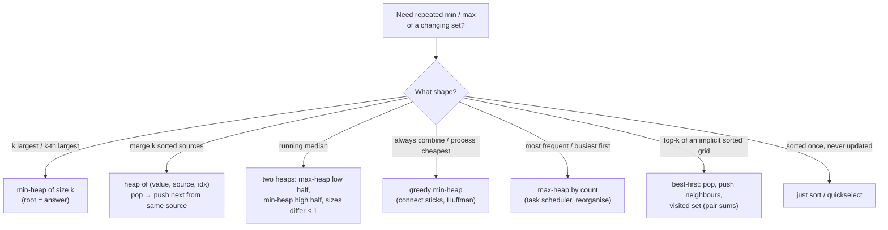

# Part 26: Heaps

← [Striver course map](../README.md)

> [!abstract] What this part covers
> **Goal:** Build the binary heap from scratch (sift up, sift down, O(n) build, heap sort), then use heaps as the engine for top-k, k-way merge, greedy scheduling, two-heap medians and lazy best-first enumeration.
> **Prereqs:** [Binary Trees](../24-binary-trees/README.md) **Time:** ~7 h.
> **Outcome:** Code a min/max heap on an array without a library; explain why bottom-up build is O(n); pick the right heap (min of size k for k-largest); merge k sorted lists in O(N log k); solve task scheduler, hand of straights and connect sticks greedily; maintain a running median with two heaps; enumerate top-k pair sums lazily.

---

## Theory

| # | Lesson | What you get | Source |
|---|---|---|---|
| 1 | [Heaps: Array Layout, Sift Operations, Build-Heap and Priority Queues](01-heap-theory.md) | Complete-tree array layout and index formulas, the heap property, sift up / sift down, push/pop/top, O(n) bottom-up build with the height-sum proof, heap sort, library priority queues in C++/Java/Python, and the five heap patterns: top-k, k-way merge, greedy by priority, two heaps, lazy best-first expansion. | [link](https://takeuforward.org/learning/dsa/heaps-theory?category=theory-and-implementation&source=strivers-a2z-dsa-sheet) |

Read these first; the problems below apply them.

---

## Problems

| # | Problem | Difficulty | Key insight | Optimal | Source |
|---|---|---|---|---|---|
| | **Theory and implementation** | | | | |
| 2 | [Heapify Algorithm](02-heapify-algorithm.md) | Medium | A single changed key is wrong in only one direction. If it got **smaller** it can only conflict with its parent, so sift **up**. If it got **larger** it can only conflict with its children, so sift **down**. One of the two loops does nothing. | O(log n) | [link](https://takeuforward.org/learning/dsa/heapify-algorithm?category=theory-and-implementation&source=strivers-a2z-dsa-sheet) |
| 3 | [Build heap from a given Array](03-build-heap-from-a-given-array.md) | Medium | Leaves (the last ⌈n/2⌉ indices) are already one-node heaps. Sift down every internal node from `n/2 − 1` down to `0`. When a node is processed both its subtrees are heaps, so one sift-down fixes it. Most nodes are near the bottom where sifts are short: Σ (nodes at height h)·h = O(n). | O(n) | [link](https://takeuforward.org/learning/dsa/build-heap-from-a-given-array?category=theory-and-implementation&source=strivers-a2z-dsa-sheet) |
| 4 | [Implement Min Heap](04-implement-min-heap.md) | Medium | Complete-tree shape lives in an array: `push` = append at the end + sift up, `pop` = move the last element to the root + sift down. Both touch one path, so O(log n). `top` is `a[0]`. | push/pop O(log n), top/size O(1) | [link](https://takeuforward.org/learning/dsa/implement-min-heap?category=theory-and-implementation&source=strivers-a2z-dsa-sheet) |
| 5 | [Implement Max Heap](05-implement-max-heap.md) | Medium | Identical to the min-heap with every key comparison flipped. Write it once around a single `higher(i, j)` predicate, and the same code becomes a min-heap, a max-heap or a custom-ordered heap. | push/pop O(log n) | [link](https://takeuforward.org/learning/dsa/implement-max-heap?category=theory-and-implementation&source=strivers-a2z-dsa-sheet) |
| 6 | [Check if an array represents a min heap](06-check-if-an-array-represents-a-min-heap.md) | Easy | The heap property is local: it's enough that every **parent ≤ child** edge holds. Shape is free, since any array is a complete tree. So check each `i ≥ 1` against its parent `(i − 1)/2`. | O(n) | [link](https://takeuforward.org/learning/dsa/check-if-an-array-represents-a-min-heap-?category=theory-and-implementation&source=strivers-a2z-dsa-sheet) |
| 7 | [Convert Min Heap to Max Heap](07-convert-min-heap-to-max-heap.md) | Medium | The min-heap ordering is no help: a max-heap needs the opposite partial order. Treat the input as an arbitrary array and run the O(n) bottom-up build with max comparisons. | O(n) | [link](https://takeuforward.org/learning/dsa/convert-min-heap-to-max-heap?category=theory-and-implementation&source=strivers-a2z-dsa-sheet) |
| 8 | [Heap Sort](08-heap-sort.md) | Medium | Build a **max**-heap in place (O(n)). Then n − 1 times swap the root (the current max) with the last element of the heap region, shrink the region by one, and sift the new root down. The sorted suffix grows from the right. | O(n log n) | [link](https://takeuforward.org/learning/dsa/heap-sort?category=theory-and-implementation&source=strivers-a2z-dsa-sheet) |
| 9 | [K-th Largest element in an array](09-k-th-largest-element-in-an-array.md) | Medium | Keep a **min-heap of size k**: it holds the k largest seen so far, and its root is the k-th largest. O(n log k). Quickselect partitions like quicksort but recurses into one side only: expected O(n). | O(n) expected | [link](https://takeuforward.org/learning/dsa/k-th-largest-element-in-an-array?category=theory-and-implementation&source=strivers-a2z-dsa-sheet) |
| | **FAQs** | | | | |
| 10 | [Kth largest element in a stream of running integers](10-kth-largest-in-a-stream.md) | Easy | A **min-heap holding exactly the k largest** values so far. Its root is the k-th largest. A new value smaller than the root can never matter again, so it's dropped; otherwise it replaces the root. Each `add` is O(log k) and memory stays O(k) no matter how long the stream is. | add O(log k) | [link](https://takeuforward.org/learning/dsa/kth-largest-element-in-a-stream-of-running-integers?category=faqs&source=strivers-a2z-dsa-sheet) |
| 11 | [Sort K sorted array](11-sort-k-sorted-array.md) | Medium | The element that belongs at index `i` must be among `nums[i … i+k]`. So a **min-heap of size k+1** sliding over the array always contains the next output. That's O(n log k), better than O(n log n) when k ≪ n. | O(n log k) | [link](https://takeuforward.org/learning/dsa/sort-k-sorted-array?category=faqs&source=strivers-a2z-dsa-sheet) |
| 12 | [Merge K sorted Lists](12-merge-k-sorted-lists.md) | Hard | The next output node is the smallest of the k current heads. A min-heap of heads gives it in O(log k): pop the min, append it, push its `next`. Total O(N log k) for N nodes. Divide-and-conquer pairwise merging gets the same bound with O(1) extra space. | O(N log k) | [link](https://takeuforward.org/learning/dsa/merge-k-sorted-lists?category=faqs&source=strivers-a2z-dsa-sheet) |
| 13 | [Replace elements by its rank in the array](13-replace-elements-by-rank.md) | Easy | Rank = 1 + number of **distinct** values smaller than it. Sort the distinct values once and map each to its position. It's coordinate compression, the same step that precedes Fenwick-tree problems. | O(n log n) | [link](https://takeuforward.org/learning/dsa/replace-elements-by-their-rank?category=faqs&source=strivers-a2z-dsa-sheet) |
| 14 | [Task Scheduler](14-task-scheduler.md) | Medium | Only the **most frequent** task forces idling. With max frequency `f` and `m` tasks sharing it, the frame is `f − 1` blocks of length `n + 1`, plus a final block of `m`. Other tasks fill the gaps. If they overflow the gaps there's no idling at all. Answer: `max(len(tasks), (f−1)(n+1) + m)`. | O(T) | [link](https://takeuforward.org/learning/dsa/task-scheduler?category=faqs&source=strivers-a2z-dsa-sheet) |
| 15 | [Hand of Straights](15-hand-of-straights.md) | Medium | The **smallest remaining card** can only be the start of a group (nothing smaller is left to precede it). So greedily start a group there and consume `x, x+1, …, x+g−1`. If any is missing, fail. With counts, start `c[x]` groups at once. | O(n log n) | [link](https://takeuforward.org/learning/dsa/hand-of-straights?category=faqs&source=strivers-a2z-dsa-sheet) |
| 16 | [Design twitter](16-design-twitter.md) | Medium | Each user's tweets are already sorted by time (append-only). The feed is a **k-way merge** of the followees' lists, newest first, stopped after 10. Use a max-heap seeded with each list's last tweet. Cost per feed: O(f + 10 log f) for f followees. | feed O(f + 10 log f) | [link](https://takeuforward.org/learning/dsa/design-twitter?category=faqs&source=strivers-a2z-dsa-sheet) |
| 17 | [Minimum cost to connect sticks](17-minimum-cost-to-connect-sticks.md) | Medium | Every stick's length is paid once per join it takes part in, i.e. its depth in the merge tree. To minimise Σ length × depth, the shortest sticks should be deepest. **Always join the two shortest** (Huffman coding), using a min-heap. | O(n log n) | [link](https://takeuforward.org/learning/dsa/minimum-cost-to-connect-sticks?category=faqs&source=strivers-a2z-dsa-sheet) |
| 18 | [Maximum Sum Combination](18-maximum-sum-combination.md) | Medium | Sort both descending. The sums form a grid that decreases along every row and column, so `(0,0)` is the max and the next candidate is always a neighbour `(i+1, j)` or `(i, j+1)` of something already taken. Expand best-first with a max-heap and a **visited set** so no cell is pushed twice: O(K log K). | O(n log n + K log K) | [link](https://takeuforward.org/learning/dsa/maximum-sum-combination?category=faqs&source=strivers-a2z-dsa-sheet) |
| 19 | [Find Median from Data Stream](19-find-median-from-data-stream.md) | Hard | Split the numbers into a **low half (max-heap)** and a **high half (min-heap)**, with every low ≤ every high and sizes equal or low larger by one. The median is `low.top()` or the average of both tops. Each insert is O(log n) and each query O(1). | add O(log n), median O(1) | [link](https://takeuforward.org/learning/dsa/find-median-from-data-stream?category=faqs&source=strivers-a2z-dsa-sheet) |
| 20 | [Top K Frequent Elements](20-top-k-frequent-elements.md) | Medium | Count, then select. A **min-heap of size k keyed by count** gives O(n log k). Better: frequencies lie in `1 … n`, so **bucket sort** by count and read buckets from high to low for O(n). | O(n) | [link](https://takeuforward.org/learning/dsa/top-k-frequent-elements?category=faqs&source=strivers-a2z-dsa-sheet) |

---

## Which heap pattern?

---

## Part 26 cheat sheet

| Operation / problem | Technique | Key rule | Complexity |
|---|---|---|---|
| Parent / children of `i` | 0-indexed array | `(i−1)/2`, `2i+1`, `2i+2` | O(1) |
| push / pop | sift up / sift down | pop: last → root, sift down to the **smaller** child | O(log n) |
| Build heap | bottom-up from `n/2−1` | subtrees already heaps | O(n) |
| Heap sort | max-heap, swap root to end | sift within shrinking size | O(n log n), O(1), unstable |
| k-th largest | min-heap size k | pop when size > k | O(n log k) |
| k-th largest (one-shot) | quickselect 3-way | target index `n−k` | O(n) expected |
| Sort k-sorted | min-heap size k+1 | element i is within k of its slot | O(n log k) |
| Merge k lists | heap of heads | push `next` of popped node | O(N log k) |
| Task scheduler | count formula | `max(n_tasks, (f−1)(n+1) + #maxf)` | O(n) |
| Hand of straights | ordered map from the smallest | start groups at the smallest card | O(n log n) |
| Connect sticks | min-heap | always join the two shortest | O(n log n) |
| Median stream | two heaps | rebalance after each insert | O(log n) add, O(1) query |
| Top-k frequent | bucket by count | buckets indexed 0..n | O(n) |
| Top-k pair sums | best-first + visited | from `(i,j)` push `(i+1,j)`, `(i,j+1)` | O(k log k) |

**Libraries:** C++ `priority_queue<T>` is a **max**-heap (`greater<T>` for min); Java `PriorityQueue` is a **min**-heap; Python `heapq` is a **min**-heap on a list (negate for max, push tuples for ties). None support decrease-key; push a new entry and skip stale ones on pop (lazy deletion).

---

## Mastery checklist

- [ ] Write the parent/child index formulas for a 0-indexed heap
- [ ] Implement push and pop with sift up / sift down from memory
- [ ] Repair a heap after changing one key (choose the direction)
- [ ] Build a heap bottom-up and prove it is O(n)
- [ ] Convert a min-heap to a max-heap in O(n)
- [ ] Write in-place heap sort and state why it is unstable
- [ ] Find the k-th largest with a size-k min-heap and with quickselect
- [ ] Maintain the k-th largest of a stream
- [ ] Sort a k-sorted array in O(n log k)
- [ ] Merge k sorted lists with a heap of heads
- [ ] Solve task scheduler by simulation and by the counting formula
- [ ] Solve hand of straights greedily from the smallest card
- [ ] Design Twitter's news feed as a k-way merge of tweet lists
- [ ] Minimise the cost of connecting sticks (Huffman argument)
- [ ] Find the median of a stream with two heaps
- [ ] Find the top k frequent elements with a heap and with bucket sort
- [ ] Enumerate the top-k pair sums lazily with a visited set

**Interview track →** [Heap deep-dive](../../01-data-structures/10-heap.md)

Next part → [Graphs](../27-graphs/README.md)
