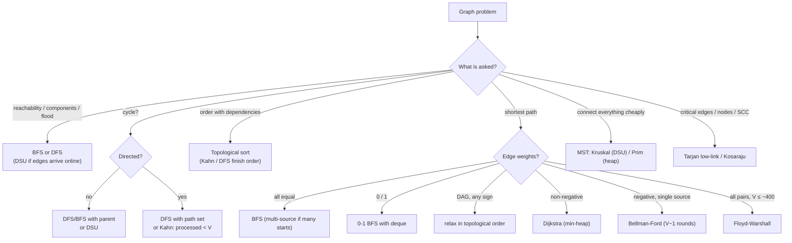

# Part 27: Graphs

← [Striver course map](../README.md)

> [!abstract] What this part covers
> **Goal:** Model problems as graphs, traverse them with BFS/DFS (adjacency lists and grids), detect cycles, order DAGs topologically, compute shortest paths (BFS, 0-1 BFS, DAG relaxation, Dijkstra, Bellman-Ford, Floyd-Warshall), build minimum spanning trees with Prim and Kruskal, use union-find for dynamic connectivity, and find SCCs, bridges and articulation points.
> **Prereqs:** [Recursion](../18-recursion/README.md), [Stack and Queues](../23-stack-and-queues/README.md), [Heaps](../26-heaps/README.md) **Time:** ~16 h.
> **Outcome:** Pick BFS vs DFS vs Dijkstra vs Bellman-Ford from the edge weights alone; write multi-source BFS on a grid without bugs; detect cycles in undirected (parent) and directed (path set / Kahn) graphs; produce a topological order and use it for scheduling and DAG shortest paths; implement DSU with path compression + union by size; run Kruskal and Prim; explain low-link for bridges and articulation points.

---

## Theory

| # | Lesson | What you get | Source |
|---|---|---|---|
| 1 | [Graphs: Representations, BFS/DFS, Cycles, Topological Order and Shortest Paths](01-graph-theory.md) | Vocabulary, adjacency matrix vs list vs edge list, grid graphs, BFS and DFS with their invariants, connected components, cycle detection in undirected and directed graphs, bipartiteness, topological sort (DFS and Kahn), and the shortest-path decision table: BFS, 0-1 BFS, DAG relaxation, Dijkstra, Bellman-Ford, Floyd-Warshall. | [link](https://takeuforward.org/learning/dsa/introduction-to-graph?category=theory-and-traversals&source=strivers-a2z-dsa-sheet) |
| 2 | [Minimum Spanning Trees and Disjoint Set Union](02-mst-and-dsu-theory.md) | Spanning trees, the cut and cycle properties, Prim and Kruskal with proofs and complexity, union-find with path compression and union by rank/size, the inverse-Ackermann bound, and the DSU problem patterns (offline connectivity, grid unions, index mapping). | [link](https://takeuforward.org/learning/dsa/mst-theory?category=minimum-spanning-tree&source=strivers-a2z-dsa-sheet) |

Read these first; the problems below apply them.

---

## Problems

| # | Problem | Difficulty | Key insight | Optimal | Source |
|---|---|---|---|---|---|
| | **Theory and traversals** | | | | |
| 3 | [Traversal Techniques](03-traversal-techniques-bfs-dfs.md) | Easy | Both traversals are 'pop a node, expand its unvisited neighbours'. The only difference is the container. A **queue** pops the oldest node, so BFS explores layer by layer. A **stack** (or recursion) pops the newest, so DFS goes as deep as it can before backtracking. A `visited` array ensures each node is expanded once, giving O(V + E). | O(V + E) | [link](https://takeuforward.org/learning/dsa/traversal-techniques?category=theory-and-traversals&source=strivers-a2z-dsa-sheet) |
| 4 | [Connected Components](04-connected-components.md) | Easy | Every traversal started from an unvisited node visits exactly one whole component. So the number of times the outer loop finds an unvisited node and starts a traversal is the component count. | O(V + E) | [link](https://takeuforward.org/learning/dsa/connected-components?category=theory-and-traversals&source=strivers-a2z-dsa-sheet) |
| | **Traversal problems** | | | | |
| 5 | [Number of provinces](05-number-of-provinces.md) | Medium | A province is a connected component. The input is already an adjacency matrix, so the DFS expands city `i` by scanning row `i`. With n² entries to read anyway, O(n²) is optimal. | O(n²) | [link](https://takeuforward.org/learning/dsa/number-of-provinces?category=traversal-problems&source=strivers-a2z-dsa-sheet) |
| 6 | [Number of islands](06-number-of-islands.md) | Medium | A grid is an implicit graph: cells are nodes and the 4 neighbours are edges. Scan every cell; each `'1'` not yet visited starts a flood that visits its whole island. Count the floods. | O(m·n) | [link](https://takeuforward.org/learning/dsa/number-of-islands?category=traversal-problems&source=strivers-a2z-dsa-sheet) |
| 7 | [Flood fill algorithm](07-flood-fill.md) | Easy | DFS from `(sr, sc)` over neighbours that still have the **original** colour, repainting as you go. The repainted colour doubles as the visited mark, except when `color == original`, where repainting changes nothing and the DFS would loop forever. Return immediately in that case. | O(m·n) | [link](https://takeuforward.org/learning/dsa/flood-fill-algorithm?category=traversal-problems&source=strivers-a2z-dsa-sheet) |
| 8 | [Number of enclaves](08-number-of-enclaves.md) | Medium | Turn the question around. Instead of asking which cells can escape, start from every land cell **on the border** and flood inwards. Everything reached can escape. The land that is never reached is the answer. | O(m·n) | [link](https://takeuforward.org/learning/dsa/number-of-enclaves?category=traversal-problems&source=strivers-a2z-dsa-sheet) |
| 9 | [Rotten Oranges](09-rotten-oranges.md) | Medium | All rotten oranges spread **simultaneously**, which is exactly multi-source BFS: put every rotten orange in the queue at time 0. An orange's BFS level is the minute it rots, and the answer is the last level reached. Count fresh oranges up front; if any are left after the BFS, return −1. | O(m·n) | [link](https://takeuforward.org/learning/dsa/rotten-oranges?category=traversal-problems&source=strivers-a2z-dsa-sheet) |
| 10 | [Distance of nearest cell having one](10-distance-of-nearest-cell-having-1.md) | Medium | Run one BFS backwards from the targets instead of a BFS forwards from every cell. Seed **every 1** at distance 0; BFS then labels each cell with its distance to the nearest seed, because BFS reaches each cell first by a shortest path from the whole source set. | O(m·n) | [link](https://takeuforward.org/learning/dsa/distance-of-nearest-cell-having-one?category=traversal-problems&source=strivers-a2z-dsa-sheet) |
| 11 | [Surrounded Regions](11-surrounded-regions.md) | Medium | A region survives exactly when it touches the border. So mark the survivors instead of hunting for the doomed regions. Flood from every border `'O'` and mark it safe (temporarily `'#'`). Then every remaining `'O'` becomes `'X'` and every `'#'` turns back into `'O'`. | O(m·n) | [link](https://takeuforward.org/learning/dsa/surrounded-regions?category=traversal-problems&source=strivers-a2z-dsa-sheet) |
| 12 | [Number of distinct islands](12-number-of-distinct-islands.md) | Medium | Translate each island so its **first-visited cell** sits at the origin. The scan reaches every island at its top-most, left-most cell, so this is a canonical anchor. Then two islands have the same shape exactly when they produce the same list of relative coordinates (in the same DFS order). Put each list, as a tuple, into a set. | O(m·n) | [link](https://takeuforward.org/learning/dsa/number-of-distinct-islands?category=traversal-problems&source=strivers-a2z-dsa-sheet) |
| | **Cycles** | | | | |
| 13 | [Detect a cycle in an undirected graph](13-cycle-in-undirected-graph.md) | Medium | During a traversal, every edge either reaches a new node (a tree edge) or points to an already-visited node. In an undirected graph, the one visited neighbour that is **not** a cycle is the parent you just came from. Any other visited neighbour closes a cycle. Track `(node, parent)` and check every component. | O(V + E) | [link](https://takeuforward.org/learning/dsa/detect-a-cycle-in-an-undirected-graph?category=cycles&source=strivers-a2z-dsa-sheet) |
| 14 | [Bipartite graph](14-bipartite-graph.md) | Medium | Colour greedily. The first node of a component gets colour 0, and every neighbour is forced to the opposite colour. The choice for the first node never matters, because swapping colours gives a mirror solution. So the graph is bipartite iff this forced colouring never meets an edge with both ends the same colour. Equivalently, there is **no odd cycle**. | O(V + E) | [link](https://takeuforward.org/learning/dsa/bipartite-graph?category=cycles&source=strivers-a2z-dsa-sheet) |
| | **Hard problems (topological sort and BFS)** | | | | |
| 15 | [Topological sort or Kahn's algorithm](15-topological-sort-dfs-and-kahn.md) | Medium | Two equivalent views. **DFS:** a node finishes only after everything reachable from it has finished, so reversed finish order is a topological order. **Kahn (BFS):** a node with in-degree 0 has no remaining prerequisites, so it can go next. Removing it may free its neighbours. | O(V + E) | [link](https://takeuforward.org/learning/dsa/topological-sort-or-kahns-algorithm?category=hard-problems&source=strivers-a2z-dsa-sheet) |
| 16 | [Detect a cycle in a directed graph](16-cycle-in-directed-graph.md) | Medium | Unlike the undirected case, reaching a visited node is not enough: in the diamond `0→1→3, 0→2→3`, node 3 is reached twice without a cycle. A cycle exists exactly when DFS meets a node that is **still on the current recursion path**, a back edge. Use three states: unvisited, on path, done. Alternatively, Kahn's algorithm fails to output every node exactly when there is a cycle. | O(V + E) | [link](https://takeuforward.org/learning/dsa/detect-a-cycle-in-a-directed-graph?category=hard-problems&source=strivers-a2z-dsa-sheet) |
| 17 | [Find eventual safe states](17-find-eventual-safe-states.md) | Medium | A node is unsafe exactly when some path from it can reach a cycle. **Reverse every edge**, then run Kahn's algorithm. Terminal nodes are the in-degree-0 starts in the reversed graph. A node gets peeled once all its original successors are proven safe. Nodes on or leading into cycles are never peeled. | O(V + E) | [link](https://takeuforward.org/learning/dsa/find-eventual-safe-states?category=hard-problems&source=strivers-a2z-dsa-sheet) |
| 18 | [Course Schedule I](18-course-schedule-i.md) | Medium | Courses are nodes and the edge `b → a` means `b` comes before `a`. Every course can be finished iff that graph has no cycle, i.e. iff Kahn's algorithm processes all `n` nodes. Watch the edge direction: `[a, b]` means `b → a`. | O(V + E) | [link](https://takeuforward.org/learning/dsa/course-schedule-i?category=hard-problems&source=strivers-a2z-dsa-sheet) |
| 19 | [Course Schedule II](19-course-schedule-ii.md) | Medium | Same graph as Course Schedule I, but now output Kahn's processing order. If the order has fewer than `n` courses, a cycle blocked the rest, so return `[]`. | O(V + E) | [link](https://takeuforward.org/learning/dsa/course-schedule-ii?category=hard-problems&source=strivers-a2z-dsa-sheet) |
| 20 | [Alien dictionary](20-alien-dictionary.md) | Hard | Compare **adjacent** words only. The first position where they differ gives one edge, `x → y` (x comes before y). Nothing after that position says anything. Topologically sort the `k` letters. A cycle, or a longer word placed before its own prefix (`"ab"` before `"a"`), means the dictionary is invalid. | O(N·L + k) | [link](https://takeuforward.org/learning/dsa/alien-dictionary?category=hard-problems&source=strivers-a2z-dsa-sheet) |
| 21 | [Shortest path in DAG](21-shortest-path-in-dag.md) | Medium | In topological order, every edge into `v` comes from a node processed earlier. So relaxing the edges of each node, in topological order, finalises `dist[v]` before `v`'s own edges are relaxed. One pass, O(V + E), and **negative weights are fine** (there are no cycles to exploit). | O(V + E) | [link](https://takeuforward.org/learning/dsa/shortest-path-in-dag?category=hard-problems&source=strivers-a2z-dsa-sheet) |
| | **Shortest path algorithms** | | | | |
| 22 | [Shortest path in undirected graph with unit weights](22-shortest-path-unit-weights.md) | Medium | With every edge weighing 1, BFS **is** Dijkstra. The queue pops nodes in non-decreasing distance, so the first time a node is discovered, it is via a shortest path. `dist[v] = dist[u] + 1` at discovery is final. | O(V + E) | [link](https://takeuforward.org/learning/dsa/shortest-path-in-undirected-graph-with-unit-weights?category=shortest-path-algorithms&source=strivers-a2z-dsa-sheet) |
| 23 | [Word ladder I](23-word-ladder-i.md) | Hard | Words are nodes, and an edge joins two words that differ in one letter, so this is unweighted shortest path, i.e. BFS. Don't build the graph by comparing all pairs. Generate each word's neighbours on the fly: try all 26 letters at each position and keep the candidates that are in the word set. **Delete a word from the set when it is enqueued**; that is the visited mark. | O(N·L²·26) | [link](https://takeuforward.org/learning/dsa/word-ladder-i?category=shortest-path-algorithms&source=strivers-a2z-dsa-sheet) |
| 24 | [Word ladder II](24-word-ladder-ii.md) | Hard | Do it in two phases. **Phase 1:** BFS layer by layer and record each word's depth, removing a layer's words from the dictionary only **after** the whole layer is processed, so two parents on the same layer can both reach a child. **Phase 2:** backtrack from `endWord` to `beginWord`, stepping only to neighbours exactly one level shallower. This explores only shortest-path edges, never storing whole paths in the queue. | O(N·L²·26 + paths·len) | [link](https://takeuforward.org/learning/dsa/word-ladder-ii?category=shortest-path-algorithms&source=strivers-a2z-dsa-sheet) |
| 25 | [Dijkstra's algorithm](25-dijkstra.md) | Medium | Dijkstra is greedy. The unfinished node with the smallest tentative distance cannot be improved later, because every other route to it would pass through a node that is already at least as far, and weights are ≥ 0. So finalise it and relax its edges. A min-heap finds that node in O(log V). Stale heap entries (pushed before a later improvement) are skipped on pop. | O((V + E) log V) | [link](https://takeuforward.org/learning/dsa/dijkstras-algorithm?category=shortest-path-algorithms&source=strivers-a2z-dsa-sheet) |
| 26 | [Print shortest path](26-print-shortest-path-dijkstra.md) | Medium | Run Dijkstra and, every time `dist[v]` improves via `u`, set `parent[v] = u`. When the run ends, the parent pointers form a shortest-path tree. Walk back from `n` to `1` and reverse. | O((n + m) log n) | [link](https://takeuforward.org/learning/dsa/print-shortest-path?category=shortest-path-algorithms&source=strivers-a2z-dsa-sheet) |
| 27 | [Shortest distance in a binary maze](27-shortest-distance-binary-maze.md) | Medium | Every move costs 1, so BFS from the source gives final distances at discovery. Dijkstra (what Striver teaches here) also works, but with unit weights its 'heap' is a FIFO queue anyway: entries are pushed in non-decreasing distance order. | O(nm) | [link](https://takeuforward.org/learning/dsa/shortest-distance-in-a-binary-maze?category=shortest-path-algorithms&source=strivers-a2z-dsa-sheet) |
| 28 | [Path with minimum effort](28-path-with-minimum-effort.md) | Medium | Path cost here is a **bottleneck**, `max` of the edge weights, not a sum. Dijkstra still works, because `max` never decreases along a path (it is monotone), just like a sum of non-negative weights. Relax with `new = max(effort[u], |h[v] − h[u]|)`, and the first time the target is popped, its effort is optimal. | O(nm log nm) | [link](https://takeuforward.org/learning/dsa/path-with-minimum-effort?category=shortest-path-algorithms&source=strivers-a2z-dsa-sheet) |
| 29 | [Cheapest flights within K stops](29-cheapest-flights-within-k-stops.md) | Medium | The stop limit breaks plain Dijkstra. A route that is more expensive but uses fewer stops may be the only one that can still be extended, so 'cheapest so far' is not final. Make the number of edges the primary dimension. **Bellman-Ford run exactly `k + 1` rounds**, each round relaxing from the *previous* round's snapshot, computes the cheapest cost using at most `k + 1` flights. | O(k·E) | [link](https://takeuforward.org/learning/dsa/cheapest-flights-within-k-stops?category=shortest-path-algorithms&source=strivers-a2z-dsa-sheet) |
| 30 | [Minimum multiplications to reach end](30-minimum-multiplications-to-reach-end.md) | Medium | It is a graph in disguise. There are 100000 nodes (the residues), and each node `x` has edges to `x · a mod 100000` for every `a`. Every step costs 1, so BFS from `start` finds the answer, and the state space is bounded by the modulus no matter how large the numbers get. | O(10⁵·|arr|) | [link](https://takeuforward.org/learning/dsa/minimum-multiplications-to-reach-end?category=shortest-path-algorithms&source=strivers-a2z-dsa-sheet) |
| 31 | [Number of ways to arrive at destination](31-number-of-ways-to-arrive-at-destination.md) | Medium | Run Dijkstra and carry `ways[v]` with it. A **strict** improvement via `u` means the old paths are no longer shortest, so `ways[v] = ways[u]`. A **tie** means another equally short route arrived, so `ways[v] += ways[u]`. This is correct because Dijkstra pops `u` only once `dist[u]` and `ways[u]` are final, and every shortest path's second-to-last node is popped before `v`. | O(E log V) | [link](https://takeuforward.org/learning/dsa/number-of-ways-to-arrive-at-destination?category=shortest-path-algorithms&source=strivers-a2z-dsa-sheet) |
| 32 | [Bellman-Ford algorithm](32-bellman-ford.md) | Medium | A shortest path without cycles has at most `V − 1` edges. Relaxing **every** edge once extends every correct prefix by at least one edge, so `V − 1` full rounds finalise every distance. If a `V`-th round can still improve something, some 'shortest path' needs more than `V − 1` edges, which is only possible if there is a negative cycle. | O(V·E) | [link](https://takeuforward.org/learning/dsa/bellman-ford-algorithm?category=shortest-path-algorithms&source=strivers-a2z-dsa-sheet) |
| 33 | [Floyd Warshall algorithm](33-floyd-warshall.md) | Medium | DP over allowed intermediate nodes. After phase `k`, `d[i][j]` is the shortest `i → j` path whose intermediate nodes all lie in `{0..k}`. Allowing node `k` either doesn't help, or splits the path into `i → k` and `k → j`, both using only `{0..k−1}`: `d[i][j] = min(d[i][j], d[i][k] + d[k][j])`. **`k` must be the outermost loop.** | O(n³) | [link](https://takeuforward.org/learning/dsa/floyd-warshall-algorithm?category=shortest-path-algorithms&source=strivers-a2z-dsa-sheet) |
| 34 | [Find the city with the smallest number of neighbors at a threshold distance](34-city-with-smallest-neighbors-at-threshold.md) | Medium | It needs every city's distance to every other city, i.e. all-pairs shortest paths, and `n ≤ 100` makes Floyd-Warshall's O(n³) = 10⁶ trivially fast. Then count `d[i][j] ≤ threshold` per row, scanning `i` upward with `≤` so that ties go to the larger index. | O(n³) | [link](https://takeuforward.org/learning/dsa/find-the-city-with-the-smallest-number-of-neighbors-at-a-threshold-distance?category=shortest-path-algorithms&source=strivers-a2z-dsa-sheet) |
| 35 | [Network delay time](35-network-delay-time.md) | Medium | Each node receives the signal at its shortest-path distance from `k`. Everyone has it once the **farthest** node does, so the answer is `max(dist)` from one Dijkstra run, or −1 if any distance is infinite. | O(E log n) | [link](https://takeuforward.org/learning/dsa/network-delay-time?category=shortest-path-algorithms&source=strivers-a2z-dsa-sheet) |
| 36 | [Swim in rising water](36-swim-in-rising-water.md) | Hard | A path is usable at time `t` iff its highest cell is ≤ `t`. So the answer is the minimum over paths of the **maximum cell** on the path, a minimax path, exactly like Minimum Effort but with node weights. Dijkstra with `new = max(cur, grid[x][y])`, starting from `grid[0][0]`, pops the target at the optimal time. | O(n² log n) | [link](https://takeuforward.org/learning/dsa/swim-in-rising-water?category=shortest-path-algorithms&source=strivers-a2z-dsa-sheet) |
| | **Minimum spanning tree** | | | | |
| 37 | [Disjoint Set (Union-Find)](37-disjoint-set.md) | Medium | Represent each set as a tree whose root is the set's name. `find` walks to the root and **compresses** the path; `unite` hangs the **smaller** tree under the larger root. Together these give O(α(n)) amortised per operation, which is ≤ 4 for any practical n. | O(α(n)) amortised | [link](https://takeuforward.org/learning/dsa/disjoint-set-?category=minimum-spanning-tree&source=strivers-a2z-dsa-sheet) |
| 38 | [Find the MST weight](38-find-the-mst-weight.md) | Medium | **Cut property:** for any split of the vertices into two sides, the lightest edge crossing the split belongs to some MST. Prim grows one tree and repeatedly takes the lightest edge leaving it (heap). Kruskal sorts all edges and takes each one that joins two different components (DSU). | O(E log E) | [link](https://takeuforward.org/learning/dsa/find-the-mst-weight?category=minimum-spanning-tree&source=strivers-a2z-dsa-sheet) |
| | **Hard problems II (disjoint set)** | | | | |
| 39 | [Number of operations to make network connected](39-number-of-operations-to-make-network-connected.md) | Medium | Joining `c` components needs exactly `c − 1` cables. Any cable that closes a cycle is spare and can be moved. So: if `E < n − 1` there aren't enough cables (−1); otherwise the answer is `components − 1`, and enough spares are guaranteed. | O(n + E·α(n)) | [link](https://takeuforward.org/learning/dsa/number-of-operations-to-make-network-connected?category=hard-problems-ii&source=strivers-a2z-dsa-sheet) |
| 40 | [Accounts merge](40-accounts-merge.md) | Medium | Accounts are nodes; a shared email is an edge. Map each email to the **first account index** that owned it and union later owners into it. Then group every email by `find(owner)` and sort each group. Same names alone never merge. | O(N log N) | [link](https://takeuforward.org/learning/dsa/accounts-merge?category=hard-problems-ii&source=strivers-a2z-dsa-sheet) |
| 41 | [Number of islands II](41-number-of-islands-ii.md) | Hard | Adding land is a union-only process, so the count can be maintained online: a new cell adds one island, and each union with a **different** neighbouring island subtracts one. Encode cell `(r, c)` as `r·m + c`. Re-adding an existing land cell changes nothing. | O(n·m + k·α) | [link](https://takeuforward.org/learning/dsa/number-of-islands-ii?category=hard-problems-ii&source=strivers-a2z-dsa-sheet) |
| 42 | [Making a large island](42-making-a-large-island.md) | Hard | Label every island once (DSU or DFS) and store its size. Flipping a 0 creates `1 + sum of sizes of the **distinct** islands among its 4 neighbours`. Use a set of roots so an island touching the cell on two sides isn't counted twice. If there is no 0, the answer is `n²`. | O(n²·α) | [link](https://takeuforward.org/learning/dsa/making-a-large-island?category=hard-problems-ii&source=strivers-a2z-dsa-sheet) |
| 43 | [Most stones removed with same row or column](43-most-stones-removed-with-same-row-or-column.md) | Medium | Stones sharing a row or column form connected components, and every component can be peeled down to exactly **one** stone (remove leaves of a spanning tree first). So the answer is `n − components`. Treat each row and each column as a DSU node and union `row r` with `col c` for every stone: no O(n²) pairing needed. | O(n·α) | [link](https://takeuforward.org/learning/dsa/most-stones-removed-with-same-row-or-column?category=hard-problems-ii&source=strivers-a2z-dsa-sheet) |
| | **Additional algorithms** | | | | |
| 44 | [Kosaraju's algorithm](44-kosarajus-algorithm.md) | Hard | Two DFS passes. Pass 1 records vertices by **finish time**. The vertex that finishes last lies in a *source* SCC of the condensation. In the **reversed** graph that SCC becomes a sink, so a DFS from it stays inside exactly that SCC. Repeat in decreasing finish order; each new DFS start is one SCC. | O(V + E) | [link](https://takeuforward.org/learning/dsa/kosaraju's-algorithm?category=additional-algorithms&source=strivers-a2z-dsa-sheet) |
| 45 | [Bridges in graph](45-bridges-in-graph.md) | Hard | DFS with discovery time `tin[u]` and `low[u]` = earliest `tin` reachable from u's subtree using **one back edge**. Tree edge `u–v` is a bridge iff `low[v] > tin[u]`: nothing under v can climb back to u or above without that edge. | O(V + E) | [link](https://takeuforward.org/learning/dsa/bridges-in-graph?category=additional-algorithms&source=strivers-a2z-dsa-sheet) |
| 46 | [Articulation point in graph](46-articulation-point-in-graph.md) | Hard | Same `tin`/`low` DFS as bridges, two changes. A **non-root** u is a cut vertex if some child v has `low[v] ≥ tin[u]` (v's subtree can't get above u). The **root** is a cut vertex iff it has **≥ 2 DFS children**. Use a boolean mark, since u can qualify through several children. | O(V + E) | [link](https://takeuforward.org/learning/dsa/articulation-point-in-graph?category=additional-algorithms&source=strivers-a2z-dsa-sheet) |

---

## Which graph algorithm?

---

## Part 27 cheat sheet

| Problem shape | Technique | Key rule | Complexity |
|---|---|---|---|
| Traverse / count components | BFS or DFS + visited | mark visited when **pushed** (BFS) | O(V + E) |
| Grid islands / flood fill | DFS/BFS on 4 neighbours | bounds check first, then cell value | O(R·C) |
| "Distance from the nearest X" | multi-source BFS | push **all** sources at distance 0 | O(R·C) |
| "Regions not touching the border" | BFS/DFS from the border | mark safe, flip the rest | O(R·C) |
| Cycle, undirected | DFS/BFS with parent | visited neighbour ≠ parent → cycle | O(V + E) |
| Cycle, directed | DFS with on-path flag / Kahn | back edge, or Kahn pops < V | O(V + E) |
| Bipartite | 2-colouring BFS/DFS | same-colour edge → not bipartite | O(V + E) |
| Topological order | Kahn (in-degree 0 queue) | DAG ⇔ all V popped | O(V + E) |
| Shortest path, unit weights | BFS | first visit = shortest | O(V + E) |
| Shortest path, DAG | topo order + relax | works with negative weights | O(V + E) |
| Shortest path, w ≥ 0 | Dijkstra + min-heap | skip stale `(d, u)` with `d > dist[u]` | O(E log V) |
| ≤ k edges / negative weights | Bellman-Ford | copy `dist` per round for "≤ k edges" | O(V·E) |
| All pairs | Floyd-Warshall | `k` loop **outermost** | O(V³) |
| Minimax path (effort, water) | Dijkstra on max / BS + BFS / DSU | path cost = max edge | O(E log V) |
| MST | Kruskal (sort + DSU) / Prim (heap) | cut property | O(E log E) |
| Dynamic connectivity | DSU, path compression + size | union returns whether it merged | ~O(α(n)) per op |
| SCC | Kosaraju (finish order, reverse, DFS) | 2 passes | O(V + E) |
| Bridges / articulation points | Tarjan `tin`, `low` | bridge: `low[v] > tin[u]`; AP: `low[v] ≥ tin[u]` (root: ≥ 2 children) | O(V + E) |

---

## Mastery checklist

- [ ] Build an adjacency list from an edge list (directed and undirected)
- [ ] Write BFS and DFS (recursive and iterative) and state their orders
- [ ] Count connected components and provinces
- [ ] Solve islands, flood fill and enclaves on a grid
- [ ] Run multi-source BFS for rotten oranges and nearest-1 distances
- [ ] Capture surrounded regions by marking from the border
- [ ] Count distinct island shapes with a canonical signature
- [ ] Detect cycles in undirected graphs with BFS and DFS
- [ ] Check bipartiteness by 2-colouring
- [ ] Produce a topological order with DFS and with Kahn
- [ ] Detect cycles in directed graphs with a path set and with Kahn
- [ ] Find eventual safe states two ways
- [ ] Solve Course Schedule I and II
- [ ] Derive an alien alphabet from a sorted dictionary
- [ ] Compute shortest paths in a DAG and in an unweighted graph
- [ ] Solve Word Ladder I (BFS) and II (BFS layers + backtracking)
- [ ] Implement Dijkstra with a heap and reconstruct the path
- [ ] Solve minimum-effort path, cheapest flights within K stops and number of ways
- [ ] Implement Bellman-Ford with negative-cycle detection
- [ ] Implement Floyd-Warshall and use it for the threshold-city problem
- [ ] Solve network delay time and swim in rising water
- [ ] Implement DSU with path compression and union by size
- [ ] Compute an MST with Kruskal and with Prim
- [ ] Solve network connections, accounts merge, islands II, largest island and stones with DSU
- [ ] Count SCCs with Kosaraju
- [ ] Find bridges and articulation points with Tarjan's low-link

**Interview track →** [Graph deep-dive](../../01-data-structures/13-graphs.md) · [Graph algorithms](../../coding/algorithms/13-graph-algorithms.md)

Next part → [Dynamic Programming](../28-dynamic-programming/README.md)
