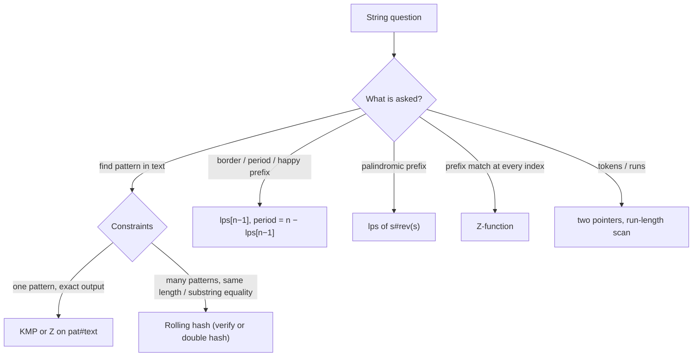

# Part 30: Strings (Advanced)

← [Striver course map](../README.md)

> [!abstract] What this part covers
> **Goal:** Finish the medium string problems (word reversal, bracket reversals, count-and-say), then learn the three linear-time matching tools (rolling hash / Rabin-Karp, Z-function, KMP prefix function) and the concatenation tricks that turn palindrome and border questions into one pass.
> **Prereqs:** [Strings](../17-strings-basic-medium/README.md), [Hashing](../15-hashing/README.md) **Time:** ~5 h.
> **Outcome:** Derive the rolling-hash update and handle the modulo safely; write the Z-algorithm and the prefix function from memory; reduce pattern search to `pat#text`, shortest palindrome to `s#rev(s)`, and longest border / smallest period to `lps[n−1]`.

---

## Theory

| # | Lesson | What you get | Source |
|---|---|---|---|
| 1 | [String Hashing and Pattern Matching](01-string-hashing-and-matching-theory.md) | Polynomial rolling hash (base, modulus, overflow, negative mod), collision probability and double hashing, Rabin-Karp, the Z-function and its Z-box, the KMP prefix function and border chains, KMP search, and the separator tricks (pat#text, s#rev(s)) with periods and borders. | [link](https://takeuforward.org/learning/dsa/hashing-in-strings-theory?category=advanced-problems-(less-asked)&source=strivers-a2z-dsa-sheet) |

Read these first; the problems below apply them.

---

## Problems

| # | Problem | Difficulty | Key insight | Optimal | Source |
|---|---|---|---|---|---|
| | **Medium problems** | | | | |
| 2 | [Reverse every word in a string](02-reverse-every-word-in-a-string.md) | Medium | Scan from the **right**: skip spaces, mark the end of a word, walk left to its start, and append it. Every word comes out in reversed order with exactly one space between words. The in-place C++ trick is to reverse the whole string, then reverse each word back while compacting the spaces. | O(n) | [link](https://takeuforward.org/learning/dsa/reverse-every-word-in-a-string?category=medium-problems&source=strivers-a2z-dsa-sheet) |
| 3 | [Minimum number of bracket reversals to balance an expression](03-minimum-number-of-bracket-reversals-to-balance-an-expression.md) | Medium | Cancel matched pairs greedily. What's left looks like `}}}…{{{`: `c` unmatched closers followed by `o` unmatched openers. Two closers `}}` need 1 flip, two openers `{{` need 1, and a leftover `}{` needs 2. So the answer is `⌈c/2⌉ + ⌈o/2⌉`. An odd length can never balance. | O(n) | [link](https://takeuforward.org/learning/dsa/minimum-number-of-bracket-reversals-to-make-an-expression-balanced?category=medium-problems&source=strivers-a2z-dsa-sheet) |
| 4 | [Count and say](04-count-and-say.md) | Medium | Each term is the **run-length encoding** of the previous one, read aloud: for every maximal block of equal digits, write its length, then the digit. Iterate `n − 1` times. Term lengths grow about 30% per step (Conway's constant ≈ 1.3036), so n stays small. | O(Σ term lengths) | [link](https://takeuforward.org/learning/dsa/count-and-say?category=medium-problems&source=strivers-a2z-dsa-sheet) |
| | **Advanced pattern matching** | | | | |
| 5 | [Rabin-Karp algorithm](05-rabin-karp-algorithm.md) | Hard | Hash the pattern and the first window as base-B polynomials mod a prime. Slide the window in O(1): subtract the outgoing char × `B^(m−1)`, multiply by `B`, add the incoming char. Compare characters **only when the hashes match**, so collisions can't produce wrong answers. Expected O(n + m). | O(n + m) expected, O(n·m) worst | [link](https://takeuforward.org/learning/dsa/rabin-karp-algorithm?category=advanced-problems-(less-asked)&source=strivers-a2z-dsa-sheet) |
| 6 | [Z-function](06-z-function.md) | Hard | `z[i]` is the length of the longest substring starting at `i` that matches a **prefix** of the string. The algorithm keeps the rightmost matched window `[l, r)`. Inside it, `z[i]` starts at `min(r − i, z[i − l])` for free, so `r` only ever moves right, which gives O(n) total. On `pat#text`, the pattern occurs wherever `z[i] == |pat|`. | O(n + m) | [link](https://takeuforward.org/learning/dsa/z-function?category=advanced-problems-(less-asked)&source=strivers-a2z-dsa-sheet) |
| 7 | [KMP algorithm (LPS array)](07-kmp-algorithm-lps-array.md) | Hard | `lps[i]` is the length of the longest proper prefix of `s[0..i]` that is also a suffix of it. Keep `len = lps[i − 1]`. If `s[i] == s[len]`, extend: `len + 1`. Otherwise fall back to the **next-shorter border**, `len = lps[len − 1]`, and try again. `len` rises by at most 1 per step, so the fallbacks total O(n). | O(n) | [link](https://takeuforward.org/learning/dsa/kmp-algorithm-or-lps-array?category=advanced-problems-(less-asked)&source=strivers-a2z-dsa-sheet) |
| 8 | [Shortest palindrome](08-shortest-palindrome.md) | Hard | Only the part after the **longest palindromic prefix** must be mirrored in front. That prefix is the longest prefix of `s` equal to a suffix of `rev(s)`, which is exactly `lps` of `s + '#' + rev(s)` at the last position. The answer is `rev(s)[:n − k] + s`. | O(n) | [link](https://takeuforward.org/learning/dsa/shortest-palindrome?category=advanced-problems-(less-asked)&source=strivers-a2z-dsa-sheet) |
| 9 | [Longest happy prefix](09-longest-happy-prefix.md) | Hard | This is literally `lps[n − 1]`, the last value of the KMP prefix function. Return `s[:lps[n − 1]]`. A rolling-hash scan over all lengths also works in O(n) expected time. | O(n) | [link](https://takeuforward.org/learning/dsa/longest-happy-prefix?category=advanced-problems-(less-asked)&source=strivers-a2z-dsa-sheet) |

---

## Which string tool?

---

## Part 30 cheat sheet

| Problem | Tool | Key move | Time |
|---|---|---|---|
| Reverse words | scan from the right | skip spaces, slice word, join | O(n) |
| Bracket reversals | two counters | ⌈open/2⌉ + ⌈close/2⌉, −1 if odd | O(n) |
| Count and say | run-length encode | count then digit per run | O(Σ len) |
| Rabin-Karp | rolling hash | `((h − out·B^(m−1))·B + in) mod M`, verify | O(n + m) exp. |
| Z search | Z-box `[l, r)` | `z[i] = min(r − i, z[i − l])`, extend | O(n + m) |
| LPS / KMP | prefix function | `len = lps[len − 1]` on mismatch | O(n) |
| Shortest palindrome | lps of `s#rev(s)` | prepend `rev(s)[:n − k]` | O(n) |
| Longest happy prefix | prefix function | `s[:lps[n − 1]]` | O(n) |

---

## Mastery checklist

- [ ] Reverse words with split/join and with the in-place reverse-all-then-each trick
- [ ] Derive the bracket reversal formula from the `}}}{{{` shape
- [ ] Write count and say without forgetting the last run
- [ ] Derive the rolling-hash update and keep it non-negative in C++/Java
- [ ] Explain collisions and when to verify vs double hash
- [ ] Write the Z-algorithm and explain why it is linear
- [ ] Write the prefix function and KMP search from memory
- [ ] Solve shortest palindrome with s#rev(s)
- [ ] Get the smallest period and all borders from the lps array

**Interview track →** [String algorithms deep-dive](../../02-algorithms/02-string-algorithms.md) · [String algorithm walkthroughs](../../coding/algorithms/02-string-algorithms.md)

Next part → [Maths](../31-maths/README.md)
