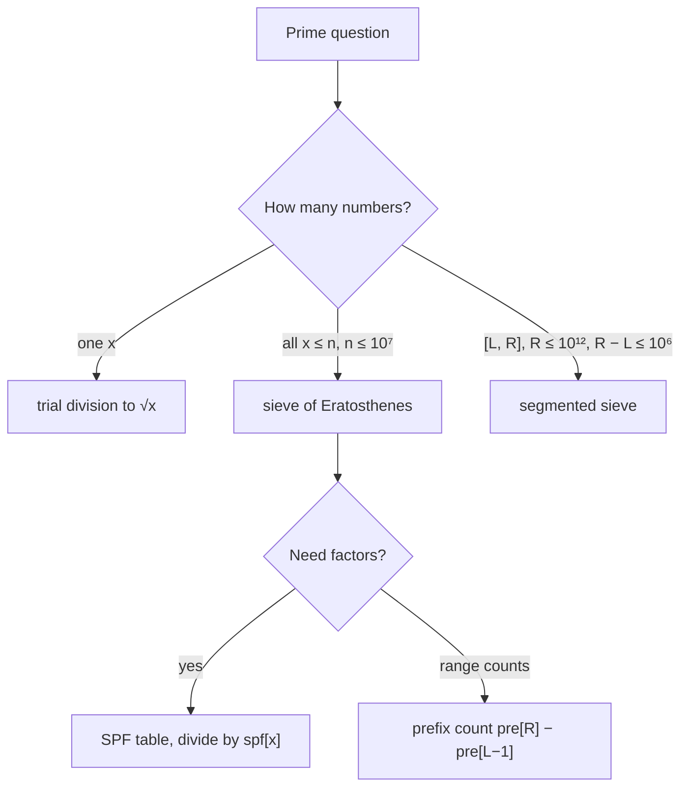

# Part 31: Maths

← [Striver course map](../README.md)

> [!abstract] What this part covers
> **Goal:** Generate primes with the sieve of Eratosthenes, turn it into a smallest-prime-factor table for fast factorisation, and answer range prime counts with prefix sums.
> **Prereqs:** [Basic maths](../08-basic-maths/README.md) **Time:** ~2 h.
> **Outcome:** Write the sieve from memory with both optimisations and justify O(n log log n); build an SPF table and factorise in O(log x); answer [L, R] prime counts in O(1) after preprocessing; know when to switch to a segmented sieve.

---

## Theory

| # | Lesson | What you get | Source |
|---|---|---|---|
| 1 | [Primes and the Sieve](01-sieve-theory.md) | Trial division to √n, the sieve of Eratosthenes and why it starts at i², the n log log n bound, linear sieve and SPF tables, factorisation and divisor functions, prefix counts, and the segmented sieve for huge ranges. | [link](https://takeuforward.org/learning/dsa/print-all-primes-till-n?category=sieve-of-eratosthenes&source=strivers-a2z-dsa-sheet) |
| 5 | [Modular Arithmetic and Combinatorics](05-modular-arithmetic-and-combinatorics-theory.md) | Mod rules, binary/matrix exponentiation, extended Euclid, Fermat and linear-time inverses, nCr mod p (factorials, Pascal, Lucas), Catalan, stars and bars, inclusion–exclusion, φ and divisor formulas. *Enrichment beyond the sheet.* | — |

Read these first; the problems below apply them.

---

## Problems

| # | Problem | Difficulty | Key insight | Optimal | Source |
|---|---|---|---|---|---|
| | **Sieve of Eratosthenes** | | | | |
| 2 | [Print all primes till N](02-print-all-primes-till-n.md) | Easy | Mark multiples instead of testing each number. For each `i` still marked prime with `i·i ≤ n`, cross out `i², i² + i, …`. Smaller multiples `k·i` with `k < i` were already crossed out by the prime factor of `k`. Total work is `Σ n/p` over primes `p ≤ √n`, which is O(n log log n). | O(n log log n) | [link](https://takeuforward.org/learning/dsa/print-all-primes-till-n?category=sieve-of-eratosthenes&source=strivers-a2z-dsa-sheet) |
| 3 | [Prime factorisation of a number](03-prime-factorisation-of-a-number.md) | Medium | Precompute the **smallest prime factor** `spf[x]` for every `x ≤ max` with a sieve: when a prime `p` crosses out `j`, set `spf[j] = p` if it is still unset. Then factorise by repeatedly dividing by `spf[x]`. Each division at least halves `x`, so a query costs O(log x) after O(N log log N) preprocessing. | O(X log log X + Σ log x) | [link](https://takeuforward.org/learning/dsa/prime-factorisation-of-a-number?category=sieve-of-eratosthenes&source=strivers-a2z-dsa-sheet) |
| 4 | [Count primes in range L to R](04-count-primes-in-range-l-to-r.md) | Medium | Sieve once up to the largest `R`, then build a prefix count `pre[i]` = the number of primes `≤ i`. Each query is `pre[R] − pre[L − 1]` in O(1). This is the prefix-sum pattern on top of a sieve. | O(R log log R + q) | [link](https://takeuforward.org/learning/dsa/count-primes-in-range-l-to-r?category=sieve-of-eratosthenes&source=strivers-a2z-dsa-sheet) |

---

## Which prime tool?

---

## Part 31 cheat sheet

| Problem | Tool | Key move | Time |
|---|---|---|---|
| Is x prime? | trial division | d·d ≤ x | O(√x) |
| All primes ≤ n | sieve | outer i·i ≤ n, inner from i² | O(n log log n) |
| Factorise many x | SPF sieve | x /= spf[x] | O(X log log X + log x) per query |
| Primes in [L, R], many queries | sieve + prefix | pre[R] − pre[L−1] | O(1) per query |
| Primes in huge [L, R] | segmented sieve | start at max(p², ⌈L/p⌉·p) | O((R−L) log log R + √R) |

---

## Mastery checklist

- [ ] Write trial division and explain why √x suffices
- [ ] Write the sieve with both optimisations from memory
- [ ] Derive the n log log n bound
- [ ] Build an SPF table and factorise in O(log x)
- [ ] Compute divisor count and divisor sum from a factorisation
- [ ] Answer range prime counts with prefix sums
- [ ] Explain the segmented sieve and its starting multiple

**Interview track →** [Math & number theory](../../02-algorithms/18-math-and-number-theory.md) · [Bit manipulation](../../02-algorithms/17-bit-manipulation.md)

Next part → [Back to index](../README.md)
