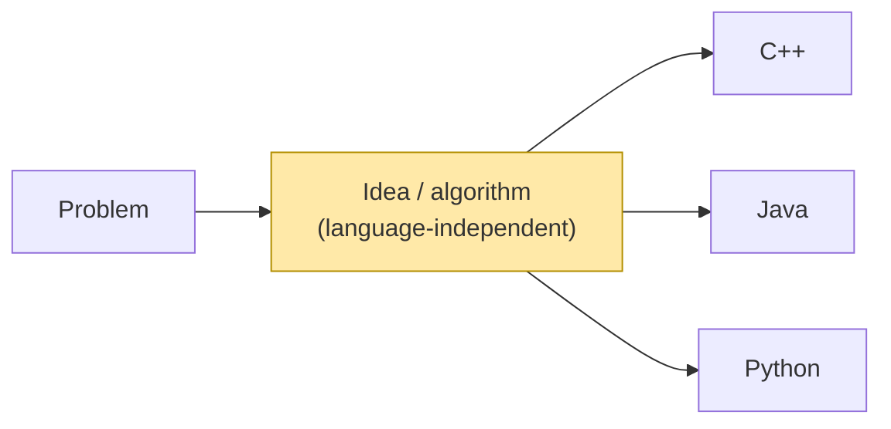

# 1. Breaking the Myth: DSA Is Language-Independent

← [Part 1 index](README.md) · Next → [Programming & What Are Computers](02-programming-and-what-are-computers.md)

> [!abstract] What this covers
> **Myth:** "I need to master language X before I can learn DSA," or "Language X is *the* DSA language."
> **Truth:** DSA is about ideas: how data is organised, which steps solve the problem, and why they are correct and fast. A language is only the vehicle that makes those ideas run.
> **You'll be able to:** separate the *idea* of a solution from its *syntax*, express an idea in pseudocode, and spot the few places where languages really do differ.
> **Source:** [takeuforward lesson](https://takeuforward.org/learning/dsa/breaking-the-myth?category=fundamentals-of-programming&source=strivers-a2z-dsa-sheet) · **Time:** 20 min

**Sections:** [1. Logic comes before syntax](#1-logic-comes-before-syntax) · [2. What changes and what doesn't](#2-what-changes-and-what-doesnt) · [3. Pseudocode: the idea with no syntax](#3-pseudocode-the-idea-with-no-syntax) · [4. Same idea, three languages](#4-same-idea-three-languages) · [5. Where language details do bite](#5-where-language-details-do-bite) · [Common mistakes](#common-mistakes) · [Practice](#practice) · [Flashcards](#flashcards)

---

## 1. Logic comes before syntax

Knowing a language without knowing the logic is like knowing a dictionary's words without knowing what you want to say. Fluent vocabulary doesn't produce an argument.

- **The idea is the solution.** "Check whether the remainder after dividing by 2 is zero" solves even/odd in *every* language.
- **Switching languages does not fix unclear thinking.** If you can't solve a problem in Python, moving to C++ only gives you more syntax to fight.
- **Interviews grade reasoning.** The interviewer wants your approach, its correctness and its complexity. Syntax slips are forgiven far more easily than a wrong approach.



> [!tip] Real-life analogy
> A recipe is language-independent. "Boil water, add tea leaves, simmer two minutes, add milk" works whether you write it in Hindi, English or French. Translating it doesn't make bad chai good.

---

## 2. What changes and what doesn't

"Language-independent" means the *idea transfers*. It does not mean the implementations look the same.

| Stays the same (concept) | Changes per language (vehicle) |
|---|---|
| The algorithm's steps and order | Keywords, brackets, indentation rules |
| Correctness argument (why it works) | Standard library names (`vector` / `ArrayList` / `list`) |
| Time and space complexity (Big-O) | Constant factors (raw speed) |
| Data structure behaviour (stack = LIFO) | Memory management (manual, GC, ownership) |
| Edge cases you must handle | How errors appear (exception, crash, silent overflow) |

**Rule of thumb:** if you can explain the solution on a whiteboard with no code, you understand it. The code is a translation.

---

## 3. Pseudocode: the idea with no syntax

Pseudocode is structured English that is precise enough to follow step by step and loose enough to belong to no language.

**Problem:** read an integer `N`; say whether it is even or odd.

```text
READ N
IF N MOD 2 = 0
    DISPLAY "Even"
ELSE
    DISPLAY "Odd"
END IF
```

| Input | `N MOD 2` | Branch taken | Output |
|---|---|---|---|
| 8 | 0 | IF | Even |
| 7 | 1 | ELSE | Odd |
| 0 | 0 | IF | Even ← zero is even |
| -3 | ±1 (see §5) | ELSE | Odd |

Pseudocode makes you decide **what** before **how**. You will use it in every lesson from here on (full rules in [Lesson 4](04-flowcharts-and-pseudocode.md)).

---

## 4. Same idea, three languages

The *shape* is identical: read, take the remainder, compare, branch. Only the punctuation differs.

```cpp
// C++
#include <iostream>
int main() {
    long long n; std::cin >> n;
    if (n % 2 == 0) std::cout << "Even\n";
    else            std::cout << "Odd\n";
}
```

```java
// Java
import java.util.Scanner;
public class Main {
    public static void main(String[] args) {
        long n = new Scanner(System.in).nextLong();
        if (n % 2 == 0) System.out.println("Even");
        else            System.out.println("Odd");
    }
}
```

```python
# Python
n = int(input())
print("Even" if n % 2 == 0 else "Odd")
```

---

## 5. Where language details do bite

The *ideas* transfer, but some details do not. Learn these once for your chosen language and they stop mattering.

| Detail | C++ | Java | Python | Why it matters |
|---|---|---|---|---|
| `-3 % 2` | `-1` | `-1` | `1` | `n % 2 == 1` misses negative odds in C++/Java → use `n % 2 != 0` |
| `-7 / 2` | `-3` (truncates) | `-3` | `-7 // 2 = -4` (floors) | Midpoints and digit math on negatives |
| Integer overflow | Silent wrap (UB for signed) | Silent wrap | Never (big ints) | `a + b` and `mid = (lo+hi)/2` in C++/Java |
| String mutability | Mutable `std::string` | Immutable `String` | Immutable `str` | Repeated `s += c` in a loop can be O(n²) in Java/Python |
| Default containers | `vector`, `map` (tree), `unordered_map` | `ArrayList`, `HashMap`, `TreeMap` | `list`, `dict`, `set` | Same concepts, different names and guarantees |

> [!tip] Language-safe parity check
> `n % 2 != 0` is "odd" in every language, and bitwise `n & 1` works too for two's-complement integers. Writing the check that holds everywhere is what language-independent thinking looks like in practice.

---

## Common mistakes

> [!failure] Tempting wrong approach
> "I'll learn all of C++, then Java, then start DSA." This repeats beginner material three times. Learn **one** language's essentials ([Lesson 7](07-programming-languages-and-choosing-a-path.md#8-how-much-language-is-enough-for-dsa)), then move straight to DSA.

- Memorising code for a problem instead of the idea: change one constraint and the memorised code breaks.
- Blaming the language ("Python is too slow") when the real problem is an O(n²) algorithm where O(n) was needed.
- Assuming `%` behaves the same on negatives everywhere (§5).
- Treating pseudocode as optional "school stuff". It is the cheapest place to find bugs.

---

## Practice

1. Write pseudocode that reads two integers and prints the larger. Then write it in your chosen language. Which lines changed meaning, and which only changed spelling?
2. Write pseudocode for "is `N` divisible by both 3 and 5?" Test it with `15`, `9`, `10`, `0` and `-30`.
3. In your language, predict and then check: `-7 % 3`, `-7 / 3`, `7 % -3`. Write down the rule your language follows.
4. Explain to a friend (or out loud) why "binary search is O(log n)" is true in every language.

<details><summary>Answer sketch for #2</summary>

```text
READ N
IF N MOD 3 = 0 AND N MOD 5 = 0
    DISPLAY "Yes"
ELSE
    DISPLAY "No"
END IF
```
15 → Yes · 9 → No · 10 → No · 0 → Yes (0 is divisible by everything nonzero) · -30 → Yes (remainder is 0 whatever the sign convention).
</details>

---

## Flashcards

**What does "DSA is language-independent" actually mean?** #flashcard
The algorithm, its correctness argument and its Big-O transfer to any language unchanged. Syntax, library names, constant factors and memory management differ, but the idea does not.

**Why doesn't switching languages fix a problem you can't solve?** #flashcard
The difficulty is in the logic, not the syntax. A new language only changes how you express the same unclear idea.

**Why is `n % 2 == 1` an unsafe odd check in C++/Java?** #flashcard
For negative odd `n`, `%` returns `-1` in C++/Java, so the check fails. Use `n % 2 != 0` or `n & 1`.

**What is pseudocode for?** #flashcard
It states the algorithm precisely with no language syntax, so you decide *what* to do (and find logic bugs) before deciding *how* to type it.

**Name three things that stay the same across languages and three that change.** #flashcard
Same: steps and order, correctness, Big-O. Change: syntax, library names and guarantees, constant-factor speed and memory/overflow behaviour.