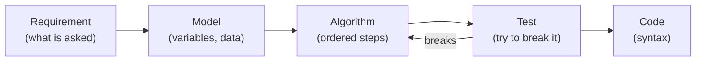
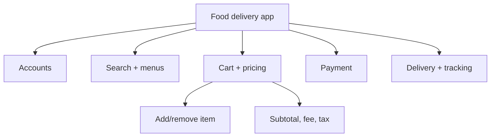
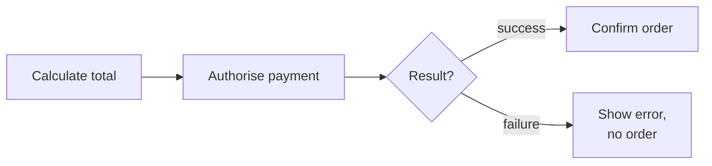

# 3. How to Think Like a Programmer

← [Programming & What Are Computers](02-programming-and-what-are-computers.md) · [Part 1 index](README.md) · Next → [Flowcharts & Pseudocode](04-flowcharts-and-pseudocode.md)

> [!abstract] What this covers
> **Core idea:** Syntax *expresses* a solution; logic *creates* it. Before writing code, turn the problem into a precise **contract**, design steps that solve the *general* problem, and test them on inputs designed to break them.
> **You'll be able to:** write a 5-part problem contract, apply the four pillars of computational thinking, list the properties every algorithm needs, and design robust logic (the "champion" method for maximum).
> **Source:** [takeuforward lesson](https://takeuforward.org/learning/dsa/how-to-think-like-a-programmer?category=fundamentals-of-programming&source=strivers-a2z-dsa-sheet) · **Time:** 45 min

**Sections:** [1. Logic creates, syntax expresses](#1-logic-creates-syntax-expresses) · [2. Worked example: compare two numbers](#2-worked-example-compare-two-numbers) · [3. The problem contract](#3-the-problem-contract) · [4. Worked example: student result](#4-worked-example-student-result) · [5. Computational thinking](#5-computational-thinking) · [6. Correctness vs efficiency](#6-correctness-vs-efficiency) · [7. Properties of an algorithm](#7-properties-of-an-algorithm) · [8. Largest of three: the champion method](#8-largest-of-three-the-champion-method) · [Common mistakes](#common-mistakes) · [Practice](#practice) · [Flashcards](#flashcards)

---

## 1. Logic creates, syntax expresses



Most beginner time is lost by jumping straight from **R** to **C**. Every arrow you skip becomes a bug you find later, and more expensively.

---

## 2. Worked example: compare two numbers

**Requirement:** read two numbers and say which one is larger.

**Model:** two variables, `a` and `b`.

**First algorithm:**
```text
READ a, b
IF a > b THEN DISPLAY "a is larger"
ELSE DISPLAY "b is larger"
```

| Test | Expected | Got | OK? |
|---|---|---|---|
| (8, 13) | b larger | b larger | ✅ |
| (100, -4) | a larger | a larger | ✅ |
| **(7, 7)** | **equal** | **b larger** | ❌ |

The sample tests passed, but a case nobody listed broke it. **Fix:** add the missing branch.

```text
READ a, b
IF a > b        THEN DISPLAY "a is larger"
ELSE IF a < b   THEN DISPLAY "b is larger"
ELSE                 DISPLAY "Both are equal"
```

> [!tip] Solve the problem, not the instance
> Code that works for (8, 13) solves one *instance*. Code that works for every pair, including equal, negative and zero, solves the *problem*. Always ask: **what input would break this?**

---

## 3. The problem contract

Before designing anything, fill in five slots:

| Slot | Question | Example (student result) |
|---|---|---|
| **Input** | What arrives, in what form? | Three integer marks |
| **Output** | What exactly must come back? | Average and "Pass"/"Fail" |
| **Rules** | What logic links input to output? | Pass only if *every* mark ≥ 40 |
| **Constraints** | Ranges, sizes, limits | Marks in 0–100 |
| **Edge cases** | Boundaries, empties, equal values, extremes | 40 exactly, 39, 0, 100, all equal |

> [!warning] Qualifiers change everything
> **every**, **at least**, **at most**, **only if**, **exactly**, **strictly**: each one maps to a specific operator (`AND` vs `OR`, `>=` vs `>`). Underline them when reading a problem.

---

## 4. Worked example: student result

**Rule:** average = (m1 + m2 + m3) / 3. The student passes **only if all three marks are ≥ 40**.

```text
READ m1, m2, m3
SET avg = (m1 + m2 + m3) / 3
IF m1 >= 40 AND m2 >= 40 AND m3 >= 40
    DISPLAY avg, "Pass"
ELSE
    DISPLAY avg, "Fail"
END IF
```

**Trap:** "pass if average ≥ 40" is a *different* rule. (90, 90, 30) averages 70 but fails, because one subject is below 40.

**Boundary tests** (a threshold of 40 means test 39, 40 and 41):

| Input | Expected | Catches |
|---|---|---|
| (39, 40, 41) and its permutations | Fail | A check that ignores one subject |
| (40, 40, 40) | Pass | `>` written instead of `>=` |
| (41, 41, 41) | Pass | Sanity |
| (90, 90, 30) | Fail | Average-based logic |
| (0, 0, 0), (100, 100, 100) | Fail, Pass | Range extremes |

---

## 5. Computational thinking

| Pillar | What it means | Example |
|---|---|---|
| **Decomposition** | Split a big problem into smaller, independent ones | Food app → accounts, search, menus, cart, pricing, payment, confirmation, delivery, tracking |
| **Pattern recognition** | Notice that a new problem has the shape of a known one | Voting age, loan eligibility, exam pass: all "check conditions → yes/no" |
| **Abstraction** | Keep the details that affect the answer, drop the rest | Delivery fee depends on cart total, not on wallpaper colour |
| **Algorithmic thinking** | Order the steps: what depends on what, what repeats, when to stop | Payment: calculate → authorise → inspect result → confirm |



**Messy room, decomposed:** clothes → books → trash → surfaces → floor. Each step is small, checkable and has a clear "done."

> [!warning] Two traps
> - **Abstraction is not permission to drop rules.** Ignoring wallpaper colour is fine. Ignoring "free delivery from ₹499" is not.
> - **A recognised pattern is a starting point, not the answer.** "Looks like binary search" still has to be checked: is the data sorted? Is the predicate monotonic?

**Dependency chain (payment):** you can't confirm an order before the payment result is known, and you can't authorise before the total is computed. Algorithmic thinking means writing steps in an order that respects these dependencies.



---

## 6. Correctness vs efficiency

**Task:** find "Aman" in a list of 1000 names.

| Approach | Needs | Worst-case checks | Note |
|---|---|---|---|
| **Linear search**: check each name in turn | Nothing | 1000 | Always correct |
| **Binary search**: open the middle, discard half | List **sorted** | ~10 (log₂ 1000) | Wrong answer if unsorted |

- **Correct first, then efficient.** A fast wrong answer is worthless.
- **There is rarely only one algorithm.** List options and their trade-offs.
- **State your assumptions out loud** ("assuming the list is sorted…"). In an interview this is where marks come from.
- **Normalise before comparing:** "aman", "Aman" and " AMAN " are one contact, so lowercase and trim first. The computer doesn't know they are "the same."

---

## 7. Properties of an algorithm

| Property | Meaning | Violation |
|---|---|---|
| **Defined input/output** | Clear what goes in and what comes out | "Process the data" |
| **Unambiguous** | Each step has exactly one meaning | "Add a bit of salt" |
| **Finite (terminates)** | Ends after a finite number of steps | Loop variable never updated |
| **Correct** | Right output for *every* valid input | Fails on equal values |
| **Effective** | Every step can actually be done | "Guess the user's password" |

---

## 8. Largest of three: the champion method

**Naive compound version:**
```text
IF a > b AND a > c THEN largest = a
ELSE IF b > a AND b > c THEN largest = b
ELSE largest = c
```
Try **(7, 7, 2)**: `a > b` is false and `b > a` is false, so it falls to `c = 2`. ❌ Strict `>` breaks on ties.

**Champion method:** keep the best seen so far and let each challenger try to beat it.

```text
READ a, b, c
SET largest = a           // first input is the starting champion
IF b > largest THEN SET largest = b
IF c > largest THEN SET largest = c
DISPLAY largest
```

| Input | Start | After b | After c | Output |
|---|---|---|---|---|
| (8, 15, 11) | 8 | 15 | 15 | 15 ✅ |
| (7, 7, 2) | 7 | 7 | 7 | 7 ✅ |
| (-8, -3, -12) | -8 | -3 | -3 | -3 ✅ |

> [!failure] Tempting wrong approach
> `SET largest = 0`. For (-8, -3, -12) this returns 0, which isn't even an input. **Initialise from a real input**, or from −∞ if you have to.

**Why it scales:** the same three lines become a loop over N values, which is how `max(arr)` works. Invariant: *after processing element i, `largest` is the maximum of the elements seen so far.*

```cpp
int largest = a[0];
for (int i = 1; i < n; i++) if (a[i] > largest) largest = a[i];
```
```java
int largest = a[0];
for (int i = 1; i < a.length; i++) if (a[i] > largest) largest = a[i];
```
```python
largest = a[0]
for x in a[1:]:
    if x > largest:
        largest = x
```

---

## Common mistakes

| Mistake | Habit that fixes it |
|---|---|
| Coding immediately | Write the contract and algorithm first |
| Testing only the given samples | Add boundary, equal, zero and negative inputs |
| Treating abstraction as permission to drop rules | Ask "does this detail change the output?" |
| Treating a pattern as a ready answer | Verify the pattern's preconditions |
| Believing there is only one algorithm | List at least two and compare |
| Expecting the computer to know your intent | Write every case and assumption explicitly |

---

## Practice

1. Write the 5-part contract for: "A shop gives 10% off if the bill is at least ₹1000 and the customer is a member."
2. Smallest of three numbers with the champion method. Trace (5, 5, 9), (-1, -7, -7) and (0, 3, -2).
3. Pass/fail where a student passes if **at least two** of three marks are ≥ 40. Write pseudocode and boundary tests.
4. Decompose an "online exam system" into at least six sub-problems.
5. A list of 10⁶ phone numbers, searched once vs searched 10⁵ times. Which approach fits each case, and why?

<details><summary>Answer sketches</summary>

**#1:** Input: bill amount, membership flag. Output: final payable amount. Rule: discount only if bill ≥ 1000 **AND** member. Constraints: bill ≥ 0. Edges: 999, 1000, 1001; member vs non-member at 1000.

**#3:**
```text
SET count = 0
IF m1 >= 40 THEN count = count + 1
IF m2 >= 40 THEN count = count + 1
IF m3 >= 40 THEN count = count + 1
IF count >= 2 THEN "Pass" ELSE "Fail"
```
Tests: (40, 40, 0) → Pass, (40, 39, 39) → Fail, (39, 39, 39) → Fail, (100, 0, 40) → Pass.

**#5:** Once: linear scan, O(n), because sorting costs more than a single search. Many times: sort once (O(n log n)), then binary search each query (O(log n)), or use a hash set.
</details>

**Interview track →** [How to Think](../../03-patterns/HOW_TO_THINK.md) · [Interview Judgment](../../03-patterns/INTERVIEW_JUDGMENT.md)

---

## Flashcards

**What are the five parts of a problem contract?** #flashcard
Input, Output, Rules, Constraints, Edge cases.

**Why did "IF a > b ELSE b larger" fail?** #flashcard
It has no equal case: (7, 7) prints "b is larger." Add ELSE IF a < b and an ELSE for equality.

**(90, 90, 30) with a pass mark of 40 per subject: pass or fail, and why does it matter?** #flashcard
Fail. The rule is that *every* mark must be ≥ 40, not the average. Average-based logic would wrongly pass it.

**Which boundary inputs do you test for a threshold k?** #flashcard
k−1, k and k+1. For example 39, 40, 41 for a pass mark of 40; this catches `>` vs `>=` bugs.

**Name the four pillars of computational thinking.** #flashcard
Decomposition, pattern recognition, abstraction, algorithmic thinking.

**What are the five properties of an algorithm?** #flashcard
Defined input and output, unambiguous, finite (terminates), correct, effective.

**Why does strict-`>` compound logic fail for the largest of (7, 7, 2)?** #flashcard
Neither `a > b` nor `b > a` holds on the tie, so it falls through to c = 2. The champion method handles ties.

**Why initialise `largest` to the first input and not 0?** #flashcard
With all-negative inputs, 0 would win even though it isn't an input. Starting from a real value (or −∞) is always safe.

**When is binary search valid for finding a name?** #flashcard
Only when the list is sorted. Otherwise use linear search. State the assumption explicitly.
