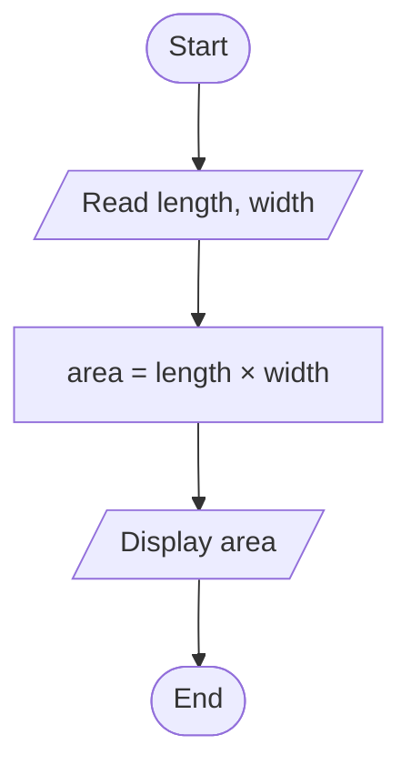
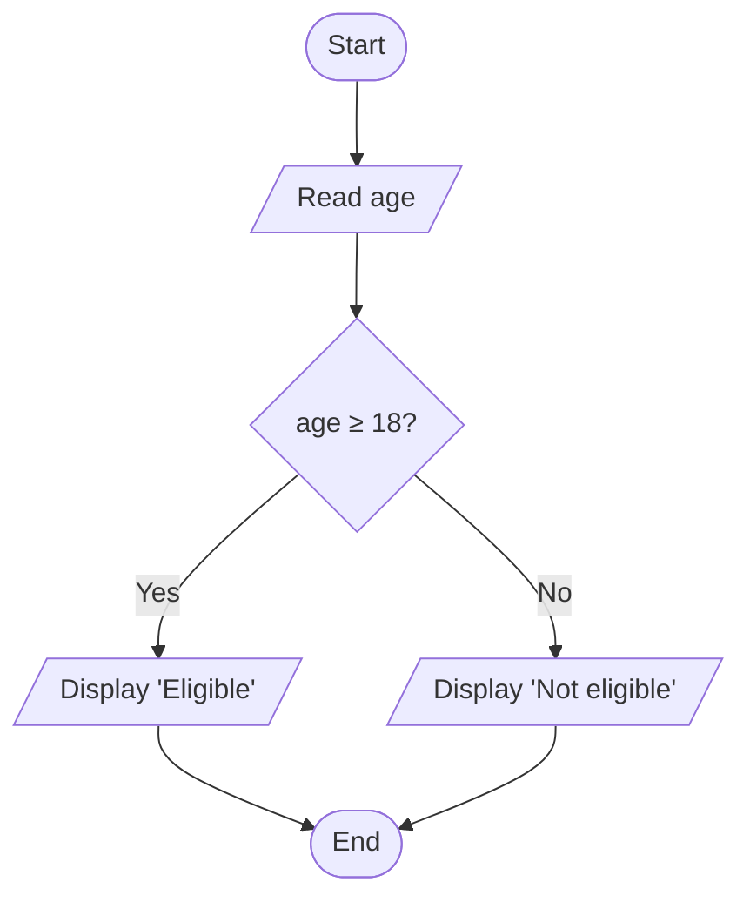
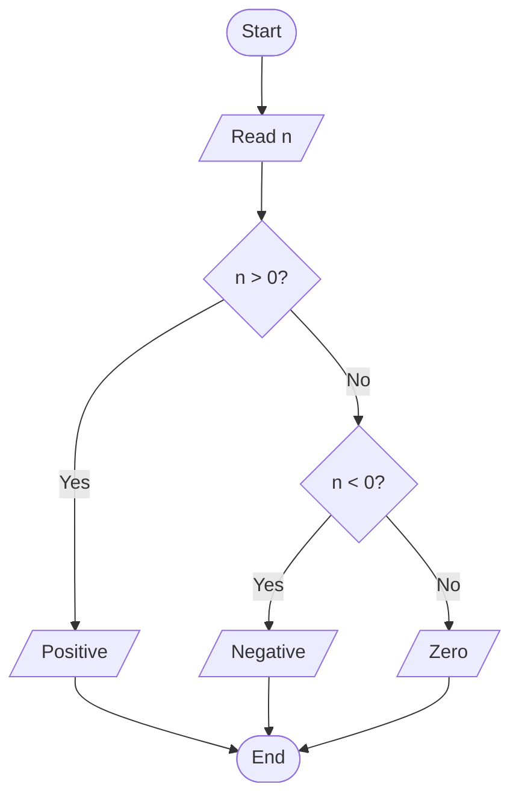
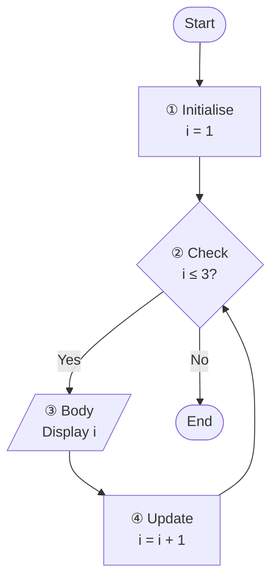
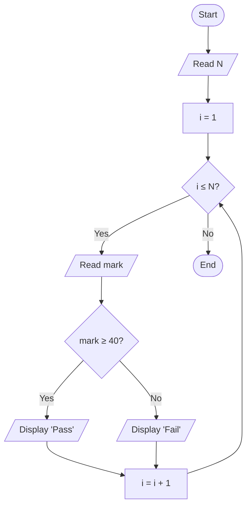
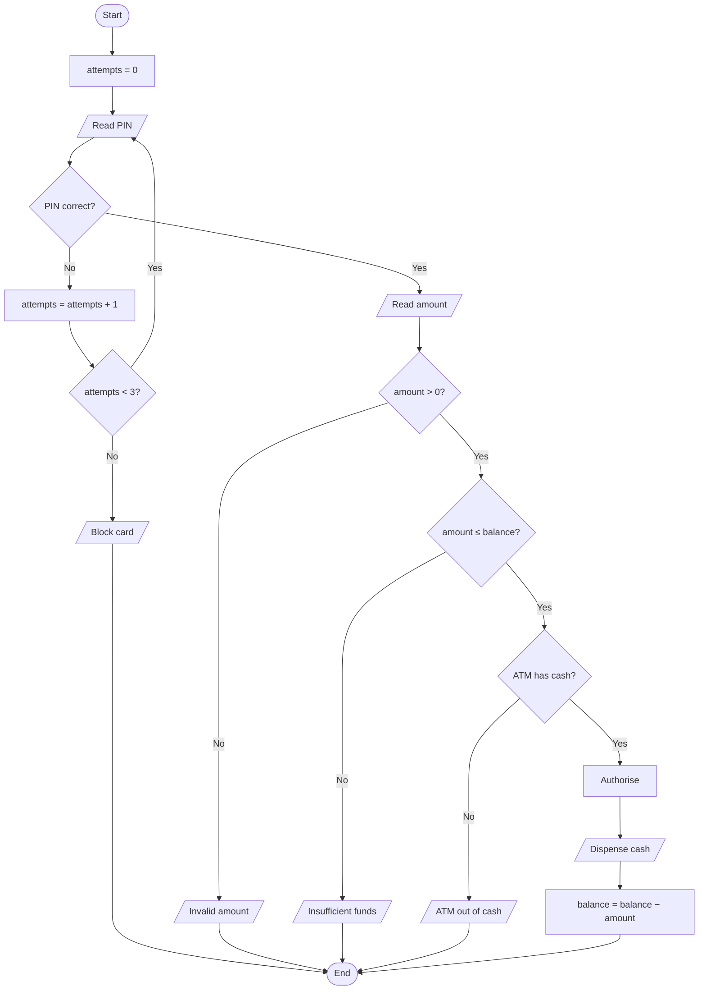

# 4. Flowcharts and Pseudocode

← [How to Think Like a Programmer](03-how-to-think-like-a-programmer.md) · [Part 1 index](README.md) · Next → [Flowchart Problem-Solving Lab](05-flowchart-problem-solving.md)

> [!abstract] What this covers
> **Core idea:** Flowcharts and pseudocode make logic *visible* before code exists. All logic is built from three structures: **sequence**, **selection** and **iteration**.
> **You'll be able to:** draw flowcharts with correct symbols, write pseudocode with standard keywords, build loops from the four-part recipe, and convert freely between flowchart, pseudocode and code.
> **Source:** [takeuforward lesson](https://takeuforward.org/learning/dsa/flowcharts-and-pseudocode?category=fundamentals-of-programming&source=strivers-a2z-dsa-sheet) · **Time:** 45 min

**Sections:** [1. Why make logic visible](#1-why-make-logic-visible) · [2. Flowchart symbols](#2-flowchart-symbols) · [3. Sequence](#3-sequence) · [4. Selection](#4-selection) · [5. Iteration](#5-iteration) · [6. Loop + decision](#6-loop--decision) · [7. ATM flowchart](#7-atm-flowchart) · [8. Pseudocode keywords](#8-pseudocode-keywords) · [9. Three representations of one algorithm](#9-three-representations-of-one-algorithm) · [Common mistakes](#common-mistakes) · [Practice](#practice) · [Flashcards](#flashcards)

---

## 1. Why make logic visible

A PIN screen sounds simple until you ask: what if the PIN is wrong? How many retries? What happens after the last one? Is the counter reset on success? A flowchart forces these questions **before** code hides them in nested `if`s.

**Control-flow token:** imagine a token sitting on the Start oval. It moves along arrows one box at a time and takes exactly one exit at each diamond. If the token can get stuck, loop forever or reach a box you didn't intend, the flowchart has a bug.

---

## 2. Flowchart symbols

| Shape | Name | Meaning | Rule |
|---|---|---|---|
| ⬭ Oval | Terminal | Start / End | Exactly one Start; every path reaches an End |
| ▱ Parallelogram | Input/Output | READ / DISPLAY | Only for I/O, never for calculations |
| ▭ Rectangle | Process | Calculation or assignment | One clear action per box |
| ◇ Diamond | Decision | Yes/No question | Every exit is labelled; the condition is a true/false question |
| → Arrow | Flow line | Next step | Direction is explicit |
| ○ Circle | Connector | Joins distant parts of a big chart | Label matching pairs (A → A) |

In mermaid (used in these notes): `([Start])` oval, `[/Read N/]` parallelogram, `[process]` rectangle, `{decision?}` diamond.

---

## 3. Sequence

Steps run one after another, top to bottom. **Area of a rectangle:**



---

## 4. Selection

A diamond chooses **one** path. **Voting eligibility:**



**Positive / negative / zero:** three outcomes need two nested decisions.



> [!tip] k outcomes need k − 1 decisions
> Each diamond splits two ways, so three outcomes need two diamonds. The last outcome is the "otherwise" and is never tested explicitly.

---

## 5. Iteration

Every loop has four parts:



| Check # | i | i ≤ 3? | Action |
|---|---|---|---|
| 1 | 1 | Yes | Print 1, i → 2 |
| 2 | 2 | Yes | Print 2, i → 3 |
| 3 | 3 | Yes | Print 3, i → 4 |
| 4 | 4 | **No** | Exit |

- **N body runs means N + 1 condition checks.** The last check is the one that fails.
- **A loop can run 0 times.** If the check is false at the start (for example N = 0), the body never executes, so the code after the loop must still be correct.
- **Forget ④ and the loop never ends.**

---

## 6. Loop + decision

**Pass/fail for N students.** The decision sits *inside* the loop, and **both branches must rejoin before the update**.



> [!failure] Tempting wrong approach
> Drawing the increment only on the "Pass" branch. Any failing student then freezes `i` and the loop never ends. Both branches must reach `i = i + 1`.

---

## 7. ATM flowchart



**Order matters:** validate the input (amount > 0) → check the business rules (balance, ATM cash) → act (dispense) → record (update). Updating the balance *before* the cash comes out means a jammed dispenser costs the customer money. ([Lesson 6](06-dry-runs-edge-cases-and-debugging.md) debugs exactly this.)

---

## 8. Pseudocode keywords

| Keyword | Use | Example |
|---|---|---|
| `READ` / `INPUT` | Take input | `READ N` |
| `DISPLAY` / `PRINT` | Produce output | `DISPLAY sum` |
| `SET` | Assign | `SET sum = 0` |
| `IF … ELSE IF … ELSE … END IF` | Selection | |
| `WHILE cond … END WHILE` | Loop while a condition holds | Unknown iteration count |
| `FOR i = a TO b … END FOR` | Counted loop | Known range |
| `RETURN` | Give a result from a function | `RETURN largest` |
| `STOP` / `END` | Finish | |

**`SET count = count + 1`** is not an equation. It means "evaluate the right side using the *old* value, then store the result as the *new* value."

**Sum of 1..N:**
```text
READ N
SET sum = 0
SET i = 1
WHILE i <= N
    SET sum = sum + i
    SET i = i + 1
END WHILE
DISPLAY sum            // outside the loop: printed once
```
N = 3: sum goes 0 → 1 → 3 → 6. Put `DISPLAY` inside the loop and it prints 1, 3, 6.

---

## 9. Three representations of one algorithm

| | Flowchart | Pseudocode | Code |
|---|---|---|---|
| Best for | Seeing branches and loops | Precise steps, quick to write | Running it |
| Weakness | Bulky for big logic | Not executable | Syntax noise hides logic |
| Audience | Anyone | Programmers in any language | Compiler and teammates |

```cpp
long long n, sum = 0; std::cin >> n;
for (long long i = 1; i <= n; i++) sum += i;
std::cout << sum;
```
```java
long n = sc.nextLong(), sum = 0;
for (long i = 1; i <= n; i++) sum += i;
System.out.println(sum);
```
```python
n = int(input())
total = 0
for i in range(1, n + 1):
    total += i
print(total)
```

> [!tip] Pre-code checklist
> One Start, every path ends · every diamond has labelled Yes/No exits · every loop has init, check, body and update · output is placed deliberately (inside or outside the loop) · the 0-iteration case is correct · boundary inputs are traced.

---

## Common mistakes

1. Using a rectangle for input/output, or a parallelogram for a calculation.
2. Unlabelled diamond exits.
3. A diamond whose condition isn't a yes/no question ("marks?").
4. A loop with no update, so it never ends.
5. A branch that never rejoins the flow or reaches End.
6. DISPLAY inside the loop when you want one final result.
7. Forgetting to initialise the accumulator (`sum` begins as garbage or undefined).
8. Checking conditions in an order that makes later branches unreachable.

---

## Practice

1. Draw a flowchart: read a number and print whether it is divisible by 5.
2. Pseudocode + flowchart: print all even numbers from 2 to N. What happens when N = 1?
3. Pseudocode: read N numbers and print how many are negative.
4. Convert to a flowchart: `SET f = 1; FOR i = 1 TO N: SET f = f * i; DISPLAY f`. Trace N = 0 and N = 4.
5. Find two bugs: `SET i = 1; WHILE i < N: DISPLAY i` (meant to print 1..N).

<details><summary>Answer sketches</summary>

**#2:** `SET i = 2; WHILE i <= N: DISPLAY i; SET i = i + 2`. For N = 1 the check fails immediately and nothing prints. That's correct: zero iterations.

**#4:** N = 0 → the loop runs 0 times, f = 1 (0! = 1 ✅). N = 4 → 1, 2, 6, 24.

**#5:** `<` should be `<=` (otherwise N is never printed), and the update `SET i = i + 1` is missing (infinite loop).
</details>

---

## Flashcards

**Name the flowchart shapes for terminal, I/O, process and decision.** #flashcard
Oval, parallelogram, rectangle, diamond.

**What are the three basic control structures?** #flashcard
Sequence, selection (decision) and iteration (loop).

**What are the four parts of every loop?** #flashcard
Initialise → check → body → update.

**A loop body runs N times. How many times is the condition checked?** #flashcard
N + 1. The final check fails and ends the loop.

**Why must both branches of a decision inside a loop reach the update?** #flashcard
Otherwise one branch skips `i = i + 1`, the loop variable freezes and the loop never ends.

**What does `SET count = count + 1` mean?** #flashcard
Read the old value of count, add 1, store the result back as the new value. It is assignment, not an equation.

**How many decisions do k outcomes need?** #flashcard
k − 1. The last outcome is the "otherwise" branch.

**Why does DISPLAY go outside the sum loop?** #flashcard
Inside, it prints every partial sum. Outside, it prints the final total once.

**ATM: why dispense before updating the balance?** #flashcard
If the balance is updated first and dispensing fails, the customer is charged for cash they never received. Act, then record.
