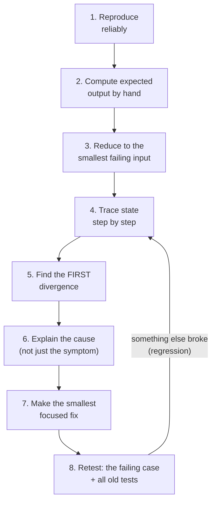

# 6. Dry Runs, Edge Cases and Debugging

← [Flowchart Problem-Solving Lab](05-flowchart-problem-solving.md) · [Part 1 index](README.md) · Next → [Programming Languages & Choosing a Path](07-programming-languages-and-choosing-a-path.md)

> [!abstract] What this covers
> **Core idea:** A dry run is executing your logic by hand while tracking every variable. Debugging is not random editing. It is finding the **first divergence**, the first step where what actually happens differs from what you intended.
> **You'll be able to:** build trace tables, classify errors, design test sets (normal, edge, invalid, exceptional), follow an 8-step debugging workflow, and use loop invariants to argue correctness.
> **Source:** [takeuforward lesson](https://takeuforward.org/learning/dsa/dry-runs-edge-cases-and-debugging?category=fundamentals-of-programming&source=strivers-a2z-dsa-sheet) · **Time:** 60 min

**Sections:** [1. What a dry run is](#1-what-a-dry-run-is) · [2. Trace tables](#2-trace-tables) · [3. Expected vs actual: first divergence](#3-expected-vs-actual-first-divergence) · [4. Three families of errors](#4-three-families-of-errors) · [5. Four kinds of input](#5-four-kinds-of-input) · [6. Designing a test set](#6-designing-a-test-set) · [7. The debugging workflow](#7-the-debugging-workflow) · [8. Debugging practice](#8-debugging-practice) · [9. Loop invariants](#9-loop-invariants) · [10. Habits](#10-habits) · [Flashcards](#flashcards)

---

## 1. What a dry run is

**Dry run:** play the computer. Execute one step at a time, write down the state after each step, and compare it with what you expected.

- It finds logic bugs **before** code exists, and that's the cheapest time to find them.
- It forces you to know what each variable should hold at every moment. If you can't say, you don't yet understand your algorithm.
- It's what interviewers expect when they ask "walk me through this on an example."

---

## 2. Trace tables

One row per iteration (or step), one column per variable. Record the values **before and after**.

**Digit sum of 472:**

| Iter | n before | digit = n % 10 | sum before | sum after | n after = n / 10 | Continue? |
|---|---|---|---|---|---|---|
| 1 | 472 | 2 | 0 | 2 | 47 | Yes |
| 2 | 47 | 7 | 2 | 9 | 4 | Yes |
| 3 | 4 | 4 | 9 | 13 | 0 | No |

Output: **13** ✅

**Same trace with a bug** (`digit = n % 100`):

| Iter | n | digit | sum |
|---|---|---|---|
| 1 | 472 | **72** ← wrong already | 72 |

The table exposes the bug in the first row, without guessing or reading the code repeatedly.

---

## 3. Expected vs actual: first divergence

**Task:** sum 1..5. Write the **expected** column *by hand first*, then trace the real logic.

Buggy line: `sum = sum + 1` (should be `sum + i`).

| i | Expected sum | Actual sum | Match? |
|---|---|---|---|
| 1 | 1 | 1 | ✅ (a coincidence) |
| 2 | 3 | 2 | ❌ **first divergence** |
| 3 | 6 | 3 | ❌ |
| 4 | 10 | 4 | ❌ |
| 5 | 15 | 5 | ❌ |

> [!tip] Look at the first failure, not the last
> Every row after the first divergence is just the consequence of it. Fix the *cause* at row 2 and rows 3–5 fix themselves. Note that iteration 1 matched by coincidence: a passing step doesn't prove the logic is right.

---

## 4. Three families of errors

| Family | When it appears | Example | How you notice |
|---|---|---|---|
| **Syntax** | Before running (compile/parse) | Missing `;` or bracket, misspelt keyword | Compiler or interpreter refuses |
| **Runtime** | While running | Divide by zero, index out of range, null access | Crash or exception |
| **Logical** | Never announced | `sum + 1` instead of `sum + i`; `>` vs `>=` | **Wrong output, no error.** Only tests reveal it |

**Factorial bug:**
```text
SET fact = 0            // ❌
FOR i = 1 TO N: SET fact = fact * i
```
The output is always 0, because 0 × anything = 0. Initialise to **1**, the multiplicative identity. That also gives 0! = 1 for free, since the loop runs zero times.

Logical errors are the dangerous ones because nothing warns you. That's why the rest of this lesson is about testing.

---

## 5. Four kinds of input

Example: an age check for voting (18+).

| Kind | Meaning | Example | Expected behaviour |
|---|---|---|---|
| **Normal** | Typical valid input | 25 | Eligible |
| **Edge** | At or next to a boundary | 18, 17 | Eligible, Not eligible |
| **Invalid** | Violates the input contract | −5, 250, "abc" | Rejected with a message |
| **Exceptional** | The environment fails | Network down, file missing | Fails gracefully, no corrupted state |

---

## 6. Designing a test set

| Category | Ask | Example for "max of array" |
|---|---|---|
| Typical | A normal case | [3, 9, 4] |
| Boundary | Values at the thresholds | Size 1: [5] |
| Duplicates | Equal values | [7, 7, 2] |
| Zero | Is 0 handled? | [0, 0] |
| Negative | All negative? | [-8, -3, -12] |
| Smallest / largest | Extremes of the constraints | [INT_MIN, INT_MAX] |
| Invalid | Contract violations | [] (empty) |
| **Path coverage** | Is every branch taken at least once? | Max first, middle and last |

**Boundary trio:** for every threshold k, test **k − 1, k and k + 1** (39/40/41 for a pass mark).

---

## 7. The debugging workflow



- **Reduce:** if [9, 3, 7, 1, 8, 2] fails, check whether [9, 3] fails too. Smaller inputs give shorter traces.
- **Explain before fixing:** "the loop adds 1 instead of i" is a cause. "The sum is too small" is a symptom.
- **Regression:** a fix that breaks something that used to work. That's why step 8 reruns *all* the earlier tests.

---

## 8. Debugging practice

**Bug A: infinite loop**
```text
SET i = 1
WHILE i <= 5
    DISPLAY i
END WHILE
```
<details><summary>Diagnosis</summary>

The trace shows i = 1, 1, 1, … and the condition is always true. The update is missing: add `SET i = i + 1` inside the loop.
</details>

**Bug B: grade boundaries**
```text
IF marks > 90 THEN "A"
ELSE IF marks > 75 THEN "B"
...
```
<details><summary>Diagnosis</summary>

Test 89/90/91: 90 gets "B" but should be "A". Test 74/75/76: 75 gets "C". Strict `>` excludes the boundary, so use `>=`.
</details>

**Bug C: ATM order**
```text
SET balance = balance - amount
DISPENSE amount
```
<details><summary>Diagnosis</summary>

If dispensing fails (a jam, or the ATM runs out of cash), the balance has already gone down and the customer loses money. Dispense first and update only after a successful dispense, or make the two steps one transaction that is rolled back on failure. Every input value passes; the bug only shows under an *exceptional* condition.
</details>

---

## 9. Loop invariants

An **invariant** is a statement that is true before (or after) every iteration. If it holds at the end, it proves the answer.

| Algorithm | Invariant | At termination it gives |
|---|---|---|
| Champion max | After processing element i, `largest` = max of elements 1..i | `largest` = max of all elements |
| Sum 1..N | Before processing i, `sum` = 1 + 2 + … + (i − 1) | When i = N + 1, `sum` = 1 + … + N |
| Digit sum | `sum` + (digit sum of the remaining n) = digit sum of the original | n = 0, so `sum` is the answer |

Three checks:

1. **Initialisation:** true before the first iteration.
2. **Maintenance:** if true before an iteration, it is still true after.
3. **Termination:** when the loop ends, the invariant plus the exit condition give the answer.

This is the same proof structure you'll use for two pointers, binary search and DP later ([Interview Judgment](../../03-patterns/INTERVIEW_JUDGMENT.md)).

---

## 10. Habits

**Misconceptions:**

| Myth | Reality |
|---|---|
| "No error message means it's correct" | Logical errors never announce themselves |
| "It passed the sample, so it's done" | Samples are typical cases; bugs live at the edges |
| "Change things until it works" | Random edits create new bugs and hide old ones |
| "Debugging is a waste of time" | It's most of real engineering work |

**Practical habits:**

- Use a debugger (breakpoints, step over/into, watch variables) or targeted print statements. Print *state*, not "here."
- Change **one** thing at a time and test **one** hypothesis at a time.
- Keep the failing input as a permanent test case.
- In interviews, narrate the dry run: "i = 2, sum was 1, now 3, matches."

> [!tip] One-line summary
> **Reproduce → Predict → Trace → First divergence → Explain → Focused fix → Retest.**

---

## Practice

1. Make a trace table for the factorial of 5 (correct version). Then trace the version initialised to 0 and mark the first divergence.
2. Write a 10-case test set for "second largest distinct element in an array." Label each case's category.
3. This counts the digits of n but fails for one input. Find it: `SET c = 0; WHILE n > 0: SET c = c + 1; SET n = n / 10`.
4. State the invariant for "count the even numbers in an array" and check its three parts.

<details><summary>Answer sketches</summary>

**#1:** fact: 1 → 1 → 2 → 6 → 24 → 120. With init 0: 0 → 0 → …, diverging at iteration 1 (expected 1, got 0).

**#3:** n = 0 returns 0 but should be 1. Special-case `IF n = 0 THEN c = 1`. (For negatives, use |n|.)

**#4:** "Before index i, `count` = number of even elements in a[0..i−1]." Init: i = 0, count = 0 ✅. Maintenance: add 1 if a[i] is even ✅. Termination: at i = n, count covers the whole array ✅.
</details>

---

## Flashcards

**What is a dry run?** #flashcard
Executing an algorithm by hand, step by step, while recording every variable's value, to check it against what you intended.

**What is the "first divergence"?** #flashcard
The first step where actual state differs from expected state. Fix the cause there; later mismatches are consequences.

**Name the three families of errors and how each appears.** #flashcard
Syntax: rejected before running. Runtime: crash or exception while running. Logical: wrong output with no error.

**Why must a factorial accumulator start at 1?** #flashcard
1 is the multiplicative identity. Starting at 0 makes every product 0. Starting at 1 also gives 0! = 1 when the loop runs zero times.

**Name the four kinds of input, with an age-check example of each.** #flashcard
Normal (25), edge (18 or 17), invalid (−5 or "abc"), exceptional (system or network failure).

**What are the eight steps of the debugging workflow?** #flashcard
Reproduce, compute expected by hand, reduce the input, trace, find first divergence, explain the cause, make the smallest fix, retest everything.

**What is a regression?** #flashcard
A fix or change that breaks behaviour that used to work. Catch it by rerunning all the earlier tests.

**What are the three checks for a loop invariant?** #flashcard
Initialisation (true before the loop), maintenance (stays true through each iteration), termination (with the exit condition, it gives the answer).

**What is the invariant of the champion max loop?** #flashcard
After processing element i, `largest` equals the maximum of elements 1..i.

**What is the ATM bug that every input value passes?** #flashcard
Updating the balance before dispensing. If dispensing fails, money is deducted for nothing. It only shows under an exceptional condition.
