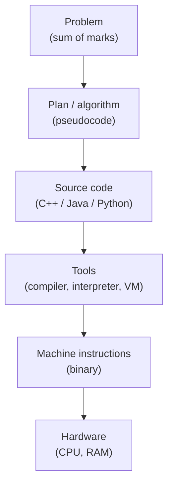
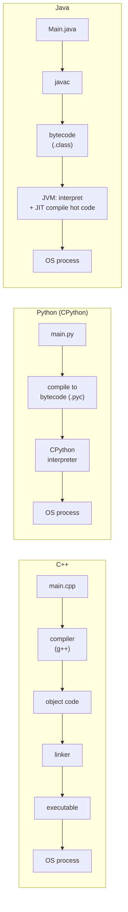

# 7. Programming Languages and Choosing a Path

← [Dry Runs, Edge Cases & Debugging](06-dry-runs-edge-cases-and-debugging.md) · [Part 1 index](README.md) · Next → [Part 2: Language Basics](../02-language-basics/README.md)

> [!abstract] What this covers
> **Core idea:** A language is a precise vocabulary and grammar for instructions, plus a toolchain that turns them into something the machine runs. For DSA, choose **one** of C++, Java or Python, learn its essential subset, and stay consistent.
> **You'll be able to:** separate syntax from semantics from correctness, explain what happens when you press Run, describe how C++, Python and Java execute, compare the major languages, and know exactly which language features DSA needs.
> **Source:** [takeuforward lesson](https://takeuforward.org/learning/dsa/programming-languages-and-choosing-a-path?category=fundamentals-of-programming&source=strivers-a2z-dsa-sheet) · **Time:** 45 min

**Sections:** [1. What a language gives you](#1-what-a-language-gives-you) · [2. The abstraction ladder](#2-the-abstraction-ladder) · [3. What happens when you press Run](#3-what-happens-when-you-press-run) · [4. Tool roles](#4-tool-roles) · [5. Execution paths: C++, Python, Java](#5-execution-paths-c-python-java) · [6. Why so many languages](#6-why-so-many-languages) · [7. Choosing C++, Java or Python](#7-choosing-c-java-or-python) · [8. How much language is enough for DSA](#8-how-much-language-is-enough-for-dsa) · [9. Myths](#9-myths) · [10. Exercise: choose a route](#10-exercise-choose-a-route) · [Key terms](#key-terms) · [Flashcards](#flashcards)

---

## 1. What a language gives you

| Element | Meaning | Example |
|---|---|---|
| **Vocabulary** | Keywords and built-ins | `if`, `while`, `return` |
| **Syntax** | Rules for well-formed code (form) | `if (x > 0) { … }` vs `if x > 0:` |
| **Semantics** | What well-formed code *means* (behaviour) | `/` on ints truncates in C++ and gives a float in Python 3 |
| **Data representation** | How values are stored | 32-bit `int`, arbitrary-precision Python `int` |
| **Control flow** | Sequence, selection, iteration, functions | `for`, `switch`, recursion |
| **Abstraction** | Ways to package and reuse logic | Functions, classes, modules, libraries |

**Three different questions:**

| Question | Checked by | Failure looks like |
|---|---|---|
| Is it **syntactically** valid? | Compiler or parser | Won't compile or run |
| What does it **mean** (semantics)? | The language rules | Runs, but does something you didn't expect (`7/2 = 3`) |
| Is it **correct**? | **Only you**, by reasoning and testing | Runs, does what you wrote, and the answer is wrong |

---

## 2. The abstraction ladder



Higher rungs are easier for humans. Lower rungs are what the machine actually executes. A language lets you work high up while the tools handle the climb down.

---

## 3. What happens when you press Run

1. **Save** the source file (editor → storage).
2. The tool **reads** the source text.
3. It **checks syntax** and reports errors with line numbers.
4. It **translates**: to machine code (C++), to bytecode (Java/Python), or both.
5. The OS **creates a process** and loads the code into RAM.
6. The **CPU executes** the instructions, reading input and producing output.
7. The process **exits**. A status code of 0 usually means success; an error prints a message or stack trace.

Error families from [Lesson 6](06-dry-runs-edge-cases-and-debugging.md#4-three-families-of-errors) map onto these steps: syntax errors come at step 3, runtime errors at step 6, and logical errors pass through every step unnoticed.

---

## 4. Tool roles

| Tool | Role |
|---|---|
| **Editor** | Write and edit text (VS Code, Vim) |
| **IDE** | Editor + build + debugger + autocomplete (IntelliJ, CLion, PyCharm, VS Code with extensions) |
| **Compiler** | Translates the whole program ahead of time (`g++`, `javac`) |
| **Interpreter** | Executes code (or bytecode) directly, step by step (CPython) |
| **Runtime / VM** | Environment that runs the program: memory management, GC, JIT (JVM) |
| **Terminal** | Text interface to run tools and programs (`g++ a.cpp && ./a.out`) |

---

## 5. Execution paths: C++, Python, Java



| | C++ | Python | Java |
|---|---|---|---|
| Translation | Ahead of time to native code | Bytecode, then interpreted | Bytecode, then JVM + JIT |
| Speed (typical) | Fastest | Slowest (~10–50× C++ for tight loops) | Close to C++ after JIT warm-up |
| Type checking | Compile time | Run time | Compile time |
| Memory | Manual / RAII | Garbage collected | Garbage collected |

> [!warning] "Compiled" vs "interpreted" describes an implementation, not a language
> Python has compilers (PyPy uses a JIT, Cython compiles to C). Java is both compiled (to bytecode) and interpreted or JIT-compiled. Say "CPython interprets bytecode", not "Python is an interpreted language and therefore…"

---

## 6. Why so many languages

Every language is a set of **trade-offs**: speed vs ease, control vs safety, flexibility vs strictness. Each one also has an **ecosystem** of libraries, tools and community built around particular domains.

| Language | Mental model | Typical uses |
|---|---|---|
| **C** | Close to hardware; you manage memory | OS kernels, embedded, drivers |
| **C++** | C + abstractions (classes, templates, STL) with zero-cost speed | Games, trading, browsers, competitive programming |
| **Java** | Strongly typed OOP on a portable VM | Backend services, enterprise, Android (legacy) |
| **Python** | Readable, dynamic, "batteries included" | Scripting, data, AI/ML, automation |
| **JavaScript** | Event-driven, runs in the browser | Web front end, Node.js back end |
| **Go** | Simple, compiled, built-in concurrency | Cloud services, infrastructure tools |
| **C#** | Java-like on .NET | Windows apps, Unity games, enterprise |
| **Kotlin** | Modern, concise JVM language | Android (preferred), backend |
| **Swift** | Safe, fast Apple language | iOS / macOS apps |
| **Rust** | Memory safety without GC (ownership) | Systems, performance + safety |

**For learners:** strict typing (C++/Java) catches mistakes early but is wordier. Dynamic typing (Python) is fast to write but hides type bugs until run time.

---

## 7. Choosing C++, Java or Python

| Choose | If | Watch out for |
|---|---|---|
| **C++** | Competitive programming, tight time limits, you want STL power | Overflow (`int` vs `long long`), undefined behaviour, cryptic template errors |
| **Java** | You already know it from college or your job, or target Java/Android roles | Verbosity, boxed `Integer` in collections, slow `Scanner` for big input |
| **Python** | Fastest to write, interviews (concise and readable), a data/ML career | Slow loops (TLE on strict judges), recursion limit (default 1000), `//` vs `/` |

**Five guiding questions:**

1. Which language do I already know a little?
2. What is my target: interviews, competitive programming, or a domain role?
3. Does my course, college or team use one?
4. Can I read error messages in it comfortably?
5. Will I stick with it for months?

> [!tip] Consistency beats optimisation
> Any of the three is fine for interviews at Google and elsewhere. Switching languages mid-prep resets your fluency. Pick one and stay with it. (This repo's interview track uses Python.)

**Even/odd, all three:**
```cpp
#include <iostream>
int main() { long long n; std::cin >> n; std::cout << (n % 2 != 0 ? "Odd" : "Even"); }
```
```java
import java.util.Scanner;
public class Main { public static void main(String[] a) {
    long n = new Scanner(System.in).nextLong();
    System.out.println(n % 2 != 0 ? "Odd" : "Even"); } }
```
```python
n = int(input())
print("Odd" if n % 2 != 0 else "Even")
```

---

## 8. How much language is enough for DSA

You need a **subset**, not the whole language:

| # | Feature | C++ | Java | Python |
|---|---|---|---|---|
| 1 | Input / output | `cin`/`cout`, fast I/O | `Scanner`, `BufferedReader` | `input()`, `sys.stdin` |
| 2 | Variables & types | `int`, `long long`, `double`, `char`, `bool` | `int`, `long`, `double`, `char`, `boolean` | `int`, `float`, `str`, `bool` |
| 3 | Operators | Arithmetic, `%`, comparison, logical, bitwise | same | same + `//`, `**` |
| 4 | Conditions | `if`/`else`, `switch`, ternary | same | `if`/`elif`/`else`, conditional expression |
| 5 | Loops | `for`, `while`, `do-while` | same | `for … in range`, `while` |
| 6 | Functions | Pass by value / reference (`&`) | Pass by value (references to objects) | Objects passed by reference-value |
| 7 | Arrays & strings | `vector`, `string` | arrays, `ArrayList`, `String`, `StringBuilder` | `list`, `str` |
| 8 | Reading errors | Compiler errors, segfaults | Exceptions + stack trace | Tracebacks |
| 9 | Standard containers | `map`, `unordered_map`, `set`, `stack`, `queue`, `priority_queue` | `HashMap`, `TreeMap`, `HashSet`, `ArrayDeque`, `PriorityQueue` | `dict`, `set`, `collections.deque`, `heapq`, `Counter` |
| 10 | Sorting & utilities | `sort`, `lower_bound`, `max`, `swap` | `Arrays.sort`, `Collections.sort`, comparators | `sorted`, `bisect`, `key=` lambdas |

**Learn later, as needed:** advanced OOP and design patterns, templates/generics in depth, concurrency, file and network I/O, frameworks.

The next category, **Language Basics**, covers rows 1–8 in detail.

---

## 9. Myths

| Myth | Reality |
|---|---|
| "You need C++ to do DSA" | The ideas are language-independent ([Lesson 1](01-breaking-the-myth.md)) |
| "Python is too slow for interviews" | Interviews grade the algorithm, not runtime constants |
| "Master the whole language first" | Learn the DSA subset (§8), then learn the rest as you go |
| "Learning many languages makes you better at DSA" | Depth in one beats shallow breadth |
| "The best language exists" | Only trade-offs exist |
| "Compiled means fast, interpreted means slow, always" | Implementation, JIT and the algorithm matter more |
| "Syntax errors are the hard part" | The compiler finds those. Logical errors are the hard part |
| "Switching language will fix my problem-solving" | It just relocates the same gap |
| "Libraries are cheating" | Using `sort` is expected. Know its complexity |
| "You must memorise every API" | Know the ~20 calls you use constantly; look up the rest |

---

## 10. Exercise: choose a route

Solve even/odd end to end, using the whole Part 1 pipeline:

1. **Contract:** input integer n (may be negative or zero), output "Even"/"Odd".
2. **Flowchart:** one diamond, `n % 2 = 0?`.
3. **Pseudocode** ([Lesson 1 §3](01-breaking-the-myth.md#3-pseudocode-the-idea-with-no-syntax)).
4. **Dry run** on 8, 7, 0 and −3.
5. **Code** in your chosen language and run the same four inputs.

<details><summary>Check</summary>

| n | n % 2 (C++/Java) | n % 2 (Python) | Output |
|---|---|---|---|
| 8 | 0 | 0 | Even |
| 7 | 1 | 1 | Odd |
| 0 | 0 | 0 | Even |
| −3 | **−1** | **1** | Odd (only if you test `!= 0`) |

If your code tested `== 1`, −3 failed in C++/Java. That's the dry run paying off.
</details>

---

## Key terms

| Term | Meaning |
|---|---|
| Syntax / semantics | Form of the code / meaning of the code |
| Source code | Human-written program text |
| Compiler | Translates the whole program ahead of time |
| Interpreter | Executes code or bytecode directly |
| Bytecode | Intermediate, platform-independent instructions (JVM, CPython) |
| JIT | Just-in-time compilation of hot code at run time |
| Runtime / VM | Execution environment (memory, GC, JIT) |
| Linker | Combines object files and libraries into an executable |
| Process | A running program managed by the OS |
| Ecosystem | Libraries, tools and community around a language |

---

## Flashcards

**Syntax vs semantics vs correctness?** #flashcard
Syntax: is it well-formed (checked by the compiler)? Semantics: what does it mean (language rules)? Correctness: does it solve the problem (only your reasoning and tests can tell)?

**What is the C++ execution path?** #flashcard
Source → compiler → object code → linker → native executable → OS process.

**What is the Java execution path?** #flashcard
Source → javac → bytecode (.class) → JVM interprets it and JIT-compiles hot code → runs.

**What is the CPython execution path?** #flashcard
Source → compiled to bytecode → CPython interpreter executes the bytecode.

**Is "Python is interpreted" a property of the language?** #flashcard
No. It's a property of the CPython implementation. PyPy JIT-compiles Python, and "compiled" vs "interpreted" describes implementations.

**At which Run step does each error family appear?** #flashcard
Syntax: during checking and translation. Runtime: during execution. Logical: never flagged; it produces wrong output.

**What is the main pitfall for each of C++, Java and Python in DSA?** #flashcard
C++: integer overflow and undefined behaviour. Java: verbosity and slow Scanner I/O. Python: slow loops and a recursion limit of 1000.

**Name the ten language features DSA needs.** #flashcard
I/O, variables and types, operators, conditions, loops, functions, arrays and strings, reading errors, standard containers, sorting and utilities.

**Why stay with one language?** #flashcard
Fluency compounds. Switching resets syntax and library knowledge without improving problem-solving.
