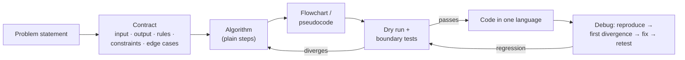

# Part 1: Fundamentals of Programming

← [Striver course map](../README.md)

> [!abstract] What this part covers
> **Goal:** Think like a programmer *before* writing code. You turn a vague task into a precise contract, design an algorithm, draw it, write it as pseudocode, dry-run it, and debug it by finding where it first goes wrong.
> **Prereqs:** None. **Time:** ~5–6 h including exercises.
> **Outcome:** Given any small problem (bill, grade, digit sum, ATM), you can produce a contract, a flowchart, pseudocode and a trace table that survive boundary tests.

---

## Lessons

| # | Lesson | Core idea in one line | Source |
|---|---|---|---|
| 1 | [Breaking the Myth](01-breaking-the-myth.md) | DSA is language-independent: logic first, syntax second | [link](https://takeuforward.org/learning/dsa/breaking-the-myth?category=fundamentals-of-programming&source=strivers-a2z-dsa-sheet) |
| 2 | [Programming & What Are Computers](02-programming-and-what-are-computers.md) | Computer = speed + obedience; storage → RAM → CPU | [link](https://takeuforward.org/learning/dsa/programming-and-what-are-computers?category=fundamentals-of-programming&source=strivers-a2z-dsa-sheet) |
| 3 | [How to Think Like a Programmer](03-how-to-think-like-a-programmer.md) | Read every problem as a contract; computational thinking | [link](https://takeuforward.org/learning/dsa/how-to-think-like-a-programmer?category=fundamentals-of-programming&source=strivers-a2z-dsa-sheet) |
| 4 | [Flowcharts & Pseudocode](04-flowcharts-and-pseudocode.md) | Sequence, selection, iteration: three ways to write one algorithm | [link](https://takeuforward.org/learning/dsa/flowcharts-and-pseudocode?category=fundamentals-of-programming&source=strivers-a2z-dsa-sheet) |
| 5 | [Flowchart Problem-Solving Lab](05-flowchart-problem-solving.md) | 8 worked problems: validation, champion, slabs, digit peeling | [link](https://takeuforward.org/learning/dsa/flowchart-problem-solving?category=fundamentals-of-programming&source=strivers-a2z-dsa-sheet) |
| 6 | [Dry Runs, Edge Cases & Debugging](06-dry-runs-edge-cases-and-debugging.md) | Trace tables, first divergence, invariants | [link](https://takeuforward.org/learning/dsa/dry-runs-edge-cases-and-debugging?category=fundamentals-of-programming&source=strivers-a2z-dsa-sheet) |
| 7 | [Programming Languages & Choosing a Path](07-programming-languages-and-choosing-a-path.md) | Pick one language (C++/Java/Python) and learn its DSA subset | [link](https://takeuforward.org/learning/dsa/programming-languages-and-choosing-a-path?category=fundamentals-of-programming&source=strivers-a2z-dsa-sheet) |

---

## The pipeline this part builds

---

## Part 1 cheat sheet

| Concept | Remember |
|---|---|
| Problem contract | Input · Output · Rules · Constraints · Edge cases |
| Computational thinking | Decomposition · Pattern recognition · Abstraction · Algorithmic thinking |
| Control structures | Sequence · Selection (diamond) · Iteration (loop with update) |
| Loop recipe | Initialize → check → body → update. N body runs means N+1 checks |
| Accumulator identity | Sum starts at `0`, product at `1`, max starts at the *first element* (not 0) |
| Boundary trio | Test `k-1`, `k`, `k+1` around every threshold `k` |
| Digit peeling | `d = n % 10`, `n = n / 10` until `n == 0` |
| Error families | Syntax (grammar) · Runtime (crash) · Logical (wrong answer, no crash) |
| Debug loop | Reproduce → expected by hand → shrink → trace → **first divergence** → explain → smallest fix → retest |
| Invariant | A fact true before or after every loop iteration; it proves the final answer |
| Language | One language, its essentials plus standard containers, then DSA |

---

## Mastery checklist

- [ ] Write the 5-part contract for a new problem in under 2 minutes
- [ ] Draw a flowchart with correctly shaped symbols and labelled Yes/No branches
- [ ] Convert flowchart ↔ pseudocode in both directions
- [ ] Build a trace table for a loop and state its invariant
- [ ] Pick boundary tests for any `>=`, `<` or range condition
- [ ] Classify a bug as syntax, runtime or logical, and find its first divergence
- [ ] Solve the [capstone](05-flowchart-problem-solving.md#capstone-even-and-odd-digit-counter) (even/odd digit counter) with every deliverable

**Interview track →** [How to Think](../../03-patterns/HOW_TO_THINK.md) · [Interview Judgment](../../03-patterns/INTERVIEW_JUDGMENT.md) · [L3 Cheatsheet: edge cases](../../00-start-here/L3_CHEATSHEET.md)

Next part → [Language Basics](../02-language-basics/README.md)
