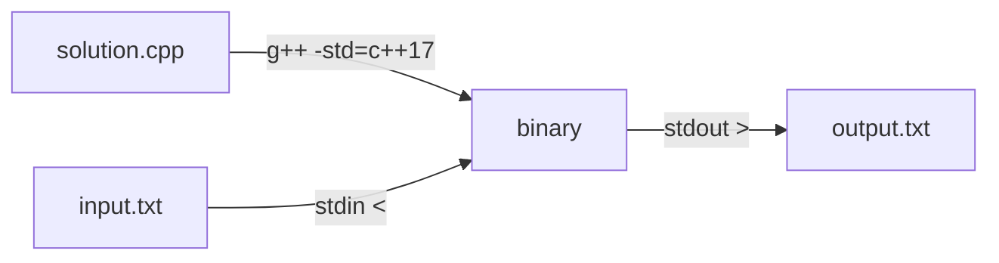

# 1. Learn C++

← [Part 2 index](README.md) · Next → [Learn Java](02-learn-java.md)

> [!abstract] What this covers
> **Core idea:** Set up a one-keystroke **compile → run on `input.txt` → write `output.txt`** loop, then learn the ~20% of C++ that DSA uses: types and their ranges, I/O, control flow, functions with references, arrays, strings, and the overflow and precision traps.
> **You'll be able to:** build and run C++17 from VS Code on Windows or macOS, write the standard DSA template, pick the right integer type from the constraints, and avoid the classic C++ bugs (overflow, `/` and `%` semantics, uninitialised variables, copying containers by value).
> **Source:** [takeuforward lesson](https://takeuforward.org/learning/dsa/learn-cpp?category=language-basics&source=strivers-a2z-dsa-sheet) · **Time:** 2–3 h with practice

**Sections:** [1. Setup](#1-setup-vs-code--g) · [2. Program skeleton](#2-program-skeleton) · [3. Types and ranges](#3-types-and-ranges) · [4. Input/output](#4-inputoutput) · [5. Operators](#5-operators-and-their-traps) · [6. Control flow](#6-control-flow) · [7. Functions](#7-functions-value-reference-pointer) · [8. Arrays](#8-arrays) · [9. Strings](#9-strings) · [10. Structs, pair, auto](#10-structs-pair-auto-range-for) · [11. DSA template](#11-dsa-template) · [Common mistakes](#common-mistakes) · [Practice](#practice) · [Flashcards](#flashcards)

---

## 1. Setup: VS Code + g++

The course's workflow: a VS Code **build task** compiles the open file, feeds it `input.txt`, and writes `output.txt`. Open the three files side by side and press **Ctrl/Cmd + Shift + B** to re-run.



**Install the compiler**

| OS | Command / action | Verify |
|---|---|---|
| Windows | Install MinGW-w64 (e.g. via MSYS2: `pacman -S mingw-w64-ucrt-x86_64-gcc`), add its `bin` to PATH | `g++ --version` in **cmd** |
| macOS | `xcode-select --install` (clang behind the name `g++`) or `brew install gcc` (real GCC: `g++-14`) | `g++ --version` |
| Linux | `sudo apt install g++` | `g++ --version` |

> [!warning] `bits/stdc++.h` on macOS
> Apple clang has no `<bits/stdc++.h>`. Either `brew install gcc` and call `g++-14`, or create the header yourself in a folder on your include path, or include the specific headers (`<iostream>`, `<vector>`, `<algorithm>`, …).

**Windows task** (`.vscode/tasks.json`). Set VS Code's default terminal to **cmd**: the `&&` / `del` syntax below is cmd syntax, not PowerShell.

```json
{
  "version": "2.0.0",
  "tasks": [{
    "label": "Compile and run",
    "type": "shell",
    "command": "g++ -std=c++17 -O2 -Wall -o \"${fileDirname}\\${fileBasenameNoExtension}.exe\" \"${file}\" && \"${fileDirname}\\${fileBasenameNoExtension}.exe\" < input.txt > output.txt && del \"${fileDirname}\\${fileBasenameNoExtension}.exe\"",
    "options": { "cwd": "${fileDirname}" },
    "group": { "kind": "build", "isDefault": true },
    "problemMatcher": ["$gcc"]
  }]
}
```

**macOS / Linux task:** two tasks, compile-only and compile + run.

```json
{
  "version": "2.0.0",
  "tasks": [
    {
      "label": "Compile",
      "type": "shell",
      "command": "g++ -std=c++17 -O2 -Wall -Wextra -o \"${fileDirname}/${fileBasenameNoExtension}\" \"${file}\"",
      "group": "build",
      "problemMatcher": ["$gcc"]
    },
    {
      "label": "Compile and run",
      "type": "shell",
      "command": "g++ -std=c++17 -O2 -Wall -Wextra -o \"${fileDirname}/${fileBasenameNoExtension}\" \"${file}\" && \"${fileDirname}/${fileBasenameNoExtension}\" < input.txt > output.txt",
      "options": { "cwd": "${fileDirname}" },
      "group": { "kind": "build", "isDefault": true },
      "problemMatcher": ["$gcc"]
    }
  ]
}
```

**What the flags do**

| Flag | Why |
|---|---|
| `-std=c++17` | `auto`, structured bindings, range-for. Platforms judge in C++17 or 20 |
| `-O2` | Same optimisation level as most judges, so timing is realistic |
| `-Wall -Wextra` | Warnings for uninitialised vars, signed/unsigned compare, missing return. **Read them** |
| `-fsanitize=address,undefined` (debug only) | Catches out-of-bounds and signed overflow at runtime. Remove for timing |
| `-o name` | Output binary name |
| `< input.txt > output.txt` | Shell redirection: stdin from the file, stdout to the file |

> [!tip] Other OSes / editors
> Any setup works if it gives you: compile with C++17 + warnings, run with stdin from a file, see stdout. Ask an AI tool for the equivalent of the command above for your shell; the logic is identical.

---

## 2. Program skeleton

```cpp
#include <bits/stdc++.h>   // every standard header (GCC only)
using namespace std;       // fine for DSA; avoid in headers / production

int main() {
    ios::sync_with_stdio(false);  // decouple C++ streams from C stdio: faster
    cin.tie(nullptr);             // don't flush cout before every cin

    int n;
    cin >> n;
    cout << n * 2 << '\n';        // '\n', not endl (endl flushes = slow)
    return 0;                     // 0 = success
}
```

| Piece | Meaning |
|---|---|
| `#include` | Paste a header's declarations in before compiling (preprocessor) |
| `using namespace std;` | Lets you write `vector` instead of `std::vector` |
| `int main()` | Entry point; the OS calls it. Returns an exit code |
| `;` | Ends every statement |
| `{ }` | Block = scope. Variables die at the closing brace |

---

## 3. Types and ranges

| Type | Size (typical) | Range | Use |
|---|---|---|---|
| `bool` | 1 B | `true` / `false` | Flags |
| `char` | 1 B | −128…127 (ASCII) | Characters; `'a' + 1 == 'b'` |
| `int` | 4 B | ≈ ±2.1 × 10⁹ (`2^31 − 1` = 2,147,483,647) | Default integer |
| `long long` | 8 B | ≈ ±9.2 × 10¹⁸ (`2^63 − 1`) | Sums, products, anything > 2 × 10⁹ |
| `unsigned long long` | 8 B | 0…1.8 × 10¹⁹ | Bit tricks, hashing |
| `double` | 8 B | ~15–16 significant digits | Real numbers, averages |
| `long double` | 10–16 B | ~18–19 digits | Rarely needed |
| `string` | — | — | Text |

**Picking the integer type from constraints**

| If values / results can reach… | Use |
|---|---|
| ≤ 2 × 10⁹ | `int` |
| up to ~9 × 10¹⁸ (e.g. sum of 10⁵ values each ≤ 10⁹ = 10¹⁴) | `long long` |
| Product of two values ≤ 10⁹ | `long long` (10¹⁸ fits) |
| Larger | modular arithmetic or big-integer (Python) |

> [!failure] Tempting wrong approach
> `long long x = a * b;` with `int a, b`. The multiplication happens in `int` and overflows **before** the assignment widens it. Write `1LL * a * b` or `(long long)a * b`.

**Limits:** `INT_MAX`, `INT_MIN`, `LLONG_MAX` (from `<climits>`) or `numeric_limits<int>::max()`. Use `1e9` style literals carefully: `1e9` is a **double**; `(int)1e9` or `1'000'000'000` is an int.

**Characters ↔ numbers**

```cpp
char c = '7';  int d = c - '0';        // 7
char l = 'c';  int idx = l - 'a';      // 2  (0-based alphabet index)
char up = l - 'a' + 'A';               // 'C'
```

---

## 4. Input/output

```cpp
int n; long long x; string s; double d;
cin >> n >> x >> s >> d;          // whitespace-separated tokens
string line; getline(cin, line);  // whole line incl. spaces
cout << n << ' ' << x << '\n';
cout << fixed << setprecision(6) << d << '\n';  // 6 digits after the point
```

| Situation | Do |
|---|---|
| Read N then N numbers | `cin >> n; vector<int> a(n); for (auto &v : a) cin >> v;` |
| Read until EOF | `while (cin >> x) { … }` |
| `getline` right after `cin >>` | Call `cin.ignore()` first: `>>` leaves the `'\n'` in the buffer |
| T test cases | `int t; cin >> t; while (t--) solve();` |
| Large I/O (10⁶ numbers) | `sync_with_stdio(false)` + `cin.tie(nullptr)` + `'\n'` |

---

## 5. Operators and their traps

| Operator | Behaviour | Trap |
|---|---|---|
| `/` on ints | **Truncates toward zero**: `7/2 = 3`, `-7/2 = -3` | Use `7.0/2` or `(double)a/b` for real division |
| `%` | Sign follows the **dividend**: `-7 % 3 = -1` | Safe positive mod: `((a % m) + m) % m` |
| `++i` / `i++` | Pre returns new value, post returns old | Don't use both on one variable in one expression |
| `==` vs `=` | Compare vs assign | `if (x = 5)` assigns, is always true. `-Wall` warns |
| `&&`, `\|\|` | **Short-circuit**: right side skipped if the result is known | Use it: `if (i < n && a[i] > 0)` guards the index |
| `&`, `\|`, `^`, `<<`, `>>` | Bitwise | `1 << 31` overflows `int`; use `1LL << k` |
| Ternary `c ? a : b` | Inline if | Keep it short |
| Precedence | `a & 1 == 0` is `a & (1 == 0)` | Parenthesise bit ops: `(a & 1) == 0` |

**Ceil division** for positives: `(a + b - 1) / b`. **Integer square root / comparisons with doubles**: avoid `sqrt` equality; loop `i * i <= n` (with `long long i` if n is near `INT_MAX`).

---

## 6. Control flow

```cpp
if (x > 0) { … } else if (x < 0) { … } else { … }

switch (op) {                // int/char only
    case '+': r = a + b; break;
    case '-': r = a - b; break;   // forgetting break = fall-through
    default:  r = 0;
}

for (int i = 0; i < n; i++) { … }      // known count
while (n > 0) { … n /= 10; }          // unknown count
do { … } while (cond);                // body runs at least once

for (int i = 0; i < n; i++) {
    if (a[i] < 0) continue;           // skip to next iteration
    if (a[i] == target) break;        // leave the loop
}
```

---

## 7. Functions: value, reference, pointer

```cpp
int add(int a, int b) { return a + b; }

void incByValue(int x) { x++; }        // caller's variable unchanged
void incByRef(int &x)  { x++; }        // caller's variable changed
void incByPtr(int *x)  { (*x)++; }     // same, pointer syntax: incByPtr(&v)

long long sum(const vector<int> &a) {  // const ref: no copy, no modification
    long long s = 0;
    for (int v : a) s += v;
    return s;
}
```

| Pass as | Copies? | Can modify caller? | Use for |
|---|---|---|---|
| `T x` | Yes | No | Small types (`int`, `char`, `double`) |
| `T &x` | No | Yes | Outputs, in-place edits, recursion state |
| `const T &x` | No | No | Large read-only inputs (`vector`, `string`) |
| `T *x` | No (copies the address) | Yes | Linked lists / trees (nodes), optional values (`nullptr`) |

> [!failure] Tempting wrong approach
> `int f(vector<int> a)` inside recursion. Every call **copies the whole vector**: O(n) per call, so a recursion that looks O(n) becomes O(n²) and can TLE / MLE. Pass `vector<int> &a`.

**Pointers in one table** (you'll need them for linked lists and trees)

| Expression | Meaning |
|---|---|
| `int *p = &x;` | `p` holds the address of `x` |
| `*p` | The value at that address (dereference) |
| `p->val` | Same as `(*p).val` for a struct/class pointer |
| `nullptr` | Points to nothing; dereferencing it crashes |
| `new Node(5)` / `delete p` | Heap allocate / free |

**Recursion** needs a base case and progress toward it; every call gets its own stack frame (Part 12).

---

## 8. Arrays

```cpp
int a[5] = {1, 2, 3};           // rest are 0; size fixed at compile time
int b[5];                        // ⚠ garbage values if local
int g[100005];                   // global: zero-initialised, not on the stack

vector<int> v(n);                // dynamic, n zeros
vector<int> w(n, -1);            // n copies of -1
vector<vector<int>> grid(r, vector<int>(c, 0));   // r × c matrix
v.push_back(7); v.size(); v.back(); v.pop_back();
```

| Fact | Consequence |
|---|---|
| Indices are `0 … n−1` | `a[n]` is out of bounds: **undefined behaviour**, not an error message |
| Local arrays live on the stack (~1–8 MB) | `int a[1e7]` inside `main` crashes; make it global or a `vector` |
| `sizeof(a)/sizeof(a[0])` | Length of a raw array, but **only** where it was declared (decays to a pointer when passed) |
| Prefer `vector` | Knows its size, resizes, passes cleanly by reference |

`.size()` returns **unsigned**: `for (int i = 0; i < v.size() - 1; i++)` with an empty `v` gives `0 - 1 = 18446744073709551615`. Cast: `(int)v.size() - 1`.

---

## 9. Strings

```cpp
string s = "hello";
s.size(); s[0]; s.back();
s += " world";                   // append (amortised O(1) per char)
s.substr(pos, len);              // O(len) copy
s.find("lo");                    // index or string::npos
reverse(s.begin(), s.end());
sort(s.begin(), s.end());
to_string(42);  stoi("42");  stoll("12345678901");
for (char c : s) { … }
isdigit(c); isalpha(c); tolower(c); toupper(c);
```

C++ strings are **mutable**: `s[i] = 'x'` is O(1). But `s = s + c` inside a loop builds a new string each time (O(n²) total); use `s += c` or `push_back`.

---

## 10. Structs, pair, auto, range-for

```cpp
struct Point { int x, y; };
Point p{3, 4};

pair<int,int> pr = {1, 2};    pr.first; pr.second;
auto [a, b] = pr;             // structured binding (C++17)

for (auto &x : v) x *= 2;     // & to modify in place
for (const auto &row : grid) { … }   // const & to avoid copying rows

struct Node {                 // used throughout linked lists / trees
    int val; Node *next;
    Node(int v) : val(v), next(nullptr) {}
};
```

---

## 11. DSA template

```cpp
#include <bits/stdc++.h>
using namespace std;
using ll = long long;

void solve() {
    int n; cin >> n;
    vector<ll> a(n);
    for (auto &x : a) cin >> x;
    ll sum = 0;
    for (ll x : a) sum += x;
    cout << sum << '\n';
}

int main() {
    ios::sync_with_stdio(false);
    cin.tie(nullptr);
    int t = 1;
    cin >> t;            // remove if single test
    while (t--) solve();
}
```

**LeetCode-style** (function only, no `main`): you implement `class Solution { public: int f(vector<int>& nums) { … } };`. Same language subset; the judge handles I/O.

**Operations per second:** ~10⁸ simple operations/sec in C++. With n = 10⁵, O(n²) = 10¹⁰ is too slow, O(n log n) ≈ 1.7 × 10⁶ is instant (Part 5).

---

## Common mistakes

1. `int` overflow in sums/products. Ask "what's the max possible value?" for every variable.
2. Integer division where you wanted a real number: `avg = sum / n` with ints.
3. Negative `%`: `-3 % 5 == -3`, not 2.
4. Uninitialised local variables / arrays hold garbage.
5. `endl` in a loop of 10⁶ lines → slow. Use `'\n'`.
6. Passing big containers by value, especially into recursion.
7. `v.size() - 1` underflow on an empty vector.
8. `getline` after `cin >>` reads an empty line.
9. Reading/writing `a[n]` or `a[-1]`: silent undefined behaviour. Compile with `-fsanitize=address` when debugging.
10. Comparing doubles with `==`. Use `fabs(a - b) < 1e-9`.

---

## Practice

1. Read n and n integers (each ≤ 10⁹, n ≤ 10⁵). Print their sum. Which type holds the sum?
2. Print `-7 / 2`, `-7 % 2`, `7 / -2`. Predict first.
3. Write `void swapVals(int &a, int &b)`. Why doesn't `void swapVals(int a, int b)` work?
4. Read a full line with spaces after reading an integer on the previous line.
5. Print 1 / 3 with exactly 4 decimals.
6. Why does `int arr[10000000];` inside `main` crash but the same line above `main` works?

<details><summary>Answer sketches</summary>

**#1:** max sum = 10⁵ × 10⁹ = 10¹⁴ → `long long`.

**#2:** `-3`, `-1`, `-3` (truncate toward zero; `%` sign follows dividend).

**#3:** By value swaps local copies; the caller sees nothing. By reference operates on the caller's variables.

**#4:** `int n; cin >> n; cin.ignore(); string line; getline(cin, line);`

**#5:** `cout << fixed << setprecision(4) << 1.0 / 3;` → `0.3333`.

**#6:** 4 × 10⁷ bytes = 40 MB exceeds the stack; globals live in static storage (and are zero-initialised).
</details>

---

## Key terms

| Term | Meaning |
|---|---|
| Compiler (g++/clang) | Translates C++ source to a native binary |
| Translation unit | One `.cpp` after the preprocessor pastes headers in |
| Undefined behaviour (UB) | Code the standard gives no meaning to (out-of-bounds, signed overflow); may "work" then fail |
| Reference (`&`) | An alias for an existing variable |
| Pointer (`*`) | A variable holding an address |
| Stack vs heap | Function locals (small, automatic) vs `new`/containers' storage (large, manual/RAII) |
| Fast I/O | `ios::sync_with_stdio(false); cin.tie(nullptr);` |

---

## Flashcards

**What does `-std=c++17 -O2 -Wall` give you?** #flashcard
Modern C++ features, judge-like optimisation, and warnings for common bugs.

**Why does `long long x = a * b;` overflow when a, b are `int`?** #flashcard
The product is computed in `int` first; widening happens only on assignment. Use `1LL * a * b`.

**What is the range of `int` and when do you switch to `long long`?** #flashcard
≈ ±2.1 × 10⁹. Switch when any value, sum or product can exceed ~2 × 10⁹.

**What is `-7 / 2` and `-7 % 2` in C++?** #flashcard
−3 and −1: division truncates toward zero, remainder takes the dividend's sign.

**How do you get a non-negative modulo?** #flashcard
`((a % m) + m) % m`.

**Why pass a `vector` as `const vector<int>&`?** #flashcard
No O(n) copy per call, and the function can't modify it.

**What two lines make `cin`/`cout` fast?** #flashcard
`ios::sync_with_stdio(false);` and `cin.tie(nullptr);` — plus `'\n'` instead of `endl`.

**Why does `getline` after `cin >> n` return an empty string?** #flashcard
`>>` leaves the newline in the buffer; call `cin.ignore()` first.

**Why is `v.size() - 1` dangerous?** #flashcard
`size()` is unsigned; on an empty vector it wraps to a huge number.

**Why make large arrays global?** #flashcard
Locals are on the small stack (a few MB); globals are in static storage and zero-initialised.

**Interview track →** [L3 Cheatsheet: constraints → complexity](../../00-start-here/L3_CHEATSHEET.md)
