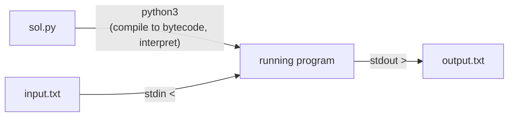

# 3. Learn Python

← [Learn Java](02-learn-java.md) · [Part 2 index](README.md) · Next → [Part 3: Logic Building (Patterns)](../03-logic-building-patterns/README.md)

> [!abstract] What this covers
> **Core idea:** Set up a one-keystroke **run on `input.txt` → `output.txt`** loop, then learn the Python subset DSA needs: dynamic typing and big ints, fast I/O, `//` and `%` semantics, functions and the mutable-object model, lists, immutable strings, comprehensions, and the speed / recursion-limit traps.
> **You'll be able to:** run Python 3 from VS Code, read input fast, reason about aliasing (`a = b` shares, `[[0]*m]*n` is a bug), and keep Python within time limits.
> **Source:** [takeuforward lesson](https://takeuforward.org/learning/dsa/learn-python?category=language-basics&source=strivers-a2z-dsa-sheet) · **Time:** 2 h with practice

**Sections:** [1. Setup](#1-setup-python-3--vs-code) · [2. Program skeleton](#2-program-skeleton) · [3. Types](#3-types) · [4. Input/output](#4-inputoutput) · [5. Operators](#5-operators-and-their-traps) · [6. Control flow](#6-control-flow) · [7. Functions and mutability](#7-functions-names-objects-mutability) · [8. Lists](#8-lists) · [9. Strings](#9-strings) · [10. Pythonic tools](#10-pythonic-tools-for-dsa) · [11. Performance](#11-performance-and-limits) · [12. DSA template](#12-dsa-template) · [Common mistakes](#common-mistakes) · [Practice](#practice) · [Flashcards](#flashcards)

---

## 1. Setup: Python 3 + VS Code



| Step | Action |
|---|---|
| 1 | Install Python 3.11+ (python.org, `brew install python`, or the Microsoft Store on Windows; tick "Add to PATH") |
| 2 | Verify: `python3 --version` (Windows: `python --version` or `py --version`) |
| 3 | VS Code: install the **Python** extension; pick the interpreter (Cmd/Ctrl+Shift+P → *Python: Select Interpreter*) |
| 4 | Add the task; **Ctrl/Cmd + Shift + B** |

```json
{
  "version": "2.0.0",
  "tasks": [{
    "label": "Run Python",
    "type": "shell",
    "command": "python3 \"${file}\" < input.txt > output.txt",
    "options": { "cwd": "${fileDirname}" },
    "group": { "kind": "build", "isDefault": true }
  }]
}
```
(Windows: replace `python3` with `python`.)

**Local-only redirect trick** (no task needed): put this at the top while developing, delete before submitting.
```python
import sys
sys.stdin = open("input.txt"); sys.stdout = open("output.txt", "w")
```

---

## 2. Program skeleton

```python
import sys
input = sys.stdin.readline        # fast line reader

def main():
    n = int(input())
    print(n * 2)

main()
```

- Indentation (4 spaces) **is** the block syntax; no braces or semicolons.
- Wrapping code in `main()` makes it faster: local variable lookups beat global ones.
- `if __name__ == "__main__": main()` — standard guard so the file can also be imported.

---

## 3. Types

| Type | Example | Notes |
|---|---|---|
| `int` | `10**30` | **Arbitrary precision**: never overflows (but huge ints are slower) |
| `float` | `3.14`, `1e9` | 64-bit double; `0.1 + 0.2 != 0.3` |
| `bool` | `True`, `False` | Subclass of int: `True + True == 2` |
| `str` | `"abc"` | Immutable Unicode |
| `list` | `[1, 2, 3]` | Dynamic array, mutable |
| `tuple` | `(1, 2)` | Immutable, hashable → usable as dict key |
| `dict` / `set` | `{"a": 1}` / `{1, 2}` | Hash table (Part 6, Part 10) |
| `None` | `None` | "No value" |

Dynamic typing: a name can be rebound to any type. `type(x)`, `isinstance(x, int)`.

**Infinity / limits:** `float('inf')`, `-float('inf')`, or `math.inf`. Since ints don't overflow, there is no `INT_MAX`; use `float('inf')` as the "worse than anything" sentinel, or `sys.maxsize` if you need an int.

**Chars:** there is no char type, just length-1 strings. `ord('a') == 97`, `chr(98) == 'b'`, digit value `int(c)` or `ord(c) - ord('0')`.

---

## 4. Input/output

```python
import sys
input = sys.stdin.readline

n = int(input())
a = list(map(int, input().split()))       # one line of ints
x, y = map(int, input().split())          # two ints
s = input().strip()                        # ⚠ readline keeps '\n'; strip it
grid = [input().strip() for _ in range(r)]

data = sys.stdin.buffer.read().split()    # read EVERYTHING at once (fastest)
```

| Output need | Do |
|---|---|
| Space-separated list | `print(*a)` or `print(' '.join(map(str, a)))` |
| Many lines | Collect in a list, then `sys.stdout.write('\n'.join(out) + '\n')` |
| Fixed decimals | `print(f"{x:.6f}")` |
| No newline | `print(x, end=' ')` |

---

## 5. Operators and their traps

| Operator | Behaviour | Compare with C++/Java |
|---|---|---|
| `/` | **Always float**: `7 / 2 == 3.5` | C++/Java truncate for ints |
| `//` | **Floor** division: `-7 // 2 == -4` | C++/Java: `-7/2 == -3` |
| `%` | Sign follows **divisor**: `-7 % 3 == 2` | C++/Java: `-1` |
| `**` | Power: `2 ** 10`; `pow(b, e, m)` is fast modular power | — |
| `and`, `or`, `not` | Short-circuit, word operators | `&&`, `\|\|`, `!` |
| `==` vs `is` | Value equality vs **same object** | Use `is` only for `None`: `x is None` |
| Chained compare | `0 <= i < n` works | Not in C++/Java |
| `x, y = y, x` | Swap in one line | Needs a temp elsewhere |
| `~x` | `-x - 1` | Same |

> [!warning] Floats in big-integer math
> `int(1e18) + 1` is fine, but `int(10**18 / 3)` goes through a float and loses digits. Use `//` for integer results; `math.isqrt(n)` for exact integer square roots.

---

## 6. Control flow

```python
if x > 0:
    ...
elif x < 0:
    ...
else:
    ...

for i in range(n):            # 0 .. n-1
for i in range(1, n + 1):     # 1 .. n
for i in range(n - 1, -1, -1):  # n-1 down to 0
for i, v in enumerate(a):     # index + value
for x, y in zip(a, b):        # parallel iteration

while n > 0:
    n //= 10

for v in a:
    if v == target:
        break
else:                          # runs only if the loop did NOT break
    print("not found")
```

`match` (3.10+) exists, but `if/elif` is the norm for DSA. No `do-while`; use `while True: … if cond: break`.

---

## 7. Functions, names, objects, mutability

Python variables are **names bound to objects**. Assignment never copies.

```python
a = [1, 2, 3]
b = a          # same list
b.append(4)    # a is now [1, 2, 3, 4]
c = a[:]       # shallow copy (also list(a), a.copy())
```

| Object kind | Examples | Mutation inside a function visible to caller? |
|---|---|---|
| Immutable | `int`, `float`, `str`, `tuple` | No — `x += 1` rebinds the local name |
| Mutable | `list`, `dict`, `set`, objects | Yes — `lst.append(…)`, `lst[i] = …` |

```python
def add_one(x):   x += 1          # caller's int unchanged
def push(lst):    lst.append(1)   # caller's list changed
def reset(lst):   lst = []        # caller's list unchanged (rebinding)
```

> [!failure] Tempting wrong approach
> `grid = [[0] * m] * n`. The outer `*` repeats the **same** inner list n times, so `grid[0][0] = 1` sets column 0 in every row. Write `grid = [[0] * m for _ in range(n)]`.

> [!failure] Mutable default argument
> `def f(path=[])` creates **one** list shared by all calls. Use `def f(path=None): path = path or []`.

**Nested functions** capture outer variables (useful for DFS helpers). To *reassign* an outer variable use `nonlocal ans` (or `global` at module level); mutating a list (`ans[0] += 1`) needs no keyword.

**Multiple return values:** `return lo, hi` returns a tuple; unpack with `lo, hi = f()`.

---

## 8. Lists

| Operation | Example | Cost |
|---|---|---|
| Index / assign | `a[i]`, `a[-1]` (last) | O(1) |
| Append / pop end | `a.append(x)`, `a.pop()` | O(1) amortised |
| Insert / pop front | `a.insert(0, x)`, `a.pop(0)` | **O(n)** → use `collections.deque` |
| Slice | `a[l:r]` (r exclusive), `a[::-1]` | O(r − l) copy |
| Search | `x in a`, `a.index(x)` | O(n) |
| Sort | `a.sort()`, `sorted(a, key=…, reverse=True)` | O(n log n), stable (Timsort) |
| Length / sum / min / max | `len(a)`, `sum(a)`, `min(a)`, `max(a)` | O(n) except `len` O(1) |
| Init | `[0] * n`, `list(range(n))` | O(n) |

Negative indices are **legal** (`a[-1]` = last), so an off-by-one `a[i - 1]` with `i = 0` silently reads the last element instead of crashing.

---

## 9. Strings

Immutable: `s[0] = 'x'` is an error.

```python
s = "hello"
len(s); s[1:4]; s[::-1]            # 'ell', 'olleh'
s.find("lo"); s.count("l")
s.split(); " ".join(words)
s.upper(); s.lower(); s.isdigit(); s.isalpha(); s.isalnum()
s.startswith("he"); s.strip()
"".join(sorted(s))                  # sort characters

chars = list(s)                      # mutate as a list, then join back
chars[0] = 'j'
s = "".join(chars)
```

`s += c` in a loop is O(n²) in principle (CPython sometimes optimises it in place, but don't rely on it). Build a list and `"".join` it.

---

## 10. Pythonic tools for DSA

```python
squares = [x * x for x in range(10) if x % 2 == 0]   # list comprehension
freq = {c: s.count(c) for c in set(s)}                # dict comprehension
any(x < 0 for x in a); all(x > 0 for x in a)
max(a, key=lambda x: (x[1], -x[0]))                   # custom ordering via tuple key
a.sort(key=lambda p: p[0])
divmod(17, 5)                                          # (3, 2)
from math import gcd, isqrt, comb, inf
from functools import lru_cache                        # memoisation (Part 28)
from collections import Counter, defaultdict, deque   # Part 6
import heapq, bisect                                   # Part 6
```

**Classes for nodes:**
```python
class ListNode:
    def __init__(self, val=0, next=None):
        self.val = val
        self.next = next
```

---

## 11. Performance and limits

| Fact | Consequence |
|---|---|
| ~10⁷ simple ops/sec (≈ 10–50× slower than C++) | n = 10⁵ with O(n log n) is fine; O(n²) at 10⁵ is hopeless. Even 10⁷ loop iterations may TLE |
| Default recursion limit ≈ 1000 | Deep DFS / recursion on n = 10⁵ → `RecursionError`. `sys.setrecursionlimit(10**6)` (and possibly a bigger thread stack), or convert to iterative |
| Built-ins run in C | `sum`, `sorted`, `max`, `"".join`, `map` beat hand-written loops |
| Attribute / global lookups cost | Put code in a function; cache `append = res.append` in very hot loops |
| PyPy | Often 5–10× faster for loop-heavy code; many judges offer it |

---

## 12. DSA template

```python
import sys
def main():
    data = sys.stdin.buffer.read().split()
    idx = 0
    t = int(data[idx]); idx += 1
    out = []
    for _ in range(t):
        n = int(data[idx]); idx += 1
        a = list(map(int, data[idx:idx + n])); idx += n
        out.append(str(sum(a)))
    sys.stdout.write("\n".join(out) + "\n")
main()
```

**LeetCode-style:** implement `class Solution: def f(self, nums: List[int]) -> int:`.

---

## Common mistakes

1. `[[0]*m]*n` shared rows.
2. `/` when you meant `//`; float results used as indices → `TypeError`.
3. `-7 // 2 == -4` and `-7 % 3 == 2` surprise people porting from C++/Java.
4. `readline()` keeps `'\n'`; forgetting `.strip()` on string input.
5. Mutable default arguments.
6. `list.pop(0)` / `insert(0, …)` in a loop → O(n²). Use `deque`.
7. Recursion depth > 1000 → `RecursionError`.
8. `a = b` for lists and expecting a copy; `a[:]` is shallow (nested lists still shared — `copy.deepcopy`).
9. Negative indices hiding off-by-one bugs.
10. `input()` for 10⁶ lines → slow; use `sys.stdin`.

---

## Practice

1. Read one line of n ints and print max, min and sum on one line.
2. Predict: `-7 // 2`, `-7 % 2`, `7 // -2`, `int(-7 / 2)`.
3. Build a 3 × 4 grid of zeros; set `grid[1][2] = 5`; print it. Then do the same with `[[0]*4]*3` and explain the difference.
4. Write `def append_twice(lst, x)` that mutates the caller's list; then `def rebind(lst)` that doesn't.
5. Reverse a string three ways.
6. Recursion `f(n) = 1 + f(n-1)` for n = 10⁵ — what fails and how do you fix it?

<details><summary>Answer sketches</summary>

**#2:** `-4`, `1`, `-4`, `-3` (the last truncates via float → `int()` truncates toward 0).

**#3:** The `*` version shows 5 in column 2 of every row — one inner list referenced three times.

**#5:** `s[::-1]`, `"".join(reversed(s))`, two-pointer swap on `list(s)` then join.

**#6:** `RecursionError`. `sys.setrecursionlimit(2*10**5)` (may still crash on the C stack — run in a thread with `threading.stack_size(1 << 26)`), or rewrite as a loop.
</details>

---

## Key terms

| Term | Meaning |
|---|---|
| CPython | The reference interpreter: compiles to bytecode, then interprets it |
| PyPy | JIT-compiled Python, much faster for loops |
| Name binding | Variables are labels on objects; assignment re-labels, never copies |
| Mutable / immutable | Can / can't change in place |
| Shallow vs deep copy | Copy the outer container only vs copy everything recursively |
| Hashable | Has a stable hash → usable as dict key / set element (immutables, tuples of immutables) |

---

## Flashcards

**What are `-7 // 2` and `-7 % 3` in Python?** #flashcard
−4 (floor division) and 2 (result takes the divisor's sign).

**Why is `[[0]*m]*n` a bug?** #flashcard
All n rows are the same list object; writing one row writes all. Use `[[0]*m for _ in range(n)]`.

**Does a Python int overflow?** #flashcard
No, ints are arbitrary precision. They just get slower as they grow.

**What does `b = a` do for a list?** #flashcard
Binds `b` to the same list object; no copy. Use `a[:]` / `a.copy()` (shallow) or `copy.deepcopy`.

**Why does a function's `lst.append` affect the caller but `lst = []` doesn't?** #flashcard
Append mutates the shared object; `=` rebinds only the local name.

**What is the fastest way to read all input in Python?** #flashcard
`sys.stdin.buffer.read().split()` and index through the tokens.

**What's Python's default recursion limit and how do you raise it?** #flashcard
About 1000; `sys.setrecursionlimit(N)` (deep recursion may also need a larger thread stack).

**Why avoid `list.pop(0)` in a loop?** #flashcard
It shifts every element: O(n) each. Use `collections.deque.popleft()` for O(1).

**What's the danger of mutable default arguments?** #flashcard
The default object is created once and shared across calls. Default to `None` instead.

**Roughly how many simple operations per second does CPython do?** #flashcard
About 10⁷ — budget 10–50× less work than C++.

**Interview track →** [L3 Cheatsheet](../../00-start-here/L3_CHEATSHEET.md)
