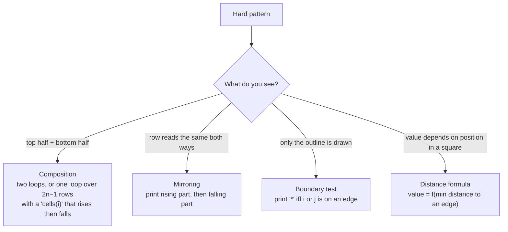

# 2. Pattern Logic Building: Hard

← [Easy and Medium](01-easy-and-medium.md) · [Part 3 index](README.md) · Next → [Part 4: Patterns](../04-patterns/README.md)

> [!abstract] What this covers
> **Core idea:** Hard patterns are built from easy ones using four tools: **composition** (stack two shapes), **mirroring** (left half + reflected right half), **boundary tests** (hollow shapes print a cell only on the border), and **distance formulas** (a cell's value is its distance from an edge or centre).
> **You'll be able to:** decompose diamonds, butterflies, number crowns, alpha hills, hollow rectangles and concentric number squares into a row table or a single (i, j) → value formula.
> **Source:** [takeuforward lesson](https://takeuforward.org/learning/dsa/hard?category=logic-building-patterns&source=strivers-a2z-dsa-sheet) · **Time:** 90 min

**Sections:** [1. The four tools](#1-the-four-tools) · [2. Composition](#2-composition-stacking-shapes) · [3. Mirroring](#3-mirroring-a-row) · [4. Middle-out symmetry](#4-middle-out-symmetry-gaps-that-shrink) · [5. Hollow shapes](#5-hollow-shapes-boundary-test) · [6. Distance formulas](#6-distance-formulas-the-grid-view) · [7. Choosing a view](#7-row-table-vs-grid-formula) · [Common mistakes](#common-mistakes) · [Practice](#practice) · [Flashcards](#flashcards)

---

## 1. The four tools



---

## 2. Composition: stacking shapes

**Diamond** (n = 3) = pyramid + inverted pyramid:
```text
  *
 ***
*****
*****
 ***
  *
```
Just run the pattern 7 loop, then the pattern 8 loop. (Striver's version repeats the middle row; a 2n − 1-row diamond skips one copy — read the expected output.)

**Half diamond** (n = 3), 2n − 1 rows:
```text
*
**
***
**
*
```

One loop with a piecewise bound:

| Row i (1..2n−1) | Stars |
|---|---|
| i ≤ n | i |
| i > n | 2n − i |

```cpp
for (int i = 1; i <= 2 * n - 1; i++) {
    int stars = (i <= n) ? i : 2 * n - i;
    for (int j = 0; j < stars; j++) cout << '*';
    cout << '\n';
}
```

Equivalent closed form: `stars = n − |n − i|`. The **absolute value trick** turns any rise-then-fall into one expression.

---

## 3. Mirroring a row

**Alpha hill** (n = 4):
```text
   A
  ABA
 ABCBA
ABCDCBA
```

Row i = spaces (n − i), then letters rising `A..('A'+i−1)`, then falling `('A'+i−2)..A`.

Two clean ways:

| Approach | How |
|---|---|
| Two inner loops | Loop `j = 0..i−1` printing `'A'+j`, then `j = i−2..0` |
| Breakpoint | One loop of length `2i − 1`; a `char` that increments while `j < breakpoint`, decrements after. Breakpoint = `(2i − 1) / 2` (0-based) |
| Absolute value | Cell j (0..2i−2) = `'A' + (i − 1) − |i − 1 − j|` |

**Number crown** (n = 4) mirrors a whole row around a central gap:
```text
1      1
12    21
123  321
12344321
```

| Row i | Left numbers | Gap spaces | Right numbers |
|---|---|---|---|
| 1 | 1 | 6 | 1 |
| 2 | 1 2 | 4 | 2 1 |
| 3 | 1 2 3 | 2 | 3 2 1 |
| 4 | 1 2 3 4 | 0 | 4 3 2 1 |
| **Formula** | `1..i` | **2(n − i)** | `i..1` |

Width invariant: i + 2(n − i) + i = 2n ✅.

---

## 4. Middle-out symmetry: gaps that shrink

**Symmetric void** (n = 3):
```text
******
**  **
*    *
*    *
**  **
******
```

| Row i (top half, 1..n) | Stars each side | Middle spaces |
|---|---|---|
| 1 | 3 | 0 |
| 2 | 2 | 2 |
| 3 | 1 | 4 |
| **Formula** | **n − i + 1** | **2(i − 1)** |

The bottom half is the same table read upwards. **Butterfly** is the inverse: stars grow `i`, middle spaces shrink `2(n − i)`.

> [!tip] Recognise the family
> Void and butterfly differ only in whether stars or gaps grow. Once you've written one, the other is a swap of `i` ↔ `n − i + 1`.

---

## 5. Hollow shapes: boundary test

**Hollow rectangle** (n = 4):
```text
****
*  *
*  *
****
```

Loop over every cell and print `*` **iff** the cell is on the border:

```cpp
for (int i = 0; i < n; i++) {
    for (int j = 0; j < n; j++)
        cout << ((i == 0 || j == 0 || i == n - 1 || j == n - 1) ? '*' : ' ');
    cout << '\n';
}
```

The same test hollows out any shape: for a hollow pyramid, a cell is on the border if it's the first or last star of its row, or it's the last row.

---

## 6. Distance formulas: the grid view

**Concentric number square** (pattern 22, n = 4) has side 2n − 1:
```text
4444444
4333334
4322234
4321234
4322234
4333334
4444444
```

Don't build a row table — think per cell. For cell (i, j), 0-based, side `S = 2n − 1`:

| Distance to | Value |
|---|---|
| top | i |
| left | j |
| bottom | S − 1 − i |
| right | S − 1 − j |

The cell lies on ring `d = min(top, left, bottom, right)`; ring 0 is the border. The value is **n − d**.

```cpp
int S = 2 * n - 1;
for (int i = 0; i < S; i++) {
    for (int j = 0; j < S; j++) {
        int d = min({i, j, S - 1 - i, S - 1 - j});
        cout << n - d;
    }
    cout << '\n';
}
```

Alternative: `value = 1 + max(|i − c|, |j − c|)` where `c = n − 1` is the centre (Chebyshev distance). Same answer, one line.

> [!tip] Distance thinking generalises
> Diamonds (`|i − c| + |j − c| ≤ r`, Manhattan distance), squares (Chebyshev), and circles (Euclidean) are all "print if distance ≤ r". This same idea returns in grid BFS (distance layers) and matrix rings (spiral traversal).

---

## 7. Row table vs grid formula

| Use a **row table** when | Use a **grid formula** when |
|---|---|
| Rows are made of runs (spaces, then stars, then numbers) | Every cell's value depends on (i, j) directly |
| Shapes are triangles, pyramids, crowns | Shapes are square, hollow, or concentric |
| You print segments with separate loops | You print every cell with one double loop and a `?:` / formula |

Both are O(rows × width) time, O(1) extra space. The grid formula is often shorter but harder to see; the row table is easier to dry-run.

---

## Common mistakes

1. Forgetting the bottom half of composed shapes runs n − 1 or n rows (duplicate middle row or missing one).
2. Middle gap formula off by one or by a factor of 2 (`n − i` instead of `2(n − i)`).
3. Mirroring repeats the peak character (`ABCCBA` instead of `ABCBA`).
4. Hollow test missing a side (`j == n − 1`).
5. Concentric square side length `2n` instead of `2n − 1`.
6. Printing multi-digit numbers (n ≥ 10) breaks alignment. Patterns assume single-digit unless stated.

---

## Practice

1. Write the row table for butterfly (n = 3) and derive formulas for both halves.
2. Hollow pyramid: print only the outline of a centred pyramid of height n.
3. Write the alpha hill with the `|·|` formula and check row 3 for n = 4.
4. Print a diamond of stars using one double loop over a (2n − 1) × (2n − 1) grid and the Manhattan test.
5. Modify pattern 22 so the centre is 1 and the border is n, but print letters (`A` centre).

<details><summary>Answer sketches</summary>

**#1:** top half i = 1..n: stars `i`, gap `2(n − i)`, stars `i`; bottom half is i = n−1..1 (or i = n..1 if the middle row is doubled).

**#2:** row i: spaces `n − i`; then for j in 1..2i−1, print `*` if `j == 1 || j == 2i − 1 || i == n`, else space.

**#3:** row i = 3 → j = 0..4: `'A' + 2 − |2 − j|` → A B C B A ✅.

**#4:** centre c = n − 1; print `*` iff `|i − c| + |j − c| ≤ n − 1`.

**#5:** `char('A' + max(|i−c|, |j−c|))`.
</details>

---

## Key terms

| Term | Meaning |
|---|---|
| Composition | Building a pattern from two simpler shapes printed in sequence |
| Breakpoint | The index where a mirrored row switches from rising to falling |
| Boundary test | Condition that is true only for cells on the outline |
| Chebyshev distance | `max(|dx|, |dy|)` — gives square rings |
| Manhattan distance | `|dx| + |dy|` — gives diamonds |

---

## Flashcards

**How do you write "rise then fall" (1, 2, …, n, …, 2, 1) as one expression over i = 1..2n−1?** #flashcard
`n − |n − i|`.

**Middle gap of the number crown in row i?** #flashcard
`2(n − i)` spaces, so the row width is always 2n.

**How do you print a hollow rectangle?** #flashcard
Double loop over all cells; print `*` iff `i == 0 || j == 0 || i == n−1 || j == n−1`, else a space.

**Value of cell (i, j) in the concentric number square?** #flashcard
`n − min(i, j, S−1−i, S−1−j)` with S = 2n − 1 (or `1 + max(|i−c|, |j−c|)`).

**What's the relation between the symmetric void and the butterfly?** #flashcard
Same structure with i ↔ n − i + 1: in one the stars shrink and the gap grows, in the other the reverse.

**When should you prefer a grid formula over a row table?** #flashcard
When each cell's value depends directly on its (i, j) position — squares, hollow and concentric shapes.

**Which distance gives a diamond and which gives a square ring?** #flashcard
Manhattan `|dx| + |dy|` → diamond; Chebyshev `max(|dx|, |dy|)` → square.

**Interview track →** [How to Think](../../03-patterns/HOW_TO_THINK.md) · [Matrix deep-dive](../../01-data-structures/04-matrix.md)
