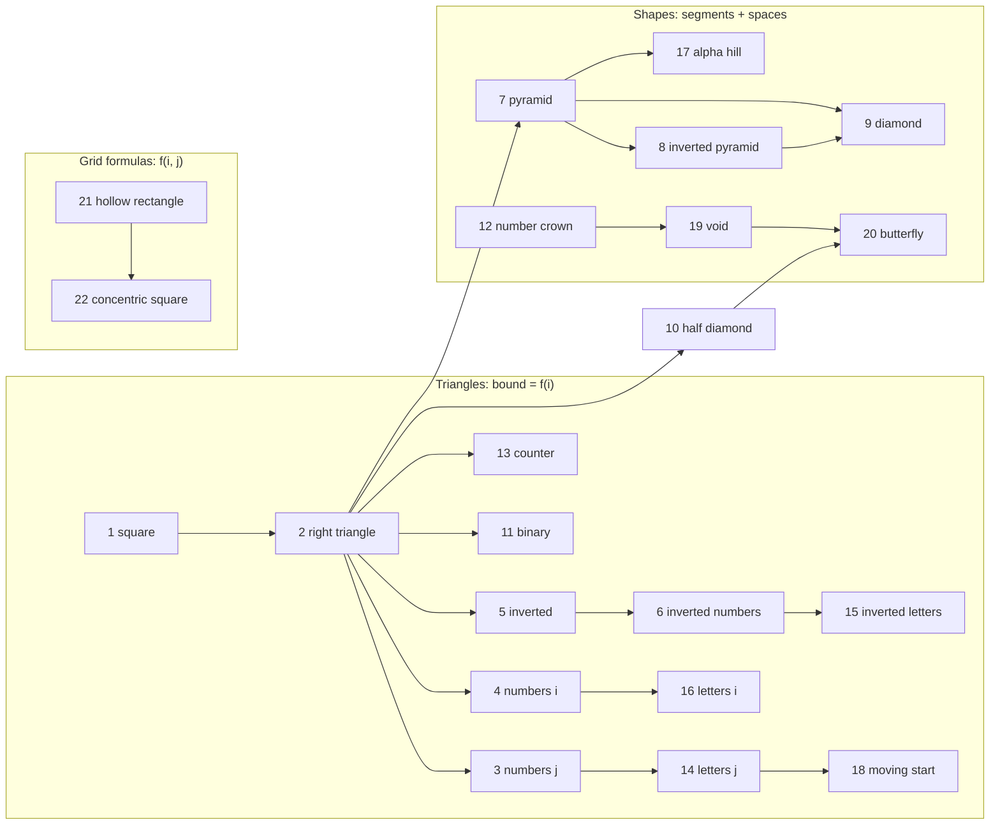

# Part 4: Patterns

← [Striver course map](../README.md)

> [!abstract] What this part covers
> **Goal:** Solve Striver's 22 pattern problems with the [Part 3 method](../03-logic-building-patterns/README.md): draw n = 3–5, build the row table, read off formulas, code, dry-run.
> **Prereqs:** [Part 3](../03-logic-building-patterns/README.md). **Time:** ~4 h total (≈10 min per pattern, plus re-solves).
> **Outcome:** Any nested-loop printing task — and the index arithmetic behind triangular loops, mirrored rows and grid distances — takes you minutes, not trial and error.

Every note has the n = 5 and n = 3 output, a row table, the derivation, C++/Java/Python code (all three verified to print identical output for n = 1…6), complexity, mistakes, a practice variation and flashcards.

> [!note] Output format
> Striver's reference output separates cells with a space in the triangle patterns (1–6, 10, 11, 13–16, 18) and prints no separator in the shape patterns (7–9, 12, 17, 19–22). Judges compare output, so always match the expected format. Trailing spaces are usually ignored.

---

## Lessons

| # | Pattern | Core idea in one line | Source |
|---|---|---|---|
| 1 | [Square of Stars](01-pattern-1.md) | Both loops run a fixed n times — the inner bound does not depend on i. | [link](https://takeuforward.org/learning/dsa/pattern-1?category=patterns&source=strivers-a2z-dsa-sheet) |
| 2 | [Right-Angled Triangle](02-pattern-2.md) | Inner bound = i: the first pattern where the inner loop depends on the outer variable. | [link](https://takeuforward.org/learning/dsa/pattern-2?category=patterns&source=strivers-a2z-dsa-sheet) |
| 3 | [Number Triangle](03-pattern-3.md) | Same shape as pattern 2; the cell content is the column index j. | [link](https://takeuforward.org/learning/dsa/pattern-3?category=patterns&source=strivers-a2z-dsa-sheet) |
| 4 | [Row-Number Triangle](04-pattern-4.md) | Same shape as pattern 2; the cell content is the row index i. | [link](https://takeuforward.org/learning/dsa/pattern-4?category=patterns&source=strivers-a2z-dsa-sheet) |
| 5 | [Inverted Right Triangle](05-pattern-5.md) | Inversion rule: replace i with n − i + 1 in pattern 2's bound. | [link](https://takeuforward.org/learning/dsa/pattern-5?category=patterns&source=strivers-a2z-dsa-sheet) |
| 6 | [Inverted Number Triangle](06-pattern-6.md) | Pattern 5's shape with pattern 3's content. | [link](https://takeuforward.org/learning/dsa/pattern-6?category=patterns&source=strivers-a2z-dsa-sheet) |
| 7 | [Star Pyramid](07-pattern-7.md) | Two segments per row: leading spaces (n − i) then stars (2i − 1); width stays 2n − 1. | [link](https://takeuforward.org/learning/dsa/pattern-7?category=patterns&source=strivers-a2z-dsa-sheet) |
| 8 | [Inverted Star Pyramid](08-pattern-8.md) | Pattern 7 with i → n − i + 1: spaces grow, stars shrink by 2. | [link](https://takeuforward.org/learning/dsa/pattern-8?category=patterns&source=strivers-a2z-dsa-sheet) |
| 9 | [Diamond](09-pattern-9.md) | Composition: run pattern 7's loop, then pattern 8's loop (middle row printed twice). | [link](https://takeuforward.org/learning/dsa/pattern-9?category=patterns&source=strivers-a2z-dsa-sheet) |
| 10 | [Half Diamond](10-pattern-10.md) | One loop over 2n − 1 rows; stars = i ≤ n ? i : 2n − i (= n − |n − i|). | [link](https://takeuforward.org/learning/dsa/pattern-10?category=patterns&source=strivers-a2z-dsa-sheet) |
| 11 | [Binary Number Triangle](11-pattern-11.md) | Cell (i, j) prints 1 when i + j is even, else 0 — parity of the position. | [link](https://takeuforward.org/learning/dsa/pattern-11?category=patterns&source=strivers-a2z-dsa-sheet) |
| 12 | [Number Crown](12-pattern-12.md) | Three segments per row: 1 … i, then 2(n − i) spaces, then i … 1. | [link](https://takeuforward.org/learning/dsa/pattern-12?category=patterns&source=strivers-a2z-dsa-sheet) |
| 13 | [Increasing Number Triangle](13-pattern-13.md) | The value lives across rows: a counter declared outside both loops, incremented every cell. | [link](https://takeuforward.org/learning/dsa/pattern-13?category=patterns&source=strivers-a2z-dsa-sheet) |
| 14 | [Letter Triangle](14-pattern-14.md) | Pattern 3 with letters: cell j prints 'A' + j. | [link](https://takeuforward.org/learning/dsa/pattern-14?category=patterns&source=strivers-a2z-dsa-sheet) |
| 15 | [Reverse Letter Triangle](15-pattern-15.md) | Pattern 14's content with pattern 5's shape: n − i + 1 letters per row. | [link](https://takeuforward.org/learning/dsa/pattern-15?category=patterns&source=strivers-a2z-dsa-sheet) |
| 16 | [Alpha-Ramp](16-pattern-16.md) | Pattern 4 with letters: row i repeats 'A' + i − 1, i times. | [link](https://takeuforward.org/learning/dsa/pattern-16?category=patterns&source=strivers-a2z-dsa-sheet) |
| 17 | [Alpha-Hill](17-pattern-17.md) | Pyramid shape (n − i spaces, 2i − 1 cells) with mirrored letters: rise to the peak 'A' + i − 1, then fall. | [link](https://takeuforward.org/learning/dsa/pattern-17?category=patterns&source=strivers-a2z-dsa-sheet) |
| 18 | [Alpha-Triangle](18-pattern-18.md) | Row i starts at 'A' + n − i and runs up to 'A' + n − 1. | [link](https://takeuforward.org/learning/dsa/pattern-18?category=patterns&source=strivers-a2z-dsa-sheet) |
| 19 | [Symmetric Void](19-pattern-19.md) | Two halves; each row = stars, gap, stars. Top: stars n − i + 1, gap 2(i − 1). Bottom: stars i, gap 2(n − i). | [link](https://takeuforward.org/learning/dsa/pattern-19?category=patterns&source=strivers-a2z-dsa-sheet) |
| 20 | [Symmetric Butterfly](20-pattern-20.md) | 2n − 1 rows; stars s = i ≤ n ? i : 2n − i on each side, gap 2(n − s). | [link](https://takeuforward.org/learning/dsa/pattern-20?category=patterns&source=strivers-a2z-dsa-sheet) |
| 21 | [Hollow Rectangle](21-pattern-21.md) | Visit every cell; print '*' iff it's on the border (first/last row or column), else a space. | [link](https://takeuforward.org/learning/dsa/pattern-21?category=patterns&source=strivers-a2z-dsa-sheet) |
| 22 | [Concentric Number Square](22-pattern-22.md) | Cell value = n − min(distance to top, left, bottom, right). | [link](https://takeuforward.org/learning/dsa/pattern-22?category=patterns&source=strivers-a2z-dsa-sheet) |

---

## How the 22 patterns build on each other

---

## Part 4 cheat sheet

| Family | Patterns | Formula (1-based i, j) |
|---|---|---|
| Fixed square | 1 | inner bound n |
| Growing triangle | 2, 3, 4, 14, 16 | bound `i`; content `j`, `i`, `'A'+j−1`, `'A'+i−1` |
| Inverted triangle | 5, 6, 15 | bound `n − i + 1` |
| Parity | 11 | `(i + j) % 2 == 0 ? 1 : 0` |
| Running counter | 13 | `num++`, declared outside both loops; row i starts at `1 + i(i−1)/2` |
| Moving start | 18 | letters `'A'+n−i … 'A'+n−1` |
| Pyramid / inverted | 7, 8 | spaces `n − i` / `i − 1`; stars `2i − 1` / `2(n − i) + 1` |
| Composition | 9 | pattern 7 then pattern 8 |
| Rise then fall | 10, 20 | `s = n − |n − i|` over 2n − 1 rows |
| Mirrored row | 12, 17 | crown gap `2(n − i)`; hill breakpoint `(2i − 1)/2` |
| Three segments | 12, 19, 20 | `s + gap + s = 2n` → derive the gap from s |
| Boundary | 21 | `i==0 ∥ j==0 ∥ i==n−1 ∥ j==n−1` (0-based) |
| Ring distance | 22 | `n − min(i, j, S−1−i, S−1−j)`, S = 2n − 1 |
| Complexity | all | O(n²) time, O(1) extra space |

---

## Mastery checklist

- [ ] Solve patterns 1–6 in under 2 minutes each, without looking
- [ ] Derive pyramid and inverted-pyramid formulas in both 0- and 1-based indexing
- [ ] Write 10 and 20 with a single loop using `n − |n − i|`
- [ ] Print the alpha hill without repeating the peak
- [ ] Explain why pattern 13's counter lives outside both loops
- [ ] Write the boundary test (21) and ring formula (22) from memory
- [ ] Re-solve 9, 12, 17, 19, 20, 22 cold after 2 days

**Interview track →** [How to Think](../../03-patterns/HOW_TO_THINK.md) · [Matrix deep-dive](../../01-data-structures/04-matrix.md) · [L3 Cheatsheet](../../00-start-here/L3_CHEATSHEET.md)

Next part → [Time Complexity](../05-time-complexity/README.md)
