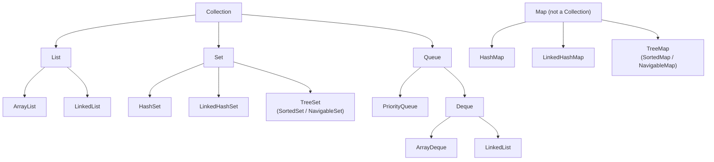

# 2. Java Collections

← [STL](01-stl.md) · [Part 6 index](README.md) · Next → [Python Libraries Part 1](03-python-libraries-part-1.md)

> [!abstract] What this covers
> **Core idea:** The Java Collections Framework is a hierarchy of **interfaces** (`List`, `Set`, `Map`, `Queue`, `Deque`) with interchangeable **implementations** (`ArrayList`, `HashSet`, `TreeMap`, `ArrayDeque`, `PriorityQueue` …). Declare the variable by interface, construct by implementation, and choose the implementation by complexity.
> **You'll be able to:** pick the right class for each DSA need, know each operation's cost, avoid boxing/`==` traps, write comparators, and use `Arrays`/`Collections` utilities.
> **Source:** [takeuforward lesson](https://takeuforward.org/learning/dsa/java-collections?category=standard-libraries-and-collections&source=strivers-a2z-dsa-sheet) · **Time:** 2 h

**Sections:** [1. Hierarchy](#1-the-hierarchy) · [2. Wrappers & boxing](#2-wrapper-types-and-autoboxing) · [3. List](#3-list-arraylist-and-linkedlist) · [4. Set](#4-set-hashset-linkedhashset-treeset) · [5. Map](#5-map-hashmap-treemap-linkedhashmap) · [6. Stack/Queue/Deque](#6-stack-queue-deque) · [7. PriorityQueue](#7-priorityqueue) · [8. Comparators](#8-comparable-and-comparator) · [9. Utilities](#9-arrays-and-collections-utilities) · [10. Iteration](#10-iteration-and-modification) · [11. STL ↔ Java](#11-stl--java-cheat-table) · [Common mistakes](#common-mistakes) · [Practice](#practice) · [Flashcards](#flashcards)

---

## 1. The hierarchy



```java
import java.util.*;
List<Integer> list = new ArrayList<>();      // interface on the left, implementation on the right
Map<String, Integer> map = new HashMap<>();
```

---

## 2. Wrapper types and autoboxing

Collections store **objects**, not primitives: `int → Integer`, `long → Long`, `char → Character`, `boolean → Boolean`, `double → Double`. Java converts automatically (**autoboxing/unboxing**).

> [!danger] `==` on Integer
> ```java
> Integer a = 127, b = 127;  a == b   // true  (cached −128..127)
> Integer c = 128, d = 128;  c == d   // false (different objects!)
> c.equals(d)                         // true ✅
> ```
> Comparing `map.get(x) == map.get(y)` or `stack.peek() == list.get(i)` silently breaks once values exceed 127. Use `.equals()` or unbox to `int` first.

Other boxing traps:
- `list.remove(1)` removes **index 1**; `list.remove(Integer.valueOf(1))` removes the **value 1**.
- `map.get(missing)` returns `null`; `int x = map.get(missing);` throws `NullPointerException`.
- Boxing costs memory and time. For fixed-size numeric data, prefer `int[]` over `List<Integer>`.

---

## 3. List: ArrayList and LinkedList

```java
List<Integer> a = new ArrayList<>();
a.add(5); a.add(0, 9);          // append; insert at index (O(n))
a.get(i); a.set(i, 7);
a.remove(a.size() - 1);         // remove last by index
a.size(); a.isEmpty(); a.contains(5); a.indexOf(5);
List<Integer> b = new ArrayList<>(a);          // copy
List<List<Integer>> adj = new ArrayList<>();
for (int i = 0; i < n; i++) adj.add(new ArrayList<>());   // graph adjacency list
List<Integer> fixed = List.of(1, 2, 3);        // immutable
List<Integer> view = Arrays.asList(1, 2, 3);   // fixed-size view
```

| Operation | ArrayList | LinkedList |
|---|---|---|
| `get(i)` / `set` | O(1) | O(n) |
| `add` at end | O(1) amortised | O(1) |
| `add/remove` at front | O(n) | O(1) |
| `contains` | O(n) | O(n) |

Use `ArrayList` almost always. For both-end operations use `ArrayDeque`, not `LinkedList`.

> [!warning] Backtracking: add a copy
> `res.add(path)` stores a reference; later changes to `path` change the stored result. Use `res.add(new ArrayList<>(path))`.

---

## 4. Set: HashSet, LinkedHashSet, TreeSet

```java
Set<Integer> hs = new HashSet<>();
hs.add(3);            // returns false if already present — handy for "seen" checks
hs.remove(3); hs.contains(3); hs.size();

TreeSet<Integer> ts = new TreeSet<>(List.of(5, 1, 3));
ts.first(); ts.last();           // min, max
ts.floor(x);   ts.ceiling(x);    // ≤ x, ≥ x  (null if none)
ts.lower(x);   ts.higher(x);     // < x, > x
ts.pollFirst(); ts.pollLast();   // remove + return min / max
ts.headSet(x); ts.tailSet(x);    // views < x, ≥ x
```

| | HashSet | LinkedHashSet | TreeSet |
|---|---|---|---|
| Order | none | insertion | sorted |
| add/remove/contains | O(1) avg | O(1) avg | O(log n) |
| floor / ceiling | ❌ | ❌ | O(log n) |

No `TreeMultiset` in Java: simulate one with `TreeMap<Integer, Integer>` (value → count).

---

## 5. Map: HashMap, TreeMap, LinkedHashMap

```java
Map<Integer, Integer> f = new HashMap<>();
f.put(k, v); f.get(k); f.containsKey(k); f.remove(k);
f.getOrDefault(k, 0);
f.put(x, f.getOrDefault(x, 0) + 1);          // frequency count
f.merge(x, 1, Integer::sum);                 // same, shorter
f.computeIfAbsent(u, z -> new ArrayList<>()).add(v);   // map of lists
for (Map.Entry<Integer, Integer> e : f.entrySet()) { e.getKey(); e.getValue(); }
for (int key : f.keySet()) {}
for (int val : f.values()) {}

TreeMap<Integer, Integer> tm = new TreeMap<>();
tm.firstKey(); tm.lastKey(); tm.floorKey(x); tm.ceilingKey(x);
tm.firstEntry(); tm.pollFirstEntry();

// multiset remove-one:
if (tm.merge(x, -1, Integer::sum) == 0) tm.remove(x);
```

| | HashMap | LinkedHashMap | TreeMap |
|---|---|---|---|
| Order | none | insertion (or access order) | sorted keys |
| get/put | O(1) avg | O(1) avg | O(log n) |
| Special | — | `removeEldestEntry` → LRU cache | floor/ceiling/first/last |

---

## 6. Stack, Queue, Deque

```java
Deque<Integer> st = new ArrayDeque<>();     // stack
st.push(1); st.peek(); st.pop(); st.isEmpty();

Queue<Integer> q = new ArrayDeque<>();      // queue (or new LinkedList<>())
q.offer(1); q.peek(); q.poll();             // poll returns null if empty

Deque<Integer> d = new ArrayDeque<>();      // both ends
d.offerFirst(1); d.offerLast(2); d.peekFirst(); d.peekLast(); d.pollFirst(); d.pollLast();
```

| Throws on empty/full | Returns special value |
|---|---|
| `add`, `remove`, `element` | `offer`, `poll`, `peek` |

> [!tip] Prefer `ArrayDeque` over `Stack`
> `java.util.Stack` extends `Vector`: synchronized and slower. `ArrayDeque` is the recommended stack and queue. It does **not** allow `null` elements.

---

## 7. PriorityQueue

A binary heap. **Min-heap by default** (opposite of C++).

```java
PriorityQueue<Integer> minh = new PriorityQueue<>();
PriorityQueue<Integer> maxh = new PriorityQueue<>(Collections.reverseOrder());
PriorityQueue<int[]> pq = new PriorityQueue<>((a, b) -> a[0] - b[0]);   // Dijkstra: {dist, node}
pq.offer(new int[]{0, src}); int[] top = pq.poll(); pq.peek(); pq.size();
```

| Operation | Cost |
|---|---|
| offer / poll | O(log n) |
| peek | O(1) |
| `remove(Object)` / `contains` | O(n) |
| Iteration order | **not sorted** — only `poll` gives sorted order |

> [!warning] `a - b` comparators can overflow
> `(a, b) -> a - b` breaks when values are near `Integer.MIN_VALUE`/`MAX_VALUE`. Safe form: `Integer.compare(a, b)` or `Comparator.comparingInt(x -> x[0])`.

---

## 8. Comparable and Comparator

| | `Comparable<T>` | `Comparator<T>` |
|---|---|---|
| Where | Inside the class: `compareTo(T o)` | Outside: a separate function/lambda |
| How many orders | One "natural" order | As many as you like |
| Used by | `Collections.sort(list)`, `TreeSet<T>` with no args | `list.sort(cmp)`, `new TreeSet<>(cmp)`, `new PriorityQueue<>(cmp)` |

Return negative if a < b, zero if equal, positive if a > b.

```java
// Sort intervals by start, ties by end descending
Arrays.sort(iv, (a, b) -> a[0] != b[0] ? Integer.compare(a[0], b[0]) : Integer.compare(b[1], a[1]));

// Comparator combinators
people.sort(Comparator.comparing(Person::age).thenComparing(Person::name));
list.sort(Comparator.reverseOrder());

class Pair implements Comparable<Pair> {
    int x, y;
    public int compareTo(Pair o) { return x != o.x ? Integer.compare(x, o.x) : Integer.compare(y, o.y); }
}
```

> [!warning] Custom keys in HashMap/HashSet
> A custom class used as a key must override **both** `equals` and `hashCode`; otherwise two equal objects land in different buckets. For grid cells, prefer a `long` key `r * cols + c` or a `record Cell(int r, int c)` (records generate both).

---

## 9. Arrays and Collections utilities

| Call | What | Notes |
|---|---|---|
| `Arrays.sort(int[])` | dual-pivot quicksort | O(n log n) avg, O(n²) worst on adversarial input |
| `Arrays.sort(Integer[] / Object[])` | TimSort, stable | supports comparators |
| `Arrays.sort(a, from, to)` | sort a subrange | `to` exclusive |
| `Arrays.fill(a, -1)` | fill | for 2D: loop over rows |
| `Arrays.toString(a)` / `deepToString` | print | debugging |
| `Arrays.binarySearch(a, x)` | index, or `−(insertion point) − 1` | sorted array |
| `Arrays.copyOfRange(a, l, r)` | new array `[l, r)` | O(r − l) |
| `Arrays.asList(…)` | fixed-size List view | |
| `Arrays.stream(a).sum()` / `.max().getAsInt()` | quick aggregates | |
| `Collections.sort(list)` / `list.sort(null)` | sort a List | |
| `Collections.reverse(list)`, `swap(list, i, j)` | | |
| `Collections.max(c)` / `min(c)` / `frequency(c, x)` | | O(n) |

> [!tip] Sorting a primitive array descending
> `Arrays.sort(int[], cmp)` doesn't exist. Either sort ascending and reverse manually, or box: `Integer[] b = …; Arrays.sort(b, Collections.reverseOrder());`.

---

## 10. Iteration and modification

```java
for (int x : list) {}                         // for-each
Iterator<Integer> it = list.iterator();
while (it.hasNext()) if (it.next() % 2 == 0) it.remove();   // safe removal
list.removeIf(x -> x % 2 == 0);               // simplest
```

Removing from a collection inside a for-each loop throws `ConcurrentModificationException`. Use an iterator, `removeIf`, or collect the keys first.

---

## 11. STL ↔ Java cheat table

| Need | C++ | Java |
|---|---|---|
| Dynamic array | `vector` | `ArrayList` |
| Stack | `stack` | `ArrayDeque` (`push/pop/peek`) |
| Queue | `queue` | `ArrayDeque` (`offer/poll/peek`) |
| Deque | `deque` | `ArrayDeque` |
| Min-heap | `priority_queue<…, greater<>>` | `PriorityQueue` (default) |
| Max-heap | `priority_queue` (default) | `PriorityQueue(Collections.reverseOrder())` |
| Hash set / map | `unordered_set / unordered_map` | `HashSet / HashMap` |
| Ordered set / map | `set / map` | `TreeSet / TreeMap` |
| Multiset | `multiset` | `TreeMap<K, Integer>` counts |
| lower_bound | `s.lower_bound(x)` | `ts.ceiling(x)` |
| Predecessor ≤ x | `prev(s.upper_bound(x))` | `ts.floor(x)` |
| Pair | `pair<int,int>` | `int[]{a, b}` or a `record` |

---

## Common mistakes

1. `Integer == Integer` for values outside −128..127.
2. `list.remove(int)` vs `list.remove(Object)` confusion.
3. Unboxing a `null` from `map.get` → NPE. Use `getOrDefault`.
4. Assuming `PriorityQueue` iteration is sorted.
5. Using `Stack`/`LinkedList` where `ArrayDeque` is faster.
6. `a - b` comparators overflowing.
7. Adding `path` instead of `new ArrayList<>(path)` in backtracking.
8. Custom key class without `equals`/`hashCode`.

---

## Practice

1. Count word frequencies, then print words sorted by frequency descending, ties alphabetically.
2. Find the smallest element ≥ x in a dynamic set with inserts and deletes.
3. Why does `if (st.peek() == arr[i])` sometimes fail with `Deque<Integer>` and `int[] arr`? When does it not?
4. Implement a max-heap of `int[]{value, index}` by value, ties by smaller index.
5. Remove all negative numbers from an `ArrayList<Integer>` without an exception.

<details><summary>Answer sketches</summary>

**#1:** `HashMap.merge`, then `List<Map.Entry<String,Integer>>` sorted with `(a, b) -> !a.getValue().equals(b.getValue()) ? b.getValue() - a.getValue() : a.getKey().compareTo(b.getKey())`.

**#2:** `TreeSet.ceiling(x)` (or a `TreeMap` of counts if duplicates are allowed).

**#3:** `Integer == int` unboxes the Integer, so it's a numeric comparison and works. It fails only for `Integer == Integer` (e.g. comparing `st.peek()` with another `Integer` from a list/map).

**#4:** `new PriorityQueue<>((a, b) -> a[0] != b[0] ? Integer.compare(b[0], a[0]) : Integer.compare(a[1], b[1]))`.

**#5:** `list.removeIf(x -> x < 0)`.
</details>

---

## Key terms

| Term | Meaning |
|---|---|
| Interface vs implementation | `List` (contract) vs `ArrayList` (concrete class) |
| Autoboxing | Automatic conversion between `int` and `Integer` |
| Integer cache | JVM reuses `Integer` objects for −128..127, so `==` works only there |
| NavigableSet / NavigableMap | Sorted collections with floor/ceiling/lower/higher |
| Comparable vs Comparator | Natural order inside the class vs an external ordering |
| Fail-fast iterator | Throws `ConcurrentModificationException` if the collection is modified during iteration |

---

## Flashcards

**Java `PriorityQueue` default — min or max?** #flashcard
Min-heap. Max: `new PriorityQueue<>(Collections.reverseOrder())`.

**Why is `Integer a = 128, b = 128; a == b` false?** #flashcard
`==` compares references; only −128..127 are cached. Use `.equals()`.

**What should you use as a stack in Java?** #flashcard
`ArrayDeque` with `push`/`pop`/`peek` — not `java.util.Stack`.

**TreeSet equivalent of C++ `lower_bound(x)`?** #flashcard
`ceiling(x)` (smallest ≥ x). `floor(x)` is the largest ≤ x.

**Frequency count one-liner?** #flashcard
`map.merge(x, 1, Integer::sum)` or `map.put(x, map.getOrDefault(x, 0) + 1)`.

**`list.remove(1)` on a `List<Integer>` removes what?** #flashcard
The element at index 1. To remove the value 1: `list.remove(Integer.valueOf(1))`.

**How do you remove elements while iterating?** #flashcard
`iterator.remove()` or `collection.removeIf(pred)`; modifying in a for-each throws `ConcurrentModificationException`.

**What must a custom HashMap key override?** #flashcard
Both `equals` and `hashCode` (records do this automatically).

**Interview track →** [L3 Cheatsheet](../../00-start-here/L3_CHEATSHEET.md) · [Hashing deep-dive](../../01-data-structures/02-hashing.md) · [Heap deep-dive](../../01-data-structures/10-heap.md)
