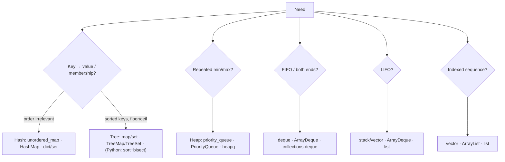

# Part 6: Standard Libraries & Collections

← [Striver course map](../README.md)

> [!abstract] What this part covers
> **Goal:** Know the ready-made containers and algorithms of C++ STL, Java Collections and Python's standard library — what each costs, when to reach for it, and the traps that cause wrong answers or TLE.
> **Prereqs:** [Part 5](../05-time-complexity/README.md) (to reason about operation costs). **Time:** ~5 h (do your main language in depth, skim the others' mapping tables).
> **Outcome:** Given "I need fast lookup / ordered keys / repeated min / FIFO", you name the container in your language and its Big-O without thinking.

---

## Lessons

| # | Lesson | Core idea in one line | Source |
|---|---|---|---|
| 1 | [STL (C++)](01-stl.md) | vector, deque, stack/queue/priority_queue, set/map vs unordered, iterators, `<algorithm>`, comparators | [link](https://takeuforward.org/learning/dsa/stl?category=standard-libraries-and-collections&source=strivers-a2z-dsa-sheet) |
| 2 | [Java Collections](02-java-collections.md) | List/Set/Map hierarchy, boxing traps, TreeMap, ArrayDeque, PriorityQueue, Comparator | [link](https://takeuforward.org/learning/dsa/java-collections?category=standard-libraries-and-collections&source=strivers-a2z-dsa-sheet) |
| 3 | [Python Libraries: Part 1](03-python-libraries-part-1.md) | list/tuple/set/dict/str costs, slicing, comprehensions, `sort(key=)`, aliasing | [link](https://takeuforward.org/learning/dsa/python-libraries-part-1?category=standard-libraries-and-collections&source=strivers-a2z-dsa-sheet) |
| 4 | [Python Libraries: Part 2](04-python-libraries-part-2.md) | deque, Counter, defaultdict, heapq, bisect, lru_cache, itertools, math, fast I/O | [link](https://takeuforward.org/learning/dsa/python-libraries-part-2?category=standard-libraries-and-collections&source=strivers-a2z-dsa-sheet) |

---

## Picking a container

---

## Cross-language cheat sheet

| Concept | C++ | Java | Python | Key ops cost |
|---|---|---|---|---|
| Dynamic array | `vector` | `ArrayList` | `list` | index O(1), push-back amortised O(1) |
| Deque | `deque` | `ArrayDeque` | `deque` | both ends O(1) |
| Stack | `stack` | `ArrayDeque` (push/pop) | `list` | O(1) |
| Queue | `queue` | `ArrayDeque` (offer/poll) | `deque` | O(1) |
| Min-heap | `priority_queue<T, vector<T>, greater<T>>` | `PriorityQueue` | `heapq` | push/pop O(log n), top O(1) |
| Max-heap | `priority_queue<T>` | `PriorityQueue(Collections.reverseOrder())` | `heapq` with `-x` | same |
| Hash set / map | `unordered_set/map` | `HashSet/HashMap` | `set/dict` | O(1) avg, O(n) worst |
| Ordered set / map | `set/map` | `TreeSet/TreeMap` | — (`sortedcontainers`) | O(log n) |
| Lower bound | `lower_bound` | `TreeMap.ceilingKey` | `bisect_left` | O(log n) |
| Sort | `sort` (introsort, unstable) | `Arrays.sort` / `Collections.sort` | `sort` (Timsort, stable) | O(n log n) |
| Frequency | `m[x]++` | `m.merge(x, 1, Integer::sum)` | `Counter` | O(1) avg |

---

## Top traps per language

| C++ | Java | Python |
|---|---|---|
| `m[k]` inserts on read | `==` on `Integer` > 127 | `[[0]*m]*n` aliasing |
| Erasing while iterating invalidates iterators | `Stack` / `LinkedList` slower than `ArrayDeque` | `list.pop(0)` is O(n) |
| `priority_queue` is a **max**-heap | `PriorityQueue` is a **min**-heap; iteration order isn't sorted | `heapq` is a **min**-heap |
| `unordered_map` anti-hash tests | Comparator `a - b` overflows | `defaultdict` read inserts |
| `s.size() - 1` underflows when empty (`size_t`) | `ConcurrentModificationException` | recursion limit ≈ 1000 |

---

## Mastery checklist

- [ ] For your main language, write from memory: a min-heap, a max-heap, a hash map with counts, an ordered map with floor/ceiling, a deque-based BFS
- [ ] State the cost of every operation in the cross-language table
- [ ] Sort pairs by second ascending, then first descending, in your language
- [ ] Explain hash vs tree containers and when ordered keys are worth O(log n)
- [ ] Name the top 3 traps in your language without looking
- [ ] Translate a solution between two languages using the cheat sheet

**Interview track →** [L3 Cheatsheet](../../00-start-here/L3_CHEATSHEET.md) · [Hashing deep-dive](../../01-data-structures/02-hashing.md) · [Heap deep-dive](../../01-data-structures/10-heap.md)

Next part → [Concept Basics](../07-concept-basics/README.md)
