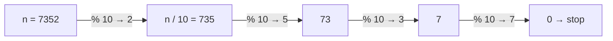
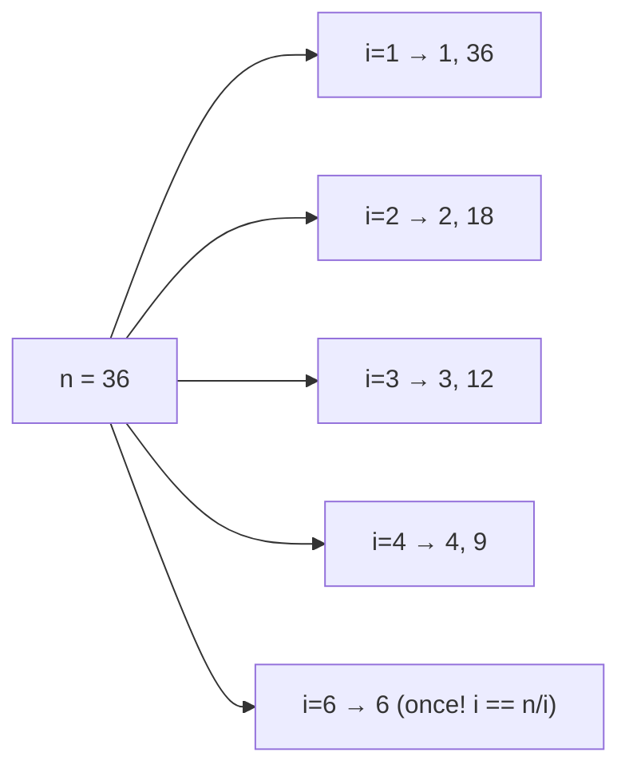

# 1. Basic Maths

← [Part 7 index](README.md) · Next → [Basic Arrays](02-basic-arrays.md)

> [!abstract] What this covers
> **Core idea:** Almost every "basic maths" problem reduces to four tools: **peel digits** with `% 10` and `/ 10`, **pair divisors** up to √n, **Euclid's GCD**, and **modular arithmetic** to keep numbers small. Master these and Part 8's 13 problems become variations.
> **You'll be able to:** extract and rebuild digits, count digits in O(1) or O(log n), list divisors in O(√n), test primality, compute GCD/LCM in O(log min), and apply `% MOD` correctly.
> **Source:** [takeuforward lesson](https://takeuforward.org/learning/dsa/basic-maths?category=concept-basics&source=strivers-a2z-dsa-sheet) · **Time:** 60 min

**Sections:** [1. Digit extraction](#1-digit-extraction) · [2. Counting digits](#2-counting-digits) · [3. Rebuilding numbers](#3-rebuilding-numbers) · [4. Divisors](#4-divisors-in-on) · [5. Primes](#5-primes) · [6. GCD & LCM](#6-gcd-and-lcm) · [7. Modular arithmetic](#7-modular-arithmetic) · [8. Overflow](#8-overflow-and-types) · [Common mistakes](#common-mistakes) · [Practice](#practice) · [Flashcards](#flashcards)

---

## 1. Digit extraction

In base 10, `n % 10` is the **last digit** and `n / 10` (integer division) **drops** it.



```cpp
while (n > 0) {
    int d = n % 10;   // process d
    n /= 10;
}
```

| Step | n | n % 10 | n / 10 |
|---|---|---|---|
| 1 | 7352 | 2 | 735 |
| 2 | 735 | 5 | 73 |
| 3 | 73 | 3 | 7 |
| 4 | 7 | 7 | 0 |

**Cost:** the loop runs once per digit = ⌊log₁₀ n⌋ + 1 → **O(log n)**.

> [!warning] n = 0 and negatives
> `while (n > 0)` runs zero times for n = 0, but 0 has one digit. Handle it separately. For negatives, work on `abs(n)` (careful: `abs(INT_MIN)` overflows — use `long long`). In C++/Java, `-7 % 10 == -7`; in Python it's `3`.

---

## 2. Counting digits

| Method | Code | Cost | Notes |
|---|---|---|---|
| Loop | `while (n) { cnt++; n /= 10; }` | O(log n) | n = 0 → special case |
| Log | `(int)log10(n) + 1` | O(1) | n > 0 only; floating-point risk near powers of 10 for huge n |
| String | `to_string(n).size()` / `len(str(n))` | O(log n) | simplest; includes `-` for negatives |

---

## 3. Rebuilding numbers

**Reverse:** `rev = rev * 10 + d` shifts left and appends.

| n | d | rev |
|---|---|---|
| 123 | 3 | 3 |
| 12 | 2 | 32 |
| 1 | 1 | 321 |

Uses: **palindrome number** (`rev == original`), **Armstrong** (sum of dᵏ where k = digit count), digit sums, largest digit, odd-digit counts.

> [!danger] Reversal overflows
> Reversing 1 534 236 469 gives 9 646 324 351 > 2³¹ − 1. Check before multiplying: `if (rev > INT_MAX / 10 || (rev == INT_MAX / 10 && d > 7)) return 0;` — or use `long long` and compare at the end.

---

## 4. Divisors in O(√n)

Divisors come in **pairs** `(i, n / i)` with `i ≤ √n ≤ n / i`. So scan only `i` up to √n.



```cpp
vector<int> divs;
for (int i = 1; 1LL * i * i <= n; i++) {
    if (n % i == 0) {
        divs.push_back(i);
        if (i != n / i) divs.push_back(n / i);
    }
}
sort(divs.begin(), divs.end());   // if order matters: O(d log d)
```

| Approach | Cost |
|---|---|
| Check 1..n | O(n) |
| Pairs up to √n | **O(√n)** |
| Divisor count bound | d(n) ≤ ~1 344 for n ≤ 10⁹ |

> [!tip] Use `i * i <= n`, not `i <= sqrt(n)`
> It avoids floating-point error and recomputing sqrt each iteration. Cast to `long long` so `i * i` can't overflow near `INT_MAX`.

**Perfect number:** sum of proper divisors (excluding n) equals n — 6, 28, 496. Sum the pairs, subtract n.

---

## 5. Primes

**Prime:** exactly two divisors, 1 and itself. 1 is **not** prime; 2 is the only even prime.

```cpp
bool isPrime(int n) {
    if (n < 2) return false;
    for (int i = 2; 1LL * i * i <= n; i++)
        if (n % i == 0) return false;
    return true;
}
```

O(√n). Why √n is enough: if n = a·b with a ≤ b, then a ≤ √n; a composite always has a factor ≤ √n.

**Counting primes ≤ N (many queries): Sieve of Eratosthenes**

```cpp
vector<bool> prime(N + 1, true);
prime[0] = prime[1] = false;
for (int i = 2; 1LL * i * i <= N; i++)
    if (prime[i])
        for (int j = i * i; j <= N; j += i) prime[j] = false;
```

| Method | Cost for all ≤ N |
|---|---|
| `isPrime` for each | O(N √N) |
| Sieve | **O(N log log N)** time, O(N) space |

Start crossing off at `i * i`: smaller multiples `k·i` with k < i were already crossed by k's prime factor. Deep dive in [Part 31: Maths](../31-maths/README.md).

---

## 6. GCD and LCM

**Euclid:** `gcd(a, b) = gcd(b, a % b)`, `gcd(a, 0) = a`.

| a | b | a % b |
|---|---|---|
| 48 | 18 | 12 |
| 18 | 12 | 6 |
| 12 | 6 | 0 |
| 6 | 0 | → **6** |

```cpp
int gcd(int a, int b) { return b == 0 ? a : gcd(b, a % b); }
long long lcm(long long a, long long b) { return a / gcd(a, b) * b; }   // divide first!
```

- **Cost:** O(log min(a, b)) — the remainder at least halves every two steps (worst case: consecutive Fibonacci numbers).
- Subtraction version `gcd(a − b, b)` is O(max) for `gcd(10⁹, 1)` — always use `%`.
- `lcm = a · b / gcd` — compute `a / gcd * b` to avoid overflowing the product.
- Library: C++ `std::gcd` (`<numeric>`), Java `BigInteger.gcd`, Python `math.gcd`.

---

## 7. Modular arithmetic

Answers "modulo 10⁹ + 7" keep numbers inside 64-bit while staying exact.

| Rule | Safe? |
|---|---|
| `(a + b) % m = ((a % m) + (b % m)) % m` | ✅ |
| `(a · b) % m = ((a % m) · (b % m)) % m` | ✅ (product must fit: use `long long`) |
| `(a − b) % m = ((a % m) − (b % m) + m) % m` | ✅ add m to stay non-negative |
| `(a / b) % m` | ❌ — multiply by the **modular inverse** `b^(m−2) mod m` (m prime) |

Why 10⁹ + 7: prime (inverses exist), and `(m − 1)² < 2⁶³` so a product of two reduced values fits in `long long`.

---

## 8. Overflow and types

| Type | Max ≈ |
|---|---|
| `int` (32-bit) | 2.1 × 10⁹ |
| `long long` / Java `long` | 9.2 × 10¹⁸ |
| Factorial fits in `long long` | up to 20! |
| Python `int` | unbounded |

Rule: if any intermediate can exceed 2 × 10⁹ — products, sums of 10⁵ values up to 10⁹, `i * i` near 10⁹ — use 64-bit.

---

## Common mistakes

1. Forgetting n = 0 has one digit.
2. Losing the original n by modifying it, then comparing to it (copy first).
3. Reverse overflow.
4. `i <= sqrt(n)` with floating error, or `i * i` overflow.
5. Adding `i` and `n / i` twice when they're equal (perfect squares).
6. Treating 1 as prime.
7. LCM as `a * b / gcd` overflowing.
8. Negative results from `%` in C++/Java subtraction.

---

## Practice

1. Sum of digits of 98 765.
2. List the divisors of 100 in sorted order. How many loop iterations did the √n method use?
3. Compute gcd(1071, 462) by hand.
4. Is 1 a perfect number? Is 28?
5. Count primes ≤ 30 with the sieve. Which numbers does i = 3 cross off first?
6. Compute `(3 − 7) mod 5` in C++ semantics vs the correct mathematical result.

<details><summary>Answer sketches</summary>

**#1:** 9 + 8 + 7 + 6 + 5 = 35.

**#2:** 1, 2, 4, 5, 10, 20, 25, 50, 100 — 10 iterations (i = 1..10); i = 10 contributes one divisor.

**#3:** 1071 % 462 = 147; 462 % 147 = 21; 147 % 21 = 0 → **21**.

**#4:** 1: proper divisor sum 0 ≠ 1 → no. 28: 1 + 2 + 4 + 7 + 14 = 28 → yes.

**#5:** 10 primes (2, 3, 5, 7, 11, 13, 17, 19, 23, 29). i = 3 starts at 9: 9, 12, 15, …

**#6:** C++: `-4 % 5 == -4`. Correct: `((-4) % 5 + 5) % 5 = 1`.
</details>

---

## Key terms

| Term | Meaning |
|---|---|
| Digit peeling | `% 10` reads the last digit, `/ 10` drops it |
| Divisor pair | `(i, n/i)`; one side is always ≤ √n |
| Prime | Exactly two divisors: 1 and itself |
| Sieve of Eratosthenes | Mark multiples of each prime; finds all primes ≤ N |
| Euclid's algorithm | `gcd(a, b) = gcd(b, a % b)` |
| Modular inverse | x with `b · x ≡ 1 (mod m)` |

---

## Flashcards

**How many digits does n have?** #flashcard
⌊log₁₀ n⌋ + 1 for n > 0; 1 for n = 0.

**Why stop divisor search at √n?** #flashcard
Divisors pair as (i, n/i); the smaller of each pair is ≤ √n.

**Edge case when listing divisors of a perfect square?** #flashcard
When i == n/i, add it once.

**Euclid's algorithm and its cost?** #flashcard
`gcd(a, b) = gcd(b, a % b)`; O(log min(a, b)).

**Safe LCM formula?** #flashcard
`a / gcd(a, b) * b` — divide before multiplying.

**Sieve complexity?** #flashcard
O(N log log N) time, O(N) space.

**How do you subtract under a modulus?** #flashcard
`((a - b) % m + m) % m`.

**Interview track →** [L3 Cheatsheet](../../00-start-here/L3_CHEATSHEET.md) · [Math & Number Theory](../../02-algorithms/18-math-and-number-theory.md)
