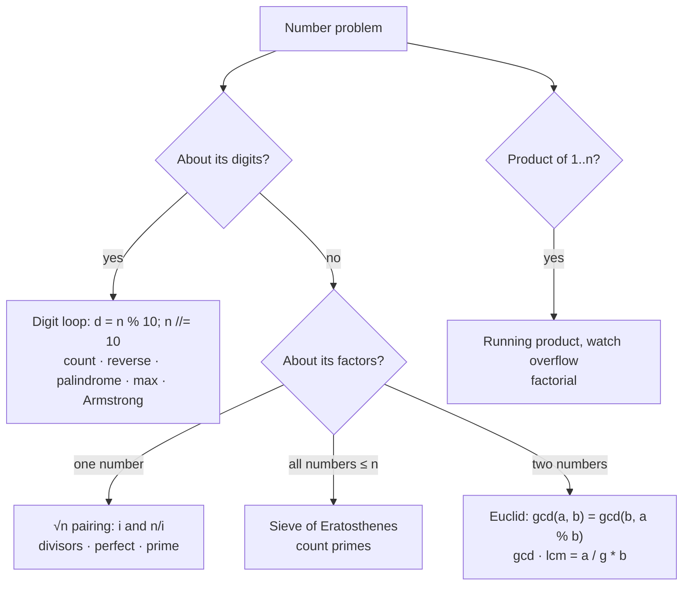

# Part 8: Basic Maths

← [Striver course map](../README.md)

> [!abstract] What this part covers
> **Goal:** Turn the digit-extraction loop, √n divisor pairing, the sieve, and Euclid's GCD into reflexes you can write in under two minutes each.
> **Prereqs:** [Concept: basic maths](../07-concept-basics/01-basic-maths.md), [Time complexity](../05-time-complexity/README.md). **Time:** ~3 h.
> **Outcome:** Every problem here reduces to one of four templates. You can name the template from the problem statement and state its complexity before writing code.

---

## Problems

| # | Problem | Difficulty | Key insight | Optimal | Source |
|---|---|---|---|---|---|
| 1 | [Count All Digits of a Number](01-count-all-digits-of-a-number.md) | Easy | Each `n //= 10` strips one digit, so the loop runs once per digit; `0` has one digit. | O(1) | [link](https://takeuforward.org/learning/dsa/count-all-digits-of-a-number?category=basic-maths&source=strivers-a2z-dsa-sheet) |
| 2 | [Count Number of Odd Digits in a Number](02-count-number-of-odd-digits-in-a-number.md) | Easy | Use the digit loop and test each digit `d` with `d % 2 == 1`. | O(log₁₀ n) | [link](https://takeuforward.org/learning/dsa/count-number-of-odd-digits-in-a-number?category=basic-maths&source=strivers-a2z-dsa-sheet) |
| 3 | [Reverse a Number](03-reverse-a-number.md) | Easy | `rev = rev * 10 + n % 10` shifts the reversed number left by one digit and appends the next digit. | O(log₁₀ n) | [link](https://takeuforward.org/learning/dsa/reverse-a-number?category=basic-maths&source=strivers-a2z-dsa-sheet) |
| 4 | [Palindrome Number](04-palindrome-number.md) | Easy | Reverse only the back half of the digits and compare it with the front half. No overflow is possible. | O(log₁₀ n) | [link](https://takeuforward.org/learning/dsa/palindrome-number?category=basic-maths&source=strivers-a2z-dsa-sheet) |
| 5 | [Return the Largest Digit in a Number](05-return-the-largest-digit-in-a-number.md) | Easy | Use the digit loop with a running max. Stop early once you see a 9. | O(log₁₀ n) | [link](https://takeuforward.org/learning/dsa/return-the-largest-digit-in-a-number?category=basic-maths&source=strivers-a2z-dsa-sheet) |
| 6 | [Factorial of a Given Number](06-factorial-of-a-given-number.md) | Easy | Use a running product with `0! = 1`. 64-bit holds results up to `20!`; past that you need big integers or a modulus. | O(n) | [link](https://takeuforward.org/learning/dsa/factorial-of-a-given-number-i?category=basic-maths&source=strivers-a2z-dsa-sheet) |
| 7 | [Check if the Number is Armstrong](07-check-if-the-number-is-armstrong.md) | Easy | Use two digit loops: one counts the digits `k`, the other sums `dᵏ`. | O(d · log k) ≈ O(log n) | [link](https://takeuforward.org/learning/dsa/check-if-the-number-if-armstrong?category=basic-maths&source=strivers-a2z-dsa-sheet) |
| 8 | [Check for Perfect Number](08-check-for-perfect-number.md) | Easy | Divisors come in pairs `(i, n/i)` with `i ≤ √n`. Sum both members of each pair, and count a square root only once. | O(√n) | [link](https://takeuforward.org/learning/dsa/check-for-perfect-number?category=basic-maths&source=strivers-a2z-dsa-sheet) |
| 9 | [Check for Prime Number](09-check-for-prime-number.md) | Easy | Composite `n` has a factor ≤ √n, so trial division up to √n settles it. Skipping evens and multiples of 3 (the 6k ± 1 trick) cuts the work by a factor of 3. | O(√n / 3) | [link](https://takeuforward.org/learning/dsa/check-for-prime-number?category=basic-maths&source=strivers-a2z-dsa-sheet) |
| 10 | [Count of Prime Numbers till N](10-count-of-prime-numbers-till-n.md) | Medium | Sieve of Eratosthenes: cross out the multiples of each prime starting at `p²`. What survives is prime. O(n log log n). | O(n log log n) | [link](https://takeuforward.org/learning/dsa/count-of-prime-numbers-till-n?category=basic-maths&source=strivers-a2z-dsa-sheet) |
| 11 | [GCD of Two Numbers](11-gcd-of-two-numbers.md) | Easy | Euclid: `gcd(a, b) = gcd(b, a mod b)`, and `gcd(a, 0) = a`. The numbers shrink at least by half every two steps → O(log min(a, b)). | O(log min(a,b)) | [link](https://takeuforward.org/learning/dsa/gcd-of-two-numbers?category=basic-maths&source=strivers-a2z-dsa-sheet) |
| 12 | [LCM of Two Numbers](12-lcm-of-two-numbers.md) | Easy | `lcm · gcd = a · b`, so `lcm = a / gcd(a, b) * b`. Divide first to avoid overflow. | O(log min(a,b)) | [link](https://takeuforward.org/learning/dsa/lcm-of-two-numbers?category=basic-maths&source=strivers-a2z-dsa-sheet) |
| 13 | [Divisors of a Number](13-divisors-of-a-number.md) | Easy | Loop `i` up to √n. Push `i` onto a small list and `n/i` onto a large list, then join `small + reversed(large)` for sorted output with no sort call. | O(√n) | [link](https://takeuforward.org/learning/dsa/divisors-of-a-number?category=basic-maths&source=strivers-a2z-dsa-sheet) |

---

## Which template?

---

## Part 8 cheat sheet

| Template | Core lines | Cost | Used by |
|---|---|---|---|
| Digit loop | `while n > 0: d = n % 10; n //= 10` | O(log₁₀ n) | 1–5, 7 |
| Reverse | `rev = rev * 10 + d` | O(log₁₀ n) | 3, 4 |
| √n pairing | `for i in 1..√n: if n % i == 0: i, n // i` | O(√n) | 8, 9, 13 |
| Sieve | mark multiples of `p` from `p*p` | O(n log log n) | 10 |
| Euclid | `while b: a, b = b, a % b` | O(log min(a,b)) | 11, 12 |
| LCM | `a // gcd(a, b) * b` (divide first) | O(log min) | 12 |

**Overflow cheat:** reversing a 32-bit int can overflow → use 64-bit or check `rev > (INT_MAX - d) / 10`. `20!` is the last factorial that fits in `long long`. Compute LCM as `a / g * b`, never `a * b / g`.

**n = 0 trap:** a `while n > 0` loop runs zero times, so "count digits of 0" returns 0 unless you special-case it (answer is 1).

---

## Mastery checklist

- [ ] Write the digit loop from memory, and say why it costs O(log₁₀ n) and not O(n)
- [ ] Reverse a number and handle 32-bit overflow both ways (64-bit and pre-check)
- [ ] Explain why trial division only needs to go to √n
- [ ] List all divisors in sorted order in O(√n) using two lists
- [ ] Write the sieve with the `p*p` start and say why it starts there
- [ ] Prove gcd(a, b) = gcd(b, a mod b) in one sentence
- [ ] Compute LCM without overflow
- [ ] Know the special cases: 0, 1, negative input, perfect squares

**Interview track →** [Math & number theory](../../02-algorithms/18-math-and-number-theory.md) · [Concept: basic maths](../07-concept-basics/01-basic-maths.md)

Next part → [Basic Arrays](../09-basic-arrays/README.md)
