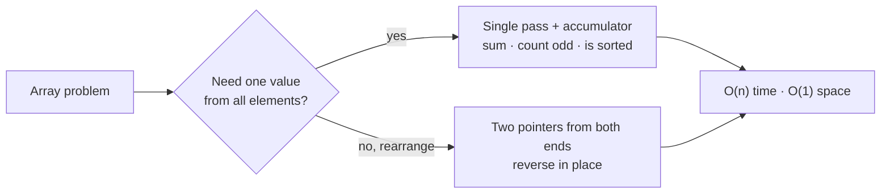

# Part 9: Basic Arrays

← [Striver course map](../README.md)

> [!abstract] What this part covers
> **Goal:** Make the single-pass scan and the two-pointer swap automatic. Most array problems later in the sheet are built from these two moves.
> **Prereqs:** [Concept: basic arrays](../07-concept-basics/02-basic-arrays.md), [Basic Maths](../08-basic-maths/README.md). **Time:** ~1.5 h.
> **Outcome:** You can write a one-pass accumulator (sum, count, sortedness) and an in-place two-pointer reverse without thinking, and you can state why each is O(n) time and O(1) space.

---

## Problems

| # | Problem | Difficulty | Key insight | Optimal | Source |
|---|---|---|---|---|---|
| 1 | [Sum of Array Elements](01-sum-of-array-elements.md) | Easy | One pass with an accumulator that starts at 0. Use 64-bit if `n · max|x|` can exceed 2³¹. | O(n) | [link](https://takeuforward.org/learning/dsa/sum-of-array-elements?category=basic-arrays&source=strivers-a2z-dsa-sheet) |
| 2 | [Count of Odd Numbers in Array](02-count-of-odd-numbers-in-array.md) | Easy | `x & 1` is 1 for odd `x`, including negatives in two's complement, so `cnt += x & 1` needs no branch. | O(n) | [link](https://takeuforward.org/learning/dsa/count-of-odd-numbers-in-array?category=basic-arrays&source=strivers-a2z-dsa-sheet) |
| 3 | [Check if the Array is Sorted](03-check-if-the-array-is-sorted.md) | Easy | Sortedness is a local property. If every adjacent pair satisfies `a[i-1] ≤ a[i]`, the whole array is sorted, because `≤` is transitive. | O(n) | [link](https://takeuforward.org/learning/dsa/check-if-the-array-is-sorted-i?category=basic-arrays&source=strivers-a2z-dsa-sheet) |
| 4 | [Reverse an Array](04-reverse-an-array.md) | Easy | Swap `a[l]` and `a[r]` and move both pointers inward until they meet. Each element moves once, using O(1) extra space. | O(n) | [link](https://takeuforward.org/learning/dsa/reverse-an-array?category=basic-arrays&source=strivers-a2z-dsa-sheet) |

---

## Two primitive moves

---

## Part 9 cheat sheet

| Problem | Accumulator / pointers | Early exit? | Cost |
|---|---|---|---|
| Sum | `s += x` (64-bit if values are large) | no | O(n) / O(1) |
| Count odd | `c += x & 1` | no | O(n) / O(1) |
| Is sorted | compare `a[i-1] > a[i]` | yes, first violation | O(n) / O(1) |
| Reverse | `l = 0, r = n-1`, swap, move inward | stop at `l ≥ r` | O(n) / O(1) |

**Adjacent-pair loops** start at `i = 1` and look at `a[i-1]`. That handles `n = 0` and `n = 1` with no special case.

---

## Mastery checklist

- [ ] Write sum, count, and is-sorted as one-pass loops with the right initial values
- [ ] Say when the sum needs a 64-bit accumulator
- [ ] Explain why is-sorted checks only adjacent pairs
- [ ] Reverse in place with two pointers and stop correctly for odd and even n
- [ ] Handle the empty array in every problem

**Interview track →** [Arrays deep-dive](../../01-data-structures/01-array.md) · [Two pointers](../../02-algorithms/03-two-pointers.md) · [Concept: basic arrays](../07-concept-basics/02-basic-arrays.md)

Next part → [Basic Hashing](../10-basic-hashing/README.md)
