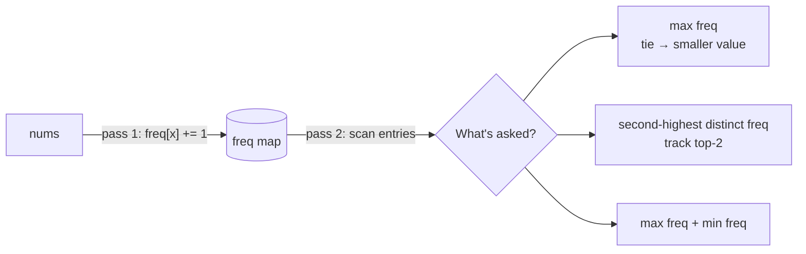

# Part 10: Basic Hashing

← [Striver course map](../README.md)

> [!abstract] What this part covers
> **Goal:** Build a frequency map in one pass and answer max / second-max / min-frequency questions from it in a second pass, including the tie-break rules.
> **Prereqs:** [Concept: basic hashing](../07-concept-basics/03-basic-hashing.md), [Basic Arrays](../09-basic-arrays/README.md). **Time:** ~1 h.
> **Outcome:** You can write `freq[x] += 1`, scan the map with explicit tie-breaks, and say when a fixed-size array beats a hashmap.

---

## Problems

| # | Problem | Difficulty | Key insight | Optimal | Source |
|---|---|---|---|---|---|
| 1 | [Highest Occurring Element in an Array](01-highest-occurring-element-in-an-array.md) | Easy | Count with a map, then do one scan with the comparison key `(-freq, value)`. | O(n) | [link](https://takeuforward.org/learning/dsa/highest-occurring-element-in-an-array?category=basic-hashing&source=strivers-a2z-dsa-sheet) |
| 2 | [Second Highest Occurring Element](02-second-highest-occurring-element.md) | Easy | Track the top-two distinct frequencies and their best elements in one scan of the map, the same way you'd track first and second largest. | O(n) | [link](https://takeuforward.org/learning/dsa/second-highest-occurring-element?category=basic-hashing&source=strivers-a2z-dsa-sheet) |
| 3 | [Sum of Highest and Lowest Frequency](03-sum-of-highest-and-lowest-frequency.md) | Easy | After counting, only the frequency values matter, so take the max and min of `freq.values()`. | O(n) | [link](https://takeuforward.org/learning/dsa/sum-of-highest-and-lowest-frequency?category=basic-hashing&source=strivers-a2z-dsa-sheet) |

---

## Count, then query

---

## Part 10 cheat sheet

| Choice | When | Cost |
|---|---|---|
| Array `cnt[x]` | values in a small known range (e.g. `0..10⁴`) | O(n + range), fastest |
| Hashmap | arbitrary or large values | O(n) expected |
| Sorted map (`map` / `TreeMap`) | need keys in order | O(n log n) |

**Tie-break pattern:** `if f > best_f or (f == best_f and x < best_x)`. Write it as one condition so it can't drift between branches.

**Top-2 pattern:** `if f > first: second = first; first = f` · `elif second < f < first: second = f`.

---

## Mastery checklist

- [ ] Write a frequency map in each of Python, C++, Java
- [ ] State the tie-break rule before coding and encode it in one comparison
- [ ] Track the top-2 distinct frequencies in a single scan
- [ ] Choose array vs hashmap from the value range
- [ ] Know what to return when there is no second-highest frequency

**Interview track →** [Hashing deep-dive](../../01-data-structures/02-hashing.md) · [Concept: basic hashing](../07-concept-basics/03-basic-hashing.md)

Next part → [Basic Strings](../11-basic-strings/README.md)
