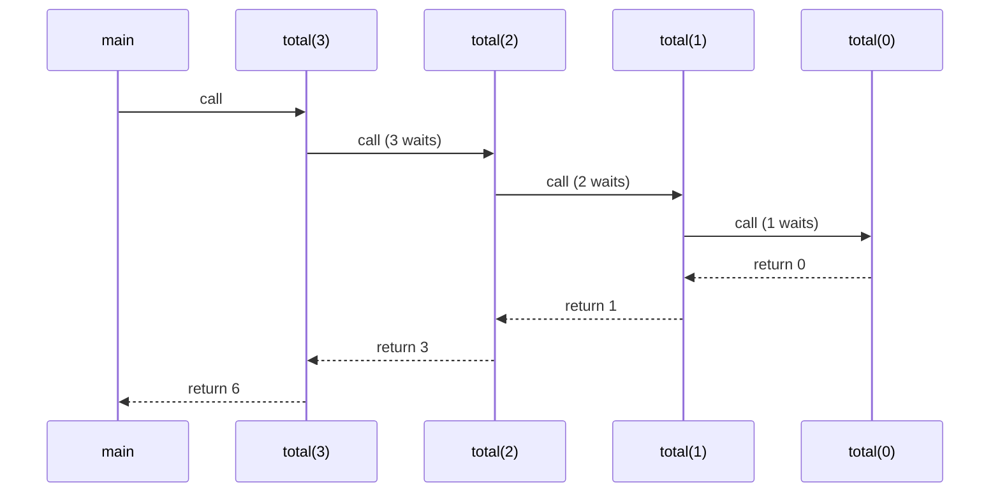
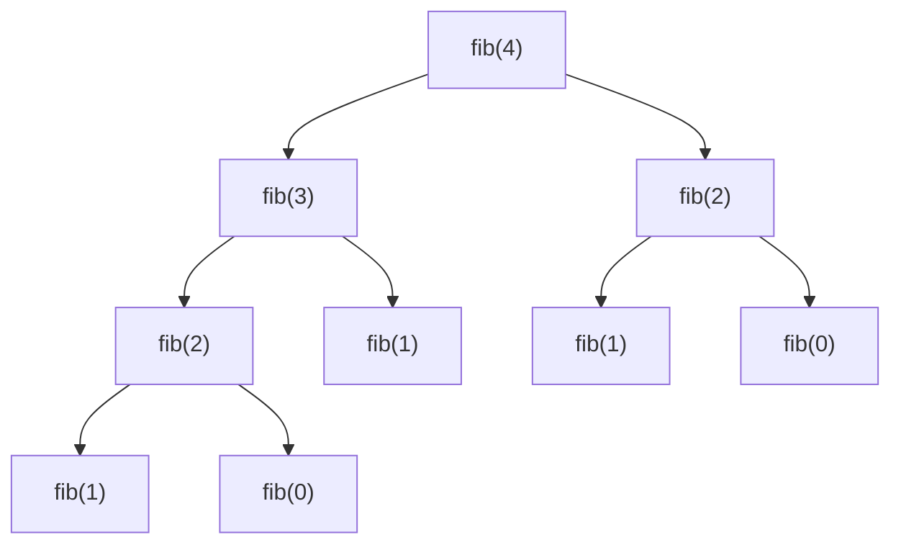

# 1. Recursion Theory

← [Part 12 index](README.md) · Next → [Recursion Concepts with Parameters](02-recursion-concepts-with-parameters.md)

> [!abstract] What this covers
> **Core idea:** A recursive function solves a problem by calling itself on a **smaller** instance, until it reaches a **base case** it can answer directly. Every pending call sits on the **call stack**, so recursion costs O(depth) memory, and a missing or unreachable base case overflows that stack.
> **You'll be able to:** write any recursion as base case + reduction + combine, trace it with a call stack and a recursion tree, predict the output order of print-before vs print-after calls, and state its time and space.
> **Source:** [takeuforward lesson](https://takeuforward.org/learning/dsa/recursion-theory?category=basic-recursion&source=strivers-a2z-dsa-sheet) · **Time:** 45 min

**Sections:** [1. Definition](#1-definition) · [2. The three parts](#2-the-three-parts) · [3. Call stack](#3-call-stack) · [4. Stack overflow](#4-stack-overflow) · [5. Recursion tree](#5-recursion-tree) · [6. Print order: head vs tail](#6-print-order-head-vs-tail) · [7. Complexity](#7-complexity) · [8. Recursion vs iteration](#8-recursion-vs-iteration) · [Common mistakes](#common-mistakes) · [Practice](#practice) · [Key terms](#key-terms) · [Flashcards](#flashcards)

---

## 1. Definition

**Recursion** is when a function calls itself, directly or through other functions, until a stopping condition is met.

```python
def f():
    print(1)
    f()      # no stopping condition → infinite recursion → RecursionError
```

Each call gets its **own frame**: its own parameters, locals and return address. When `f(3)` calls `f(2)`, `f(3)` is **paused**, not finished. It resumes at the line after the call once `f(2)` returns.

---

## 2. The three parts

| Part | Question it answers | `sum(n) = 1 + … + n` |
|---|---|---|
| **Base case** | Which smallest input do I answer without recursing? | `n == 0 → 0` |
| **Reduction** | Which smaller subproblem do I call? It must move toward the base case. | `sum(n − 1)` |
| **Combine** | How do I build my answer from the sub-answer? | `n + sum(n − 1)` |

```python
def total(n):
    if n == 0:            # base case
        return 0
    return n + total(n - 1)   # reduce + combine
```

> [!tip] The leap of faith
> Don't trace the whole recursion in your head. **Assume** `total(n − 1)` returns the correct answer, and check two things: (1) the combine step is right given that assumption, and (2) the base case is right. Together they prove correctness by induction.

---

## 3. Call stack



The stack grows to depth 4 (`n + 1` frames) and then unwinds in reverse order. **Last in, first out**: the deepest call finishes first.

| Moment | Stack (top on the right) |
|---|---|
| deepest point | `main · total(3) · total(2) · total(1) · total(0)` |
| after `total(0)` returns | `main · total(3) · total(2) · total(1)` |
| end | `main` |

---

## 4. Stack overflow

Stack memory is limited (typically 1–8 MB per thread). Each frame costs tens to hundreds of bytes, so the depth limit is finite even when the base case is correct.

| Language | Typical depth before a crash | Symptom |
|---|---|---|
| C++ | ~10⁵ – 10⁶ (depends on frame size, 8 MB default stack on Linux/macOS) | segfault |
| Java | ~10⁴ – 10⁵ (512 KB – 1 MB default) | `StackOverflowError` |
| Python | **1000** (soft limit) | `RecursionError: maximum recursion depth exceeded` |

**Causes:** (1) no base case; (2) a base case the reduction can skip, e.g. `f(n − 2)` from odd `n` with base `n == 0`; (3) a legitimate depth that is too large (linear recursion over 10⁶ elements).

**Fixes:** convert to iteration; raise the limit (`sys.setrecursionlimit(10**6)` in Python, which may still segfault at the OS limit; `-Xss` in Java); or cut the depth (halving recursion has depth log n).

> [!warning] Interview rule of thumb
> Linear-depth recursion over input sizes ≥ 10⁴ is a red flag in Python and risky in Java. Mention it, and offer the iterative version.

---

## 5. Recursion tree

When a function makes **more than one** recursive call, draw a tree: nodes are calls, children are the subcalls.



- **Time** = (number of nodes) × (work per node). This tree has ~φⁿ nodes, so `fib` is O(φⁿ) ≈ O(1.618ⁿ). The loose bound is O(2ⁿ).
- **Space** = the **height** of the tree, n here, not the node count. Only one root-to-leaf path is on the stack at a time.
- Repeated subtrees (`fib(2)` twice) are the signal for memoisation → [Recursion → DP](../../02-algorithms/10-recursion-to-dp.md).

---

## 6. Print order: head vs tail

Where the work sits relative to the recursive call decides the output order.

```python
def down(i, n):          # work BEFORE the call (tail position)
    if i > n: return
    print(i)
    down(i + 1, n)       # prints 1 2 … n

def up(i):               # work AFTER the call (head recursion / backtracking)
    if i < 1: return
    up(i - 1)
    print(i)             # prints 1 2 … n — while unwinding
```

| Task | Before the call | After the call (on the way back) |
|---|---|---|
| Print `1..N` | `f(i)` print i, call `f(i + 1)` | `f(i)` call `f(i − 1)`, print i |
| Print `N..1` | `f(i)` print i, call `f(i − 1)` | `f(i)` call `f(i + 1)`, print i |
| Print name N times | print, call `f(i + 1)` | — |

**Backtracking-style printing** means doing the work after the call returns. It is the same mechanism that later undoes choices in [backtracking](../../02-algorithms/12-backtracking.md).

**Tail call** = the recursive call is the very last action, with nothing pending after it. Some compilers (C++ at `-O2`, sometimes) turn it into a loop. **Java and Python never do**, so don't rely on it.

---

## 7. Complexity

| Shape | Example | Time | Space (stack) |
|---|---|---|---|
| One call, n − 1, O(1) work | sum, factorial, print 1..N | O(n) | O(n) |
| One call, n / 2 | binary search, fast power | O(log n) | O(log n) |
| Two calls, n − 1 / n − 2 | naive fibonacci | O(φⁿ) | O(n) |
| Two calls, n / 2 each, O(n) merge | merge sort | O(n log n) | O(log n) stack + O(n) buffer |
| Branching b, depth d | subsets (b = 2, d = n) | O(bᵈ) | O(d) |

Recurrence shortcut: `T(n) = T(n − 1) + O(1)` gives O(n); `T(n) = 2T(n − 1) + O(1)` gives O(2ⁿ); `T(n) = T(n/2) + O(1)` gives O(log n); `T(n) = 2T(n/2) + O(n)` gives O(n log n).

---

## 8. Recursion vs iteration

| | Recursion | Iteration |
|---|---|---|
| Fits | trees, divide and conquer, backtracking, nested structure | linear scans, simple accumulation |
| Memory | O(depth) stack frames | O(1) usually |
| Readability | mirrors the definition | can need an explicit stack |
| Risk | stack overflow, call overhead | off-by-one in loop bounds |

Every recursion can be rewritten with an explicit stack. Linear recursions with an accumulator become plain loops.

---

## Common mistakes

1. Missing the base case, or a base case that's unreachable from some inputs (`n` odd, step −2, base `n == 0`). Use `n <= 0`.
2. The reduction doesn't shrink the input: `f(n)` calls `f(n)`.
3. Forgetting `return` on the recursive call in Python/Java (`total(n − 1)` instead of `return n + total(n − 1)`), so the result is `None`.
4. Counting nodes for space. Space is the max depth, not the total number of calls.
5. Assuming tail-call optimisation in Java or Python.
6. Linear recursion on 10⁵+ elements in Python without raising the limit, or without switching to a loop.

---

## Practice

1. What does `f(3)` print? `def f(n): if n == 0: return; f(n − 1); print(n); f(n − 1)`
2. Write `print N..1` using only work after the call.
3. State the time and space of `g(n) = g(n // 2) + g(n // 2) + 1`.
4. Why does `h(n) = 1 if n == 0 else h(n − 2)` crash for `n = 5`?
5. Your Python solution recurses once per array element with `n = 10⁵`. What two fixes can you offer?

<details><summary>Answer sketches</summary>

**#1:** `1 2 1 3 1 2 1`, an in-order walk of the tree, with 2ⁿ − 1 prints.

**#2:** `f(i)`: if `i > n` return; `f(i + 1)`; print i. Call `f(1)`.

**#3:** T(n) = 2T(n/2) + O(1) → **O(n)** time; depth log n → **O(log n)** space. (Calling `g(n // 2)` once and doubling it would make it O(log n) time.)

**#4:** 5 → 3 → 1 → −1 → … The base case `n == 0` is skipped. Use `n <= 0`.

**#5:** rewrite iteratively, or `sys.setrecursionlimit(10**6)` plus `threading.stack_size` to enlarge the real stack.
</details>

---

## Key terms

| Term | Meaning |
|---|---|
| Base case | Input answered directly, without recursing |
| Stack frame | One call's parameters, locals, return address |
| Call stack | LIFO of active frames |
| Stack overflow | Depth exceeded the stack memory |
| Recursion tree | Calls as nodes; children = subcalls |
| Head recursion | Recursive call first, work after (runs while unwinding) |
| Tail recursion | Recursive call is the last action |
| Leap of faith | Assume the subcall is correct; verify combine + base |

---

## Flashcards

**Three parts of any recursive function?** #flashcard
Base case, reduction toward it, combine.

**Space complexity of recursion?** #flashcard
O(max depth) for the stack frames, not the number of calls.

**Python's default recursion limit?** #flashcard
1000 (`sys.setrecursionlimit` to change).

**Print 1..N with work after the call?** #flashcard
f(i): if i < 1 return; f(i − 1); print(i). Call f(N).

**Time of naive fib(n)?** #flashcard
O(φⁿ) ≈ 1.618ⁿ (bound O(2ⁿ)); space O(n).

**Do Java/Python optimise tail calls?** #flashcard
No.

**Interview track →** [Recursion deep-dive](../../02-algorithms/09-recursion.md) · [Recursion → DP](../../02-algorithms/10-recursion-to-dp.md) · [Recursion & DP masterclass](../../03-patterns/RECURSION_AND_DP_MASTERCLASS.md)
