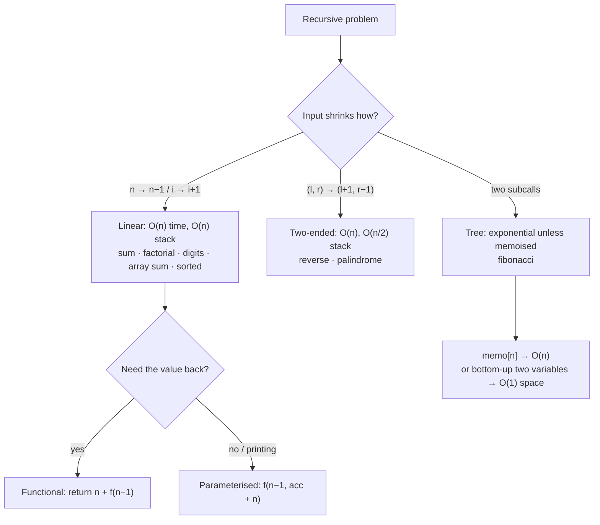

# Part 12: Basic Recursion

← [Striver course map](../README.md)

> [!abstract] What this part covers
> **Goal:** Write every linear recursion as base case + reduction + combine, in both the parameterised and the functional style, and know its stack cost before you run it.
> **Prereqs:** [Basic Arrays](../09-basic-arrays/README.md), [Basic Strings](../11-basic-strings/README.md). **Time:** ~4 h.
> **Outcome:** You can turn any loop from Parts 8–11 into a recursion and back, trace the call stack, and explain why naive Fibonacci is exponential and how memoisation fixes it.

---

## Theory

| # | Lesson | What you get | Source |
|---|---|---|---|
| 1 | [Recursion Theory](01-recursion-theory.md) | Base case, call stack, stack overflow, recursion trees, head vs tail printing, complexity | [link](https://takeuforward.org/learning/dsa/recursion-theory?category=basic-recursion&source=strivers-a2z-dsa-sheet) |
| 2 | [Recursion Concepts with Parameters](02-recursion-concepts-with-parameters.md) | Parameterised vs functional, index parameters instead of slices, pass-by-value traps, multiple calls | [link](https://takeuforward.org/learning/dsa/recursion-concepts-with-parameters?category=basic-recursion&source=strivers-a2z-dsa-sheet) |

Read these first; the problems below apply them.

---

## Problems

| # | Problem | Difficulty | Key insight | Optimal | Source |
|---|---|---|---|---|---|
| 3 | [Sum of First N Numbers](03-sum-of-first-n-numbers.md) | Easy | `S(N) = N + S(N − 1)`, with `S(0) = 0`. This is the first recursion to write in both styles, even though Gauss's `N(N+1)/2` is O(1). | O(N) | [link](https://takeuforward.org/learning/dsa/sum-of-first-n-numbers?category=basic-recursion&source=strivers-a2z-dsa-sheet) |
| 4 | [Factorial of a Given Number](04-factorial-of-a-given-number.md) | Easy | `n! = n · (n − 1)!` with `0! = 1! = 1`. Use a 64-bit type: `int` overflows at 13!, `long` at 21!. | O(n) | [link](https://takeuforward.org/learning/dsa/factorial-of-a-given-number-ii?category=basic-recursion&source=strivers-a2z-dsa-sheet) |
| 5 | [Sum of Array Elements](05-sum-of-array-elements.md) | Easy | Recurse on an **index**, not a slice: `f(i) = nums[i] + f(i + 1)`, `f(n) = 0`. Slicing makes it O(n²). | O(n) | [link](https://takeuforward.org/learning/dsa/sum-of-array-elements-ii?category=basic-recursion&source=strivers-a2z-dsa-sheet) |
| 6 | [Reverse a String (Recursive)](06-reverse-a-string-recursive.md) | Easy | Swap the ends and recurse inward on `(l + 1, r − 1)`, stopping at `l ≥ r`. This is the two-pointer loop from Part 11, written as recursion. | O(n) | [link](https://takeuforward.org/learning/dsa/reverse-a-string-i?category=basic-recursion&source=strivers-a2z-dsa-sheet) |
| 7 | [Check if String is Palindrome or Not](07-check-if-string-is-palindrome.md) | Easy | `isPal(l, r) = s[l] == s[r] and isPal(l + 1, r − 1)`, with `l ≥ r → true`. The `and` short-circuits, so the first mismatch stops the recursion. | O(n) | [link](https://takeuforward.org/learning/dsa/check-if-string-is-palindrome-or-not-?category=basic-recursion&source=strivers-a2z-dsa-sheet) |
| 8 | [Check if a Number is Prime or Not](08-check-if-a-number-is-prime.md) | Easy | Only divisors up to `√num` matter. Recurse on the divisor `i`: `f(i) = (num % i ≠ 0) and f(i + 1)`, base `i·i > num → true`. | O(√n) | [link](https://takeuforward.org/learning/dsa/check-if-a-number-is-prime-or-not?category=basic-recursion&source=strivers-a2z-dsa-sheet) |
| 9 | [Reverse an Array (Recursive)](09-reverse-an-array-recursive.md) | Easy | The same two-ended recursion as the string: swap `nums[l]` and `nums[r]`, then call `f(l + 1, r − 1)`. A single-index version is `f(i)` swapping `i` with `n − 1 − i` until `i ≥ n/2`. | O(n) | [link](https://takeuforward.org/learning/dsa/reverse-an-array-ii?category=basic-recursion&source=strivers-a2z-dsa-sheet) |
| 10 | [Check if the Array is Sorted](10-check-if-the-array-is-sorted-recursive.md) | Easy | Sorted means every adjacent pair is in order: `f(i) = nums[i] ≤ nums[i + 1] and f(i + 1)`, base `i ≥ n − 1 → true`. | O(n) | [link](https://takeuforward.org/learning/dsa/check-if-the-array-is-sorted-ii?category=basic-recursion&source=strivers-a2z-dsa-sheet) |
| 11 | [Sum of Digits in a Given Number](11-sum-of-digits.md) | Easy | Peel off the last digit: `f(n) = n % 10 + f(n / 10)`, `f(0) = 0`. The depth is the digit count, ⌊log₁₀ n⌋ + 1. | O(d) = O(log n) | [link](https://takeuforward.org/learning/dsa/sum-of-digits-in-a-given-number?category=basic-recursion&source=strivers-a2z-dsa-sheet) |
| 12 | [Fibonacci Number](12-fibonacci-number.md) | Easy | Naive `F(n−1) + F(n−2)` recomputes the same subproblems, which is O(φⁿ). Memoising makes it O(n), and keeping only the last two values makes it O(1) space. This is the gateway to DP. | O(n) | [link](https://takeuforward.org/learning/dsa/fibonacci-number?category=basic-recursion&source=strivers-a2z-dsa-sheet) |

---

## Shape of the recursion

---

## Part 12 cheat sheet

| Problem | Base case | Recursive step | Time / Stack |
|---|---|---|---|
| Sum 1..N | `n == 0 → 0` | `n + f(n−1)` | O(n) / O(n) |
| Factorial | `n ≤ 1 → 1` | `n · f(n−1)` | O(n) / O(n) |
| Array sum | `i == n → 0` | `a[i] + f(i+1)` | O(n) / O(n) |
| Reverse string / array | `l ≥ r` | swap, `f(l+1, r−1)` | O(n) / O(n) |
| Palindrome | `l ≥ r → true` | `s[l]==s[r] and f(l+1, r−1)` | O(n) / O(n) |
| Prime | `i·i > n → true` | `n % i ≠ 0 and f(i+1)` | O(√n) / O(√n) |
| Sorted | `i ≥ n−1 → true` | `a[i] ≤ a[i+1] and f(i+1)` | O(n) / O(n) |
| Digit sum | `n == 0 → 0` | `n%10 + f(n/10)` | O(log₁₀ n) / same |
| Fibonacci | `n ≤ 1 → n` | `f(n−1) + f(n−2)` | O(φⁿ) naive → O(n) memo |

**Habits:** pass indices, never slices. Pass C++ containers by `&`. Expect a Python `RecursionError` beyond depth ~1000. Every linear recursion here has an O(1)-space loop twin; say so in interviews.

---

## Mastery checklist

- [ ] Write sum and factorial in both the parameterised and the functional style
- [ ] Trace the call stack of `sum(3)` frame by frame
- [ ] Recurse on `(l, r)` for reverse and palindrome, without slicing
- [ ] Explain why naive fib is O(φⁿ) and memoised fib is O(n)
- [ ] State the stack depth of every problem in this part
- [ ] Convert any of them to an iterative loop on demand

**Interview track →** [Recursion deep-dive](../../02-algorithms/09-recursion.md) · [Recursion → DP](../../02-algorithms/10-recursion-to-dp.md) · [Recursion & DP masterclass](../../03-patterns/RECURSION_AND_DP_MASTERCLASS.md)

Next part → [Sorting](../13-sorting/README.md)
