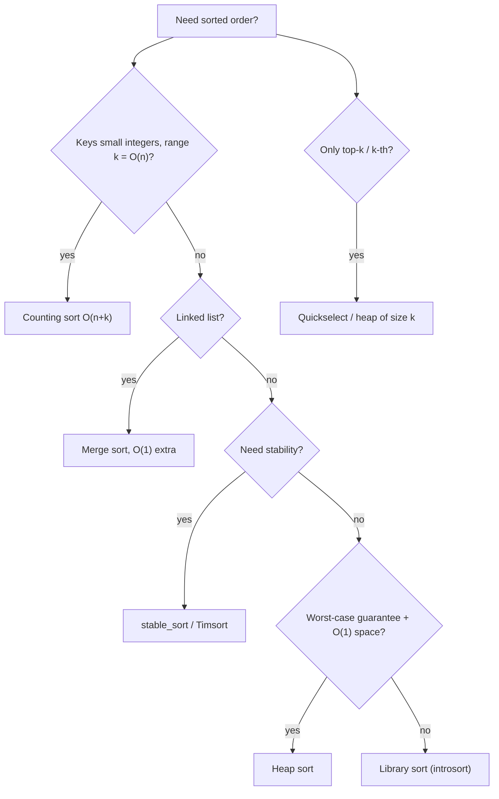

# 0. Sorting Theory

← [Part 13 index](README.md) · Next → [Selection Sort](01-selection-sort.md)

> [!abstract] What this covers
> **Core idea:** A sorting algorithm can be described by five properties: time (best, average, worst), extra space, stability, adaptivity, and whether it compares keys. Comparison sorts can't beat Ω(n log n). Counting, radix and bucket sort beat it by using the *structure* of the keys. In interviews you almost always call the library sort with the right comparator, and you need to know what that call costs.
> **You'll be able to:** fill in the comparison table from memory; prove the n log n lower bound; pick counting or radix sort when the key range is small; write a correct comparator in C++, Java and Python; and spot the problems where sorting first is the whole trick.
> **Source:** enrichment for the [Sorting category](https://takeuforward.org/learning/dsa/selection-sort?category=sorting&source=strivers-a2z-dsa-sheet). The lessons in this part cover each algorithm. · **Time:** 40 min

**Sections:** [1. Properties](#1-properties) · [2. Comparison table](#2-comparison-table) · [3. Lower bound](#3-lower-bound) · [4. Non-comparison sorts](#4-non-comparison-sorts) · [5. Library sorts](#5-library-sorts) · [6. Comparators](#6-comparators) · [7. Sort-first patterns](#7-sort-first-patterns) · [8. Choosing](#8-choosing)

---

## 1. Properties

| Property | Meaning | Why it matters |
|---|---|---|
| **In-place** | O(1) extra memory (O(log n) stack counts as in-place for quicksort) | Memory-bound inputs; "without extra space" constraints |
| **Stable** | Equal keys keep their original relative order | Multi-key sorts: sort by secondary key, then *stable* sort by primary key |
| **Adaptive** | Faster on nearly-sorted input | Insertion sort is O(n + inversions); Timsort finds existing runs |
| **Online** | Can sort as items arrive | Insertion sort; heaps for streaming top-k |
| **Comparison-based** | Only uses `a < b` | Subject to the Ω(n log n) bound |

**Inversion:** a pair `i < j` with `a[i] > a[j]`. Bubble and insertion sort remove exactly one inversion per swap or shift, so they take Θ(n + inv). In the worst case inv = n(n−1)/2. Merge sort can count inversions in O(n log n) (Part 14, *Count inversions*).

---

## 2. Comparison table

| Algorithm | Best | Average | Worst | Extra space | Stable | Notes |
|---|---|---|---|---|---|---|
| Selection | n² | n² | n² | 1 | ✗ | Fewest swaps (≤ n − 1) |
| Bubble (early exit) | n | n² | n² | 1 | ✓ | Only teaching value |
| Insertion | n | n² | n² | 1 | ✓ | Best for n ≤ ~16 and nearly-sorted input; used inside Timsort and introsort |
| Merge | n log n | n log n | n log n | n | ✓ | Predictable; good for linked lists (O(1) extra) and external sort |
| Quick (random pivot) | n log n | n log n | n² | log n | ✗ | Fastest in practice (cache-friendly); quickselect gives k-th in O(n) average |
| Heap | n log n | n log n | n log n | 1 | ✗ | Guaranteed worst case + in-place; poor cache behaviour |
| Counting | n + k | n + k | n + k | n + k | ✓ | Integer keys in `[0, k)` |
| Radix (LSD) | d(n + b) | d(n + b) | d(n + b) | n + b | ✓ | d digits in base b |
| Bucket | n | n | n² | n + b | ✓* | Uniformly distributed floats |

**Quick sort worst case** happens with a fixed pivot on sorted input, or with many duplicates and a 2-way partition. Fixes: a random pivot, median-of-three, or a 3-way (Dutch flag) partition for duplicates.

---

## 3. Lower bound

Any comparison sort can be drawn as a binary **decision tree**: each internal node is one comparison, and each leaf is one output permutation. All `n!` permutations must be reachable, so the tree has at least `n!` leaves. Its height `h` therefore satisfies `2^h ≥ n!`, so `h ≥ log₂ n! = Θ(n log n)` (Stirling: `log n! ≈ n log n − n log e`).

Consequences:
- No comparison sort beats Ω(n log n) in the worst case, *or on average*.
- Finding the min, max or median is cheaper (O(n)), because it doesn't need the full order.
- Merging k sorted lists of total n elements needs Ω(n log k). The heap merge achieves this.

---

## 4. Non-comparison sorts

**Counting sort** (keys in `[0, k)`):
```text
cnt[k] = 0; for x in a: cnt[x]++
prefix: cnt[i] += cnt[i-1]                 # cnt[i] = # keys ≤ i
for x in a reversed: out[--cnt[x]] = x     # reversed scan → stable
```
- Use it when `k = O(n)`, e.g. ages, grades, lowercase letters (k = 26), or "sort 0s, 1s and 2s" (k = 3, though Dutch flag does it in one pass).
- For keys in `[lo, hi]`, shift each key by `lo`.

**Radix sort (LSD):** stable counting sort on each digit, least significant first. 32-bit ints with base 256 take 4 passes, so it is O(4(n + 256)).
- **Why LSD must be stable:** after sorting by digit d, the earlier ordering by lower digits has to survive among equal digit-d keys.

**Bucket sort:** split `[0, 1)` into n buckets, insertion-sort each, then concatenate. Expected O(n) for uniform input, worst O(n²) if everything lands in one bucket. It is the idea behind *Maximum Gap* (LC 164): use pigeonhole buckets and compare only bucket min/max.

---

## 5. Library sorts

| Language | Call | Algorithm | Stable | Worst |
|---|---|---|---|---|
| C++ | `sort(v.begin(), v.end())` | Introsort (quick → heap fallback, insertion for small) | ✗ | n log n |
| C++ | `stable_sort` | Merge sort (buffered) | ✓ | n log n (n log² n without memory) |
| C++ | `nth_element`, `partial_sort` | Introselect / heap | ✗ | O(n) avg / O(n log k) |
| Java | `Arrays.sort(int[])` | Dual-pivot quicksort | ✗ (irrelevant for primitives) | n log n since JDK 14; older JDKs n² on adversarial input |
| Java | `Arrays.sort(Object[])`, `Collections.sort` | Timsort | ✓ | n log n |
| Python | `list.sort()`, `sorted()` | Timsort | ✓ | n log n, O(n) extra |

Traps:
- **Java anti-quicksort.** On older JDKs, crafted inputs can drive `int[]` sorting to quadratic time; this was a known Codeforces hack. Safe options are sorting `Integer[]` or shuffling first.
- **C++ strict weak ordering.** The comparator must return `false` for equal elements. Writing `a <= b` is **undefined behaviour** and can crash or read out of bounds.
- **Sort cost with string keys.** Each comparison is O(L), so sorting n strings costs O(n L log n).

---

## 6. Comparators

Example: sort by length ascending, then by value descending.

```cpp
sort(v.begin(), v.end(), [](const string& a, const string& b) {
    if (a.size() != b.size()) return a.size() < b.size();
    return a > b;                       // strict: never true for equal
});
```
```java
list.sort((a, b) -> a.length() != b.length()
        ? Integer.compare(a.length(), b.length())
        : b.compareTo(a));
// int[][] intervals: Arrays.sort(iv, (x, y) -> Integer.compare(x[0], y[0]));
```
```python
words.sort(key=lambda s: (len(s), [-ord(c) for c in s]))   # tuple keys
# or: from functools import cmp_to_key; words.sort(key=cmp_to_key(cmp))
```

- **Never write `return a - b` in Java.** It overflows for values near `±2³¹`. Use `Integer.compare`.
- **Python tip.** Python's sort is stable, so you can chain passes: `sort(key=secondary)` then `sort(key=primary)`.
- **Custom-order comparators.** *Largest Number* (LC 179) sorts strings with `a + b > b + a`. The comparison is transitive, which is why the sort is valid.

---

## 7. Sort-first patterns

| Signal | After sorting… | Example |
|---|---|---|
| Pairs/triples with a target sum | two pointers from both ends | 3Sum, 4Sum (Part 14) |
| Overlapping intervals | sort by start, then merge or sweep | Merge intervals, meeting rooms |
| Greedy matching | match smallest with smallest | Assign cookies (Part 21) |
| Activity selection | sort by **end** | N meetings in one room (Part 21) |
| Grouping equal items | equal keys become adjacent | Group anagrams (sort each word) |
| k-th smallest | quickselect O(n) avg, or heap O(n log k) | Kth largest element (Part 26) |
| Deduplicate | `sort` + `unique` | Remove duplicates (Part 14) |
| Minimise max difference | sort, slide a window of size k | Min difference among k elements |

Sorting is O(n log n). If the constraints allow it (n ≤ 10⁵ or 10⁶), it is often the first step that turns a hard problem into a scan.

---

## 8. Choosing



---

## Common mistakes

| Mistake | Fix |
|---|---|
| Comparator returns true for equal elements (C++) | Use strict `<`; compare tie-breakers explicitly |
| `a - b` comparator in Java | `Integer.compare(a, b)` |
| Quick sort on sorted input with a first-element pivot | Random pivot or median-of-three |
| Quick sort with many duplicates | 3-way partition (`< p`, `= p`, `> p`) |
| Assuming `sort` is stable in C++ | Use `stable_sort` |
| Counting sort with negative keys | Offset by `min` |
| Forgetting the O(L) string comparison cost | Sorting n strings costs O(nL log n) |

---

## Practice

<details><summary>1. Which of selection, insertion and merge sort are stable, and why isn't selection sort?</summary>

Insertion and merge sort are stable. Selection sort's long-distance swap can jump an element over an equal one: `[2a, 2b, 1]` becomes `[1, 2b, 2a]`.
</details>

<details><summary>2. You must sort 10⁷ integers in [0, 1000]. What do you use?</summary>

Counting sort: O(n + 1001) time and memory, beating n log n by a factor of about 23.
</details>

<details><summary>3. Prove that sorting needs Ω(n log n) comparisons.</summary>

A decision tree needs ≥ n! leaves, so height ≥ log₂ n! = Θ(n log n).
</details>

<details><summary>4. Why does LSD radix sort need a stable inner sort?</summary>

The order by lower digits must survive among keys that tie on the current digit.
</details>

<details><summary>5. Sort intervals by start, breaking ties by end descending, in Java.</summary>

`Arrays.sort(iv, (a, b) -> a[0] != b[0] ? Integer.compare(a[0], b[0]) : Integer.compare(b[1], a[1]));`
</details>

<details><summary>6. When is insertion sort the best choice?</summary>

When n is small (≤ 16) or the input is nearly sorted (few inversions), since it runs in O(n + inv). Library hybrids use it for small subarrays.
</details>

<details><summary>7. Which sort would you use for a singly linked list, and with what extra space?</summary>

Merge sort. Split with slow/fast pointers and merge by relinking. It needs O(log n) recursion, or O(1) extra space bottom-up.
</details>

<details><summary>8. Find the k-th largest element without fully sorting.</summary>

Quickselect runs in O(n) on average. A min-heap of size k runs in O(n log k). `nth_element` does it in C++.
</details>

---

## Key terms

| Term | Meaning |
|---|---|
| Stable | Equal keys keep their input order |
| In-place | O(1) (or O(log n)) extra memory |
| Inversion | Pair i < j with a[i] > a[j] |
| Introsort | Quicksort that falls back to heapsort at depth 2 log n, and uses insertion sort for small parts |
| Timsort | Merge sort over natural runs + insertion sort; stable, adaptive |
| Strict weak ordering | Comparator contract: irreflexive, transitive, and equivalence is transitive |

---

## Flashcards

**Comparison sort lower bound and why?** #flashcard
Ω(n log n): the decision tree has ≥ n! leaves, so its height is ≥ log n!.

**Which classic sorts are stable?** #flashcard
Bubble, insertion, merge, counting, radix. Not selection, quick or heap.

**C++ `sort` vs `stable_sort`?** #flashcard
`sort` is introsort, unstable, worst-case n log n. `stable_sort` is a merge sort and stable.

**Python and Java object sort algorithm?** #flashcard
Timsort: stable and adaptive.

**Counting sort complexity and when?** #flashcard
O(n + k), when the integer keys have a small range k.

**Quick sort worst case and fix?** #flashcard
O(n²) on sorted input with a bad pivot or with many duplicates. Fix with a random pivot and a 3-way partition.

**Why is `a <= b` in a C++ comparator a bug?** #flashcard
It breaks strict weak ordering, which is undefined behaviour and can crash.

**Insertion sort cost in terms of inversions?** #flashcard
Θ(n + inversions).

---

**Interview track →** [Sorting deep-dive](../../02-algorithms/00-sorting.md) · [Sorting walkthroughs](../../04-practice/algorithms/00-sorting.md)
